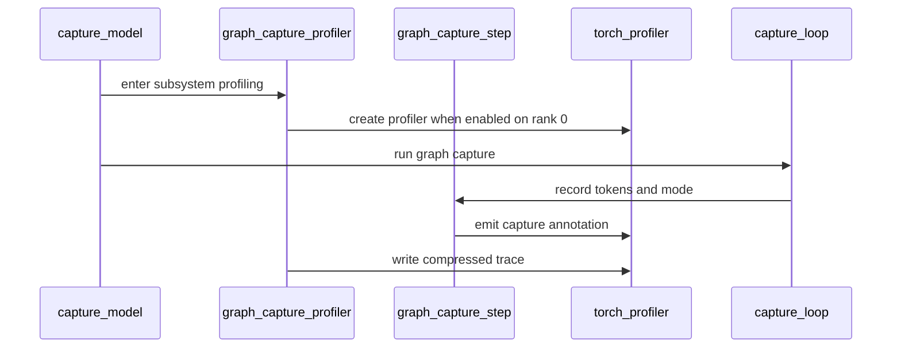

# [Profiler][GPU] Extend CUDA graph capture profiling to the V2 model runner

[Upstream PR](https://github.com/vllm-project/vllm/pull/54061) · state: open · merged: False

## Original PR description


This PR extends the CUDA graph capture profiling added in #37524 to the V2 model runner, and to the encoder capture path in both runners. Capture tracing itself is unchanged: the `capture_torch_profiler` flag, the `capture_traces/` layout and the `capture_{batch_size}_{mode}` annotation all behave as merged.

**Shared capture-profiling helper:**
- New `vllm/profiler/graph_capture.py`. `graph_capture_profiler(vllm_config, subsystem, label_prefix)` builds one profiler for one capture subsystem and binds it to a `ContextVar`; `graph_capture_step(num_tokens, mode)` enters that profiler and records the annotation for a single captured shape. When profiling is disabled or off rank 0, no binding is installed and `graph_capture_step` does nothing.
- The profiler is built through `create_worker_profiler()`, the same path serving uses, and `TorchProfilerWrapper.build_profiler()` returns it unstarted. Capture never calls the wrapper's `start()`, so capture profiling does not interfere with serving profiling sessions.

**V2 model runner:**
- `gpu/cudagraph_utils.py`: `CudaGraphManager.capture()` binds the decoder profiler and annotates its three capture execution points (PIECEWISE reusing attention state, PIECEWISE with fresh state, and FULL). Only the capture call sits inside the profiled region.
- Speculator cudagraph managers (`spec_decode/dflash`, `spec_decode/target_dependent_ar`) bind the speculator profiler before `super().capture()`. A nested binding keeps the outer one, so draft graphs keep their `draft` prefix.

**Encoder capture (V1 and V2):**
- `encoder_cudagraph.py`: `EncoderCudaGraphManager.capture()` binds the encoder profiler and annotates the per-budget encoder graph capture.
- `gpu_model_runner.py`: V1 `_capture_cudagraphs()` binds the decoder profiler through the same helper. The throwaway capture used for memory estimation runs under `skip_graph_capture_tracing()` and is intentionally not included in the traces.


**Trace output** — one profiler enter/exit per captured shape, so each shape lands in its own file:

| Subsystem  | Trace file                          | Annotation                           |
| ---------- | ----------------------------------- | ------------------------------------ |
| Decoder    | `graph_capture_rank_0.*`            | `capture_{n}_{FULL,PIECEWISE}`       |
| Encoder    | `graph_capture_rank_0_encoder.*`    | `capture_{n}_encoder_{path}`         |
| Speculator | `graph_capture_rank_0_speculator.*` | `capture_{n}_draft_{FULL,PIECEWISE}` |

**Unit tests:**
- `TestGraphCaptureProfiler` in `tests/v1/worker/test_gpu_profiler.py` checks:
  - `graph_capture_step` is a no-op outside a binding, and the bound profiler is entered once per captured shape.
  - Annotation labels are correct for all three subsystems, and the binding is cleared when capture raises.
  - The trace file name and directory are correct per subsystem.
  - No binding is installed when profiling is disabled or off rank 0.
  - Nested binds keep the outer prefix, and skipped tracing records nothing.
  - On rank 0 with the flag enabled, the real `TorchProfilerWrapper` returns a profiler that can be entered and exited without `start()`, using the configured activities.


## Purpose

#37524 instruments only the V1 decoder capture loop, so a run on the V2 model runner (`VLLM_USE_V2_MODEL_RUNNER=1`) produces an empty `capture_traces/` directory, and encoder capture is untraced in both runners. This closes the V2 gap reported in #53767.

Note that #53767 also asks for capture profiling to go through `TorchProfilerWrapper` rather than constructing `torch.profiler.profile` directly. This PR does not change that — it keeps the merged behaviour and only extends coverage, so `capture_torch_profiler` still ignores the `torch_profiler_record_shapes` / `_with_memory` / `_with_stack` / `_with_flops` / `_use_gzip` fields. The main goal of graph capture tracing is to recover the CPU callstack for graph replay region. Hence, the torch profiler configs related to CPU callstack and record_shapes are set True independent of the profiler config. 

Memory events are no longer forced on. The old V1 path hardcoded `profile_memory=True`; capture now follows `torch_profiler_with_memory`, which defaults to False. This is intentional: memory events are not needed to recover the callstack and they make the traces larger. Pass `--profiler-config.torch_profiler_with_memory True` to record them.

## Test Result

### 1. vLLM dev (after the `TorchProfilerWrapper` change)

**Environment:** vllm ROCm dev image with the current PR branch installed, gfx950, TP=1, V2 runner, `--profiler-config.capture_torch_profiler True`, capture sizes `[1, 2, 4, 8, 16, 24, 32]`.


| vLLM | Workload | Shards (decoder + subsystem) | Graph capture |
|---|---|---|---|
| 0.32.0.dev3423+g9cb7aae8d8 | Qwen3-8B FP8, V2 runner, no MTP | 14 | 143 s |
| 0.32.0.dev3423+g9cb7aae8d8 | Qwen3.5-4B MTP, 3 spec tokens, V2 runner | 12 + 19 speculator | 114 s |

### 2. vLLM 0.28 (before the `TorchProfilerWrapper` change)

**Environment:** 1× MI355X (gfx950), TP=1, ROCm 7.2.3, PyTorch 2.11.0, ROCm base images for v0.28.0 with this change applied. Traces collected with
`--profiler-config.capture_torch_profiler True --profiler-config.detailed_trace_annotation True`.

Tests executed:
| vLLM | Workload |Graph capture trace shards (decoder + subsystem) (decoder + subsystem) | Graph capture |
|---|---|---|---|
| v0.28.0 | Qwen3-8B + EAGLE3, V2 runner | 100 + 151 speculator | 234 s | 
| v0.28.0 | Qwen2-VL-2B-Instruct, encoder cudagraphs (budgets `[256,512]`) | 102 + 2 encoder | 65 s | 
| v0.28.0 | gpt-oss-20b MXFP4 (MoE → legacy V1 runner) | 166 | 222 s | 

The gpt-oss-20b run confirms the legacy V1 path still behaves as before this change: 166 shards for
83 capture sizes × {PIECEWISE, FULL}.

Details on Qwen3-8B + EAGLE3, V2 runner:
| Build | Model runner | Graph-capture shards emitted |
|---|---|---|
| stock v0.26.0 | V2 (default for this model) | **0** — no `capture_traces/` directory created |
| stock v0.26.0 | V1 (`VLLM_USE_V2_MODEL_RUNNER=0`) | 98 |
| **patched** | V2 (default) | **251** (100 decoder + 151 speculator) |

### 3 Subsystem separation and annotation naming

Each subsystem writes its own trace-file group.

- `graph_capture_rank_0.*` — `capture_104_FULL`, `capture_104_PIECEWISE`, … (100 distinct
  annotations across 100 shards)
- `graph_capture_rank_0_speculator.*` — `capture_104_draft_FULL`, `capture_104_draft_PIECEWISE`, …
  (151 shards, 102 distinct annotations; the 49 `*_draft_FULL` shapes captured by both drafter
  capture invocations appear once per invocation, each in its own shard file)
- `graph_capture_rank_0_encoder.*` — `capture_256_encoder_default`, `capture_512_encoder_default`

### 4. Cost and opt-out (v0.28.0, Qwen3-8B + EAGLE3, 251 captured shapes)

| `capture_torch_profiler` | Graph capture time | Captured graph memory |
|---|---|---|
| `True` | 234 s | 5.33 GiB |
| `False` | 50 s | 5.33 GiB |
| profiler flags absent entirely | 52 s | 5.33 GiB |

Disabling the flag returns capture time to the no-flag baseline within noise (50 s vs 52 s), so the
instrumentation is inert when off. Captured graph memory is identical in all three cases, i.e. the
profiler does not perturb what gets captured. 

---
Essential Elements of an Effective PR Description Checklist
- [Y] The purpose of the PR, such as "Fix some issue (link existing issues this PR will resolve)".
- [Y] The test plan, such as providing test command.
- [Y] The test results, such as pasting the results comparison before and after, or e2e results
- [ ] (Optional) The necessary documentation update.
- [ ] (Optional) Release notes update.


## Review and discussion

### reviews

- claude[bot] · COMMENTED · 2026-08-31T21:31:33Z · [source](https://github.com/vllm-project/vllm/pull/54061#pullrequestreview-5071461561)

## Claude Code Review

This pull request is from a fork — automated review is disabled. A repository maintainer can comment `@claude review` to run a one-time review.

- tjtanaa · APPROVED · 2026-09-07T12:06:01Z · [source](https://github.com/vllm-project/vllm/pull/54061#pullrequestreview-5131787579)

LGTM but let's get one more pair of eyes

- njhill · COMMENTED · 2026-09-07T17:59:57Z · [source](https://github.com/vllm-project/vllm/pull/54061#pullrequestreview-5134458828)

(No body; status only.)

- benchislett · CHANGES_REQUESTED · 2026-09-14T15:01:47Z · [source](https://github.com/vllm-project/vllm/pull/54061#pullrequestreview-5199317481)

see https://github.com/vllm-project/vllm/issues/53767#issuecomment-5666028333

please address before merging. I am open to further discussion but would like to block merge until we have resolved this issue one way or the other. Using the MRV2 feature port as the opportunity to polish/improve the implementation seems like a good place for it to happen

- devalshahamd · COMMENTED · 2026-09-15T01:00:49Z · [source](https://github.com/vllm-project/vllm/pull/54061#pullrequestreview-5204440284)

(No body; status only.)

- njhill · COMMENTED · 2026-09-15T21:46:11Z · [source](https://github.com/vllm-project/vllm/pull/54061#pullrequestreview-5216090736)

(No body; status only.)

- devalshahamd · COMMENTED · 2026-09-15T22:58:54Z · [source](https://github.com/vllm-project/vllm/pull/54061#pullrequestreview-5216649668)

(No body; status only.)

- mrodden · COMMENTED · 2026-10-28T00:41:08Z · [source](https://github.com/vllm-project/vllm/pull/54061#pullrequestreview-5676385591)

Ran this through DeepSeek v4.1 Flash and it found some issues:

**Blocker: enabling `capture_torch_profiler` raises `AttributeError`**
`make_graph_capture_profiler()` returns `wrapper.profiler` (`vllm/profiler/graph_capture.py:89`), but `TorchProfilerWrapper.__init__` only annotates `self.profiler` (`vllm/profiler/wrapper.py:338`); it is assigned only in `_start()` (`wrapper.py:435`). On rank 0 with `capture_torch_profiler=True`, the first `with graph_capture_profiler(...)` will fail before any capture:

```
AttributeError: 'TorchProfilerWrapper' object has no attribute 'profiler'
```

The trace numbers in the PR description predate the wrapper change (`809c115`). Suggested fix: add a small public builder on the wrapper that returns `torch.profiler.profile(**self._profiler_kwargs)` without starting it, and use that here; or make the wrapper own the enter/exit lifecycle. Please avoid calling `_start()` and then re-entering the profiler, which would double-start it.

**Test gap**
`test_trace_file_name_per_subsystem` mocks `TorchProfilerWrapper` and asserts `wrapper.start` was not called (`tests/v1/worker/test_gpu_profiler.py:843-861`), so it cannot catch the missing attribute. `test_no_profiler_when_disabled_or_off_rank` also never covers `(local_rank=0, enabled=True)`. Please add a test that uses the real wrapper (patching `torch.profiler.profile` if needed) and verifies the returned object can be entered/exited.

**Follow-ups**
- The old V1 implementation forced `profile_memory=True`; `graph_capture_profiler_config()` leaves `torch_profiler_with_memory` at its default `False`. Is dropping memory events intentional? If not, force it `True`; if yes, please call it out in the description.
- `graph_capture_profiler` still installs a binding when profiling is disabled or off-rank (a `nullcontext`), so `graph_capture_step` still runs `torch.profiler.record_function` per shape. The benchmark says the cost is negligible, but it contradicts "no-op when profiling is not active"; consider skipping the binding entirely.
- `default_torch_profiler_activities()` duplicates `_DEFAULT_TORCH_PROFILER_ACTIVITIES` and mishandles `PrivateUse1` (`"PrivateUse1".upper()` is not a map key).
- Please update the stale description: it still says `gpu/model_runner.py` binds profilers and that V1 `capture_model()` binds the encoder; the current head binds in `CudaGraphManager.capture`, `EncoderCudaGraphManager.capture`, and the speculator managers. The note about not using `TorchProfilerWrapper` is also obsolete.


### issue_comments

- mergify[bot] · comment · 2026-09-01T03:38:07Z · [source](https://github.com/vllm-project/vllm/pull/54061#issuecomment-5488534226)

This pull request has merge conflicts that must be resolved before it can be
merged. Please rebase the PR, @devalshahamd.

https://docs.github.com/en/pull-requests/collaborating-with-pull-requests/working-with-forks/syncing-a-fork


- coderabbitai[bot] · comment · 2026-09-03T18:44:07Z · [source](https://github.com/vllm-project/vllm/pull/54061#issuecomment-5530474012)

<!-- coderabbit-ai-generated:v1 -->

<!-- This is an auto-generated comment: summarize by coderabbit.ai -->
<!-- review_stack_entry_start -->

[](https://app.coderabbit.ai/change-stack/vllm-project/vllm/pull/54061)

<!-- review_stack_entry_end -->
<!-- recent_review_start -->

No actionable comments were generated in the recent review.

<details>
<summary><strong>ℹ️ Recent review info</strong></summary>
<dl>
<dd>

<details>
<summary><strong>⚙️ Run configuration</strong></summary>
<dl>
<dd>

**Configuration used**: Repository UI

**Review profile**: CHILL

**Plan**: Team

**Run ID**: `71a79504-36af-4aee-9b92-bee555e350df`

</dd>
</dl>
</details>

<details>
<summary><strong>📥 Commits</strong></summary>
<dl>
<dd>

Reviewing files that changed from the base of the PR and between 58ad1f3b8973b23943107b51230d594050b42ec3 and 5268c4f483713cde8a2e7a8601c80c956a76bdbe.

</dd>
</dl>
</details>

<details>
<summary><strong>📒 Files selected for processing (6)</strong></summary>
<dl>
<dd>

* `tests/v1/worker/test_gpu_profiler.py`
* `vllm/profiler/graph_capture.py`
* `vllm/v1/worker/encoder_cudagraph.py`
* `vllm/v1/worker/gpu/cudagraph_utils.py`
* `vllm/v1/worker/gpu/model_runner.py`
* `vllm/v1/worker/gpu_model_runner.py`

</dd>
</dl>
</details>

<details>
<summary><strong>🚧 Files skipped from review as they are similar to previous changes (5)</strong></summary>
<dl>
<dd>

* vllm/v1/worker/encoder_cudagraph.py
* vllm/v1/worker/gpu/cudagraph_utils.py
* vllm/profiler/graph_capture.py
* vllm/v1/worker/gpu/model_runner.py
* vllm/v1/worker/gpu_model_runner.py

</dd>
</dl>
</details>

**Included review availability:** Your plan provides up to 10 included reviews per hour; 9 remain after this review.

</dd>
</dl>
</details>


<!-- recent_review_end -->
<!-- walkthrough_start -->

### Walkthrough

The change adds optional rank-zero torch profiler tracing for graph capture. It adds capture-step annotations, subsystem-specific trace names, lifecycle cleanup, and instrumentation for encoder, decoder, speculator, piecewise, and standard CUDA graph captures.

### Changes

**Graph capture profiling**

|Layer / File(s)|Summary|
|:---|:---|
|**Profiler contexts and lifecycle tests** <br> `vllm/profiler/graph_capture.py`, `tests/v1/worker/test_gpu_profiler.py`|Adds conditional profiler creation, ContextVar binding, subsystem trace naming, capture annotations, cleanup, and tests for enabled, disabled, off-rank, and failure cases.|
|**Capture-step instrumentation** <br> `vllm/v1/worker/encoder_cudagraph.py`, `vllm/v1/worker/gpu/cudagraph_utils.py`|Records token counts and graph modes during encoder, piecewise, and standard CUDA graph capture.|
|**Subsystem profiler wiring** <br> `vllm/v1/worker/gpu/model_runner.py`, `vllm/v1/worker/gpu_model_runner.py`|Wraps encoder, decoder, and speculator capture entry points with subsystem-specific profiler contexts and labels.|

**Estimated code review effort:** 3 (Moderate) | ~20 minutes


### Sequence Diagram(s)



<!-- walkthrough_end -->
<details>
<summary><strong>Merge Risk:</strong> <strong><picture></picture> Minimal</strong> · up to <code>5268c</code></summary>
<dl>
<dd>

<!-- final_review_risk_start -->
<!-- final_review_risk_label
**Merge Risk:** _⚪ Minimal_ · up to `5268c`
-->
<!-- final_review_risk_coverage:{"sourceCommitId":"5268c4f483713cde8a2e7a8601c80c956a76bdbe","coveredCommitId":"5268c4f483713cde8a2e7a8601c80c956a76bdbe","kind":"reviewed"} -->

This change adds optional rank-zero graph-capture profiling with separate encoder, decoder, and speculator traces while retaining disabled-mode behavior. No current merge-readiness risk is identified.
<!-- final_review_risk_end -->

</dd>
</dl>
</details>
<!-- pre_merge_checks_walkthrough_start -->

<details>
<summary><strong>Pre-merge checks: <sup><picture></picture></sup> 4</strong></summary>
<dl>
<dd>

|         Check name         |                                             Status                                             | Explanation                                                                                                                                                              |
| :------------------------ | :--------------------------------------------------------------------------------------------: | :----------------------------------------------------------------------------------------------------------------------------------------------------------------------- |
|     Linked Issues check    |  | Check skipped because no linked issues were found for this pull request.                                                                                                 |
| Out of Scope Changes check |  | Check skipped because no linked issues were found for this pull request.                                                                                                 |
|         Title check        |  | The title clearly identifies the main change: extending GPU CUDA graph capture profiling to the V2 model runner. It is concise and specific.                             |
|      Description check     |  | The pull request description directly explains the CUDA graph capture profiling changes, affected runners and subsystems, trace behavior, tests, and validation results. |

</dd>
</dl>
</details>

<!-- pre_merge_checks_walkthrough_end -->
<!-- tips_start -->


Thanks for using [CodeRabbit](https://coderabbit.ai?utm_source=oss&utm_medium=github&utm_campaign=vllm-project/vllm&utm_content=54061)! It's free for OSS, and your support helps us grow. If you like it, consider giving us a shout-out.

<details>
<summary><strong>❤️ Share</strong></summary>
<dl>
<dd>

- [X](https://twitter.com/intent/tweet?text=I%20just%20used%20%40coderabbitai%20for%20my%20code%20review%2C%20and%20it%27s%20fantastic%21%20It%27s%20free%20for%20OSS%20and%20offers%20a%20free%20trial%20for%20the%20proprietary%20code.%20Check%20it%20out%3A&url=https%3A//coderabbit.ai)
- [Mastodon](https://mastodon.social/share?text=I%20just%20used%20%40coderabbitai%20for%20my%20code%20review%2C%20and%20it%27s%20fantastic%21%20It%27s%20free%20for%20OSS%20and%20offers%20a%20free%20trial%20for%20the%20proprietary%20code.%20Check%20it%20out%3A%20https%3A%2F%2Fcoderabbit.ai)
- [Reddit](https://www.reddit.com/submit?title=Great%20tool%20for%20code%20review%20-%20CodeRabbit&text=I%20just%20used%20CodeRabbit%20for%20my%20code%20review%2C%20and%20it%27s%20fantastic%21%20It%27s%20free%20for%20OSS%20and%20offers%20a%20free%20trial%20for%20proprietary%20code.%20Check%20it%20out%3A%20https%3A//coderabbit.ai)
- [LinkedIn](https://www.linkedin.com/sharing/share-offsite/?url=https%3A%2F%2Fcoderabbit.ai&mini=true&title=Great%20tool%20for%20code%20review%20-%20CodeRabbit&summary=I%20just%20used%20CodeRabbit%20for%20my%20code%20review%2C%20and%20it%27s%20fantastic%21%20It%27s%20free%20for%20OSS%20and%20offers%20a%20free%20trial%20for%20proprietary%20code)

</dd>
</dl>
</details>


<sub>Comment `@coderabbitai help` to get the list of available commands.</sub>

<!-- tips_end -->

- tjtanaa · comment · 2026-09-07T11:55:09Z · [source](https://github.com/vllm-project/vllm/pull/54061#issuecomment-5570240129)

@njhill @yewentao256, can you help to review this PR?

- tjtanaa · comment · 2026-09-07T12:06:18Z · [source](https://github.com/vllm-project/vllm/pull/54061#issuecomment-5570366522)

/ci run

- coderabbitai[bot] · comment · 2026-09-07T12:06:32Z · [source](https://github.com/vllm-project/vllm/pull/54061#issuecomment-5570369330)

<!-- This is an auto-generated comment by CodeRabbit -->
<!-- coderabbit-full-review-fallback-pr-54061-head-5268c4f483713cde8a2e7a8601c80c956a76bdbe -->
> [!NOTE]
> GitHub couldn't provide a complete incremental comparison for this pull request, so CodeRabbit is performing a full review instead. This review may take a little longer.

- github-actions[bot] · comment · 2026-09-07T12:07:49Z · [source](https://github.com/vllm-project/vllm/pull/54061#issuecomment-5570384994)

✅ @devalshahamd, CI is now available for this PR.

- `/ci run` starts upstream CI; `/amd-ci run` starts AMD CI only.
- `/ci retry` retries failed jobs in the CI build for the current PR head. If the current head has no CI build, it starts a new CI build for the current head containing only jobs that failed in the latest earlier CI build for this PR.
- `/amd-ci retry` retries failed jobs in AMD CI for the current PR head. Use `/amd-ci run` when the current head has no AMD CI build.
- `/ci cancel` cancels scheduled or running CI builds for this PR branch; `/amd-ci cancel` does the same for AMD CI only.

<!-- vllm-ci-authorized -->

- github-actions[bot] · comment · 2026-09-07T12:07:56Z · [source](https://github.com/vllm-project/vllm/pull/54061#issuecomment-5570386540)

✅ Triggered [Buildkite CI #87537](https://buildkite.com/vllm/ci/builds/87537) for commit `5268c4f48371`.

- mergify[bot] · comment · 2026-09-07T12:20:35Z · [source](https://github.com/vllm-project/vllm/pull/54061#issuecomment-5570544876)

Hi @devalshahamd, the pre-commit checks have failed. Please run:

```bash 
uv pip install pre-commit>=4.5.1
pre-commit install
pre-commit run --all-files
```

Then, commit the changes and push to your branch.

For future commits, `pre-commit` will run automatically on changed files before each commit.


- mergify[bot] · comment · 2026-09-11T20:01:42Z · [source](https://github.com/vllm-project/vllm/pull/54061#issuecomment-5639963385)

Hi @devalshahamd, the pre-commit checks have failed. Please run:

```bash 
uv pip install pre-commit>=4.5.1
pre-commit install
pre-commit run --all-files
```

Then, commit the changes and push to your branch.

For future commits, `pre-commit` will run automatically on changed files before each commit.


- mergify[bot] · comment · 2026-09-14T07:39:55Z · [source](https://github.com/vllm-project/vllm/pull/54061#issuecomment-5660641751)

This pull request has merge conflicts that must be resolved before it can be
merged. Please rebase the PR, @devalshahamd.

https://docs.github.com/en/pull-requests/collaborating-with-pull-requests/working-with-forks/syncing-a-fork


- mergify[bot] · comment · 2026-09-14T20:03:31Z · [source](https://github.com/vllm-project/vllm/pull/54061#issuecomment-5670047386)

Hi @devalshahamd, the pre-commit checks have failed. Please run:

```bash 
uv pip install pre-commit>=4.5.1
pre-commit install
pre-commit run --all-files
```

Then, commit the changes and push to your branch.

For future commits, `pre-commit` will run automatically on changed files before each commit.


- devalshahamd · comment · 2026-09-15T00:05:09Z · [source](https://github.com/vllm-project/vllm/pull/54061#issuecomment-5672590312)

Hello @benchislett 

Agreed. Capture now builds the profiler through TorchProfilerWrapper instead of calling torch.profiler.profile directly. Capture-specific overrides live in graph_capture_profiler_config (delay/max/warmup/wait = 0, shapes/stack forced on); gzip/flops/memory still come from ProfilerConfig. Activities are selected from device_config.device_type, so XPU records XPU events rather than CUDA, as @CySpiegel suggested in #56755.

@CySpiegel 
Thanks — capture profiling now picks activities from the runner device (CPU + XPU on Intel GPUs, CPU + CUDA on CUDA/ROCm) instead of hardcoding CUDA.


- mergify[bot] · comment · 2026-09-15T00:49:50Z · [source](https://github.com/vllm-project/vllm/pull/54061#issuecomment-5672977282)

This pull request has merge conflicts that must be resolved before it can be
merged. Please rebase the PR, @devalshahamd.

https://docs.github.com/en/pull-requests/collaborating-with-pull-requests/working-with-forks/syncing-a-fork


- mergify[bot] · comment · 2026-09-15T01:15:59Z · [source](https://github.com/vllm-project/vllm/pull/54061#issuecomment-5673180820)

Hi @devalshahamd, the pre-commit checks have failed. Please run:

```bash 
uv pip install pre-commit>=4.5.1
pre-commit install
pre-commit run --all-files
```

Then, commit the changes and push to your branch.

For future commits, `pre-commit` will run automatically on changed files before each commit.


- mergify[bot] · comment · 2026-09-16T17:36:57Z · [source](https://github.com/vllm-project/vllm/pull/54061#issuecomment-5701836597)

This pull request has merge conflicts that must be resolved before it can be
merged. Please rebase the PR, @devalshahamd.

https://docs.github.com/en/pull-requests/collaborating-with-pull-requests/working-with-forks/syncing-a-fork


- mergify[bot] · comment · 2026-09-16T17:46:54Z · [source](https://github.com/vllm-project/vllm/pull/54061#issuecomment-5701967977)

Hi @devalshahamd, the pre-commit checks have failed. Please run:

```bash 
uv pip install pre-commit>=4.5.1
pre-commit install
pre-commit run --all-files
```

Then, commit the changes and push to your branch.

For future commits, `pre-commit` will run automatically on changed files before each commit.


- mergify[bot] · comment · 2026-09-17T05:59:07Z · [source](https://github.com/vllm-project/vllm/pull/54061#issuecomment-5709680612)

This pull request has merge conflicts that must be resolved before it can be
merged. Please rebase the PR, @devalshahamd.

https://docs.github.com/en/pull-requests/collaborating-with-pull-requests/working-with-forks/syncing-a-fork


- devalshahamd · comment · 2026-09-18T18:38:17Z · [source](https://github.com/vllm-project/vllm/pull/54061#issuecomment-5734552707)

Hello @tjtanaa, @njhill 
I have addressed all comments. Now the code uses TorchProfilerWraper to construct the profiler. All graph capture profiling related functions are in one central location, which is better for maintainability in the future. Please let me know if anything else needs to be added. 


- mergify[bot] · comment · 2026-09-21T02:28:12Z · [source](https://github.com/vllm-project/vllm/pull/54061#issuecomment-5754617390)

This pull request has merge conflicts that must be resolved before it can be
merged. Please rebase the PR, @devalshahamd.

https://docs.github.com/en/pull-requests/collaborating-with-pull-requests/working-with-forks/syncing-a-fork


- mergify[bot] · comment · 2026-10-04T01:45:29Z · [source](https://github.com/vllm-project/vllm/pull/54061#issuecomment-5975503077)

This pull request has merge conflicts that must be resolved before it can be
merged. Please rebase the PR, @devalshahamd.

https://docs.github.com/en/pull-requests/collaborating-with-pull-requests/working-with-forks/syncing-a-fork


- mergify[bot] · comment · 2026-10-27T21:25:12Z · [source](https://github.com/vllm-project/vllm/pull/54061#issuecomment-6453943025)

This pull request has merge conflicts that must be resolved before it can be
merged. Please rebase the PR, @devalshahamd.

https://docs.github.com/en/pull-requests/collaborating-with-pull-requests/working-with-forks/syncing-a-fork


- devalshahamd · comment · 2026-10-29T23:54:20Z · [source](https://github.com/vllm-project/vllm/pull/54061#issuecomment-6511341668)

Thanks @mrodden for flagging this. As you said, the commit added after my changes resulted in this issue. I have fixed it and also extended the test. I have also tested it on this vLLM version (updated results in the PR description). 

Regarding follow ups:
1. I have changed the description to clarify that using torch_profiler_with_memory  instead of default True is intentional. 
2. Thanks, I have fixed it too. When profiling is off or off-rank, graph_capture_profiler no longer installs a binding, so graph_capture_step returns before record_function. test_no_binding_when_disabled_or_off_rank covers both cases.
3. I removed default_torch_profiler_activities. Capture now builds its wrapper through create_worker_profiler(), so its activities come from the same place as serving: torch_profiler_activities if set, otherwise _DEFAULT_TORCH_PROFILER_ACTIVITIES. That drops the duplicated mapping and the PrivateUse1 lookup that could never match, and capture now respects a user-set activity list.
4. I have modified the description. 


- mergify[bot] · comment · 2026-11-03T18:50:51Z · [source](https://github.com/vllm-project/vllm/pull/54061#issuecomment-6612656407)

This pull request has merge conflicts that must be resolved before it can be
merged. Please rebase the PR, @devalshahamd.

https://docs.github.com/en/pull-requests/collaborating-with-pull-requests/working-with-forks/syncing-a-fork


### inline_comments

- njhill · comment · 2026-09-07T17:59:58Z · [source](https://github.com/vllm-project/vllm/pull/54061#discussion_r3951853234)

File: `vllm/v1/worker/gpu/model_runner.py` · line None

Can the changes in this file be moved inside the respective capture methods?

- devalshahamd · comment · 2026-09-15T01:00:49Z · [source](https://github.com/vllm-project/vllm/pull/54061#discussion_r4010970987)

File: `vllm/v1/worker/gpu/model_runner.py` · line None

Hi @njhill  Thanks for the suggestion!
I moved the binding into the capture methods themselves (CudaGraphManager.capture, the encoder/speculator managers, and V1 _capture_cudagraphs), so capture_model() no longer has to wrap anything. Nested speculator/encoder capture inherits the outer binding, and the throwaway memory-estimate run skips tracing.

- njhill · comment · 2026-09-15T21:46:11Z · [source](https://github.com/vllm-project/vllm/pull/54061#discussion_r4020495386)

File: `vllm/v1/worker/gpu/model_runner.py` · line None

please revert

- devalshahamd · comment · 2026-09-15T22:58:53Z · [source](https://github.com/vllm-project/vllm/pull/54061#discussion_r4020941437)

File: `vllm/v1/worker/gpu/model_runner.py` · line None

Thanks for pointing it out. Reverted the change, now model_runner.py is not in the changed files. 

## Changed files and fixed code

- `tests/v1/worker/test_gpu_profiler.py` · modified · additions 239 / deletions 9
  - [head](https://github.com/devalshahamd/vllm/blob/632a3d22b4c4ec3b463483ce537b7a4ebb3cb962/tests/v1/worker/test_gpu_profiler.py)
  - [base](https://github.com/vllm-project/vllm/blob/6044ab06099025db08188dc44ffac45268f5b3bd/tests/v1/worker/test_gpu_profiler.py)
- `vllm/config/profiler.py` · modified · additions 3 / deletions 1
  - [head](https://github.com/devalshahamd/vllm/blob/632a3d22b4c4ec3b463483ce537b7a4ebb3cb962/vllm/config/profiler.py)
  - [base](https://github.com/vllm-project/vllm/blob/6044ab06099025db08188dc44ffac45268f5b3bd/vllm/config/profiler.py)
- `vllm/profiler/graph_capture.py` · added · additions 139 / deletions 0
  - [head](https://github.com/devalshahamd/vllm/blob/632a3d22b4c4ec3b463483ce537b7a4ebb3cb962/vllm/profiler/graph_capture.py)
  - [base](https://github.com/vllm-project/vllm/blob/6044ab06099025db08188dc44ffac45268f5b3bd/vllm/profiler/graph_capture.py)
- `vllm/profiler/wrapper.py` · modified · additions 21 / deletions 1
  - [head](https://github.com/devalshahamd/vllm/blob/632a3d22b4c4ec3b463483ce537b7a4ebb3cb962/vllm/profiler/wrapper.py)
  - [base](https://github.com/vllm-project/vllm/blob/6044ab06099025db08188dc44ffac45268f5b3bd/vllm/profiler/wrapper.py)
- `vllm/v1/worker/encoder_cudagraph.py` · modified · additions 8 / deletions 0
  - [head](https://github.com/devalshahamd/vllm/blob/632a3d22b4c4ec3b463483ce537b7a4ebb3cb962/vllm/v1/worker/encoder_cudagraph.py)
  - [base](https://github.com/vllm-project/vllm/blob/6044ab06099025db08188dc44ffac45268f5b3bd/vllm/v1/worker/encoder_cudagraph.py)
- `vllm/v1/worker/gpu/cudagraph_utils.py` · modified · additions 16 / deletions 4
  - [head](https://github.com/devalshahamd/vllm/blob/632a3d22b4c4ec3b463483ce537b7a4ebb3cb962/vllm/v1/worker/gpu/cudagraph_utils.py)
  - [base](https://github.com/vllm-project/vllm/blob/6044ab06099025db08188dc44ffac45268f5b3bd/vllm/v1/worker/gpu/cudagraph_utils.py)
- `vllm/v1/worker/gpu/spec_decode/dflash/cudagraph.py` · modified · additions 5 / deletions 1
  - [head](https://github.com/devalshahamd/vllm/blob/632a3d22b4c4ec3b463483ce537b7a4ebb3cb962/vllm/v1/worker/gpu/spec_decode/dflash/cudagraph.py)
  - [base](https://github.com/vllm-project/vllm/blob/6044ab06099025db08188dc44ffac45268f5b3bd/vllm/v1/worker/gpu/spec_decode/dflash/cudagraph.py)
- `vllm/v1/worker/gpu/spec_decode/target_dependent_ar/cudagraph_utils.py` · modified · additions 5 / deletions 1
  - [head](https://github.com/devalshahamd/vllm/blob/632a3d22b4c4ec3b463483ce537b7a4ebb3cb962/vllm/v1/worker/gpu/spec_decode/target_dependent_ar/cudagraph_utils.py)
  - [base](https://github.com/vllm-project/vllm/blob/6044ab06099025db08188dc44ffac45268f5b3bd/vllm/v1/worker/gpu/spec_decode/target_dependent_ar/cudagraph_utils.py)
- `vllm/v1/worker/gpu_model_runner.py` · modified · additions 19 / deletions 50
  - [head](https://github.com/devalshahamd/vllm/blob/632a3d22b4c4ec3b463483ce537b7a4ebb3cb962/vllm/v1/worker/gpu_model_runner.py)
  - [base](https://github.com/vllm-project/vllm/blob/6044ab06099025db08188dc44ffac45268f5b3bd/vllm/v1/worker/gpu_model_runner.py)

## Evidence and interpretation boundary

[Original JSON, discussions and patches](../../../../../../evidence/prs/vllm-project--vllm/54061-a95c85df4df567a7cc6843ebd3e693674fd840bcd8a81c7f3b2dd071ffdb5530.json) · SHA-256 `a95c85df4df567a7cc6843ebd3e693674fd840bcd8a81c7f3b2dd071ffdb5530`.

Diff complete: True. Missing/binary/truncated patches require pinned source inspection. This is a source page, not an independently verified optimization case. Open, merged and released are different states; recheck the deployed dependency.
