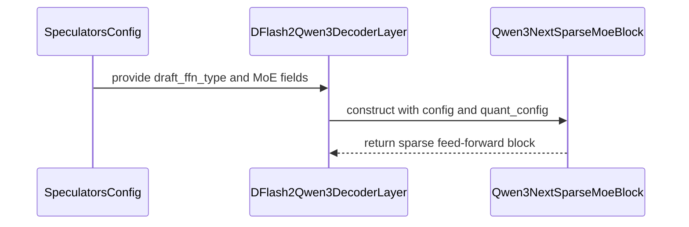

# [Spec Decode] Support MoE DFlash2 draft models

[Upstream PR](https://github.com/vllm-project/vllm/pull/54475) · state: closed · merged: False

## Original PR description

## Purpose

Support MoE DFlash2 draft models

## Test Plan

```
vllm serve Kwaipilot/KAT-Coder-V2.5-Dev \
  --tensor-parallel-size 1 \
  --reasoning-parser qwen3 \
  --enable-auto-tool-choice \
  --tool-call-parser qwen3_coder \
  --language-model-only \
  --speculative-config '{
    "method": "dflash",
    "model": "DaoCloud/KAT-Coder-V2.5-Dev-DFlash2-2.6B-A0.3B",
    "num_speculative_tokens": 7
  }'
```

## Test Result

https://huggingface.co/DaoCloud/KAT-Coder-V2.5-Dev-DFlash2-2.6B-A0.3B

---
<details>
<summary> Essential Elements of an Effective PR Description Checklist </summary>

- [x] The purpose of the PR, such as "Fix some issue (link existing issues this PR will resolve)".
- [x] The test plan, such as providing test command.
- [x] The test results, such as pasting the results comparison before and after, or e2e results
- [ ] (Optional) The necessary documentation update, such as updating `supported_models.md` and `examples` for a new model.
</details>


## Review and discussion

### reviews

- claude[bot] · COMMENTED · 2026-08-31T10:59:38Z · [source](https://github.com/vllm-project/vllm/pull/54475#pullrequestreview-5065705841)

## Claude Code Review

This pull request is from a fork — automated review is disabled. A repository maintainer can comment `@claude review` to run a one-time review.

- copilot-pull-request-reviewer[bot] · COMMENTED · 2026-08-31T10:59:41Z · [source](https://github.com/vllm-project/vllm/pull/54475#pullrequestreview-5065706160)

Copilot was unable to review this pull request because the user who requested the review has reached their quota limit.

- benchislett · COMMENTED · 2026-08-31T21:11:06Z · [source](https://github.com/vllm-project/vllm/pull/54475#pullrequestreview-5071271108)

(No body; status only.)

- benchislett · COMMENTED · 2026-08-31T21:12:04Z · [source](https://github.com/vllm-project/vllm/pull/54475#pullrequestreview-5071279980)

(No body; status only.)

- benchislett · COMMENTED · 2026-08-31T21:12:39Z · [source](https://github.com/vllm-project/vllm/pull/54475#pullrequestreview-5071285687)

(No body; status only.)

- qianlihuang · COMMENTED · 2026-09-01T07:07:42Z · [source](https://github.com/vllm-project/vllm/pull/54475#pullrequestreview-5074966623)

(No body; status only.)

- qianlihuang · COMMENTED · 2026-09-01T07:08:09Z · [source](https://github.com/vllm-project/vllm/pull/54475#pullrequestreview-5074970076)

(No body; status only.)

### issue_comments

- coderabbitai[bot] · comment · 2026-09-07T06:24:22Z · [source](https://github.com/vllm-project/vllm/pull/54475#issuecomment-5565996104)

<!-- This is an auto-generated comment: summarize by coderabbit.ai -->
<!-- review_stack_entry_start -->

[](https://app.coderabbit.ai/change-stack/vllm-project/vllm/pull/54475)

<!-- review_stack_entry_end -->
<!-- recent_review_start -->

No actionable comments were generated in the recent review. 🎉

<details>
<summary>ℹ️ Recent review info</summary>

<details>
<summary>⚙️ Run configuration</summary>

**Configuration used**: Repository UI

**Review profile**: CHILL

**Plan**: Team

**Run ID**: `9f0c0843-00b7-46e2-8cc9-400839a0af73`

</details>

<details>
<summary>📥 Commits</summary>

Reviewing files that changed from the base of the PR and between c92b29a1d40644da710209f862b1be0ebd5c2e74 and bdba5743dee06532a86272853a3554936e50b8a8.

</details>

<details>
<summary>📒 Files selected for processing (5)</summary>

* `tests/v1/spec_decode/test_dflash2.py`
* `vllm/model_executor/models/qwen3_dflash.py`
* `vllm/model_executor/models/qwen3_dflash2.py`
* `vllm/model_executor/models/qwen3_next.py`
* `vllm/transformers_utils/configs/speculators/algos.py`

</details>

**Included review availability:** Your plan provides up to 10 included reviews per hour; 9 remain after this review.

</details>

---


<!-- recent_review_end -->
<!-- walkthrough_start -->

<details>
<summary>📝 Summary</summary>

<!-- This is an auto-generated comment: release notes by coderabbit.ai -->

## Summary by CodeRabbit

* **New Features**
  * Added support for dense and sparse MoE feed-forward configurations in DFlash2 speculative decoding.
  * Added validation for incomplete or unsupported MoE configurations.
  * Added support for configuring draft-model quantization independently from the target model.

* **Bug Fixes**
  * Improved model weight mapping for shared-expert and routed-expert layers.

* **Tests**
  * Added coverage for dense MLPs, sparse MoE construction, invalid configurations, and unsupported EPLB usage.

<!-- end of auto-generated comment: release notes by coderabbit.ai -->
## Walkthrough

DFlash2 now supports validated MoE draft configurations. Decoder layers select dense or sparse MLP implementations. Sparse MoE construction preserves explicit draft configuration and quantization values. Tests cover extraction, validation, MLP types, and EPLB behavior.

### Changes

**DFlash2 MoE draft support**

|Layer / File(s)|Summary|
|---|---|
|**DFlash2 configuration extraction** <br> `vllm/transformers_utils/configs/speculators/algos.py`|DFlash2 records `draft_ffn_type`. MoE configurations copy expert fields and `norm_topk_prob` to the configuration root. Unsupported or incomplete configurations raise `ValueError`.|
|**Decoder MLP factory and weight mappings** <br> `vllm/model_executor/models/qwen3_dflash.py`, `tests/v1/spec_decode/test_dflash2.py`|The decoder constructs its MLP through `build_mlp`. Dense MLP projections and shared-expert projections use explicit weight prefixes. Tests verify the dense MLP type.|
|**Sparse MoE construction and validation** <br> `vllm/model_executor/models/qwen3_dflash2.py`, `vllm/model_executor/models/qwen3_next.py`, `tests/v1/spec_decode/test_dflash2.py`|DFlash2 selects dense or sparse MoE blocks. Sparse blocks accept explicit configuration and quantization arguments. Tests cover MoE construction, missing fields, and unsupported EPLB.|
**Estimated code review effort:** 3 (Moderate) | ~20 minutes

<!-- final_review_risk_start -->
**Merge Risk:** _⚪ Minimal_ · up to `bdba5`
<!-- final_review_risk_coverage:{"sourceCommitId":"bdba5743dee06532a86272853a3554936e50b8a8","coveredCommitId":"bdba5743dee06532a86272853a3554936e50b8a8","kind":"reviewed"} -->

This change enables supported MoE DFlash2 draft models for speculative decoding while retaining dense behavior and rejecting unsupported EPLB configurations. No concrete current-head merge-blocking risk remains.
<!-- final_review_risk_end -->

### Sequence Diagram(s)



**Suggested reviewers:** `yewentao256`

</details>

<!-- walkthrough_end -->
<!-- pre_merge_checks_walkthrough_start -->

<details>
<summary>🚥 Pre-merge checks | ✅ 4 | ❌ 1</summary>

### ❌ Failed checks (1 warning)

|     Check name     | Status     | Explanation                                                                                                                                                                                 | Resolution                                                                         |
| :----------------: | :--------- | :------------------------------------------------------------------------------------------------------------------------------------------------------------------------------------------ | :--------------------------------------------------------------------------------- |
| Docstring Coverage | ⚠️ Warning | Docstring coverage is 33.33% which is insufficient. The required threshold is 80.00%. Docstring coverage is scoped to functions touched by this diff. Analyzed 12 functions across 5 files. | Write docstrings for the functions missing them to satisfy the coverage threshold. |

<details>
<summary>✅ Passed checks (4 passed)</summary>

|         Check name         | Status   | Explanation                                                                                                                                |
| :------------------------: | :------- | :----------------------------------------------------------------------------------------------------------------------------------------- |
|         Title check        | ✅ Passed | The title clearly and concisely describes the main change: adding MoE support for DFlash2 draft models.                                    |
|      Description check     | ✅ Passed | The description explains the purpose of the change and includes a relevant test plan and test result for MoE DFlash2 speculative decoding. |
|     Linked Issues check    | ✅ Passed | Check skipped because no linked issues were found for this pull request.                                                                   |
| Out of Scope Changes check | ✅ Passed | Check skipped because no linked issues were found for this pull request.                                                                   |

</details>

</details>

<!-- pre_merge_checks_walkthrough_end -->

- [ ] <!-- {"checkboxId":"585bb3f6-faf5-4dbf-96d2-74e382adf19a"} --> Fix all pre-merge checks with AI
<!-- tips_start -->

---

Thanks for using [CodeRabbit](https://coderabbit.ai?utm_source=oss&utm_medium=github&utm_campaign=vllm-project/vllm&utm_content=54475)! It's free for OSS, and your support helps us grow. If you like it, consider giving us a shout-out.

<details>
<summary>❤️ Share</summary>

- [X](https://twitter.com/intent/tweet?text=I%20just%20used%20%40coderabbitai%20for%20my%20code%20review%2C%20and%20it%27s%20fantastic%21%20It%27s%20free%20for%20OSS%20and%20offers%20a%20free%20trial%20for%20the%20proprietary%20code.%20Check%20it%20out%3A&url=https%3A//coderabbit.ai)
- [Mastodon](https://mastodon.social/share?text=I%20just%20used%20%40coderabbitai%20for%20my%20code%20review%2C%20and%20it%27s%20fantastic%21%20It%27s%20free%20for%20OSS%20and%20offers%20a%20free%20trial%20for%20the%20proprietary%20code.%20Check%20it%20out%3A%20https%3A%2F%2Fcoderabbit.ai)
- [Reddit](https://www.reddit.com/submit?title=Great%20tool%20for%20code%20review%20-%20CodeRabbit&text=I%20just%20used%20CodeRabbit%20for%20my%20code%20review%2C%20and%20it%27s%20fantastic%21%20It%27s%20free%20for%20OSS%20and%20offers%20a%20free%20trial%20for%20proprietary%20code.%20Check%20it%20out%3A%20https%3A//coderabbit.ai)
- [LinkedIn](https://www.linkedin.com/sharing/share-offsite/?url=https%3A%2F%2Fcoderabbit.ai&mini=true&title=Great%20tool%20for%20code%20review%20-%20CodeRabbit&summary=I%20just%20used%20CodeRabbit%20for%20my%20code%20review%2C%20and%20it%27s%20fantastic%21%20It%27s%20free%20for%20OSS%20and%20offers%20a%20free%20trial%20for%20proprietary%20code)

</details>


<sub>Comment `@coderabbitai help` to get the list of available commands.</sub>

<!-- tips_end -->

- mergify[bot] · comment · 2026-09-26T03:37:20Z · [source](https://github.com/vllm-project/vllm/pull/54475#issuecomment-5842833485)

This pull request has merge conflicts that must be resolved before it can be
merged. Please rebase the PR, @qianlihuang.

https://docs.github.com/en/pull-requests/collaborating-with-pull-requests/working-with-forks/syncing-a-fork


- qianlihuang · comment · 2026-10-29T05:17:18Z · [source](https://github.com/vllm-project/vllm/pull/54475#issuecomment-6488633172)

https://github.com/vllm-project/vllm/pull/63205

### inline_comments

- benchislett · comment · 2026-08-31T21:11:06Z · [source](https://github.com/vllm-project/vllm/pull/54475#discussion_r3898418247)

File: `vllm/model_executor/models/qwen3_dflash.py` · line 292

The more standard design pattern is `mlp_cls = Qwen3MLP` and then `self.mlp = self.mlp_cls(**kwargs)`

- benchislett · comment · 2026-08-31T21:12:04Z · [source](https://github.com/vllm-project/vllm/pull/54475#discussion_r3898425195)

File: `vllm/model_executor/models/qwen3_dflash2.py` · line 132

It's not clear to me that this is the "canonical" choice for `draft_ffn_type == "moe"`

- benchislett · comment · 2026-08-31T21:12:38Z · [source](https://github.com/vllm-project/vllm/pull/54475#discussion_r3898429593)

File: `vllm/model_executor/models/qwen3_dflash2.py` · line 132

We may wish to make this more configurable -- or flexible, such as by making it default to the target model's FFN type when set to "moe"

- qianlihuang · comment · 2026-09-01T07:07:42Z · [source](https://github.com/vllm-project/vllm/pull/54475#discussion_r3901602875)

File: `vllm/model_executor/models/qwen3_dflash.py` · line 292

build_mlp() is a small override hook so DFlash2 can reuse the base decoder init without duplicating it. This seems simpler to me

- qianlihuang · comment · 2026-09-01T07:08:08Z · [source](https://github.com/vllm-project/vllm/pull/54475#discussion_r3901606085)

File: `vllm/model_executor/models/qwen3_dflash2.py` · line 132

draft_ffn_type is a field I introduced to let the draft checkpoint choose its own FFN, and I don’t think there’s an existing generic convention for this yet. I agree that "moe" is a bit too generic here. I see two options: make it explicit, e.g. "qwen3_next_moe", or register a separate architecture for the MoE variant, e.g. MoEDFlash2DraftModel, which may be more in line with existing vLLM model dispatch. Happy to follow whichever approach you think fits vLLM better.

## Changed files and fixed code

- `tests/v1/spec_decode/test_dflash2.py` · modified · additions 91 / deletions 0
  - [head](https://github.com/qianlihuang/vllm/blob/bdba5743dee06532a86272853a3554936e50b8a8/tests/v1/spec_decode/test_dflash2.py)
  - [base](https://github.com/vllm-project/vllm/blob/c92b29a1d40644da710209f862b1be0ebd5c2e74/tests/v1/spec_decode/test_dflash2.py)
- `vllm/model_executor/models/qwen3_dflash.py` · modified · additions 24 / deletions 6
  - [head](https://github.com/qianlihuang/vllm/blob/bdba5743dee06532a86272853a3554936e50b8a8/vllm/model_executor/models/qwen3_dflash.py)
  - [base](https://github.com/vllm-project/vllm/blob/c92b29a1d40644da710209f862b1be0ebd5c2e74/vllm/model_executor/models/qwen3_dflash.py)
- `vllm/model_executor/models/qwen3_dflash2.py` · modified · additions 34 / deletions 0
  - [head](https://github.com/qianlihuang/vllm/blob/bdba5743dee06532a86272853a3554936e50b8a8/vllm/model_executor/models/qwen3_dflash2.py)
  - [base](https://github.com/vllm-project/vllm/blob/c92b29a1d40644da710209f862b1be0ebd5c2e74/vllm/model_executor/models/qwen3_dflash2.py)
- `vllm/model_executor/models/qwen3_next.py` · modified · additions 19 / deletions 3
  - [head](https://github.com/qianlihuang/vllm/blob/bdba5743dee06532a86272853a3554936e50b8a8/vllm/model_executor/models/qwen3_next.py)
  - [base](https://github.com/vllm-project/vllm/blob/c92b29a1d40644da710209f862b1be0ebd5c2e74/vllm/model_executor/models/qwen3_next.py)
- `vllm/transformers_utils/configs/speculators/algos.py` · modified · additions 20 / deletions 0
  - [head](https://github.com/qianlihuang/vllm/blob/bdba5743dee06532a86272853a3554936e50b8a8/vllm/transformers_utils/configs/speculators/algos.py)
  - [base](https://github.com/vllm-project/vllm/blob/c92b29a1d40644da710209f862b1be0ebd5c2e74/vllm/transformers_utils/configs/speculators/algos.py)

## Evidence and interpretation boundary

[Original JSON, discussions and patches](../../../../../../evidence/prs/vllm-project--vllm/54475-4038d1ea4d5837979c2c13788e095d5d01f1f0adc4c4f2f32d68950e1b642100.json) · SHA-256 `4038d1ea4d5837979c2c13788e095d5d01f1f0adc4c4f2f32d68950e1b642100`.

Diff complete: True. Missing/binary/truncated patches require pinned source inspection. This is a source page, not an independently verified optimization case. Open, merged and released are different states; recheck the deployed dependency.
