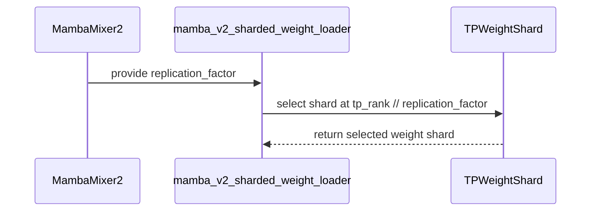

# [Bugfix] Support Mamba2 TP group replication

[Upstream PR](https://github.com/vllm-project/vllm/pull/55091) · state: open · merged: False

## Original PR description

<!-- markdownlint-disable -->

## Purpose

`MambaMixer2` currently supports tensor parallelism larger than `num_groups` only when `num_groups == 1`. This prevents serving models such as `nvidia/NVIDIA-Nemotron-3-Ultra-550B-A55B-BF16`, which has eight Mamba groups, with TP32:

```text
AssertionError: If tensor parallel world size does not divide num_groups,
then num_groups must equal 1.
```

When tensor parallelism is a multiple of the group count, each group can be replicated across the adjacent TP ranks whose head shards consume it. This patch:

- represents the weight-loader setting as an integer replication factor;
- maps each TP rank to `tp_rank // replication_factor` for replicated group shards;
- accepts either `num_groups % tp_size == 0` or `tp_size % num_groups == 0`; and
- updates the Qwen GDN caller to pass a replication factor of one for ordinary shards.

Related issue [#46407](https://github.com/vllm-project/vllm/issues/46407) reports the same TP limitation in a broader pipeline-disaggregation setup.

## Test Plan

Use four nodes with eight H100 GPUs each. Start the Ray head on the first node:

```bash
ray start --head --port=6379
```

Join each of the other three nodes to it:

```bash
ray start --address="<HEAD_NODE_IP>:6379"
```

On the head node, run the following command first from `origin/main` to reproduce the failure, then from this branch to verify the fix:

```bash
vllm serve nvidia/NVIDIA-Nemotron-3-Ultra-550B-A55B-BF16 \
  --host 0.0.0.0 \
  --port 8000 \
  --dtype bfloat16 \
  --tensor-parallel-size 32 \
  --distributed-executor-backend ray \
  --trust-remote-code \
  --gpu-memory-utilization 0.9 \
  --max-model-len 34816 \
  --max-num-batched-tokens 16384 \
  --max-num-seqs 64 \
  --block-size 128 \
  --no-enable-prefix-caching \
  --compilation-config '{"cudagraph_capture_sizes":[1,2,4,8,16,32,64]}'
```

After the patched server becomes ready, run the 32K-input, one-output-token workload at concurrency 16:

```bash
vllm bench serve \
  --backend vllm \
  --host "<HEAD_NODE_IP>" \
  --port 8000 \
  --model nvidia/NVIDIA-Nemotron-3-Ultra-550B-A55B-BF16 \
  --endpoint /v1/completions \
  --dataset-name random \
  --random-input-len 32768 \
  --random-output-len 1 \
  --random-range-ratio 0.8 \
  --num-prompts 48 \
  --max-concurrency 16 \
  --request-rate inf \
  --ignore-eos
```

## Test Result

Before the change, the server failed during model construction before loading weights:

```text
MambaMixer2.__init__
AssertionError: If tensor parallel world size does not divide num_groups,
then num_groups must equal 1.
```

After the change, the same BF16 checkpoint and TP32 topology initialized all 32 ranks, loaded the checkpoint, captured CUDA graphs, became ready, and served all 48 requests successfully. The saved concurrency-16 result was:

```text
completed: 48
total_input_tokens: 1396900
total_output_tokens: 48
generated_texts: 48 non-empty one-token responses ("The")
errors: 48 empty entries
total_token_throughput: 7030.0069 tokens/s
```

The workload requests exactly one output token, and every request returned the expected one-token response without an error.

AI assistance was used to prepare the patch and PR description. The author reviewed every changed line and validated the change with the end-to-end run above.

---

<details>
<summary> Essential Elements of an Effective PR Description Checklist </summary>

- [x] The purpose of the PR, including the failing configuration and related issue.
- [x] The test plan and commands are provided.
- [x] Before-and-after end-to-end results are provided.

</details>

**BEFORE SUBMITTING, PLEASE READ <https://docs.vllm.ai/en/latest/contributing>**
(anything written below this line will be removed by GitHub Actions)


## Review and discussion

### reviews

- claude[bot] · COMMENTED · 2026-09-03T06:31:41Z · [source](https://github.com/vllm-project/vllm/pull/55091#pullrequestreview-5098573764)

## Claude Code Review

This pull request is from a fork — automated review is disabled. A repository maintainer can comment `@claude review` to run a one-time review.

### issue_comments

- coderabbitai[bot] · comment · 2026-09-05T00:51:15Z · [source](https://github.com/vllm-project/vllm/pull/55091#issuecomment-5548200659)

<!-- This is an auto-generated comment: summarize by coderabbit.ai -->
<!-- review_stack_entry_start -->

[](https://app.coderabbit.ai/change-stack/vllm-project/vllm/pull/55091)

<!-- review_stack_entry_end -->
<!-- recent_review_start -->

No actionable comments were generated in the recent review. 🎉

<details>
<summary>ℹ️ Recent review info</summary>

<details>
<summary>⚙️ Run configuration</summary>

**Configuration used**: Repository UI

**Review profile**: CHILL

**Plan**: Team

**Run ID**: `1a21fa01-52cf-4702-9bae-aee27756dfda`

</details>

<details>
<summary>📥 Commits</summary>

Reviewing files that changed from the base of the PR and between 6cbb3c154ef1449d2b3c9131a237f36faa695734 and c90c7b4a1f401c0ee017dc0ad4e724f2dfd596db.

</details>

<details>
<summary>📒 Files selected for processing (2)</summary>

* `vllm/model_executor/layers/mamba/gdn/qwen_gdn_linear_attn.py`
* `vllm/model_executor/layers/mamba/mamba_mixer2.py`

</details>

**Included review availability:** Your plan provides up to 10 included reviews per hour; 5 remain after this review.

</details>

---


<!-- recent_review_end -->
<!-- walkthrough_start -->

<details>
<summary>📝 Summary</summary>

<!-- This is an auto-generated comment: release notes by coderabbit.ai -->

## Summary by CodeRabbit

- **Bug Fixes**
  - Improved model loading for Qwen gated delta attention weights.
  - Fixed tensor-parallel weight sharding for Mamba2 configurations that replicate groups across partitions.
  - Expanded supported configurations when the tensor-parallel size is evenly divisible by the number of model groups.
  - Ensured replicated group weights are assigned to the correct partitions during loading.

<!-- end of auto-generated comment: release notes by coderabbit.ai -->
## Walkthrough

### Changes

**Mamba tensor-parallel replication**

|Layer / File(s)|Summary|
|---|---|
|**Replication-aware sharded weight loading** <br> `vllm/model_executor/layers/mamba/mamba_mixer2.py`|The weight loader now accepts integer replication factors and selects loaded-weight ranks with `tp_rank // replication_factor`.|
|**Mamba2 and Qwen GDN shard configuration** <br> `vllm/model_executor/layers/mamba/mamba_mixer2.py`, `vllm/model_executor/layers/mamba/gdn/qwen_gdn_linear_attn.py`|Mamba2 now permits tensor-parallel sizes divisible by `n_groups` and passes integer replication factors. Qwen GDN query/key and value settings now use `1`.|

**Estimated code review effort:** 3 (Moderate) | ~20 minutes

<!-- final_review_risk_start -->
**Merge Risk:** _⚪ Minimal_ · up to `c90c7`
<!-- final_review_risk_coverage:{"sourceCommitId":"c90c7b4a1f401c0ee017dc0ad4e724f2dfd596db","coveredCommitId":"c90c7b4a1f401c0ee017dc0ad4e724f2dfd596db","kind":"reviewed"} -->

This enables Mamba2 group replication for tensor-parallel configurations such as TP32 while preserving ordinary shard loading. The reported TP32 initialization and request-serving validation completed successfully, with no remaining merge-blocking risk.
<!-- final_review_risk_end -->

### Sequence Diagram(s)



**Suggested reviewers:** `njhill`

</details>

<!-- walkthrough_end -->
<!-- pre_merge_checks_walkthrough_start -->

<details>
<summary>🚥 Pre-merge checks | ✅ 4 | ❌ 1</summary>

### ❌ Failed checks (1 warning)

|     Check name     | Status     | Explanation                                                                                                                                                                                | Resolution                                                                         |
| :----------------: | :--------- | :----------------------------------------------------------------------------------------------------------------------------------------------------------------------------------------- | :--------------------------------------------------------------------------------- |
| Docstring Coverage | ⚠️ Warning | Docstring coverage is 25.00% which is insufficient. The required threshold is 80.00%. Docstring coverage is scoped to functions touched by this diff. Analyzed 4 functions across 2 files. | Write docstrings for the functions missing them to satisfy the coverage threshold. |

<details>
<summary>✅ Passed checks (4 passed)</summary>

|         Check name         | Status   | Explanation                                                                                                                                            |
| :------------------------: | :------- | :----------------------------------------------------------------------------------------------------------------------------------------------------- |
|         Title check        | ✅ Passed | The title clearly and concisely identifies the main change: adding Mamba2 tensor-parallel group replication support.                                   |
|      Description check     | ✅ Passed | The description directly explains the TP32 limitation, the implemented replication changes, the affected model, and the end-to-end validation results. |
|     Linked Issues check    | ✅ Passed | Check skipped because no linked issues were found for this pull request.                                                                               |
| Out of Scope Changes check | ✅ Passed | Check skipped because no linked issues were found for this pull request.                                                                               |

</details>

</details>

<!-- pre_merge_checks_walkthrough_end -->

- [ ] <!-- {"checkboxId":"585bb3f6-faf5-4dbf-96d2-74e382adf19a"} --> Fix all pre-merge checks with AI
<!-- tips_start -->

---

Thanks for using [CodeRabbit](https://coderabbit.ai?utm_source=oss&utm_medium=github&utm_campaign=vllm-project/vllm&utm_content=55091)! It's free for OSS, and your support helps us grow. If you like it, consider giving us a shout-out.

<details>
<summary>❤️ Share</summary>

- [X](https://twitter.com/intent/tweet?text=I%20just%20used%20%40coderabbitai%20for%20my%20code%20review%2C%20and%20it%27s%20fantastic%21%20It%27s%20free%20for%20OSS%20and%20offers%20a%20free%20trial%20for%20the%20proprietary%20code.%20Check%20it%20out%3A&url=https%3A//coderabbit.ai)
- [Mastodon](https://mastodon.social/share?text=I%20just%20used%20%40coderabbitai%20for%20my%20code%20review%2C%20and%20it%27s%20fantastic%21%20It%27s%20free%20for%20OSS%20and%20offers%20a%20free%20trial%20for%20the%20proprietary%20code.%20Check%20it%20out%3A%20https%3A%2F%2Fcoderabbit.ai)
- [Reddit](https://www.reddit.com/submit?title=Great%20tool%20for%20code%20review%20-%20CodeRabbit&text=I%20just%20used%20CodeRabbit%20for%20my%20code%20review%2C%20and%20it%27s%20fantastic%21%20It%27s%20free%20for%20OSS%20and%20offers%20a%20free%20trial%20for%20proprietary%20code.%20Check%20it%20out%3A%20https%3A//coderabbit.ai)
- [LinkedIn](https://www.linkedin.com/sharing/share-offsite/?url=https%3A%2F%2Fcoderabbit.ai&mini=true&title=Great%20tool%20for%20code%20review%20-%20CodeRabbit&summary=I%20just%20used%20CodeRabbit%20for%20my%20code%20review%2C%20and%20it%27s%20fantastic%21%20It%27s%20free%20for%20OSS%20and%20offers%20a%20free%20trial%20for%20proprietary%20code)

</details>


<sub>Comment `@coderabbitai help` to get the list of available commands.</sub>

<!-- tips_end -->

- mergify[bot] · comment · 2026-10-15T10:07:26Z · [source](https://github.com/vllm-project/vllm/pull/55091#issuecomment-6189587420)

This pull request has merge conflicts that must be resolved before it can be
merged. Please rebase the PR, @mikekg.

https://docs.github.com/en/pull-requests/collaborating-with-pull-requests/working-with-forks/syncing-a-fork


### inline_comments

## Changed files and fixed code

- `tests/kernels/mamba/test_mamba_mixer2.py` · modified · additions 67 / deletions 41
  - [head](https://github.com/mikekg/vllm/blob/3c4e385f726dcc1f756b987b1d139a7be167a589/tests/kernels/mamba/test_mamba_mixer2.py)
  - [base](https://github.com/vllm-project/vllm/blob/ab905a885dfbfc60a2c02286cc9c608c93884de3/tests/kernels/mamba/test_mamba_mixer2.py)
- `vllm/model_executor/layers/mamba/gdn/qwen_gdn_linear_attn.py` · modified · additions 3 / deletions 2
  - [head](https://github.com/mikekg/vllm/blob/3c4e385f726dcc1f756b987b1d139a7be167a589/vllm/model_executor/layers/mamba/gdn/qwen_gdn_linear_attn.py)
  - [base](https://github.com/vllm-project/vllm/blob/ab905a885dfbfc60a2c02286cc9c608c93884de3/vllm/model_executor/layers/mamba/gdn/qwen_gdn_linear_attn.py)
- `vllm/model_executor/layers/mamba/mamba_mixer2.py` · modified · additions 23 / deletions 21
  - [head](https://github.com/mikekg/vllm/blob/3c4e385f726dcc1f756b987b1d139a7be167a589/vllm/model_executor/layers/mamba/mamba_mixer2.py)
  - [base](https://github.com/vllm-project/vllm/blob/ab905a885dfbfc60a2c02286cc9c608c93884de3/vllm/model_executor/layers/mamba/mamba_mixer2.py)

## Evidence and interpretation boundary

[Original JSON, discussions and patches](../../../../../../evidence/prs/vllm-project--vllm/55091-22189f41947cb2164c1d229c547346d6d3c51e65ba5692abef69bbfd55d7d0e2.json) · SHA-256 `22189f41947cb2164c1d229c547346d6d3c51e65ba5692abef69bbfd55d7d0e2`.

Diff complete: True. Missing/binary/truncated patches require pinned source inspection. This is a source page, not an independently verified optimization case. Open, merged and released are different states; recheck the deployed dependency.
