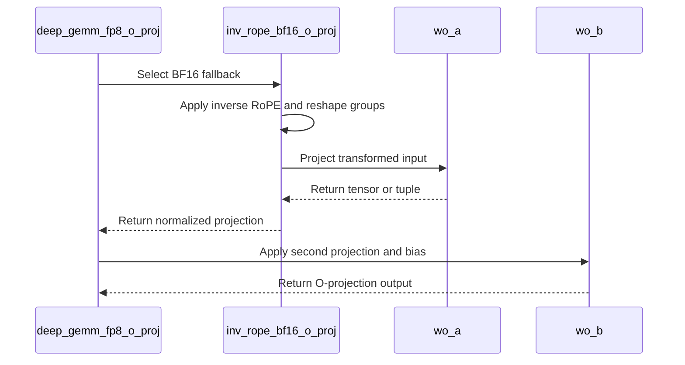

# Fix/dsv4 sm8x o proj

[Upstream PR](https://github.com/vllm-project/vllm/pull/55172) · state: open · merged: False

## Original PR description


## Purpose

DeepSeek V4 sends scaled NVIDIA output-projection weights through the fused FP8 DeepGEMM path. On A100 the first projection fails before generation while converting the inverse-RoPE output:

```text
ValueError: type fp8e4nv not supported in this architecture
```

DeepGEMM is unavailable throughout SM8x, so replacing only that conversion would move the failure into `fp8_einsum`. [#44847](https://github.com/vllm-project/vllm/pull/44847) already provides a BF16 grouped output-projection helper when scale metadata is absent. This PR is stacked on #44847 and selects that helper whenever the platform does not support DeepGEMM, including when the weights carry scale metadata.

Scaled weights must still pass through `wo_a` so its quantization backend applies their scales. The helper therefore calls `wo_a` for scaled weights, reshapes its output by group, and selects the per-group diagonal. It retains #44847’s direct einsum for unscaled BF16 weights and retains the fused FP8 path on DeepGEMM-capable GPUs.

The alternatives were to duplicate the BF16 inverse-RoPE projection or extend only the FP8 conversion. Reusing #44847 avoids a second implementation, while extending only the conversion would still fail at DeepGEMM. Calling the existing linear module for scaled weights preserves its quantization contract instead of reading raw FP8 weights without their scales.

## Test Plan

Use a direct import of the production output-projection module, extend #44847’s existing test with a scaled-weight case, and run the complete module. This focused test is CPU-only: it reproduces the A100/SM8x dispatch condition by forcing `support_deep_gemm()` to false and verifies both the scaled and unscaled projection contracts without claiming GPU kernel coverage.

```bash
.venv/bin/python -m pytest \
  tests/models/deepseek_v4/test_nvidia_o_proj.py \
  -v
```

Exercise the model path with #44847, the FP8-conversion-helper prerequisite, and the sparse-MLA companion on four eight-GPU A100 nodes. Run the prerequisite stack without this branch to reproduce the output-projection failure, then add this branch and repeat the same job:

```bash
#!/bin/bash
#SBATCH --nodes=4
#SBATCH --ntasks=4
#SBATCH --ntasks-per-node=1
#SBATCH --gpus-per-node=8
#SBATCH --time=02:00:00

set -euo pipefail

export MODEL=nvidia/DeepSeek-V4-Pro-0813-NVFP4
export REVISION=2ff4ec53ee664e54571f670276d2c89d0fcc7b82
export MASTER_ADDR
MASTER_ADDR=$(scontrol show hostnames "$SLURM_JOB_NODELIST" | head -n1)
export MASTER_PORT=29501
export COMPILATION_CONFIG='{"cudagraph_capture_sizes":[1,2,4,8,16,32,64],"inductor_compile_config":{"enable_auto_functionalized_v2":true}}'

srun --nodes=4 --ntasks=4 --ntasks-per-node=1 bash -lc '
  headless=()
  if (( SLURM_NODEID > 0 )); then
    headless=(--headless)
  fi

  exec vllm serve "$MODEL" \
    --revision "$REVISION" \
    --served-model-name deepseek-v4-pro \
    --host 0.0.0.0 \
    --port 8000 \
    --trust-remote-code \
    --tokenizer-mode deepseek_v4 \
    --load-format fastsafetensors \
    --safetensors-load-strategy lazy \
    --distributed-executor-backend mp \
    --master-addr "$MASTER_ADDR" \
    --master-port "$MASTER_PORT" \
    --nnodes "$SLURM_NNODES" \
    --node-rank "$SLURM_NODEID" \
    --tensor-parallel-size 16 \
    --pipeline-parallel-size 2 \
    --enable-expert-parallel \
    --kv-cache-dtype fp8 \
    --block-size 256 \
    --max-model-len 10240 \
    --max-num-seqs 64 \
    --max-num-batched-tokens 16384 \
    --gpu-memory-utilization 0.9 \
    --linear-backend auto \
    --moe-backend auto \
    --no-enable-prefix-caching \
    --distributed-timeout-seconds 7200 \
    --cpu-distributed-timeout-seconds 7200 \
    --compilation-config "$COMPILATION_CONFIG" \
    "${headless[@]}"
'
```

After the A100 head process becomes ready, run a concurrency-16 smoke test and then the full GSM8K evaluation:

```bash
.venv/bin/python tests/evals/gsm8k/gsm8k_eval.py \
  --host http://127.0.0.1 \
  --port 8000 \
  --num-questions 16 \
  --num-shots 5 \
  --max-tokens 1024 \
  --temperature 0 \
  --seed 42 \
  --max-concurrency 16 \
  --save-results gsm8k-c16.json

.venv/bin/python tests/evals/gsm8k/gsm8k_eval.py \
  --host http://127.0.0.1 \
  --port 8000 \
  --num-questions 1319 \
  --num-shots 5 \
  --max-tokens 1024 \
  --temperature 0 \
  --seed 42 \
  --max-concurrency 64 \
  --save-results gsm8k-full.json
```

Run the repository checks on both changed files:

```bash
pre-commit run --files \
  tests/models/deepseek_v4/test_nvidia_o_proj.py \
  vllm/models/deepseek_v4/nvidia/ops/o_proj.py
```

## Test Result

On #44847 alone, the CPU-only focused module passed six cases, but the scaled-weight case entered `fused_inv_rope_fp8_quant` instead of the BF16 fallback and failed. With this PR, the same module passes 7/7 cases. The scaled case verifies that `wo_a` receives the BF16 inverse-RoPE activations and applies its non-unit scale before `wo_b`; the unscaled case continues to use #44847's direct BF16 einsum.

Before this PR, the compiled four-node A100/SM80 model run failed in `deep_gemm_fp8_o_proj` before producing a response:

```text
ValueError: type fp8e4nv not supported in this architecture
```

Together with #44847 and the co-pending FP8-conversion-helper and sparse-MLA PRs, this PR lets the compiled A100 server capture CUDA graphs and produces the following successful end-to-end results:

```text
c16: 16/16 requests completed, 0 invalid responses
full GSM8K: 1319/1319 requests completed
flexible accuracy: 0.965125
strict accuracy: 0.953753
invalid responses: 0
output tokens: 121802
evaluation time: 429.349 seconds
```

All applicable pre-commit hooks passed.

AI assistance was used to prepare the patch and PR description. The author reviewed every changed line and validated the focused and end-to-end results above.

---

<details>
<summary> Essential Elements of an Effective PR Description Checklist </summary>

- [x] The purpose of the PR, including the failure and dependency on #44847, is described.
- [x] The focused test and complete Slurm-native test commands are provided.
- [x] The focused before/after comparison and A100 end-to-end results are provided.
- [x] No documentation update is required because this changes backend dispatch without changing the public model interface.

</details>


## Review and discussion

### reviews

- claude · COMMENTED · 2026-09-03T15:57:51Z · [source](https://github.com/vllm-project/vllm/pull/55172#pullrequestreview-5104057413)

## Claude Code Review

This pull request is from a fork — automated review is disabled. A repository maintainer can comment `@claude review` to run a one-time review.

### issue_comments

- coderabbitai · comment · 2026-09-03T15:59:14Z · [source](https://github.com/vllm-project/vllm/pull/55172#issuecomment-5528433425)

<!-- This is an auto-generated comment: summarize by coderabbit.ai -->
<!-- review_stack_entry_start -->

[](https://app.coderabbit.ai/change-stack/vllm-project/vllm/pull/55172)

<!-- review_stack_entry_end -->
<!-- This is an auto-generated comment: skip review by coderabbit.ai -->

> [!IMPORTANT]
> ## Draft PR not reviewed
> 
> Draft PRs are not automatically reviewed by default.
> 
> - [ ] <!-- {"checkboxId":"e9bb8d72-00e8-4f67-9cb2-caf3b22574fe"} --> Trigger a manual review
> 
> To automatically review draft PRs, update your CodeRabbit configuration:
> 
> ```yaml
> reviews:
>   auto_review:
>     drafts: true
> ```

<!-- end of auto-generated comment: skip review by coderabbit.ai -->

<!-- recent_review_start -->

No actionable comments were generated in the recent review. 🎉

<details>
<summary>ℹ️ Recent review info</summary>

<details>
<summary>⚙️ Run configuration</summary>

**Configuration used**: Repository UI

**Review profile**: CHILL

**Plan**: Team

**Run ID**: `4cd4adab-c910-4e0c-9157-5f96a6141c2b`

</details>

<details>
<summary>📥 Commits</summary>

Reviewing files that changed from the base of the PR and between e55b93f2969d76b854eae158b6d17baea757d3e8 and 911475f1e6c7cc935f803e8106f4c7e928fac1ad.

</details>

<details>
<summary>📒 Files selected for processing (2)</summary>

* `tests/models/deepseek_v4/test_nvidia_o_proj.py`
* `vllm/models/deepseek_v4/nvidia/ops/o_proj.py`

</details>

**Included review availability:** Your plan provides up to 10 included reviews per hour; 9 remain after this review.

</details>

---


<!-- recent_review_end -->
<!-- walkthrough_start -->

<details>
<summary>📝 Summary</summary>

<!-- This is an auto-generated comment: release notes by coderabbit.ai -->

## Summary by CodeRabbit

* **New Features**
  * Added BF16 fallback support for DeepSeek V4 output projection when FP8 acceleration is unavailable or unsupported.
  * Added inverse RoPE handling and grouped projection support for broader model configurations.
  * Improved compatibility with different FP8 weight-scale formats and projection output shapes.

* **Tests**
  * Added coverage for FP8 scale selection, BF16 fallback behavior, grouped weights, and unsupported acceleration scenarios.

<!-- end of auto-generated comment: release notes by coderabbit.ai -->
## Walkthrough

The O-projection implementation now supports BF16 inverse-RoPE fallback, grouped inputs, flexible FP8 scale lookup, tuple outputs, and fallback dispatch when FP8 weights or DeepGEMM support are unavailable. New tests cover scale resolution, grouped projection, and fallback behavior.

### Changes

**DeepSeek v4 O-projection**

|Layer / File(s)|Summary|
|---|---|
|**BF16 projection path and scale handling** <br> `vllm/models/deepseek_v4/nvidia/ops/o_proj.py`, `tests/models/deepseek_v4/test_nvidia_o_proj.py`|The code resolves `weight_scale_inv` or `weight_scale`, normalizes tensor and tuple outputs, applies inverse RoPE, reshapes grouped inputs, and performs BF16 projection. Tests cover scale lookup and grouped and unquantized paths.|
|**DeepGEMM fallback dispatch** <br> `vllm/models/deepseek_v4/nvidia/ops/o_proj.py`, `tests/models/deepseek_v4/test_nvidia_o_proj.py`|`deep_gemm_fp8_o_proj` uses the BF16 path when FP8 scale data is missing or DeepGEMM is unsupported. Tests cover fallback execution with and without a weight scale.|

**Estimated code review effort:** 3 (Moderate) | ~25 minutes

<!-- final_review_risk_start -->
**Merge Risk:** _⚪ Minimal_ · up to `91147`
<!-- final_review_risk_coverage:{"sourceCommitId":"911475f1e6c7cc935f803e8106f4c7e928fac1ad","coveredCommitId":"911475f1e6c7cc935f803e8106f4c7e928fac1ad","kind":"reviewed"} -->

This change adds the BF16 output-projection fallback for unsupported GPUs while retaining the supported fused path. No merge-blocking risk remains.
<!-- final_review_risk_end -->

### Sequence Diagram(s)



</details>

<!-- walkthrough_end -->
<!-- pre_merge_checks_walkthrough_start -->

<details>
<summary>🚥 Pre-merge checks | ✅ 4 | ❌ 1</summary>

### ❌ Failed checks (1 warning)

|     Check name     | Status     | Explanation                                                                                                                                                                                 | Resolution                                                                         |
| :----------------: | :--------- | :------------------------------------------------------------------------------------------------------------------------------------------------------------------------------------------ | :--------------------------------------------------------------------------------- |
| Docstring Coverage | ⚠️ Warning | Docstring coverage is 11.11% which is insufficient. The required threshold is 80.00%. Docstring coverage is scoped to functions touched by this diff. Analyzed 18 functions across 2 files. | Write docstrings for the functions missing them to satisfy the coverage threshold. |

<details>
<summary>✅ Passed checks (4 passed)</summary>

|         Check name         | Status   | Explanation                                                                                                                                                  |
| :------------------------: | :------- | :----------------------------------------------------------------------------------------------------------------------------------------------------------- |
|      Description check     | ✅ Passed | The description clearly explains the DeepSeek V4 output-projection failure, the BF16 fallback, scaled-weight handling, dependencies, and validation results. |
|         Title check        | ✅ Passed | The title identifies a DeepSeek V4 SM8x output-projection fix, which matches the primary change in the pull request.                                         |
|     Linked Issues check    | ✅ Passed | Check skipped because no linked issues were found for this pull request.                                                                                     |
| Out of Scope Changes check | ✅ Passed | Check skipped because no linked issues were found for this pull request.                                                                                     |

</details>

</details>

<!-- pre_merge_checks_walkthrough_end -->
<!-- tips_start -->

---

Thanks for using [CodeRabbit](https://coderabbit.ai?utm_source=oss&utm_medium=github&utm_campaign=vllm-project/vllm&utm_content=55172)! It's free for OSS, and your support helps us grow. If you like it, consider giving us a shout-out.

<details>
<summary>❤️ Share</summary>

- [X](https://twitter.com/intent/tweet?text=I%20just%20used%20%40coderabbitai%20for%20my%20code%20review%2C%20and%20it%27s%20fantastic%21%20It%27s%20free%20for%20OSS%20and%20offers%20a%20free%20trial%20for%20the%20proprietary%20code.%20Check%20it%20out%3A&url=https%3A//coderabbit.ai)
- [Mastodon](https://mastodon.social/share?text=I%20just%20used%20%40coderabbitai%20for%20my%20code%20review%2C%20and%20it%27s%20fantastic%21%20It%27s%20free%20for%20OSS%20and%20offers%20a%20free%20trial%20for%20the%20proprietary%20code.%20Check%20it%20out%3A%20https%3A%2F%2Fcoderabbit.ai)
- [Reddit](https://www.reddit.com/submit?title=Great%20tool%20for%20code%20review%20-%20CodeRabbit&text=I%20just%20used%20CodeRabbit%20for%20my%20code%20review%2C%20and%20it%27s%20fantastic%21%20It%27s%20free%20for%20OSS%20and%20offers%20a%20free%20trial%20for%20proprietary%20code.%20Check%20it%20out%3A%20https%3A//coderabbit.ai)
- [LinkedIn](https://www.linkedin.com/sharing/share-offsite/?url=https%3A%2F%2Fcoderabbit.ai&mini=true&title=Great%20tool%20for%20code%20review%20-%20CodeRabbit&summary=I%20just%20used%20CodeRabbit%20for%20my%20code%20review%2C%20and%20it%27s%20fantastic%21%20It%27s%20free%20for%20OSS%20and%20offers%20a%20free%20trial%20for%20proprietary%20code)

</details>


<sub>Comment `@coderabbitai help` to get the list of available commands.</sub>

<!-- tips_end -->

- mergify · comment · 2026-09-10T20:52:14Z · [source](https://github.com/vllm-project/vllm/pull/55172#issuecomment-5625276522)

This pull request has merge conflicts that must be resolved before it can be
merged. Please rebase the PR, @mikekg.

https://docs.github.com/en/pull-requests/collaborating-with-pull-requests/working-with-forks/syncing-a-fork


- mergify · comment · 2026-10-10T03:06:50Z · [source](https://github.com/vllm-project/vllm/pull/55172#issuecomment-6093137805)

This pull request has merge conflicts that must be resolved before it can be
merged. Please rebase the PR, @mikekg.

https://docs.github.com/en/pull-requests/collaborating-with-pull-requests/working-with-forks/syncing-a-fork


### inline_comments

## Changed files and fixed code

- `.buildkite/test_areas/models_basic.yaml` · modified · additions 2 / deletions 1
  - [head](https://github.com/mikekg/vllm/blob/786712fe9e3063b8895af4dc9bc4d5ab1114450f/.buildkite/test_areas/models_basic.yaml)
  - [base](https://github.com/vllm-project/vllm/blob/ab905a885dfbfc60a2c02286cc9c608c93884de3/.buildkite/test_areas/models_basic.yaml)
- `tests/models/deepseek_v4/test_nvidia_o_proj.py` · added · additions 230 / deletions 0
  - [head](https://github.com/mikekg/vllm/blob/786712fe9e3063b8895af4dc9bc4d5ab1114450f/tests/models/deepseek_v4/test_nvidia_o_proj.py)
  - [base](https://github.com/vllm-project/vllm/blob/ab905a885dfbfc60a2c02286cc9c608c93884de3/tests/models/deepseek_v4/test_nvidia_o_proj.py)
- `vllm/models/deepseek_v4/common/ops/fused_inv_rope_fp8_quant.py` · modified · additions 3 / deletions 0
  - [head](https://github.com/mikekg/vllm/blob/786712fe9e3063b8895af4dc9bc4d5ab1114450f/vllm/models/deepseek_v4/common/ops/fused_inv_rope_fp8_quant.py)
  - [base](https://github.com/vllm-project/vllm/blob/ab905a885dfbfc60a2c02286cc9c608c93884de3/vllm/models/deepseek_v4/common/ops/fused_inv_rope_fp8_quant.py)
- `vllm/models/deepseek_v4/nvidia/ops/o_proj.py` · modified · additions 109 / deletions 0
  - [head](https://github.com/mikekg/vllm/blob/786712fe9e3063b8895af4dc9bc4d5ab1114450f/vllm/models/deepseek_v4/nvidia/ops/o_proj.py)
  - [base](https://github.com/vllm-project/vllm/blob/ab905a885dfbfc60a2c02286cc9c608c93884de3/vllm/models/deepseek_v4/nvidia/ops/o_proj.py)

## Evidence and interpretation boundary

[Original JSON, discussions and patches](../../../../../../evidence/prs/vllm-project--vllm/55172-359275626b3b81d2780eaf0aa49b2ed0776b999483ce7286eb6a9f01330211bd.json) · SHA-256 `359275626b3b81d2780eaf0aa49b2ed0776b999483ce7286eb6a9f01330211bd`.

Diff complete: True. Missing/binary/truncated patches require pinned source inspection. This is a source page, not an independently verified optimization case. Open, merged and released are different states; recheck the deployed dependency.
