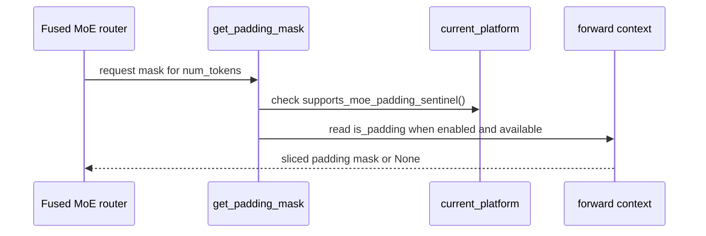

# [Bugfix][MoE][XPU] Gate topk_id=-1 padding sentinel on XPU (stopgap for vllm-xpu-kernels#572)

[Upstream PR](https://github.com/vllm-project/vllm/pull/55231) · state: closed · merged: False

## Original PR description

## What

New `Platform.supports_moe_padding_sentinel()` (default `True`). XPU overrides to `False`; both top-k routers gate `topk_id = -1` emission on it instead of the raw `VLLM_MOE_SKIP_PADDING` env var. Check consolidated into `base_router.get_padding_mask()` (no `@functools.cache` — caching a platform+env check is unsafe under monkeypatching).

## Why — stopgap for vllm-xpu-kernels#572, not a permanent fix

SYCL `moe_align_block_size` never gained the `expert_id < 0` guard CUDA has. `topk_id = -1` (padding sentinel, emitted whenever `VLLM_MOE_SKIP_PADDING` is on — default) is used as a raw index, writing out of bounds in `_count_and_sort_expert_tokens` and the small-batch-expert path. Depending on overflow size: silent weight corruption or device crash. Not WNA16-specific — any Triton MoE on XPU going through this kernel is exposed.

The real fix is vllm-project/vllm-xpu-kernels#572 (adds the guard at all 4 unguarded sites). **This PR is a temporary shield for `vllm-xpu-kernels` builds that predate #572** — remove it once #572 ships in a released wheel that `requirements/xpu.txt` pins.

Not a duplicate: vllm-project/vllm#50759 covers routers without native padding support (different gap); vllm-project/vllm#42034 fixes the same "-1 as index" hazard in FlashInfer NVLink EP dispatch (different, CUDA-only path).

## Test plan

```bash
.venv/bin/python -m pytest tests/kernels/moe/test_routing.py -k padding_mask -v
```
`4 passed`, device-agnostic — also passed against a real CUDA platform (see below).

**Hardware (Intel B60, TP=1/TP=2), unpatched vs. patched:**

| Config | Unpatched | Patched |
|---|---|---|
| `moe_wna16`, `--moe-backend triton` | Segfault | Coherent, byte-identical |
| online FP8, `--moe-backend triton` (generic `TritonExperts`) | `DEVICE_LOST` in `profile_run()` | Coherent |

Native SYCL (`--moe-backend auto`, no `moe_align_block_size` call) hits an unrelated `ptr_A.size(1)≠ptr_B.size(1)` bug identically with and without this patch — separate, pre-existing, not fixed here.

**CUDA (L40S):** this diff `patch -p1`'d onto stock `vllm-openai:0.28.0` — generation output byte-identical unpatched vs. patched, unit tests pass against the real `CudaPlatform`. No cross-platform regression.

AI-assisted (Claude Code / Opus); I reviewed every changed line and reproduced all results above myself.


## Review and discussion

### reviews

- claude · COMMENTED · 2026-09-03T19:43:58Z · [source](https://github.com/vllm-project/vllm/pull/55231#pullrequestreview-5106105474)

## Claude Code Review

This pull request is from a fork — automated review is disabled. A repository maintainer can comment `@claude review` to run a one-time review.

### issue_comments

- coderabbitai · comment · 2026-09-03T19:44:51Z · [source](https://github.com/vllm-project/vllm/pull/55231#issuecomment-5531194437)

<!-- This is an auto-generated comment: summarize by coderabbit.ai -->
<!-- review_stack_entry_start -->

[](https://app.coderabbit.ai/change-stack/vllm-project/vllm/pull/55231)

<!-- review_stack_entry_end -->
<!-- recent_review_start -->

No actionable comments were generated in the recent review. 🎉

<details>
<summary>ℹ️ Recent review info</summary>

<details>
<summary>⚙️ Run configuration</summary>

**Configuration used**: Repository UI

**Review profile**: CHILL

**Plan**: Team

**Run ID**: `b6bb8be3-d978-4127-9d29-6eb17d54fa13`

</details>

<details>
<summary>📥 Commits</summary>

Reviewing files that changed from the base of the PR and between 4a806d08ee94b35356dd749bf814ee91ee93f8d0 and 49785d3b65cbaf77cc75d79cead5d6551590b5e8.

</details>

<details>
<summary>📒 Files selected for processing (6)</summary>

* `tests/kernels/moe/test_routing.py`
* `vllm/model_executor/layers/fused_moe/router/base_router.py`
* `vllm/model_executor/layers/fused_moe/router/fused_topk_bias_router.py`
* `vllm/model_executor/layers/fused_moe/router/fused_topk_router.py`
* `vllm/platforms/interface.py`
* `vllm/platforms/xpu.py`

</details>

<details>
<summary>🚧 Files skipped from review as they are similar to previous changes (6)</summary>

* vllm/platforms/interface.py
* vllm/model_executor/layers/fused_moe/router/base_router.py
* vllm/platforms/xpu.py
* vllm/model_executor/layers/fused_moe/router/fused_topk_router.py
* tests/kernels/moe/test_routing.py
* vllm/model_executor/layers/fused_moe/router/fused_topk_bias_router.py

</details>

**Included review availability:** Your plan provides up to 10 included reviews per hour; 9 remain after this review.

</details>

---


<!-- recent_review_end -->
<!-- walkthrough_start -->

<details>
<summary>📝 Summary</summary>

<!-- This is an auto-generated comment: release notes by coderabbit.ai -->

## Summary by CodeRabbit

* **New Features**
  * Added optional skipping of padded tokens during fused Mixture-of-Experts routing when enabled by configuration.
  * Added platform-aware safeguards to prevent padding-sentinel handling on unsupported hardware.
  * Centralized padding-mask handling across supported MoE routers.

* **Tests**
  * Added coverage for configuration, platform support, missing context, and token-count slicing scenarios.

<!-- end of auto-generated comment: release notes by coderabbit.ai -->
## Walkthrough

The change centralizes MoE padding-mask handling in the base router, adds platform capability checks for padding sentinels, updates top-k routers to use the shared helper, and adds tests for gating and forward-context behavior.

### Changes

**MoE padding-mask routing**

|Layer / File(s)|Summary|
|---|---|
|**Padding-mask contract and capability gate** <br> `vllm/model_executor/layers/fused_moe/router/base_router.py`, `vllm/platforms/interface.py`, `vllm/platforms/xpu.py`|The base router adds shared padding-mask logic. The platform interface enables sentinel support by default. XPU disables the capability.|
|**Router integration and validation** <br> `vllm/model_executor/layers/fused_moe/router/fused_topk_bias_router.py`, `vllm/model_executor/layers/fused_moe/router/fused_topk_router.py`, `tests/kernels/moe/test_routing.py`|Both top-k routers use the shared helper. Tests cover environment and platform gating, unavailable forward context, and token slicing.|

**Estimated code review effort:** 3 (Moderate) | ~20 minutes

<!-- final_review_risk_start -->
**Merge Risk:** _⚪ Minimal_ · up to `49785`
<!-- final_review_risk_coverage:{"sourceCommitId":"49785d3b65cbaf77cc75d79cead5d6551590b5e8","coveredCommitId":"49785d3b65cbaf77cc75d79cead5d6551590b5e8","kind":"reviewed"} -->

This change prevents XPU MoE routing from emitting unsupported negative expert-ID padding sentinels while retaining existing behavior on platforms that support them. No concrete unresolved merge risk is established.
<!-- final_review_risk_end -->

### Sequence Diagram(s)



</details>

<!-- walkthrough_end -->
<!-- pre_merge_checks_walkthrough_start -->

<details>
<summary>🚥 Pre-merge checks | ✅ 4 | ❌ 1</summary>

### ❌ Failed checks (1 warning)

|     Check name     | Status     | Explanation                                                                                                                                                                                 | Resolution                                                                         |
| :----------------: | :--------- | :------------------------------------------------------------------------------------------------------------------------------------------------------------------------------------------ | :--------------------------------------------------------------------------------- |
| Docstring Coverage | ⚠️ Warning | Docstring coverage is 41.18% which is insufficient. The required threshold is 80.00%. Docstring coverage is scoped to functions touched by this diff. Analyzed 17 functions across 6 files. | Write docstrings for the functions missing them to satisfy the coverage threshold. |

<details>
<summary>✅ Passed checks (4 passed)</summary>

|         Check name         | Status   | Explanation                                                                                                                                                                                    |
| :------------------------: | :------- | :--------------------------------------------------------------------------------------------------------------------------------------------------------------------------------------------- |
|         Title check        | ✅ Passed | The title clearly identifies the main change: gating the MoE padding sentinel on XPU. It also identifies the affected area and the stopgap nature of the fix.                                  |
|      Description check     | ✅ Passed | The description directly explains the platform capability, XPU override, affected routers, safety issue, temporary scope, tests, and validation results. It is fully related to the changeset. |
|     Linked Issues check    | ✅ Passed | Check skipped because no linked issues were found for this pull request.                                                                                                                       |
| Out of Scope Changes check | ✅ Passed | Check skipped because no linked issues were found for this pull request.                                                                                                                       |

</details>

</details>

<!-- pre_merge_checks_walkthrough_end -->

- [ ] <!-- {"checkboxId":"585bb3f6-faf5-4dbf-96d2-74e382adf19a"} --> Fix all pre-merge checks with AI
<!-- tips_start -->

---

Thanks for using [CodeRabbit](https://coderabbit.ai?utm_source=oss&utm_medium=github&utm_campaign=vllm-project/vllm&utm_content=55231)! It's free for OSS, and your support helps us grow. If you like it, consider giving us a shout-out.

<details>
<summary>❤️ Share</summary>

- [X](https://twitter.com/intent/tweet?text=I%20just%20used%20%40coderabbitai%20for%20my%20code%20review%2C%20and%20it%27s%20fantastic%21%20It%27s%20free%20for%20OSS%20and%20offers%20a%20free%20trial%20for%20the%20proprietary%20code.%20Check%20it%20out%3A&url=https%3A//coderabbit.ai)
- [Mastodon](https://mastodon.social/share?text=I%20just%20used%20%40coderabbitai%20for%20my%20code%20review%2C%20and%20it%27s%20fantastic%21%20It%27s%20free%20for%20OSS%20and%20offers%20a%20free%20trial%20for%20the%20proprietary%20code.%20Check%20it%20out%3A%20https%3A%2F%2Fcoderabbit.ai)
- [Reddit](https://www.reddit.com/submit?title=Great%20tool%20for%20code%20review%20-%20CodeRabbit&text=I%20just%20used%20CodeRabbit%20for%20my%20code%20review%2C%20and%20it%27s%20fantastic%21%20It%27s%20free%20for%20OSS%20and%20offers%20a%20free%20trial%20for%20proprietary%20code.%20Check%20it%20out%3A%20https%3A//coderabbit.ai)
- [LinkedIn](https://www.linkedin.com/sharing/share-offsite/?url=https%3A%2F%2Fcoderabbit.ai&mini=true&title=Great%20tool%20for%20code%20review%20-%20CodeRabbit&summary=I%20just%20used%20CodeRabbit%20for%20my%20code%20review%2C%20and%20it%27s%20fantastic%21%20It%27s%20free%20for%20OSS%20and%20offers%20a%20free%20trial%20for%20proprietary%20code)

</details>


<sub>Comment `@coderabbitai help` to get the list of available commands.</sub>

<!-- tips_end -->

- coderabbitai · comment · 2026-09-07T12:16:28Z · [source](https://github.com/vllm-project/vllm/pull/55231#issuecomment-5570495708)

<!-- This is an auto-generated comment by CodeRabbit -->
<!-- coderabbit-full-review-fallback-pr-55231-head-49785d3b65cbaf77cc75d79cead5d6551590b5e8 -->
> [!NOTE]
> GitHub couldn't provide a complete incremental comparison for this pull request, so CodeRabbit is performing a full review instead. This review may take a little longer.

- mergify · comment · 2026-09-29T12:24:16Z · [source](https://github.com/vllm-project/vllm/pull/55231#issuecomment-5890246098)

This pull request has merge conflicts that must be resolved before it can be
merged. Please rebase the PR, @afierka-intel.

https://docs.github.com/en/pull-requests/collaborating-with-pull-requests/working-with-forks/syncing-a-fork


- afierka-intel · comment · 2026-10-09T11:27:06Z · [source](https://github.com/vllm-project/vllm/pull/55231#issuecomment-6079937869)

Closing: this was a stopgap for vllm-project/vllm-xpu-kernels#572, which is now fixed at the root. The fix (`moe_align_block_size` guard against negative `expert_id`, merged 2026-09-10 as vllm-project/vllm-xpu-kernels@c1fd11d) is included in `vllm_xpu_kernels==0.1.15.4`, which `requirements/xpu.txt` on main already pins. The platform-level gate is no longer needed.

### inline_comments

## Changed files and fixed code

- `tests/kernels/moe/test_routing.py` · modified · additions 70 / deletions 0
  - [head](https://github.com/afierka-intel/vllm/blob/a3709be91b75357ca32d49add10cfac4888019ed/tests/kernels/moe/test_routing.py)
  - [base](https://github.com/vllm-project/vllm/blob/2b8a5495a88a9a44a9d92e8c4f4aae3b55b6b74b/tests/kernels/moe/test_routing.py)
- `vllm/model_executor/layers/fused_moe/router/base_router.py` · modified · additions 15 / deletions 0
  - [head](https://github.com/afierka-intel/vllm/blob/a3709be91b75357ca32d49add10cfac4888019ed/vllm/model_executor/layers/fused_moe/router/base_router.py)
  - [base](https://github.com/vllm-project/vllm/blob/2b8a5495a88a9a44a9d92e8c4f4aae3b55b6b74b/vllm/model_executor/layers/fused_moe/router/base_router.py)
- `vllm/model_executor/layers/fused_moe/router/fused_topk_bias_router.py` · modified · additions 6 / deletions 9
  - [head](https://github.com/afierka-intel/vllm/blob/a3709be91b75357ca32d49add10cfac4888019ed/vllm/model_executor/layers/fused_moe/router/fused_topk_bias_router.py)
  - [base](https://github.com/vllm-project/vllm/blob/2b8a5495a88a9a44a9d92e8c4f4aae3b55b6b74b/vllm/model_executor/layers/fused_moe/router/fused_topk_bias_router.py)
- `vllm/model_executor/layers/fused_moe/router/fused_topk_router.py` · modified · additions 6 / deletions 10
  - [head](https://github.com/afierka-intel/vllm/blob/a3709be91b75357ca32d49add10cfac4888019ed/vllm/model_executor/layers/fused_moe/router/fused_topk_router.py)
  - [base](https://github.com/vllm-project/vllm/blob/2b8a5495a88a9a44a9d92e8c4f4aae3b55b6b74b/vllm/model_executor/layers/fused_moe/router/fused_topk_router.py)
- `vllm/platforms/interface.py` · modified · additions 11 / deletions 0
  - [head](https://github.com/afierka-intel/vllm/blob/a3709be91b75357ca32d49add10cfac4888019ed/vllm/platforms/interface.py)
  - [base](https://github.com/vllm-project/vllm/blob/2b8a5495a88a9a44a9d92e8c4f4aae3b55b6b74b/vllm/platforms/interface.py)
- `vllm/platforms/xpu.py` · modified · additions 10 / deletions 0
  - [head](https://github.com/afierka-intel/vllm/blob/a3709be91b75357ca32d49add10cfac4888019ed/vllm/platforms/xpu.py)
  - [base](https://github.com/vllm-project/vllm/blob/2b8a5495a88a9a44a9d92e8c4f4aae3b55b6b74b/vllm/platforms/xpu.py)

## Evidence and interpretation boundary

[Original JSON, discussions and patches](../../../../../../evidence/prs/vllm-project--vllm/55231-22a766a015b8cceac273f2c984313b0cf540e07b2de1a09ebdd216536450fdcc.json) · SHA-256 `22a766a015b8cceac273f2c984313b0cf540e07b2de1a09ebdd216536450fdcc`.

Diff complete: True. Missing/binary/truncated patches require pinned source inspection. This is a source page, not an independently verified optimization case. Open, merged and released are different states; recheck the deployed dependency.
