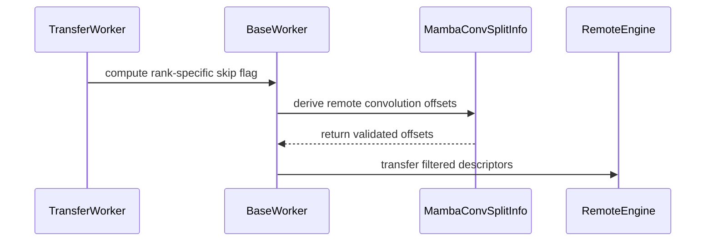

# fix: fix Heterogeneous TP bug of Mamba2 conv state

[Upstream PR](https://github.com/vllm-project/vllm/pull/55306) · state: open · merged: False

## Original PR description


## Purpose

Fixes #55208.

NIXL currently scales every Mamba2 convolution projection by the TP ratio. With `n_groups=1`, B/C are replicated across ranks while x is sharded. For Falcon-H1-0.5B-Base with P TP=1 and D TP=2, this makes one rank read C as B and both ranks read temporal state as C, even though the NIXL transfers succeeded.

This PR **derives remote projection boundaries from the advertised convolution size**, **preserves replicated B/C during reverse gathers**, and **selects one B/C writer per destination in both pull and push modes**. It also validates projection bounds and temporal-state sizes. Uniformly sharded Mamba1, Mamba2 and GDN layouts retain their existing transfer semantics.

Duplicate-work check: reviewed the issue comments and searched open PRs for `55208 in:body` and `Mamba conv heterogeneous`. No open PR addressing this NIXL fix was found. Related Mooncake and MoRIIO work targets different connectors.

**AI assistance** was used for implementation, test development, experiments and this description.


## Test Plan

Regression coverage includes replicated B/C offsets in both TP directions, local gather slices, single-writer selection for pull/push, descriptor filtering, incompatible layouts and engine cleanup.

```bash
.venv/bin/python -m pytest \
  tests/v1/kv_connector/unit/test_tp_mapping.py \
  tests/v1/kv_connector/unit/test_nixl_connector_hma.py \
  -q -k 'not fewer_blocks_with_hma'

.venv/bin/python -m pytest \
  tests/v1/kv_connector/unit/test_nixl_push_connector.py -q
```

Project pre-commit hooks `ruff-check`, `ruff-format` and `mypy-3.12` (manual stage) were run on the modified files, along with `git diff --check`.

Real-model validation used **Falcon-H1-0.5B-Base** on **4 × RTX 5090** with BF16, greedy decoding, seed 42 and 64 generated tokens. Each configuration ran 20 fixed prompts twice, including attention block-boundary lengths. P1D2, P2D1, P1D1 and P2D2 used real NIXL pull transfers and were compared with the unmodified baseline. Push was validated with unit tests only.


## Test Result

- TP mapping and HMA tests: **119 passed, 1 deselected**. The excluded integration test requires an additional Gemma model.
- Push connector tests: **44 passed**.
- Ruff check, Ruff format, mypy and `git diff --check`: **passed**.

P/D denote prefill/decode TP sizes. Counts below are unequal generated token sequences out of 40 requests, not task error rates.

| Comparison | Before | After |
|---|---:|---:|
| P1D2 vs ordinary TP2 | 6/40 | **0/40** |
| P1D2 vs P2D2 | 4/40 | 2/40 |
| P2D1 vs ordinary TP1 | 4/40 | 4/40 |
| P2D1 vs P1D1 | 6/40 | 2/40 |

P1D1 and P2D2 each retained identical token sequences before and after the change. All repeated runs were deterministic, and all four patched configurations reported zero transfer or notification failures.

The remaining P1D2/P2D2 difference is the prompt where the homogeneous baseline already differs from ordinary inference. P2D1 still differs from P1D1 on one prompt in both repetitions; that residual difference has not been independently attributed. These results establish the P1D2 correction, not full generation equivalence across all TP configurations or benchmark accuracy.

Environment limitation: Python source was based on `d6bce42983bc0b2095ad6422dbf1399e219ae572`, with CUDA 12.9 precompiled extensions from `27a94d1ce4e3fc100c4732439ccec10f8246a804` because of driver compatibility. All before/after comparisons used the same binaries. This was not a full source build of the target commit. The full test dependency installation was blocked by an unrelated `arctic-inference` Torch requirement; focused test dependencies were installed with uv instead.

The tests could be compressed if reviewers think they are superfluous and not that necessary.

PTAL.

---

- [x] Purpose and linked issue included.
- [x] Test commands and results included.
- [x] Model evaluation results and limitations included.
- [x] Duplicate-work check and AI assistance disclosed.
- [x] Human submitter has reviewed every changed line, run the relevant tests and can explain the change end-to-end.


## Review and discussion

### reviews

- claude[bot] · COMMENTED · 2026-09-04T08:43:01Z · [source](https://github.com/vllm-project/vllm/pull/55306#pullrequestreview-5110937525)

## Claude Code Review

This pull request is from a fork — automated review is disabled. A repository maintainer can comment `@claude review` to run a one-time review.

### issue_comments

- coderabbitai[bot] · comment · 2026-09-04T08:44:39Z · [source](https://github.com/vllm-project/vllm/pull/55306#issuecomment-5537994685)

<!-- This is an auto-generated comment: summarize by coderabbit.ai -->
<!-- review_stack_entry_start -->

[](https://app.coderabbit.ai/change-stack/vllm-project/vllm/pull/55306)

<!-- review_stack_entry_end -->
<!-- recent_review_start -->

No actionable comments were generated in the recent review. 🎉

<details>
<summary>ℹ️ Recent review info</summary>

<details>
<summary>⚙️ Run configuration</summary>

**Configuration used**: Repository UI

**Review profile**: CHILL

**Plan**: Team

**Run ID**: `4383f2c3-17da-450a-9958-63ec9f38a02d`

</details>

<details>
<summary>📥 Commits</summary>

Reviewing files that changed from the base of the PR and between 9cd956c7e6cf54efa366b803cafa15ec6c2df827 and c7cb19afdba80046d21faefa6f1937fc74c5b174.

</details>

<details>
<summary>📒 Files selected for processing (8)</summary>

* `tests/v1/kv_connector/unit/test_nixl_connector_hma.py`
* `tests/v1/kv_connector/unit/test_nixl_desc_geometry.py`
* `tests/v1/kv_connector/unit/test_nixl_push_connector.py`
* `tests/v1/kv_connector/unit/test_tp_mapping.py`
* `vllm/distributed/kv_transfer/kv_connector/v1/nixl/base_worker.py`
* `vllm/distributed/kv_transfer/kv_connector/v1/nixl/pull_worker.py`
* `vllm/distributed/kv_transfer/kv_connector/v1/nixl/push_worker.py`
* `vllm/distributed/kv_transfer/kv_connector/v1/ssm_conv_transfer_utils.py`

</details>

**Included review availability:** Your plan provides up to 10 included reviews per hour; 9 remain after this review.

</details>

---


<!-- recent_review_end -->
<!-- walkthrough_start -->

<details>
<summary>📝 Summary</summary>

<!-- This is an auto-generated comment: release notes by coderabbit.ai -->

## Summary by CodeRabbit

- **Bug Fixes**
  - Improved Mamba2 KV-cache transfers across tensor-parallel configurations.
  - Correctly handles replicated convolution state during push and pull operations, preventing duplicate writes and preserving state consistency.
  - Added validation for incompatible remote convolution sizes and invalid rank offsets.
  - Improved support for heterogeneous state layouts and engine eviction cleanup.
- **Reliability**
  - Added safeguards to ensure temporal state dimensions and transfer descriptors match the expected parallel layout.

<!-- end of auto-generated comment: release notes by coderabbit.ai -->
## Walkthrough

The NIXL KV connector now handles replicated Mamba2 B/C convolution projections across heterogeneous tensor-parallel engines. It derives remote layouts, validates offsets, selects one writer for replicated regions, and scales related test geometry by tensor-parallel size.

### Changes

**Replicated Mamba2 convolution transfers**

|Layer / File(s)|Summary|
|---|---|
|**Remote convolution layout and offsets** <br> `vllm/distributed/kv_transfer/kv_connector/v1/ssm_conv_transfer_utils.py`, `tests/v1/kv_connector/unit/test_nixl_connector_hma.py`|`MambaConvSplitInfo` derives remote projection layouts, identifies replicated B/C projections, computes validated offsets, and stores the Mamba2 state size. Tests cover supported and invalid layouts.|
|**Worker replication state and descriptor planning** <br> `vllm/distributed/kv_transfer/kv_connector/v1/nixl/base_worker.py`|The worker tracks replicated layouts per engine, preserves replicated B/C descriptors, validates split sizes, selects one writer, and removes state during engine cleanup.|
|**Pull and push transfer integration** <br> `vllm/distributed/kv_transfer/kv_connector/v1/nixl/pull_worker.py`, `vllm/distributed/kv_transfer/kv_connector/v1/nixl/push_worker.py`, `tests/v1/kv_connector/unit/test_nixl_connector_hma.py`, `tests/v1/kv_connector/unit/test_tp_mapping.py`|Pull and push paths pass rank-specific skip flags to descriptor generation. Tests verify one writer per replicated B/C source and preserve whole B/C descriptors while splitting `x` and temporal-state descriptors.|
|**Geometry and lifecycle validation** <br> `tests/v1/kv_connector/unit/test_nixl_desc_geometry.py`, `tests/v1/kv_connector/unit/test_nixl_push_connector.py`|KDA state geometry and remote SSM sizes now scale with tensor-parallel size. Eviction tests verify cleanup of replicated-convolution state.|

**Estimated code review effort:** 3 (Moderate) | ~25 minutes

<!-- final_review_risk_start -->
**Merge Risk:** _⚪ Minimal_ · up to `c7cb1`
<!-- final_review_risk_coverage:{"sourceCommitId":"c7cb19afdba80046d21faefa6f1937fc74c5b174","coveredCommitId":"c7cb19afdba80046d21faefa6f1937fc74c5b174","kind":"reviewed"} -->

The heterogeneous Mamba2 transfer layout is validated and covered across pull, push, replicated descriptors, and cleanup paths. No unresolved merge-blocking risk remains.
<!-- final_review_risk_end -->

### Sequence Diagram(s)



</details>

<!-- walkthrough_end -->
<!-- pre_merge_checks_walkthrough_start -->

<details>
<summary>🚥 Pre-merge checks | ✅ 5</summary>

<details>
<summary>✅ Passed checks (5 passed)</summary>

|         Check name         | Status   | Explanation                                                                                                                                                                                               |
| :------------------------: | :------- | :-------------------------------------------------------------------------------------------------------------------------------------------------------------------------------------------------------- |
|         Title check        | ✅ Passed | The title clearly identifies the primary change: fixing the heterogeneous TP Mamba2 convolution-state bug.                                                                                                |
|      Description check     | ✅ Passed | The description is directly related to the changes. It explains the bug, the fix, validation, tests, and known limitations.                                                                               |
|     Linked Issues check    | ✅ Passed | The implementation addresses the requirements in [`#55208`] by deriving remote layouts from advertised sizes, preserving replicated B/C projections, selecting single writers, and validating incompatible… |
| Out of Scope Changes check | ✅ Passed | The production and test changes are within the scope of [`#55208`]. The added validation, transfer logic, cleanup, and regression coverage directly support the heterogeneous Mamba2 convolution-state fix… |
|     Docstring Coverage     | ✅ Passed | Docstring coverage is 89.66% which is sufficient. The required threshold is 80.00%. Docstring coverage is scoped to functions touched by this diff. Analyzed 29 functions across 8 files.                 |

</details>

</details>

<!-- pre_merge_checks_walkthrough_end -->
<!-- finishing_touch_checkbox_start -->

<details>
<summary>✨ Finishing Touches 💡 1</summary>

<!-- finishing_touch_suggestion:fix_ci -->
<details open>
<summary>🛠️ Fix failing CI checks 💡</summary>

- [ ] <!-- {"checkboxId": "6d21cfe8-ec3f-40e2-9222-b8318b64d3b0", "radioGroupId": "fix-ci-output-choice-group-unknown_comment_id"} -->   Create stacked PR
- [ ] <!-- {"checkboxId": "9f0d24fb-b419-4f01-baf0-8b26b6424f34", "radioGroupId": "fix-ci-output-choice-group-unknown_comment_id"} -->   Commit on current branch

</details>

</details>

<!-- finishing_touch_checkbox_end -->
<!-- tips_start -->

---

Thanks for using [CodeRabbit](https://coderabbit.ai?utm_source=oss&utm_medium=github&utm_campaign=vllm-project/vllm&utm_content=55306)! It's free for OSS, and your support helps us grow. If you like it, consider giving us a shout-out.

<details>
<summary>❤️ Share</summary>

- [X](https://twitter.com/intent/tweet?text=I%20just%20used%20%40coderabbitai%20for%20my%20code%20review%2C%20and%20it%27s%20fantastic%21%20It%27s%20free%20for%20OSS%20and%20offers%20a%20free%20trial%20for%20the%20proprietary%20code.%20Check%20it%20out%3A&url=https%3A//coderabbit.ai)
- [Mastodon](https://mastodon.social/share?text=I%20just%20used%20%40coderabbitai%20for%20my%20code%20review%2C%20and%20it%27s%20fantastic%21%20It%27s%20free%20for%20OSS%20and%20offers%20a%20free%20trial%20for%20the%20proprietary%20code.%20Check%20it%20out%3A%20https%3A%2F%2Fcoderabbit.ai)
- [Reddit](https://www.reddit.com/submit?title=Great%20tool%20for%20code%20review%20-%20CodeRabbit&text=I%20just%20used%20CodeRabbit%20for%20my%20code%20review%2C%20and%20it%27s%20fantastic%21%20It%27s%20free%20for%20OSS%20and%20offers%20a%20free%20trial%20for%20proprietary%20code.%20Check%20it%20out%3A%20https%3A//coderabbit.ai)
- [LinkedIn](https://www.linkedin.com/sharing/share-offsite/?url=https%3A%2F%2Fcoderabbit.ai&mini=true&title=Great%20tool%20for%20code%20review%20-%20CodeRabbit&summary=I%20just%20used%20CodeRabbit%20for%20my%20code%20review%2C%20and%20it%27s%20fantastic%21%20It%27s%20free%20for%20OSS%20and%20offers%20a%20free%20trial%20for%20proprietary%20code)

</details>


<sub>Comment `@coderabbitai help` to get the list of available commands.</sub>

<!-- tips_end -->

- mergify[bot] · comment · 2026-09-08T23:46:32Z · [source](https://github.com/vllm-project/vllm/pull/55306#issuecomment-5593509703)

This pull request has merge conflicts that must be resolved before it can be
merged. Please rebase the PR, @Alchuang22-dev.

https://docs.github.com/en/pull-requests/collaborating-with-pull-requests/working-with-forks/syncing-a-fork


- mergify[bot] · comment · 2026-09-12T06:20:02Z · [source](https://github.com/vllm-project/vllm/pull/55306#issuecomment-5644149610)

This pull request has merge conflicts that must be resolved before it can be
merged. Please rebase the PR, @Alchuang22-dev.

https://docs.github.com/en/pull-requests/collaborating-with-pull-requests/working-with-forks/syncing-a-fork


- mergify[bot] · comment · 2026-09-25T00:44:11Z · [source](https://github.com/vllm-project/vllm/pull/55306#issuecomment-5824724633)

This pull request has merge conflicts that must be resolved before it can be
merged. Please rebase the PR, @Alchuang22-dev.

https://docs.github.com/en/pull-requests/collaborating-with-pull-requests/working-with-forks/syncing-a-fork


### inline_comments

## Changed files and fixed code

- `tests/v1/kv_connector/unit/test_nixl_connector_hma.py` · modified · additions 59 / deletions 2
  - [head](https://github.com/Alchuang22-dev/vllm/blob/9c3855cdaed9b6ac63022862acb4716a8857134e/tests/v1/kv_connector/unit/test_nixl_connector_hma.py)
  - [base](https://github.com/vllm-project/vllm/blob/03f83013872015f6addb66954e2752d2d9bccd96/tests/v1/kv_connector/unit/test_nixl_connector_hma.py)
- `tests/v1/kv_connector/unit/test_nixl_desc_geometry.py` · modified · additions 8 / deletions 5
  - [head](https://github.com/Alchuang22-dev/vllm/blob/9c3855cdaed9b6ac63022862acb4716a8857134e/tests/v1/kv_connector/unit/test_nixl_desc_geometry.py)
  - [base](https://github.com/vllm-project/vllm/blob/03f83013872015f6addb66954e2752d2d9bccd96/tests/v1/kv_connector/unit/test_nixl_desc_geometry.py)
- `tests/v1/kv_connector/unit/test_nixl_push_connector.py` · modified · additions 3 / deletions 0
  - [head](https://github.com/Alchuang22-dev/vllm/blob/9c3855cdaed9b6ac63022862acb4716a8857134e/tests/v1/kv_connector/unit/test_nixl_push_connector.py)
  - [base](https://github.com/vllm-project/vllm/blob/03f83013872015f6addb66954e2752d2d9bccd96/tests/v1/kv_connector/unit/test_nixl_push_connector.py)
- `tests/v1/kv_connector/unit/test_tp_mapping.py` · modified · additions 76 / deletions 0
  - [head](https://github.com/Alchuang22-dev/vllm/blob/9c3855cdaed9b6ac63022862acb4716a8857134e/tests/v1/kv_connector/unit/test_tp_mapping.py)
  - [base](https://github.com/vllm-project/vllm/blob/03f83013872015f6addb66954e2752d2d9bccd96/tests/v1/kv_connector/unit/test_tp_mapping.py)
- `vllm/distributed/kv_transfer/kv_connector/v1/nixl/base_worker.py` · modified · additions 61 / deletions 5
  - [head](https://github.com/Alchuang22-dev/vllm/blob/9c3855cdaed9b6ac63022862acb4716a8857134e/vllm/distributed/kv_transfer/kv_connector/v1/nixl/base_worker.py)
  - [base](https://github.com/vllm-project/vllm/blob/03f83013872015f6addb66954e2752d2d9bccd96/vllm/distributed/kv_transfer/kv_connector/v1/nixl/base_worker.py)
- `vllm/distributed/kv_transfer/kv_connector/v1/nixl/pull_worker.py` · modified · additions 5 / deletions 0
  - [head](https://github.com/Alchuang22-dev/vllm/blob/9c3855cdaed9b6ac63022862acb4716a8857134e/vllm/distributed/kv_transfer/kv_connector/v1/nixl/pull_worker.py)
  - [base](https://github.com/vllm-project/vllm/blob/03f83013872015f6addb66954e2752d2d9bccd96/vllm/distributed/kv_transfer/kv_connector/v1/nixl/pull_worker.py)
- `vllm/distributed/kv_transfer/kv_connector/v1/nixl/push_worker.py` · modified · additions 5 / deletions 0
  - [head](https://github.com/Alchuang22-dev/vllm/blob/9c3855cdaed9b6ac63022862acb4716a8857134e/vllm/distributed/kv_transfer/kv_connector/v1/nixl/push_worker.py)
  - [base](https://github.com/vllm-project/vllm/blob/03f83013872015f6addb66954e2752d2d9bccd96/vllm/distributed/kv_transfer/kv_connector/v1/nixl/push_worker.py)
- `vllm/distributed/kv_transfer/kv_connector/v1/ssm_conv_transfer_utils.py` · modified · additions 63 / deletions 18
  - [head](https://github.com/Alchuang22-dev/vllm/blob/9c3855cdaed9b6ac63022862acb4716a8857134e/vllm/distributed/kv_transfer/kv_connector/v1/ssm_conv_transfer_utils.py)
  - [base](https://github.com/vllm-project/vllm/blob/03f83013872015f6addb66954e2752d2d9bccd96/vllm/distributed/kv_transfer/kv_connector/v1/ssm_conv_transfer_utils.py)

## Evidence and interpretation boundary

[Original JSON, discussions and patches](../../../../../../evidence/prs/vllm-project--vllm/55306-2a987cb26b24f930aff99f1dbac96168a24c9a5b5e2628be05309e5587bc81ae.json) · SHA-256 `2a987cb26b24f930aff99f1dbac96168a24c9a5b5e2628be05309e5587bc81ae`.

Diff complete: True. Missing/binary/truncated patches require pinned source inspection. This is a source page, not an independently verified optimization case. Open, merged and released are different states; recheck the deployed dependency.
