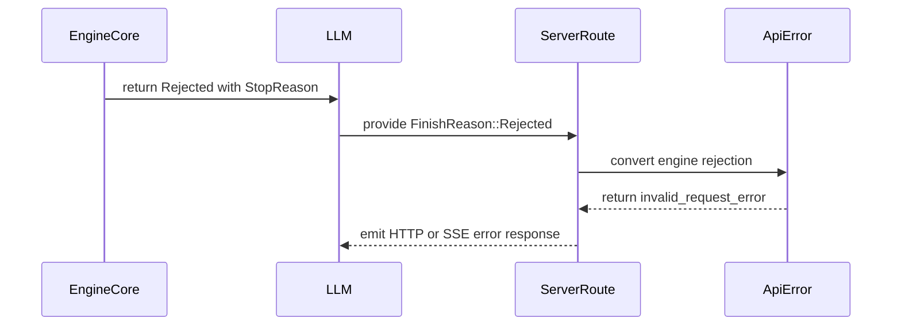

# [Rust Frontend] Report engine errors on completion streams that request logprobs

[Upstream PR](https://github.com/vllm-project/vllm/pull/55399) · state: open · merged: False

## Original PR description

## Purpose

Since #62872 the Rust frontend answers an engine `validation_error` with 400 and a retryable engine error with 503. A `/v1/completions` stream that requests `logprobs` still hides both. When the engine finishes the request with an error, the stream looks for generated logprobs first and sends `completion stream requested logprobs but generation returned none` as an internal server error in place of the engine's error. Since #64220 an echoed stream reads its prompt logprobs when it starts, so with or without generation it sends `echoed completion prompt requested logprobs but generation returned none` instead.

This PR checks the terminal finish reason before it asks for logprobs, so the stream reports the engine's error. An echoed stream holds a missing prompt logprobs error until the request finishes, reports the engine's error when there is one, and still fails as before when the request finishes normally without prompt logprobs.

It also stops the engine client from logging a validation error at error level as an engine failure, as it already does for retryable errors, and drops "internal" from the `FinishReason::Error` doc, since the error can now be the client's.

An earlier version of this PR added the 400 mapping itself, which #62872 has since landed, so this version keeps only the stream fix. It also turned an untyped engine error on non streaming `/inference/v1/generate` into a 500; #62872 keeps that as finish reason `error`, like Python, and this version leaves it so.

AI assistance was used for this change. The submitter reviewed every changed line and ran the tests below.

## Test Plan

```
cd rust
cargo fmt --all --check
cargo clippy -p vllm-server -p vllm-engine-core-client -p vllm-llm --all-targets -- -D warnings
cargo test --no-fail-fast -p vllm-server -p vllm-llm -p vllm-engine-core-client
```

`engine_request_errors_map_to_http_status` gains three completion streams that request logprobs, a plain one, an echoed one and a prompt only one, so both the retryable and the validation error run through them. `completion_chunk_stream_rejects_missing_prompt_logprobs` covers a prompt only stream that finishes normally without prompt logprobs.

## Test Result

| Completion stream with `logprobs` that the engine ends with an error | main | this PR |
| --- | --- | --- |
| plain stream | `InternalServerError`: `completion stream requested logprobs but generation returned none` | the engine's error: 503 for a retryable one, 400 for a validation error, with its message |
| echoed stream, with or without generation | `InternalServerError`: `echoed completion prompt requested logprobs but generation returned none` | the engine's error, as above |

On main with only the new test cases, the route test fails on the first of them:

```
/v1/completions {"model":"Qwen/Qwen1.5-0.5B-Chat","prompt":"hello","logprobs":1,"stream":true}: data: {"error":{"message":"completion stream requested logprobs but generation returned none","type":"InternalServerError","param":null,"code":500}}
```

With the change, `cargo test` over the three crates passes 743 of 743, and `cargo clippy ... -D warnings` and `cargo fmt --all --check` are clean.


## Review and discussion

### reviews

- claude[bot] · COMMENTED · 2026-09-04T20:19:08Z · [source](https://github.com/vllm-project/vllm/pull/55399#pullrequestreview-5117458845)

## Claude Code Review

This pull request is from a fork — automated review is disabled. A repository maintainer can comment `@claude review` to run a one-time review.

### issue_comments

- coderabbitai[bot] · comment · 2026-09-04T20:20:02Z · [source](https://github.com/vllm-project/vllm/pull/55399#issuecomment-5546001598)

<!-- coderabbit-ai-generated:v1 -->

<!-- This is an auto-generated comment: summarize by coderabbit.ai -->
<!-- review_stack_entry_start -->

[](https://app.coderabbit.ai/change-stack/vllm-project/vllm/pull/55399)

<!-- review_stack_entry_end -->
<!-- recent_review_start -->

No actionable comments were generated in the recent review.

<details>
<summary><strong>ℹ️ Recent review info</strong></summary>
<dl>
<dd>

<details>
<summary><strong>⚙️ Run configuration</strong></summary>
<dl>
<dd>

**Configuration used**: Repository UI

**Review profile**: CHILL

**Plan**: Team

**Run ID**: `5b0c2809-a571-4db9-bee2-2f006cc8a677`

</dd>
</dl>
</details>

<details>
<summary><strong>📥 Commits</strong></summary>
<dl>
<dd>

Reviewing files that changed from the base of the PR and between c81ace18596f75660bbc04efc2075a5f17a76791 and 6820f741255ec35212e2caf72cb357be5b4e9a6b.

</dd>
</dl>
</details>

<details>
<summary><strong>📒 Files selected for processing (11)</strong></summary>
<dl>
<dd>

* `rust/src/engine-core-client/src/client/stream.rs`
* `rust/src/engine-core-client/src/protocol/output.rs`
* `rust/src/engine-core-client/src/tests/python_compat.py`
* `rust/src/llm/src/output.rs`
* `rust/src/server/src/error.rs`
* `rust/src/server/src/grpc/convert.rs`
* `rust/src/server/src/routes/inference/generate.rs`
* `rust/src/server/src/routes/openai/chat_completions.rs`
* `rust/src/server/src/routes/openai/completions.rs`
* `rust/src/server/src/routes/tests.rs`
* `vllm/v1/engine/__init__.py`

</dd>
</dl>
</details>

**Included review availability:** Your plan provides up to 10 included reviews per hour; 9 remain after this review.

</dd>
</dl>
</details>


<!-- recent_review_end -->
<!-- walkthrough_start -->

### Walkthrough

The change adds a `Rejected` finish reason across engine, LLM, Python, and server APIs. Server routes convert rejected outputs into client errors, preserve streaming behavior, and add coverage for rejection and generic error responses.

### Changes

**Engine rejection handling**

|Layer / File(s)|Summary|
|:---|:---|
|**Finish reason contract** <br> `rust/src/engine-core-client/src/protocol/output.rs`, `rust/src/llm/src/output.rs`, `vllm/v1/engine/__init__.py`, `rust/src/engine-core-client/src/tests/python_compat.py`, `rust/src/engine-core-client/src/client/stream.rs`|Adds `Rejected = 5` and `Rejected(Option<StopReason>)`. The new reason maps to `"rejected"` and logs the engine stop reason when output completes.|
|**Server error mapping** <br> `rust/src/server/src/error.rs`, `rust/src/server/src/grpc/convert.rs`, `rust/src/server/src/routes/inference/generate.rs`, `rust/src/server/src/routes/openai/chat_completions.rs`|Adds engine rejection errors and maps rejected finishes in raw generation, chat, gRPC, and shared finish validation.|
|**Completion stream handling** <br> `rust/src/server/src/routes/openai/completions.rs`|Validates finish reasons before logprob access. Deferred prompt-only logprob errors are resolved after terminal finish validation.|
|**Rejection regression coverage** <br> `rust/src/server/src/routes/tests.rs`|Adds rejection fixtures and tests for raw generation, chat, completion, streaming responses, HTTP errors, SSE termination, and usage omission.|

**Estimated code review effort:** 3 (Moderate) | ~25 minutes


### Sequence Diagram(s)



Suggested reviewers: `reidliu41`

<!-- walkthrough_end -->
<details>
<summary><strong>Merge Risk:</strong> <strong><picture></picture> Minimal</strong> · up to <code>6820f</code></summary>
<dl>
<dd>

<!-- final_review_risk_start -->
<!-- final_review_risk_label
**Merge Risk:** _⚪ Minimal_ · up to `6820f`
-->
<!-- final_review_risk_coverage:{"sourceCommitId":"6820f741255ec35212e2caf72cb357be5b4e9a6b","coveredCommitId":"6820f741255ec35212e2caf72cb357be5b4e9a6b","kind":"reviewed"} -->

The rejection mapping is implemented consistently across the changed API paths, with no actionable merge-blocking issue identified.
<!-- final_review_risk_end -->

</dd>
</dl>
</details>
<!-- pre_merge_checks_walkthrough_start -->

<details>
<summary><strong>Pre-merge checks: <sup><picture></picture></sup> 4</strong></summary>
<dl>
<dd>

|         Check name         |                                             Status                                             | Explanation                                                                                                                                                                                               |
| :------------------------ | :--------------------------------------------------------------------------------------------: | :-------------------------------------------------------------------------------------------------------------------------------------------------------------------------------------------------------- |
|     Linked Issues check    |  | Check skipped because no linked issues were found for this pull request.                                                                                                                                  |
| Out of Scope Changes check |  | Check skipped because no linked issues were found for this pull request.                                                                                                                                  |
|         Title check        |  | The title accurately describes the logprobs stream error-handling changes, which are a significant part of the pull request, although it does not mention the broader rejected finish-reason support.     |
|      Description check     |  | The pull request description directly explains the logprobs error-handling changes, rejected finish reasons, HTTP error behavior, affected endpoints, tests, and validation results. It matches the chan… |

<details>
<summary><strong>Full details: Description check</strong></summary>
<dl>
<dd>

**Explanation**

The pull request description directly explains the logprobs error-handling changes, rejected finish reasons, HTTP error behavior, affected endpoints, tests, and validation results. It matches the changeset.

</dd>
</dl>
</details>

</dd>
</dl>
</details>

<!-- pre_merge_checks_walkthrough_end -->
<!-- finishing_touch_checkbox_start -->

<details>
<summary><strong>Finishing Touches</strong></summary>
<dl>
<dd>

<!-- finishing_touch_suggestion:fix_ci -->
<details open>
<summary><strong>Fix failing CI checks</strong></summary>
<dl>
<dd>

- [ ] <!-- {"checkboxId": "6d21cfe8-ec3f-40e2-9222-b8318b64d3b0", "radioGroupId": "fix-ci-output-choice-group-unknown_comment_id"} -->   Create stacked PR
- [ ] <!-- {"checkboxId": "9f0d24fb-b419-4f01-baf0-8b26b6424f34", "radioGroupId": "fix-ci-output-choice-group-unknown_comment_id"} -->   Commit on current branch

</dd>
</dl>
</details>

</dd>
</dl>
</details>

<!-- finishing_touch_checkbox_end -->
<!-- tips_start -->


Thanks for using [CodeRabbit](https://coderabbit.ai?utm_source=oss&utm_medium=github&utm_campaign=vllm-project/vllm&utm_content=55399)! It's free for OSS, and your support helps us grow. If you like it, consider giving us a shout-out.

<details>
<summary><strong>Share</strong></summary>
<dl>
<dd>

- [X](https://twitter.com/intent/tweet?text=I%20just%20used%20%40coderabbitai%20for%20my%20code%20review%2C%20and%20it%27s%20fantastic%21%20It%27s%20free%20for%20OSS%20and%20offers%20a%20free%20trial%20for%20the%20proprietary%20code.%20Check%20it%20out%3A&url=https%3A//coderabbit.ai)
- [Mastodon](https://mastodon.social/share?text=I%20just%20used%20%40coderabbitai%20for%20my%20code%20review%2C%20and%20it%27s%20fantastic%21%20It%27s%20free%20for%20OSS%20and%20offers%20a%20free%20trial%20for%20the%20proprietary%20code.%20Check%20it%20out%3A%20https%3A%2F%2Fcoderabbit.ai)
- [Reddit](https://www.reddit.com/submit?title=Great%20tool%20for%20code%20review%20-%20CodeRabbit&text=I%20just%20used%20CodeRabbit%20for%20my%20code%20review%2C%20and%20it%27s%20fantastic%21%20It%27s%20free%20for%20OSS%20and%20offers%20a%20free%20trial%20for%20proprietary%20code.%20Check%20it%20out%3A%20https%3A//coderabbit.ai)
- [LinkedIn](https://www.linkedin.com/sharing/share-offsite/?url=https%3A%2F%2Fcoderabbit.ai&mini=true&title=Great%20tool%20for%20code%20review%20-%20CodeRabbit&summary=I%20just%20used%20CodeRabbit%20for%20my%20code%20review%2C%20and%20it%27s%20fantastic%21%20It%27s%20free%20for%20OSS%20and%20offers%20a%20free%20trial%20for%20proprietary%20code)

</dd>
</dl>
</details>

<!-- tips_end -->

- BugenZhao · comment · 2026-09-07T17:22:11Z · [source](https://github.com/vllm-project/vllm/pull/55399#issuecomment-5573898952)

@codex review

- chatgpt-codex-connector[bot] · comment · 2026-09-07T17:22:28Z · [source](https://github.com/vllm-project/vllm/pull/55399#issuecomment-5573901271)

<!-- codex-pull-request-review-summary -->

## Codex Review Summary

This comment shows the latest Codex review activity on this pull request.

| Review | Status | Commit | Review trigger |
| --- | --- | --- | --- |
| 📝 **Code Review** | ✅ **Completed** <relative-time datetime="2026-09-07T17:25:59.721102Z">2026-09-07T17:25:59.721102Z</relative-time> | `6820f74` | Manual request |


<details> <summary>ℹ️ About Codex in GitHub</summary>
<br/>

[Your team has set up Codex to review pull requests in this repo](https://chatgpt.com/codex/cloud/settings/general). Reviews are triggered when you
- Open a pull request for review
- Mark a draft as ready
- Comment "@codex review" or "@codex security review".

Codex reacts with 👀 while any review is running, comments if it has suggestions, and reacts with 👍 once all reviews finish with no findings.

</details>

- chatgpt-codex-connector[bot] · comment · 2026-09-07T17:25:58Z · [source](https://github.com/vllm-project/vllm/pull/55399#issuecomment-5573929823)

Codex Review: Didn't find any major issues. Keep it up!

**Reviewed commit:** `6820f74125`

<details> <summary>ℹ️ About Codex in GitHub</summary>
<br/>

[Your team has set up Codex to review pull requests in this repo](https://chatgpt.com/codex/cloud/settings/general). Reviews are triggered when you
- Open a pull request for review
- Mark a draft as ready
- Comment "@codex review".

If Codex has suggestions, it will comment; otherwise it will react with 👍.


Codex can also answer questions or update the PR. Try commenting "@codex address that feedback".
            
</details>

- mergify[bot] · comment · 2026-09-12T01:39:35Z · [source](https://github.com/vllm-project/vllm/pull/55399#issuecomment-5642594681)

This pull request has merge conflicts that must be resolved before it can be
merged. Please rebase the PR, @FeathBow.

https://docs.github.com/en/pull-requests/collaborating-with-pull-requests/working-with-forks/syncing-a-fork


- mergify[bot] · comment · 2026-09-16T20:59:49Z · [source](https://github.com/vllm-project/vllm/pull/55399#issuecomment-5704430529)

This pull request has merge conflicts that must be resolved before it can be
merged. Please rebase the PR, @FeathBow.

https://docs.github.com/en/pull-requests/collaborating-with-pull-requests/working-with-forks/syncing-a-fork


- FeathBow · comment · 2026-09-16T21:19:13Z · [source](https://github.com/vllm-project/vllm/pull/55399#issuecomment-5704664211)

done

- mergify[bot] · comment · 2026-10-20T23:45:44Z · [source](https://github.com/vllm-project/vllm/pull/55399#issuecomment-6304351475)

This pull request has merge conflicts that must be resolved before it can be
merged. Please rebase the PR, @FeathBow.

https://docs.github.com/en/pull-requests/collaborating-with-pull-requests/working-with-forks/syncing-a-fork


- mergify[bot] · comment · 2026-10-21T14:17:07Z · [source](https://github.com/vllm-project/vllm/pull/55399#issuecomment-6318320945)

Documentation preview: https://vllm--55399.org.readthedocs.build/en/55399/

- mergify[bot] · comment · 2026-10-22T06:34:51Z · [source](https://github.com/vllm-project/vllm/pull/55399#issuecomment-6334418565)

This pull request has merge conflicts that must be resolved before it can be
merged. Please rebase the PR, @FeathBow.

https://docs.github.com/en/pull-requests/collaborating-with-pull-requests/working-with-forks/syncing-a-fork


- mergify[bot] · comment · 2026-10-27T08:03:46Z · [source](https://github.com/vllm-project/vllm/pull/55399#issuecomment-6436762751)

This pull request has merge conflicts that must be resolved before it can be
merged. Please rebase the PR, @FeathBow.

https://docs.github.com/en/pull-requests/collaborating-with-pull-requests/working-with-forks/syncing-a-fork


- mergify[bot] · comment · 2026-10-30T09:34:55Z · [source](https://github.com/vllm-project/vllm/pull/55399#issuecomment-6519592928)

This pull request has merge conflicts that must be resolved before it can be
merged. Please rebase the PR, @FeathBow.

https://docs.github.com/en/pull-requests/collaborating-with-pull-requests/working-with-forks/syncing-a-fork


### inline_comments

## Changed files and fixed code

- `rust/src/engine-core-client/src/client/stream.rs` · modified · additions 4 / deletions 2
  - [head](https://github.com/FeathBow/vllm/blob/af341ef04f78878581d98f1065b11073f39314fb/rust/src/engine-core-client/src/client/stream.rs)
  - [base](https://github.com/vllm-project/vllm/blob/8530a778f78dc7cd9a31e108ebc035c4b27ceb3c/rust/src/engine-core-client/src/client/stream.rs)
- `rust/src/llm/src/output.rs` · modified · additions 1 / deletions 1
  - [head](https://github.com/FeathBow/vllm/blob/af341ef04f78878581d98f1065b11073f39314fb/rust/src/llm/src/output.rs)
  - [base](https://github.com/vllm-project/vllm/blob/8530a778f78dc7cd9a31e108ebc035c4b27ceb3c/rust/src/llm/src/output.rs)
- `rust/src/server/src/routes/openai/completions.rs` · modified · additions 66 / deletions 3
  - [head](https://github.com/FeathBow/vllm/blob/af341ef04f78878581d98f1065b11073f39314fb/rust/src/server/src/routes/openai/completions.rs)
  - [base](https://github.com/vllm-project/vllm/blob/8530a778f78dc7cd9a31e108ebc035c4b27ceb3c/rust/src/server/src/routes/openai/completions.rs)
- `rust/src/server/src/routes/tests.rs` · modified · additions 19 / deletions 0
  - [head](https://github.com/FeathBow/vllm/blob/af341ef04f78878581d98f1065b11073f39314fb/rust/src/server/src/routes/tests.rs)
  - [base](https://github.com/vllm-project/vllm/blob/8530a778f78dc7cd9a31e108ebc035c4b27ceb3c/rust/src/server/src/routes/tests.rs)

## Evidence and interpretation boundary

[Original JSON, discussions and patches](../../../../../../evidence/prs/vllm-project--vllm/55399-fc1cfd25fb248b761621b753b25dadc4ac51f2308bf43b4f3c12b11edc3837db.json) · SHA-256 `fc1cfd25fb248b761621b753b25dadc4ac51f2308bf43b4f3c12b11edc3837db`.

Diff complete: True. Missing/binary/truncated patches require pinned source inspection. This is a source page, not an independently verified optimization case. Open, merged and released are different states; recheck the deployed dependency.
