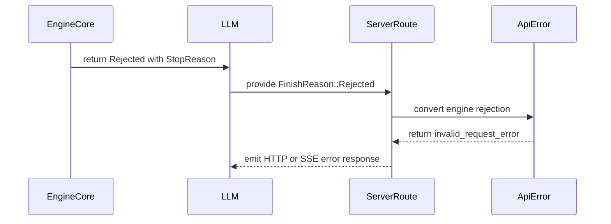

# [Core][Rust Frontend] Mark invalid requests in RequestError and return 400 with the engine's message

[Upstream PR](https://github.com/vllm-project/vllm/pull/55399) · state: open · merged: False

## Original PR description

## Purpose

An engine can refuse a request for a reason that lies with the client, such as a prompt it cannot hold or a sampling combination it does not serve. Since #51488 the engine core can send a `RequestError` with a failed request on `EngineCoreOutput.error`, and the frontends turn a retryable one into a 503. Every other `RequestError` becomes a 500, and the Rust frontend also replaces its message with `Internal server error`, so a client error that the engine finds reaches the user as a server error.

This PR adds `invalid_request: bool = False` to `RequestError`. When it is set, `RequestError.to_exception()` returns `VLLMValidationError`, so the Python frontends answer 400. The Rust frontend answers 400 `invalid_request_error` with the engine's message on `/v1/completions`, `/v1/chat/completions` and `/inference/v1/generate`, and gRPC answers `INVALID_ARGUMENT`. The flag wins over `retryable`, because sending the same request again cannot succeed. It defaults to false on both sides, so current producers and decoders behave as before. The engine core does not set it in this PR.

Two Rust paths hid an engine error behind another answer and are fixed here.

- `/inference/v1/generate` without streaming only checked retryable errors, so any other engine error came back as HTTP 200 with `finish_reason: "error"`. It now runs the same check as the streaming path and returns 500, as the Python route does.
- A completion stream that requests logprobs failed with `completion stream requested logprobs but generation returned none` before it looked at the terminal error. It now reports the engine's error first, also for a stream that only echoes the prompt (`echo` with `max_tokens: 0`).

The earlier version of this PR added `FinishReason.REJECTED` for the same purpose. `RequestError` now carries the error as a typed field, so this version drops the new finish reason and builds on it.

AI assistance was used for this change. The submitter reviewed every changed line and ran the tests below.

## Test Plan

```
cd rust
cargo fmt --all --check
cargo clippy --workspace --all-targets -- -D warnings
cargo test --no-fail-fast -p vllm-server -p vllm-llm -p vllm-engine-core-client
cd ..
ruff check vllm/outputs.py tests/test_outputs.py rust/src/engine-core-client/src/tests/python_compat.py
ruff format --check vllm/outputs.py tests/test_outputs.py rust/src/engine-core-client/src/tests/python_compat.py
pytest tests/test_outputs.py
```

New tests:

- `invalid_request_engine_error_returns_bad_request` sends an error marked both invalid and retryable through completions, chat completions, raw generate and streamed raw generate.
- `engine_error_reaches_completion_streams_that_request_logprobs` covers a plain stream and an echo stream, both with `logprobs`.
- `other_engine_errors_return_internal_server_error` covers a bare error and a plain `RequestError` on the same four routes.
- `engine_errors_map_to_status_by_kind` and `invalid_request_engine_error_maps_to_invalid_argument` cover the mapping in `error.rs` and gRPC.
- `test_request_error_to_exception` covers the Python mapping.

`retryable_engine_error_returns_service_unavailable` now uses the same helper as the new route tests.

## Test Result

| Engine error | main | this PR |
| --- | --- | --- |
| `RequestError` marked as an invalid request, on the three HTTP routes | 500 `Internal server error` (503 when also retryable) | 400 `invalid_request_error` with the engine's message |
| Same, over gRPC | `INTERNAL` | `INVALID_ARGUMENT` with the engine's message |
| Same, in the Python frontends | `GenerationError`, 500 | `VLLMValidationError`, 400 |
| Any other engine error on `/inference/v1/generate` without streaming | 200 with `finish_reason: "error"` | 500 |
| Any engine error on a completion stream that requests logprobs | `server_error` event saying the generation returned no logprobs | the engine's error |

Each row was checked by removing that part of the change and running the new test. Without the raw generate fix:

```
assertion `left == right` failed: /inference/v1/generate {"model":"Qwen/Qwen1.5-0.5B-Chat","token_ids":[11,22],"stream":false,...}
  left: 200
 right: 500
```

Without the stream fix:

```
data: {"error":{"message":"completion stream requested logprobs but generation returned none","type":"server_error","param":null,"code":"server_error"}}
data: [DONE]
```

Without the 400 branch in `engine_error`, the route test gets 503 and the unit test gets 500 where 400 is expected. Without the 400 branch in `to_exception`, the two invalid cases of `test_request_error_to_exception` fail.

With the change, `cargo test` over the three crates passes 640 of 640, `cargo clippy --workspace --all-targets -- -D warnings` and `cargo fmt --check` are clean, ruff is clean on the three Python files, and `tests/test_outputs.py` passes 9 of 9.


## Review and discussion

### reviews

- claude[bot] · COMMENTED · 2026-09-04T20:19:08Z · [source](https://github.com/vllm-project/vllm/pull/55399#pullrequestreview-5117458845)

## Claude Code Review

This pull request is from a fork — automated review is disabled. A repository maintainer can comment `@claude review` to run a one-time review.

### issue_comments

- coderabbitai[bot] · comment · 2026-09-04T20:20:02Z · [source](https://github.com/vllm-project/vllm/pull/55399#issuecomment-5546001598)

<!-- This is an auto-generated comment: summarize by coderabbit.ai -->
<!-- review_stack_entry_start -->

[](https://app.coderabbit.ai/change-stack/vllm-project/vllm/pull/55399)

<!-- review_stack_entry_end -->
<!-- recent_review_start -->

No actionable comments were generated in the recent review. 🎉

<details>
<summary><strong>ℹ️ Recent review info</strong></summary>
<dl>
<dd>

<details>
<summary><strong>⚙️ Run configuration</strong></summary>
<dl>
<dd>

**Configuration used**: Repository UI

**Review profile**: CHILL

**Plan**: Team

**Run ID**: `5b0c2809-a571-4db9-bee2-2f006cc8a677`

</dd>
</dl>
</details>

<details>
<summary><strong>📥 Commits</strong></summary>
<dl>
<dd>

Reviewing files that changed from the base of the PR and between c81ace18596f75660bbc04efc2075a5f17a76791 and 6820f741255ec35212e2caf72cb357be5b4e9a6b.

</dd>
</dl>
</details>

<details>
<summary><strong>📒 Files selected for processing (11)</strong></summary>
<dl>
<dd>

* `rust/src/engine-core-client/src/client/stream.rs`
* `rust/src/engine-core-client/src/protocol/output.rs`
* `rust/src/engine-core-client/src/tests/python_compat.py`
* `rust/src/llm/src/output.rs`
* `rust/src/server/src/error.rs`
* `rust/src/server/src/grpc/convert.rs`
* `rust/src/server/src/routes/inference/generate.rs`
* `rust/src/server/src/routes/openai/chat_completions.rs`
* `rust/src/server/src/routes/openai/completions.rs`
* `rust/src/server/src/routes/tests.rs`
* `vllm/v1/engine/__init__.py`

</dd>
</dl>
</details>

**Included review availability:** Your plan provides up to 10 included reviews per hour; 9 remain after this review.

</dd>
</dl>
</details>


<!-- recent_review_end -->
<!-- walkthrough_start -->

### Walkthrough

The change adds a `Rejected` finish reason across engine, LLM, Python, and server APIs. Server routes convert rejected outputs into client errors, preserve streaming behavior, and add coverage for rejection and generic error responses.

### Changes

**Engine rejection handling**

|Layer / File(s)|Summary|
|:---|:---|
|**Finish reason contract** <br> `rust/src/engine-core-client/src/protocol/output.rs`, `rust/src/llm/src/output.rs`, `vllm/v1/engine/__init__.py`, `rust/src/engine-core-client/src/tests/python_compat.py`, `rust/src/engine-core-client/src/client/stream.rs`|Adds `Rejected = 5` and `Rejected(Option<StopReason>)`. The new reason maps to `"rejected"` and logs the engine stop reason when output completes.|
|**Server error mapping** <br> `rust/src/server/src/error.rs`, `rust/src/server/src/grpc/convert.rs`, `rust/src/server/src/routes/inference/generate.rs`, `rust/src/server/src/routes/openai/chat_completions.rs`|Adds engine rejection errors and maps rejected finishes in raw generation, chat, gRPC, and shared finish validation.|
|**Completion stream handling** <br> `rust/src/server/src/routes/openai/completions.rs`|Validates finish reasons before logprob access. Deferred prompt-only logprob errors are resolved after terminal finish validation.|
|**Rejection regression coverage** <br> `rust/src/server/src/routes/tests.rs`|Adds rejection fixtures and tests for raw generation, chat, completion, streaming responses, HTTP errors, SSE termination, and usage omission.|

**Estimated code review effort:** 3 (Moderate) | ~25 minutes


### Sequence Diagram(s)



Suggested reviewers: `reidliu41`

<!-- walkthrough_end -->
<details>
<summary><strong>Merge Risk:</strong> <strong>⚪ Minimal</strong> · up to <code>6820f</code></summary>
<dl>
<dd>

<!-- final_review_risk_start -->
<!-- final_review_risk_label
**Merge Risk:** _⚪ Minimal_ · up to `6820f`
-->
<!-- final_review_risk_coverage:{"sourceCommitId":"6820f741255ec35212e2caf72cb357be5b4e9a6b","coveredCommitId":"6820f741255ec35212e2caf72cb357be5b4e9a6b","kind":"reviewed"} -->

The rejection mapping is implemented consistently across the changed API paths, with no actionable merge-blocking issue identified.
<!-- final_review_risk_end -->

</dd>
</dl>
</details>
<!-- pre_merge_checks_walkthrough_start -->

<details>
<summary><strong>Pre-merge checks: <sup><picture></picture></sup> 4 · <sup><picture></picture></sup> 1</strong></summary>
<dl>
<dd>

<strong><sup><picture></picture></sup> Failed checks: 1 warning</strong>

|     Check name     |                                              Status                                              | Explanation                                                                                                                                                                                  | Resolution                                                                         |
| :---------------- | :----------------------------------------------------------------------------------------------: | :------------------------------------------------------------------------------------------------------------------------------------------------------------------------------------------- | :--------------------------------------------------------------------------------- |
| Docstring Coverage |  | Docstring coverage is 46.67% which is insufficient. The required threshold is 80.00%. Docstring coverage is scoped to functions touched by this diff. Analyzed 30 functions across 11 files. | Write docstrings for the functions missing them to satisfy the coverage threshold. |

<details>
<summary><strong><sup><picture></picture></sup> Passed checks: 4 passed</strong></summary>
<dl>
<dd>

|         Check name         |                                             Status                                             | Explanation                                                                                                                                                                                               |
| :------------------------ | :--------------------------------------------------------------------------------------------: | :-------------------------------------------------------------------------------------------------------------------------------------------------------------------------------------------------------- |
|     Linked Issues check    |  | Check skipped because no linked issues were found for this pull request.                                                                                                                                  |
| Out of Scope Changes check |  | Check skipped because no linked issues were found for this pull request.                                                                                                                                  |
|         Title check        |  | The title accurately describes returning engine-rejected requests as HTTP 400 responses with the engine message. The RequestError wording is not directly reflected in the summarized file changes, but … |
|      Description check     |  | The description directly explains the invalid-request handling, HTTP 400 responses, engine error propagation, logprobs behavior, and test coverage. It is related to the changeset.                       |

<details>
<summary><strong>Full details: Title check</strong></summary>
<dl>
<dd>

**Explanation**

The title accurately describes returning engine-rejected requests as HTTP 400 responses with the engine message. The RequestError wording is not directly reflected in the summarized file changes, but the title remains related to the main behavior.

</dd>
</dl>
</details>

</dd>
</dl>
</details>

</dd>
</dl>
</details>

<!-- pre_merge_checks_walkthrough_end -->
<!-- finishing_touch_checkbox_start -->

<details>
<summary><strong>✨ Finishing Touches 💡 1</strong></summary>
<dl>
<dd>

<!-- finishing_touch_suggestion:fix_ci -->
<details open>
<summary><strong>🛠️ Fix failing CI checks 💡</strong></summary>
<dl>
<dd>

- [ ] <!-- {"checkboxId": "6d21cfe8-ec3f-40e2-9222-b8318b64d3b0", "radioGroupId": "fix-ci-output-choice-group-unknown_comment_id"} -->   Create stacked PR
- [ ] <!-- {"checkboxId": "9f0d24fb-b419-4f01-baf0-8b26b6424f34", "radioGroupId": "fix-ci-output-choice-group-unknown_comment_id"} -->   Commit on current branch

</dd>
</dl>
</details>

</dd>
</dl>
</details>

<!-- finishing_touch_checkbox_end -->
<!-- tips_start -->


Thanks for using [CodeRabbit](https://coderabbit.ai?utm_source=oss&utm_medium=github&utm_campaign=vllm-project/vllm&utm_content=55399)! It's free for OSS, and your support helps us grow. If you like it, consider giving us a shout-out.

<details>
<summary><strong>❤️ Share</strong></summary>
<dl>
<dd>

- [X](https://twitter.com/intent/tweet?text=I%20just%20used%20%40coderabbitai%20for%20my%20code%20review%2C%20and%20it%27s%20fantastic%21%20It%27s%20free%20for%20OSS%20and%20offers%20a%20free%20trial%20for%20the%20proprietary%20code.%20Check%20it%20out%3A&url=https%3A//coderabbit.ai)
- [Mastodon](https://mastodon.social/share?text=I%20just%20used%20%40coderabbitai%20for%20my%20code%20review%2C%20and%20it%27s%20fantastic%21%20It%27s%20free%20for%20OSS%20and%20offers%20a%20free%20trial%20for%20the%20proprietary%20code.%20Check%20it%20out%3A%20https%3A%2F%2Fcoderabbit.ai)
- [Reddit](https://www.reddit.com/submit?title=Great%20tool%20for%20code%20review%20-%20CodeRabbit&text=I%20just%20used%20CodeRabbit%20for%20my%20code%20review%2C%20and%20it%27s%20fantastic%21%20It%27s%20free%20for%20OSS%20and%20offers%20a%20free%20trial%20for%20proprietary%20code.%20Check%20it%20out%3A%20https%3A//coderabbit.ai)
- [LinkedIn](https://www.linkedin.com/sharing/share-offsite/?url=https%3A%2F%2Fcoderabbit.ai&mini=true&title=Great%20tool%20for%20code%20review%20-%20CodeRabbit&summary=I%20just%20used%20CodeRabbit%20for%20my%20code%20review%2C%20and%20it%27s%20fantastic%21%20It%27s%20free%20for%20OSS%20and%20offers%20a%20free%20trial%20for%20proprietary%20code)

</dd>
</dl>
</details>


<sub>Comment `@coderabbitai help` to get the list of available commands.</sub>

<!-- tips_end -->

- BugenZhao · comment · 2026-09-07T17:22:11Z · [source](https://github.com/vllm-project/vllm/pull/55399#issuecomment-5573898952)

@codex review

- chatgpt-codex-connector[bot] · comment · 2026-09-07T17:22:28Z · [source](https://github.com/vllm-project/vllm/pull/55399#issuecomment-5573901271)

<!-- codex-pull-request-review-summary -->

## Codex Review Summary

This comment shows the latest Codex review activity on this pull request.

| Review | Status | Commit | Review trigger |
| --- | --- | --- | --- |
| 📝 **Code Review** | ✅ **Completed** <relative-time datetime="2026-09-07T17:25:59.721102Z">2026-09-07T17:25:59.721102Z</relative-time> | `6820f74` | Manual request |


<details> <summary>ℹ️ About Codex in GitHub</summary>
<br/>

[Your team has set up Codex to review pull requests in this repo](https://chatgpt.com/codex/cloud/settings/general). Reviews are triggered when you
- Open a pull request for review
- Mark a draft as ready
- Comment "@codex review" or "@codex security review".

Codex reacts with 👀 while any review is running, comments if it has suggestions, and reacts with 👍 once all reviews finish with no findings.

</details>

- chatgpt-codex-connector[bot] · comment · 2026-09-07T17:25:58Z · [source](https://github.com/vllm-project/vllm/pull/55399#issuecomment-5573929823)

Codex Review: Didn't find any major issues. Keep it up!

**Reviewed commit:** `6820f74125`

<details> <summary>ℹ️ About Codex in GitHub</summary>
<br/>

[Your team has set up Codex to review pull requests in this repo](https://chatgpt.com/codex/cloud/settings/general). Reviews are triggered when you
- Open a pull request for review
- Mark a draft as ready
- Comment "@codex review".

If Codex has suggestions, it will comment; otherwise it will react with 👍.


Codex can also answer questions or update the PR. Try commenting "@codex address that feedback".
            
</details>

- mergify[bot] · comment · 2026-09-12T01:39:35Z · [source](https://github.com/vllm-project/vllm/pull/55399#issuecomment-5642594681)

This pull request has merge conflicts that must be resolved before it can be
merged. Please rebase the PR, @FeathBow.

https://docs.github.com/en/pull-requests/collaborating-with-pull-requests/working-with-forks/syncing-a-fork


- mergify[bot] · comment · 2026-09-16T20:59:49Z · [source](https://github.com/vllm-project/vllm/pull/55399#issuecomment-5704430529)

This pull request has merge conflicts that must be resolved before it can be
merged. Please rebase the PR, @FeathBow.

https://docs.github.com/en/pull-requests/collaborating-with-pull-requests/working-with-forks/syncing-a-fork


- FeathBow · comment · 2026-09-16T21:19:13Z · [source](https://github.com/vllm-project/vllm/pull/55399#issuecomment-5704664211)

done

### inline_comments

## Changed files and fixed code

- `rust/src/engine-core-client/src/client/stream.rs` · modified · additions 6 / deletions 2
  - [head](https://github.com/FeathBow/vllm/blob/82c660f4f6f13ce8f1751ca6f8bb1533152217c8/rust/src/engine-core-client/src/client/stream.rs)
  - [base](https://github.com/vllm-project/vllm/blob/4bd75e952a9f423742223c97c8cc9fc6db362950/rust/src/engine-core-client/src/client/stream.rs)
- `rust/src/engine-core-client/src/protocol/output.rs` · modified · additions 4 / deletions 0
  - [head](https://github.com/FeathBow/vllm/blob/82c660f4f6f13ce8f1751ca6f8bb1533152217c8/rust/src/engine-core-client/src/protocol/output.rs)
  - [base](https://github.com/vllm-project/vllm/blob/4bd75e952a9f423742223c97c8cc9fc6db362950/rust/src/engine-core-client/src/protocol/output.rs)
- `rust/src/engine-core-client/src/tests/client.rs` · modified · additions 1 / deletions 0
  - [head](https://github.com/FeathBow/vllm/blob/82c660f4f6f13ce8f1751ca6f8bb1533152217c8/rust/src/engine-core-client/src/tests/client.rs)
  - [base](https://github.com/vllm-project/vllm/blob/4bd75e952a9f423742223c97c8cc9fc6db362950/rust/src/engine-core-client/src/tests/client.rs)
- `rust/src/engine-core-client/src/tests/python_compat.py` · modified · additions 1 / deletions 0
  - [head](https://github.com/FeathBow/vllm/blob/82c660f4f6f13ce8f1751ca6f8bb1533152217c8/rust/src/engine-core-client/src/tests/python_compat.py)
  - [base](https://github.com/vllm-project/vllm/blob/4bd75e952a9f423742223c97c8cc9fc6db362950/rust/src/engine-core-client/src/tests/python_compat.py)
- `rust/src/llm/src/output.rs` · modified · additions 2 / deletions 2
  - [head](https://github.com/FeathBow/vllm/blob/82c660f4f6f13ce8f1751ca6f8bb1533152217c8/rust/src/llm/src/output.rs)
  - [base](https://github.com/vllm-project/vllm/blob/4bd75e952a9f423742223c97c8cc9fc6db362950/rust/src/llm/src/output.rs)
- `rust/src/server/src/error.rs` · modified · additions 37 / deletions 2
  - [head](https://github.com/FeathBow/vllm/blob/82c660f4f6f13ce8f1751ca6f8bb1533152217c8/rust/src/server/src/error.rs)
  - [base](https://github.com/vllm-project/vllm/blob/4bd75e952a9f423742223c97c8cc9fc6db362950/rust/src/server/src/error.rs)
- `rust/src/server/src/grpc/convert.rs` · modified · additions 19 / deletions 0
  - [head](https://github.com/FeathBow/vllm/blob/82c660f4f6f13ce8f1751ca6f8bb1533152217c8/rust/src/server/src/grpc/convert.rs)
  - [base](https://github.com/vllm-project/vllm/blob/4bd75e952a9f423742223c97c8cc9fc6db362950/rust/src/server/src/grpc/convert.rs)
- `rust/src/server/src/routes/inference/generate.rs` · modified · additions 2 / deletions 4
  - [head](https://github.com/FeathBow/vllm/blob/82c660f4f6f13ce8f1751ca6f8bb1533152217c8/rust/src/server/src/routes/inference/generate.rs)
  - [base](https://github.com/vllm-project/vllm/blob/4bd75e952a9f423742223c97c8cc9fc6db362950/rust/src/server/src/routes/inference/generate.rs)
- `rust/src/server/src/routes/openai/completions.rs` · modified · additions 21 / deletions 2
  - [head](https://github.com/FeathBow/vllm/blob/82c660f4f6f13ce8f1751ca6f8bb1533152217c8/rust/src/server/src/routes/openai/completions.rs)
  - [base](https://github.com/vllm-project/vllm/blob/4bd75e952a9f423742223c97c8cc9fc6db362950/rust/src/server/src/routes/openai/completions.rs)
- `rust/src/server/src/routes/tests.rs` · modified · additions 166 / deletions 54
  - [head](https://github.com/FeathBow/vllm/blob/82c660f4f6f13ce8f1751ca6f8bb1533152217c8/rust/src/server/src/routes/tests.rs)
  - [base](https://github.com/vllm-project/vllm/blob/4bd75e952a9f423742223c97c8cc9fc6db362950/rust/src/server/src/routes/tests.rs)
- `tests/test_outputs.py` · modified · additions 29 / deletions 0
  - [head](https://github.com/FeathBow/vllm/blob/82c660f4f6f13ce8f1751ca6f8bb1533152217c8/tests/test_outputs.py)
  - [base](https://github.com/vllm-project/vllm/blob/4bd75e952a9f423742223c97c8cc9fc6db362950/tests/test_outputs.py)
- `vllm/outputs.py` · modified · additions 16 / deletions 3
  - [head](https://github.com/FeathBow/vllm/blob/82c660f4f6f13ce8f1751ca6f8bb1533152217c8/vllm/outputs.py)
  - [base](https://github.com/vllm-project/vllm/blob/4bd75e952a9f423742223c97c8cc9fc6db362950/vllm/outputs.py)

## Evidence and interpretation boundary

[Original JSON, discussions and patches](../../../../../../evidence/prs/vllm-project--vllm/55399-d7c8550dde0fa254e138eed824e254de6a89a3e16c4706ad39c8e415bd0a848b.json) · SHA-256 `d7c8550dde0fa254e138eed824e254de6a89a3e16c4706ad39c8e415bd0a848b`.

Diff complete: True. Missing/binary/truncated patches require pinned source inspection. This is a source page, not an independently verified optimization case. Open, merged and released are different states; recheck the deployed dependency.
