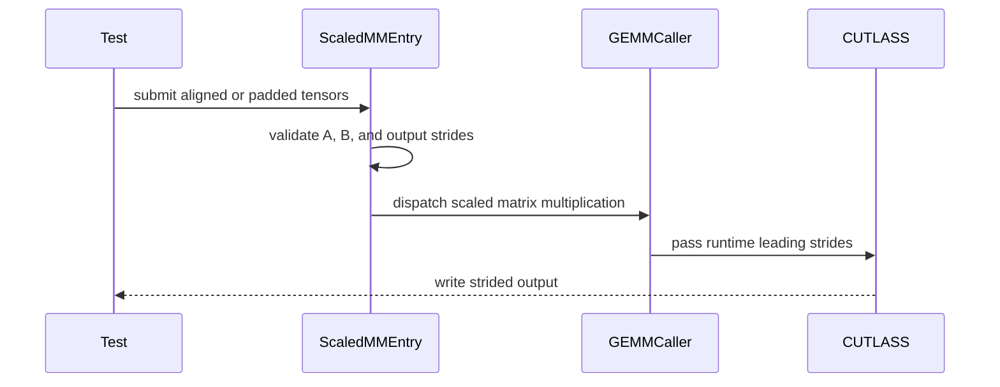

# [Kernel] Reject unsupported layouts in CUTLASS 3.x scaled_mm

[Upstream PR](https://github.com/vllm-project/vllm/pull/55537) · state: closed · merged: True

## Original PR description

## Overview

Reject unsupported padded operands and misaligned pointers before CUTLASS 3.x scaled-mm dispatch (#55534). Packed inputs and CUTLASS 2.x behavior remain unchanged.

## Claims

- Check A, B and output leading strides and 16-byte pointer alignment, preserving the size-one leading-dimension exception.
- Update the existing subset regression and select it alongside the existing FP8 tests in B200 CI; the revised diff is +34/-1 across three files, including tests and CI.

## Validation

```bash
.venv/bin/python -m pytest tests/kernels/quantization/test_cutlass_scaled_mm.py::test_cutlass_subset -v -s 
# main
E       AssertionError: Tensor-likes are not close!
E       
E       Mismatched elements: 159110 / 262144 (60.7%)
E       Greatest absolute difference: 9.75 at index (26, 44) (up to 1.0 allowed)
E       Greatest relative difference: inf at index (155, 233) (up to 0.1 allowed)

tests/kernels/quantization/test_cutlass_scaled_mm.py:592: AssertionError
=============================== warnings summary ===============================
.venv/lib/python3.12/site-packages/torch/jit/_script.py:365: 14 warnings
  /root/autodl-tmp/pr55537-validation-20261011/source/.venv/lib/python3.12/site-packages/torch/jit/_script.py:365: DeprecationWarning: `torch.jit.script_method` is deprecated. Please switch to `torch.compile` or `torch.export`.
    warnings.warn(

-- Docs: https://docs.pytest.org/en/stable/how-to/capture-warnings.html
=========================== short test summary info ============================
FAILED tests/kernels/quantization/test_cutlass_scaled_mm.py::test_cutlass_subset
======================== 1 failed, 14 warnings in 1.40s ========================
# Now
======================== 1 passed, 14 warnings in 1.10s ========================
```

This PR passes the repro by rejecting the padded input, not by supporting it. Reversing the change reproduced the main failure again; the main-repeat log is included.

Raw command/output logs, including **all nine benchmark runs**: [validation evidence](https://gist.github.com/jackLei0901/d7a0460bc0494577445e586c55e3e3ce).

H800 PCIe (SM90), torch 2.13.0+cu130. Main at `3e8e1364ff` was built from source, including its pinned FlashAttention. The H800 results below validate `5b18e7656c` on base `3e8e1364ff`, before the source-layout refactor in #60721. The subsequent main merge follows the source rename and updates its two include paths; the operand guard and existing subset regression are unchanged. The new layout has not been built or GPU-tested locally; CUDA CI will be the first build validation of this revision. Only the scaled-mm entry object and stable extension were rebuilt when switching between main and this change; every other native library stayed byte-identical.

Historical H800 validation passed 7 boundary cases (the existing subset case plus 6 dedicated cases), 36 packed/output-dtype/CUDA-graph cases, and 11 offline INT8/AZP/size-one/pointer cases. The six dedicated cases were removed from the committed tests at yewentao256's request; their raw logs remain in the linked gist. Every serving run logged `Selected CutlassFP8ScaledMMLinearKernel`. Only SM90 was tested locally. The B200 selector is now `-k 'fp8 or cutlass_subset'`: it retains the existing FP8 tests and adds the one existing subset regression. This CI result is pending.

<details>
<summary>Accuracy command and raw lm_eval output</summary>

The server command was the same on main and this PR:

```bash
vllm serve /root/autodl-tmp/models/Meta-Llama-3-8B-Instruct --served-model-name contract-fp8 --quantization fp8 --dtype bfloat16 --tensor-parallel-size 1 --max-model-len 8192 --gpu-memory-utilization 0.85 --seed 42 --host 127.0.0.1 --port 9256
```

```bash
.venv/bin/python -m lm_eval --model local-completions --model_args base_url=http://127.0.0.1:9256/v1/completions\,model=contract-fp8\,tokenizer=/root/autodl-tmp/models/Meta-Llama-3-8B-Instruct\,num_concurrent=64 --tasks gsm8k --num_fewshot 5 --gen_kwargs temperature=0\,max_gen_toks=512 --seed 42 --log_samples --output_path /root/autodl-tmp/pr55537-validation-20261011/results/main/accuracy 
# main
|Tasks|Version|     Filter     |n-shot|  Metric   |   |Value |   |Stderr|
|-----|------:|----------------|-----:|-----------|---|-----:|---|-----:|
|gsm8k|      3|flexible-extract|     5|exact_match|↑  |0.7475|±  | 0.012|
|     |       |strict-match    |     5|exact_match|↑  |0.7460|±  | 0.012|
# Now
|Tasks|Version|     Filter     |n-shot|  Metric   |   |Value |   |Stderr|
|-----|------:|----------------|-----:|-----------|---|-----:|---|-----:|
|gsm8k|      3|flexible-extract|     5|exact_match|↑  |0.7475|±  | 0.012|
|     |       |strict-match    |     5|exact_match|↑  |0.7460|±  | 0.012|
```

The output directory changed between main and this PR; all other evaluation arguments stayed fixed. All 1,319 GSM8K examples completed. The full sample JSONL files were byte-identical (SHA-256 `08078a7d51736f125add194b827000344c7c6fc5a1bef0a3ca21aa1cbbbc0e0d`); the large sample files are retained privately. The API harness used its default 2,047-token context limit.

</details>

<details>
<summary>Benchmark command and raw output from repetition 2</summary>

Three repetitions were run on main, then this PR, then main again. All nine command/output logs are included. The first repetition in each group was slower (about 3.0k output tok/s); later repetitions were 6.47-6.66k tok/s. The cause of this warm-state difference was not isolated. Corresponding repetition 2 outputs are shown here; these are not a speedup claim. Benchmark sampling temperature was not explicitly set.

```bash
.venv/bin/vllm bench serve --model /root/autodl-tmp/models/Meta-Llama-3-8B-Instruct --served-model-name contract-fp8 --dataset-name random --host 127.0.0.1 --port 9256 --random-input-len 1024 --random-output-len 128 --request-rate inf --num-prompts 128 --num-warmups 16 --seed 42 
# main (repetition 2)
============ Serving Benchmark Result ============
Successful requests:                     128       
Failed requests:                         0         
Benchmark duration (s):                  2.48      
Total input tokens:                      131072    
Total generated tokens:                  16384     
Request throughput (req/s):              51.69     
Output token throughput (tok/s):         6616.12   
Peak output token throughput (tok/s):    7552.00   
Peak concurrent requests:                128.00    
Total token throughput (tok/s):          59545.12  
---------------Time to First Token----------------
Mean TTFT (ms):                          264.56    
Median TTFT (ms):                        251.26    
P99 TTFT (ms):                           472.46    
-----Time per Output Token (excl. 1st token)------
Mean TPOT (ms):                          16.20     
Median TPOT (ms):                        16.24     
P99 TPOT (ms):                           16.44     
---------------Inter-token Latency----------------
Mean ITL (ms):                           16.20     
Median ITL (ms):                         16.88     
P99 ITL (ms):                            20.96     
==================================================
# Now (repetition 2)
============ Serving Benchmark Result ============
Successful requests:                     128       
Failed requests:                         0         
Benchmark duration (s):                  2.50      
Total input tokens:                      131072    
Total generated tokens:                  16384     
Request throughput (req/s):              51.22     
Output token throughput (tok/s):         6556.76   
Peak output token throughput (tok/s):    7552.00   
Peak concurrent requests:                128.00    
Total token throughput (tok/s):          59010.88  
---------------Time to First Token----------------
Mean TTFT (ms):                          281.78    
Median TTFT (ms):                        270.78    
P99 TTFT (ms):                           492.78    
-----Time per Output Token (excl. 1st token)------
Mean TPOT (ms):                          16.14     
Median TPOT (ms):                        16.18     
P99 TPOT (ms):                           16.36     
---------------Inter-token Latency----------------
Mean ITL (ms):                           16.14     
Median ITL (ms):                         16.95     
P99 ITL (ms):                            18.03     
==================================================
```

</details>

## Details

C3x callers reconstruct packed strides from shapes, so incompatible operands can silently address the wrong elements. This change rejects them at dispatch rather than adding stride support. No current in-tree serving caller requiring padded operands has been identified; the model runs check normal packed serving for regressions.

This revises the existing #55537, not a parallel fix. #56248 and #56659 remain open stride-support alternatives. The author closed #56480 on October 8 because its SM100 stride support conflicts with this shared reject-only contract; that is not a maintainer approval of this PR. The architecture-wide contract still needs agreement. INT8/AZP/size-one cases removed from the committed test matrix remain in the offline evidence; the implementation still checks those inputs.

AI assistance was used for diagnosis, patch preparation, validation and this description.

---

<details>
<summary> Pull Request Checklist </summary>

- [x] I used vLLM's `/pr-checklist` skill. (Mandatory for agents, optional for humans).
- [x] AI assistance was used during the creation of this PR.
- [x] **Design Fit:** Minimizes impact on core components, reuses existing functionality, and justifies added complexity.
- [x] **Testing and Validation:** Validates the change and ensures any added tests are meaningful and reliable, with CI coverage or documented CI resource constraints and validation performed outside CI.
- [x] **Code Quality and Style:** Keeps code and comments clear and concise, and updates relevant documentation and examples.
- [x] **Pull Request Contents:** Includes a brief summary and relevant links, supports claims with evidence, explains root causes and implementation trade-offs, and follows the contributing guide.

</details>

**BEFORE SUBMITTING, PLEASE READ <https://docs.vllm.ai/en/latest/contributing>** (anything written below this line will be removed by GitHub Actions)


## Review and discussion

### reviews

- claude[bot] · COMMENTED · 2026-09-06T05:08:37Z · [source](https://github.com/vllm-project/vllm/pull/55537#pullrequestreview-5124243163)

## Claude Code Review

This pull request is from a fork — automated review is disabled. A repository maintainer can comment `@claude review` to run a one-time review.

- liulanze · COMMENTED · 2026-09-07T21:14:24Z · [source](https://github.com/vllm-project/vllm/pull/55537#pullrequestreview-5135257912)

(No body; status only.)

- jackLei0901 · COMMENTED · 2026-09-08T06:16:14Z · [source](https://github.com/vllm-project/vllm/pull/55537#pullrequestreview-5138068786)

(No body; status only.)

- jackLei0901 · COMMENTED · 2026-09-08T06:16:30Z · [source](https://github.com/vllm-project/vllm/pull/55537#pullrequestreview-5138070423)

(No body; status only.)

- jackLei0901 · COMMENTED · 2026-09-08T06:16:46Z · [source](https://github.com/vllm-project/vllm/pull/55537#pullrequestreview-5138072076)

(No body; status only.)

- yewentao256 · COMMENTED · 2026-10-11T14:39:33Z · [source](https://github.com/vllm-project/vllm/pull/55537#pullrequestreview-5483700221)

Thanks for the work!

Please do the following:
- [ ] shrink the diff, idealy < 75 LOC including the tests
- [ ] full reproduce command line, error log in main and the same command line works in current PR
- [ ] e2e accuracy using `lm_eval`...
- [ ] e2e benchmark using `vllm bench serve...`

When doing reproduce / e2e test, please attach with raw output log in case some agents fake the data. **DO NOT use AI generated Table here**

For example:

```bash
pytest tests/v1/kv_connector/extract_hidden_states_integration/test_extraction.py::test_extract_hidden_states_tp2
# main
  | (EngineCore pid=1580)   File "/usr/local/lib/python3.12/dist-packages/vllm/v1/engine/core.py", line 1070, in __init__
  | (EngineCore pid=1580)     super().__init__(
  | (EngineCore pid=1580)   File "/usr/local/lib/python3.12/dist-packages/vllm/v1/engine/core.py", line 160, in __init__
  | (EngineCore pid=1580)     self.scheduler: SchedulerInterface = Scheduler(
  | (EngineCore pid=1580)                                          ^^^^^^^^^^
  | (EngineCore pid=1580)   File "/usr/local/lib/python3.12/dist-packages/vllm/v1/core/sched/async_scheduler.py", line 14, in __init__
  | (EngineCore pid=1580)     super().__init__(*args, **kwargs)
  | (EngineCore pid=1580)   File "/usr/local/lib/python3.12/dist-packages/vllm/v1/core/sched/scheduler.py", line 277, in __init__
  | (EngineCore pid=1580)     self.kv_cache_manager = KVCacheManager(
  | (EngineCore pid=1580)                             ^^^^^^^^^^^^^^^
  | (EngineCore pid=1580)   File "/usr/local/lib/python3.12/dist-packages/vllm/v1/core/kv_cache_manager.py", line 151, in __init__
  | (EngineCore pid=1580)     self.coordinator = get_kv_cache_coordinator(
  | (EngineCore pid=1580)                        ^^^^^^^^^^^^^^^^^^^^^^^^^
  | (EngineCore pid=1580)   File "/usr/local/lib/python3.12/dist-packages/vllm/v1/core/kv_cache_coordinator.py", line 891, in get_kv_cache_coordinator
  | (EngineCore pid=1580)     return HybridKVCacheCoordinator(
  | (EngineCore pid=1580)            ^^^^^^^^^^^^^^^^^^^^^^^^^
  | (EngineCore pid=1580)   File "/usr/local/lib/python3.12/dist-packages/vllm/v1/core/kv_cache_coordinator.py", line 563, in __init__
  | (EngineCore pid=1580)     assert all(
  | (EngineCore pid=1580)            ^^^^
  | (EngineCore pid=1580) AssertionError: Each KV cache group's real block_size must be divisible by hash_block_size. block_sizes=[544, 544, 544, 544, 181], hash_block_size=98464
  | FAILED
  | v1/kv_connector/extract_hidden_states_integration/test_extraction.py::test_extract_hidden_states_tp2

# Now
================= 1 passed, 23 warnings in 174.57s (0:02:54) ==================
```

```bash
"lm_eval --model local-completions --model_args "base_url=http://127.0.0.1:9256/v1/completions,model=$MODEL,num_concurrent=1024" --tasks gsm8k --trust_remote_code"

# Now
|Tasks|Version|     Filter     |n-shot|  Metric   |   |Value |   |Stderr|
|-----|------:|----------------|-----:|-----------|---|-----:|---|-----:|
|gsm8k|      3|flexible-extract|     5|exact_match|↑  |0.9212|±  |0.0074|
|     |       |strict-match    |     5|exact_match|↑  |0.9212|±  |0.0074|

# main
|Tasks|Version|     Filter     |n-shot|  Metric   |   |Value |   |Stderr|
|-----|------:|----------------|-----:|-----------|---|-----:|---|-----:|
|gsm8k|      3|flexible-extract|     5|exact_match|↑  |0.9151|±  |0.0077|
|     |       |strict-match    |     5|exact_match|↑  |0.9158|±  |0.0076|
```

```bash
vllm bench serve --model zai-org/GLM-5.2-FP8  --dataset-name random --host 127.0.0.1 --port 9256 --random-input-len 8192 --random-output-len 1 --request-rate inf --num-prompts 128 --num-warmups 16

# Now

============ Serving Benchmark Result ============
Successful requests:                     128       
Failed requests:                         0         
Benchmark duration (s):                  3.08      
Total input tokens:                      1048576   
Total generated tokens:                  128       
Request throughput (req/s):              41.50     
Output token throughput (tok/s):         41.50     
Peak output token throughput (tok/s):    76.00     
Peak concurrent requests:                128.00    
Total token throughput (tok/s):          340041.81 
---------------Time to First Token----------------
Mean TTFT (ms):                          1669.15   
Median TTFT (ms):                        1669.02   
P99 TTFT (ms):                           2724.38   
-----Time per Output Token (excl. 1st token)------
Mean TPOT (ms):                          0.00      
Median TPOT (ms):                        0.00      
P99 TPOT (ms):                           0.00      
---------------Inter-token Latency----------------
Mean ITL (ms):                           0.00      
Median ITL (ms):                         0.00      
P99 ITL (ms):                            0.00      
==================================================

# main
============ Serving Benchmark Result ============
Successful requests:                     128       
Failed requests:                         0         
Benchmark duration (s):                  3.23      
Total input tokens:                      1048576   
Total generated tokens:                  128       
Request throughput (req/s):              39.63     
Output token throughput (tok/s):         39.63     
Peak output token throughput (tok/s):    50.00     
Peak concurrent requests:                128.00    
Total token throughput (tok/s):          324671.20 
---------------Time to First Token----------------
Mean TTFT (ms):                          1668.69   
Median TTFT (ms):                        1649.00   
P99 TTFT (ms):                           3126.43   
-----Time per Output Token (excl. 1st token)------
Mean TPOT (ms):                          0.00      
Median TPOT (ms):                        0.00      
P99 TPOT (ms):                           0.00      
---------------Inter-token Latency----------------
Mean ITL (ms):                           0.00      
Median ITL (ms):                         0.00      
P99 ITL (ms):                            0.00      
==================================================
```

- yewentao256 · COMMENTED · 2026-10-13T18:59:36Z · [source](https://github.com/vllm-project/vllm/pull/55537#pullrequestreview-5508532560)

Generally LGTM, just some clean up

- yewentao256 · APPROVED · 2026-10-13T19:38:53Z · [source](https://github.com/vllm-project/vllm/pull/55537#pullrequestreview-5508984600)

(No body; status only.)

- jackLei0901 · COMMENTED · 2026-10-13T19:45:41Z · [source](https://github.com/vllm-project/vllm/pull/55537#pullrequestreview-5509058712)

(No body; status only.)

### issue_comments

- coderabbitai[bot] · comment · 2026-09-06T05:10:45Z · [source](https://github.com/vllm-project/vllm/pull/55537#issuecomment-5557114420)

<!-- This is an auto-generated comment: summarize by coderabbit.ai -->
<!-- review_stack_entry_start -->

[](https://app.coderabbit.ai/change-stack/vllm-project/vllm/pull/55537)

<!-- review_stack_entry_end -->
<!-- recent_review_start -->

No actionable comments were generated in the recent review. 🎉

<details>
<summary><strong>ℹ️ Recent review info</strong></summary>
<dl>
<dd>

<details>
<summary><strong>⚙️ Run configuration</strong></summary>
<dl>
<dd>

**Configuration used**: Repository UI

**Review profile**: CHILL

**Plan**: Team

**Run ID**: `37a6d014-6c3c-4686-9f3d-df3142f8bc46`


</dd>
</dl>


</details>

<details>
<summary><strong>📥 Commits</strong></summary>
<dl>
<dd>

Reviewing files that changed from the base of the PR and between 108463797f3e3ec88465136ca79ce55bcbdecc7a and 20917ae2164efe6e9b20aacd66c9f0ed6388e15e.


</dd>
</dl>


</details>

<details>
<summary><strong>📒 Files selected for processing (4)</strong></summary>
<dl>
<dd>

* `csrc/libtorch_stable/quantization/w8a8/cutlass/c3x/cutlass_gemm_caller.cuh`
* `csrc/libtorch_stable/quantization/w8a8/cutlass/c3x/scaled_mm_sm90_fp8_dispatch.cuh`
* `csrc/libtorch_stable/quantization/w8a8/cutlass/scaled_mm_entry.cu`
* `tests/kernels/quantization/test_cutlass_scaled_mm.py`


</dd>
</dl>


</details>

**Included review availability:** Your plan provides up to 10 included reviews per hour; 9 remain after this review.


</dd>
</dl>


</details>


<!-- recent_review_end -->
<!-- walkthrough_start -->

## Walkthrough

The CUTLASS 3.x scaled matrix multiplication callers now preserve runtime leading strides for supported padded views. Entry points validate A-stride alignment. Tests cover int8, FP8, strided views, and invalid alignment.

### Changes

**CUTLASS stride propagation**

|Layer / File(s)|Summary|
|:---|:---|
|**Forward runtime leading strides** <br> `csrc/libtorch_stable/quantization/w8a8/cutlass/c3x/cutlass_gemm_caller.cuh`, `csrc/libtorch_stable/quantization/w8a8/cutlass/c3x/scaled_mm_sm90_fp8_dispatch.cuh`|The callers forward runtime leading strides for A, B, C, and D. The SM90 FP8 path selects the correct output stride component when `swap_ab` is enabled.|
|**Validate aligned input layouts** <br> `csrc/libtorch_stable/quantization/w8a8/cutlass/scaled_mm_entry.cu`|`cutlass_scaled_mm` and `cutlass_scaled_mm_azp` require the A leading stride to be 16-byte aligned.|
|**Validate strided subsets** <br> `tests/kernels/quantization/test_cutlass_scaled_mm.py`|Parameterized tests cover int8 and FP8 inputs, padded A, B, and output views, and rejection of misaligned A strides.|

**Estimated code review effort:** 2 (Simple) | ~15 minutes


### Sequence Diagram(s)



<!-- walkthrough_end -->
<details>
<summary><strong>Merge Risk:</strong> <strong>⚪ Minimal</strong> · up to <code>20917</code></summary>
<dl>
<dd>

<!-- final_review_risk_start -->
<!-- final_review_risk_label
**Merge Risk:** _⚪ Minimal_ · up to `20917`
-->
<!-- final_review_risk_coverage:{"sourceCommitId":"20917ae2164efe6e9b20aacd66c9f0ed6388e15e","coveredCommitId":"20917ae2164efe6e9b20aacd66c9f0ed6388e15e","kind":"reviewed"} -->

This change fixes incorrect scaled GEMM addressing for supported padded tensor views while retaining packed-layout behavior and adds targeted regression coverage. No merge-blocking risk remains.
<!-- final_review_risk_end -->

</dd>
</dl>
</details>
<!-- pre_merge_checks_walkthrough_start -->

<details>
<summary><strong>Pre-merge checks: <sup><picture></picture></sup> 4 · <sup><picture></picture></sup> 1</strong></summary>
<dl>
<dd>

<strong><sup><picture></picture></sup> Failed checks: 1 warning</strong>

|     Check name     |                                              Status                                              | Explanation                                                                                                                                                                                               | Resolution                                                                         |
| :---------------- | :----------------------------------------------------------------------------------------------: | :-------------------------------------------------------------------------------------------------------------------------------------------------------------------------------------------------------- | :--------------------------------------------------------------------------------- |
| Docstring Coverage |  | Docstring coverage is 0.00% which is insufficient. The required threshold is 80.00%. Docstring coverage is scoped to functions touched by this diff. Analyzed 5 functions across 2 files. (2 skipped: 2 … | Write docstrings for the functions missing them to satisfy the coverage threshold. |

<details>
<summary><strong><sup><picture></picture></sup> Passed checks: 4 passed</strong></summary>
<dl>
<dd>

|         Check name         |                                             Status                                             | Explanation                                                                                                                                                                                               |
| :------------------------ | :--------------------------------------------------------------------------------------------: | :-------------------------------------------------------------------------------------------------------------------------------------------------------------------------------------------------------- |
|     Linked Issues check    |  | The PR satisfies the addressed requirements in issue `#55534`: it forwards runtime leading strides for the common C3x and SM90 FP8 callers, handles swap_ab output strides, preserves packed layouts witho… |
| Out of Scope Changes check |  | All changes support the linked issue. The A-stride validation and regression tests directly enforce and verify CUTLASS alignment requirements; no unrelated code changes are present.                     |
|         Title check        |  | The title describes the added rejection of unsupported or misaligned layouts, which is part of the changes, but it does not capture the main objective of forwarding runtime strides for padded tensor v… |
|      Description check     |  | The description is directly related to the CUTLASS 3.x scaled_mm stride handling, validation checks, tests, and benchmark results.                                                                        |

</dd>
</dl>
</details>

<details>
<summary><strong>Full details: Docstring Coverage</strong></summary>
<dl>
<dd>

**Explanation**

Docstring coverage is 0.00% which is insufficient. The required threshold is 80.00%. Docstring coverage is scoped to functions touched by this diff. Analyzed 5 functions across 2 files. (2 skipped: 2 unsupported.)

</dd>
</dl>
</details>

</dd>
</dl>
</details>

<!-- pre_merge_checks_walkthrough_end -->
<!-- finishing_touch_checkbox_start -->

<details>
<summary><strong>✨ Finishing Touches 💡 1</strong></summary>
<dl>
<dd>

<!-- finishing_touch_suggestion:fix_ci -->
<details open>
<summary><strong>🛠️ Fix failing CI checks 💡</strong></summary>
<dl>
<dd>

- [ ] <!-- {"checkboxId": "6d21cfe8-ec3f-40e2-9222-b8318b64d3b0", "radioGroupId": "fix-ci-output-choice-group-unknown_comment_id"} -->   Create stacked PR
- [ ] <!-- {"checkboxId": "9f0d24fb-b419-4f01-baf0-8b26b6424f34", "radioGroupId": "fix-ci-output-choice-group-unknown_comment_id"} -->   Commit on current branch


</dd>
</dl>


</details>


</dd>
</dl>


</details>

<!-- finishing_touch_checkbox_end -->
<!-- tips_start -->


Thanks for using [CodeRabbit](https://coderabbit.ai?utm_source=oss&utm_medium=github&utm_campaign=vllm-project/vllm&utm_content=55537)! It's free for OSS, and your support helps us grow. If you like it, consider giving us a shout-out.

<details>
<summary><strong>❤️ Share</strong></summary>
<dl>
<dd>

- [X](https://twitter.com/intent/tweet?text=I%20just%20used%20%40coderabbitai%20for%20my%20code%20review%2C%20and%20it%27s%20fantastic%21%20It%27s%20free%20for%20OSS%20and%20offers%20a%20free%20trial%20for%20the%20proprietary%20code.%20Check%20it%20out%3A&url=https%3A//coderabbit.ai)
- [Mastodon](https://mastodon.social/share?text=I%20just%20used%20%40coderabbitai%20for%20my%20code%20review%2C%20and%20it%27s%20fantastic%21%20It%27s%20free%20for%20OSS%20and%20offers%20a%20free%20trial%20for%20the%20proprietary%20code.%20Check%20it%20out%3A%20https%3A%2F%2Fcoderabbit.ai)
- [Reddit](https://www.reddit.com/submit?title=Great%20tool%20for%20code%20review%20-%20CodeRabbit&text=I%20just%20used%20CodeRabbit%20for%20my%20code%20review%2C%20and%20it%27s%20fantastic%21%20It%27s%20free%20for%20OSS%20and%20offers%20a%20free%20trial%20for%20proprietary%20code.%20Check%20it%20out%3A%20https%3A//coderabbit.ai)
- [LinkedIn](https://www.linkedin.com/sharing/share-offsite/?url=https%3A%2F%2Fcoderabbit.ai&mini=true&title=Great%20tool%20for%20code%20review%20-%20CodeRabbit&summary=I%20just%20used%20CodeRabbit%20for%20my%20code%20review%2C%20and%20it%27s%20fantastic%21%20It%27s%20free%20for%20OSS%20and%20offers%20a%20free%20trial%20for%20proprietary%20code)

</dd>
</dl>
</details>


<sub>Comment `@coderabbitai help` to get the list of available commands.</sub>

<!-- tips_end -->

- jackLei0901 · comment · 2026-09-10T04:53:18Z · [source](https://github.com/vllm-project/vllm/pull/55537#issuecomment-5613376816)

@mgoin @tlrmchlsmth, could one of you please take a look at this PR when convenient?
@liulanze’s three review findings—raw pointer alignment, overlapping leading dimensions, and architecture-specific test gating—have all been addressed, with the corresponding threads resolved.
The current head is mergeable and the diff is frozen. Validation on H800/SM90 includes:
- focused regression suite: 22 passed;
- full CUTLASS scaled-mm suite: 688 passed, 54 skipped;
- paired bitwise comparison: all 30 cases equal;
- repository-pinned ruff, formatting, typos, clang-format, mypy, and git diff --check: passed.
The scope remains intentionally limited to the validated tensorwise C3x/SM90 paths; SM100 and blockwise callers remain tracked in #55534.
If the direction looks appropriate, could you provide a code-owner review or enable CI?

- jackLei0901 · comment · 2026-09-21T17:12:32Z · [source](https://github.com/vllm-project/vllm/pull/55537#issuecomment-5764497872)

@tlrmchlsmth Following our Slack discussion, I rewrote this PR around the reject-only contract and force-pushed the revised version as a single commit (7b054aca).
The new implementation rejects non-packed leading dimensions and misaligned pointers at the CUTLASS 3.x scaled_mm and scaled_mm_azp dispatch sites, while leaving CUTLASS 2.x behavior unchanged. It adds focused contract coverage and wires the tests into the B200 CI shard. The final files were also built and tested on H800/SM90: all 12 contract cases and 32 existing packed-layout regression cases passed.
The updated description documents the direction change and the overlap with #56248, #56480, and #56659. Could you please take another look at the revised implementation?
The current pre-run-check failure is the contributor label gate (ready / verified / ready-run-all-tests), not the change itself—it also blocks the Buildkite build, so B200 coverage has not run yet.

- ptimizeroracle · comment · 2026-09-29T20:51:03Z · [source](https://github.com/vllm-project/vllm/pull/55537#issuecomment-5898623013)

i read the revised contract in #55537. it changes the integration plan for #56480: the shared entry guard would reject its sm100 padded-layout cases before they reach the callers, so a rebase would not make the two approaches work together

my b300 runs show the sm100 callers can honor padded strides, including a deliberately padded qwen weight view. i haven't found an in-tree serving path that needs that layout. @tlrmchlsmth is reject-only the intended contract for sm100 too? if so i'll close #56480 and keep the regression evidence available. holding off on rebase and more gpu work meanwhile


- jackLei0901 · comment · 2026-10-05T14:24:52Z · [source](https://github.com/vllm-project/vllm/pull/55537#issuecomment-5996462041)

@mgoin this is now merged with current main (7def490c); pre-commit and DCO pass, and GPU CI has not run on it yet. It makes cutlass_scaled_mm reject padded or misaligned operands on the CUTLASS 3.x paths instead of silently returning wrong results (#55534). I validated it on H800 (SM90); the B200 job should give 9 passed / 3 skipped for the new cases. @tlrmchlsmth agreed with the reject-only direction on Slack. #56248, #56480 and #56659 take the other route (honor the strides), so one decision here settles all four. Could you review when you have time?

- jackLei0901 · comment · 2026-10-09T11:59:55Z · [source](https://github.com/vllm-project/vllm/pull/55537#issuecomment-6080428687)

Hi @yewentao256 — could you take a look at this PR when you have time? It rejects padded or misaligned operands on the CUTLASS 3.x scaled-mm paths instead of silently returning incorrect results. Tyler agreed with the reject-only direction in our Slack discussion. H800/SM90 validation is documented, and pre-commit and DCO pass; GPU CI has not run yet. The PR also documents the overlap with #56248, #56480 and #56659; that shared entry-point contract still needs a maintainer decision, so I’m only asking for a review of the guard and its tests here. Thanks!

- jackLei0901 · comment · 2026-10-11T14:45:26Z · [source](https://github.com/vllm-project/vllm/pull/55537#issuecomment-6110206232)

> Thanks for the work!
> 
> Please do the following:
> 
> * [ ]  shrink the diff, idealy < 75 LOC including the tests
> * [ ]  full reproduce command line, error log in main and the same command line works in current PR
> * [ ]  e2e accuracy using `lm_eval`...
> * [ ]  e2e benchmark using `vllm bench serve...`
> 
> When doing reproduce / e2e test, please attach with raw output log in case some agents fake the data. **DO NOT use AI generated Table here**
> 
> For example:
> 
> ```shell
> pytest tests/v1/kv_connector/extract_hidden_states_integration/test_extraction.py::test_extract_hidden_states_tp2
> # main
>   | (EngineCore pid=1580)   File "/usr/local/lib/python3.12/dist-packages/vllm/v1/engine/core.py", line 1070, in __init__
>   | (EngineCore pid=1580)     super().__init__(
>   | (EngineCore pid=1580)   File "/usr/local/lib/python3.12/dist-packages/vllm/v1/engine/core.py", line 160, in __init__
>   | (EngineCore pid=1580)     self.scheduler: SchedulerInterface = Scheduler(
>   | (EngineCore pid=1580)                                          ^^^^^^^^^^
>   | (EngineCore pid=1580)   File "/usr/local/lib/python3.12/dist-packages/vllm/v1/core/sched/async_scheduler.py", line 14, in __init__
>   | (EngineCore pid=1580)     super().__init__(*args, **kwargs)
>   | (EngineCore pid=1580)   File "/usr/local/lib/python3.12/dist-packages/vllm/v1/core/sched/scheduler.py", line 277, in __init__
>   | (EngineCore pid=1580)     self.kv_cache_manager = KVCacheManager(
>   | (EngineCore pid=1580)                             ^^^^^^^^^^^^^^^
>   | (EngineCore pid=1580)   File "/usr/local/lib/python3.12/dist-packages/vllm/v1/core/kv_cache_manager.py", line 151, in __init__
>   | (EngineCore pid=1580)     self.coordinator = get_kv_cache_coordinator(
>   | (EngineCore pid=1580)                        ^^^^^^^^^^^^^^^^^^^^^^^^^
>   | (EngineCore pid=1580)   File "/usr/local/lib/python3.12/dist-packages/vllm/v1/core/kv_cache_coordinator.py", line 891, in get_kv_cache_coordinator
>   | (EngineCore pid=1580)     return HybridKVCacheCoordinator(
>   | (EngineCore pid=1580)            ^^^^^^^^^^^^^^^^^^^^^^^^^
>   | (EngineCore pid=1580)   File "/usr/local/lib/python3.12/dist-packages/vllm/v1/core/kv_cache_coordinator.py", line 563, in __init__
>   | (EngineCore pid=1580)     assert all(
>   | (EngineCore pid=1580)            ^^^^
>   | (EngineCore pid=1580) AssertionError: Each KV cache group's real block_size must be divisible by hash_block_size. block_sizes=[544, 544, 544, 544, 181], hash_block_size=98464
>   | FAILED
>   | v1/kv_connector/extract_hidden_states_integration/test_extraction.py::test_extract_hidden_states_tp2
> 
> # Now
> ================= 1 passed, 23 warnings in 174.57s (0:02:54) ==================
> ```
> 
> ```shell
> "lm_eval --model local-completions --model_args "base_url=http://127.0.0.1:9256/v1/completions,model=$MODEL,num_concurrent=1024" --tasks gsm8k --trust_remote_code"
> 
> # Now
> |Tasks|Version|     Filter     |n-shot|  Metric   |   |Value |   |Stderr|
> |-----|------:|----------------|-----:|-----------|---|-----:|---|-----:|
> |gsm8k|      3|flexible-extract|     5|exact_match|↑  |0.9212|±  |0.0074|
> |     |       |strict-match    |     5|exact_match|↑  |0.9212|±  |0.0074|
> 
> # main
> |Tasks|Version|     Filter     |n-shot|  Metric   |   |Value |   |Stderr|
> |-----|------:|----------------|-----:|-----------|---|-----:|---|-----:|
> |gsm8k|      3|flexible-extract|     5|exact_match|↑  |0.9151|±  |0.0077|
> |     |       |strict-match    |     5|exact_match|↑  |0.9158|±  |0.0076|
> ```
> 
> ```shell
> vllm bench serve --model zai-org/GLM-5.2-FP8  --dataset-name random --host 127.0.0.1 --port 9256 --random-input-len 8192 --random-output-len 1 --request-rate inf --num-prompts 128 --num-warmups 16
> 
> # Now
> 
> ============ Serving Benchmark Result ============
> Successful requests:                     128       
> Failed requests:                         0         
> Benchmark duration (s):                  3.08      
> Total input tokens:                      1048576   
> Total generated tokens:                  128       
> Request throughput (req/s):              41.50     
> Output token throughput (tok/s):         41.50     
> Peak output token throughput (tok/s):    76.00     
> Peak concurrent requests:                128.00    
> Total token throughput (tok/s):          340041.81 
> ---------------Time to First Token----------------
> Mean TTFT (ms):                          1669.15   
> Median TTFT (ms):                        1669.02   
> P99 TTFT (ms):                           2724.38   
> -----Time per Output Token (excl. 1st token)------
> Mean TPOT (ms):                          0.00      
> Median TPOT (ms):                        0.00      
> P99 TPOT (ms):                           0.00      
> ---------------Inter-token Latency----------------
> Mean ITL (ms):                           0.00      
> Median ITL (ms):                         0.00      
> P99 ITL (ms):                            0.00      
> ==================================================
> 
> # main
> ============ Serving Benchmark Result ============
> Successful requests:                     128       
> Failed requests:                         0         
> Benchmark duration (s):                  3.23      
> Total input tokens:                      1048576   
> Total generated tokens:                  128       
> Request throughput (req/s):              39.63     
> Output token throughput (tok/s):         39.63     
> Peak output token throughput (tok/s):    50.00     
> Peak concurrent requests:                128.00    
> Total token throughput (tok/s):          324671.20 
> ---------------Time to First Token----------------
> Mean TTFT (ms):                          1668.69   
> Median TTFT (ms):                        1649.00   
> P99 TTFT (ms):                           3126.43   
> -----Time per Output Token (excl. 1st token)------
> Mean TPOT (ms):                          0.00      
> Median TPOT (ms):                        0.00      
> P99 TPOT (ms):                           0.00      
> ---------------Inter-token Latency----------------
> Mean ITL (ms):                           0.00      
> Median ITL (ms):                         0.00      
> P99 ITL (ms):                            0.00      
> ==================================================
> ```

Thanks for the review! I’ll shrink the diff under 75 LOC and attach raw logs for the repro on main vs this PR, plus lm_eval and vllm bench serve. I’ll update here when it’s ready.

- jackLei0901 · comment · 2026-10-11T19:18:08Z · [source](https://github.com/vllm-project/vllm/pull/55537#issuecomment-6112731082)

Thanks for the review. Updated in `5b18e7656c`:

- Diff is now +56/-1 across three files, including tests and CI.
- Repro: the same pytest command fails on main and passes here; raw output is in the description.
- lm_eval gsm8k: 0.7475 / 0.7460 on both, with byte-identical sample outputs; raw output is in the description.
- vllm bench serve: raw output is in the description, and all nine runs are in the [validation logs](https://gist.github.com/jackLei0901/d7a0460bc0494577445e586c55e3e3ce).

The repro passes by rejecting the unsupported input, not by supporting padded layouts. I tested on SM90 only; B200 CI has not run yet.


- github-actions[bot] · comment · 2026-10-13T19:00:11Z · [source](https://github.com/vllm-project/vllm/pull/55537#issuecomment-6152953019)

✅ @jackLei0901, CI is now available for this PR.

- `/ci run` starts upstream CI; `/amd-ci run` starts AMD CI only.
- Your branch must contain every commit currently on its upstream target branch. Merge or rebase onto the latest target branch, then rerun the command. Append `--allow-stale` to a run command to test an outdated branch at your own risk.
- `/ci retry` retries failed jobs in the CI build for the current PR head. If the current head has no CI build, it starts a new CI build for the current head containing only jobs that failed in the latest earlier CI build for this PR.
- `/amd-ci retry` retries failed jobs in AMD CI for the current PR head. Use `/amd-ci run` when the current head has no AMD CI build.
- `/ci cancel` cancels scheduled or running CI builds for this PR branch; `/amd-ci cancel` does the same for AMD CI only.

<!-- vllm-ci-authorized -->

- jackLei0901 · comment · 2026-10-13T19:45:55Z · [source](https://github.com/vllm-project/vllm/pull/55537#issuecomment-6153791070)

/ci run --allow-stale

- github-actions[bot] · comment · 2026-10-13T19:46:17Z · [source](https://github.com/vllm-project/vllm/pull/55537#issuecomment-6153798548)

✅ Triggered [Buildkite CI #94586](https://buildkite.com/vllm/ci/builds/94586) for commit `80ed32c5d6f7`.

⚠️ This PR is 5 commits behind upstream `main`. Running CI at your own risk because `--allow-stale` was requested; outdated CI configuration may cause failures. Before merging, merge or rebase onto the latest `main`, then rerun `/ci run` on the latest PR commit.

- jackLei0901 · comment · 2026-10-14T03:45:37Z · [source](https://github.com/vllm-project/vllm/pull/55537#issuecomment-6160414293)

/ci retry

- github-actions[bot] · comment · 2026-10-14T03:45:55Z · [source](https://github.com/vllm-project/vllm/pull/55537#issuecomment-6160417593)

✅ Queued 14 failed job(s) for retry in [Buildkite CI #94586](https://buildkite.com/vllm/ci/builds/94586).

- jackLei0901 · comment · 2026-10-14T05:31:05Z · [source](https://github.com/vllm-project/vllm/pull/55537#issuecomment-6161632652)

/ci run

- github-actions[bot] · comment · 2026-10-14T05:31:28Z · [source](https://github.com/vllm-project/vllm/pull/55537#issuecomment-6161637546)

✅ Triggered [Buildkite CI #94683](https://buildkite.com/vllm/ci/builds/94683) for commit `d6afd7b9f5a2`.

- jackLei0901 · comment · 2026-10-14T07:23:18Z · [source](https://github.com/vllm-project/vllm/pull/55537#issuecomment-6163142370)

@yewentao256, CI has finished on d6afd7b9: [build 94683](https://buildkite.com/vllm/ci/builds/94683). The three B200 kernel shards passed, including test_cutlass_subset, and all H100/B200 Attention shards passed too.
I checked the remaining failures. The MI355 numerics failure is tracked in #61559. Two model tests failed because Unlimited-OCR now requires trust_remote_code. The H200 log-capture failure is covered by #61535, which has already merged.
These look unrelated to this change, so I haven't started another run. If you'd prefer a green build before merging, I'll update main and rerun once the remaining fixes land.

- jackLei0901 · comment · 2026-10-14T12:54:23Z · [source](https://github.com/vllm-project/vllm/pull/55537#issuecomment-6168814177)

/ci run

- github-actions[bot] · comment · 2026-10-14T12:54:45Z · [source](https://github.com/vllm-project/vllm/pull/55537#issuecomment-6168820855)

✅ Triggered [Buildkite CI #94797](https://buildkite.com/vllm/ci/builds/94797) for commit `a4a6bcf50398`.

- jackLei0901 · comment · 2026-10-14T16:37:42Z · [source](https://github.com/vllm-project/vllm/pull/55537#issuecomment-6173316734)

@yewentao256, a quick update on [94797](https://buildkite.com/vllm/ci/builds/94797) (a4a6bcf5): all three B200 kernel shards passed, including test_cutlass_subset. The earlier failures have cleared.
Three failures remain: test_deepseek_v41_mxfp8_scale_loading still patches an import removed by #57797, and the Kimi metadata test is missing dtype after #60645 (fix in #61650). Both follow changes merged from main. The DP-supervisor test also exceeded its 5-second shutdown wait; that may be timing-related.
Five L4 jobs are still reserved without an assigned agent, so the build hasn’t fully finished. I haven’t queued another retry.

- jackLei0901 · comment · 2026-10-15T04:41:44Z · [source](https://github.com/vllm-project/vllm/pull/55537#issuecomment-6184575899)

/ci run

- github-actions[bot] · comment · 2026-10-15T04:42:03Z · [source](https://github.com/vllm-project/vllm/pull/55537#issuecomment-6184579577)

✅ Triggered [Buildkite CI #95028](https://buildkite.com/vllm/ci/builds/95028) for commit `de68d85ce211`.

- jackLei0901 · comment · 2026-10-15T13:04:42Z · [source](https://github.com/vllm-project/vllm/pull/55537#issuecomment-6192745281)

/ci retry

- github-actions[bot] · comment · 2026-10-15T13:05:03Z · [source](https://github.com/vllm-project/vllm/pull/55537#issuecomment-6192751839)

✅ Queued 2 failed job(s) for retry in [Buildkite CI #95028](https://buildkite.com/vllm/ci/builds/95028).

- jackLei0901 · comment · 2026-10-15T13:46:14Z · [source](https://github.com/vllm-project/vllm/pull/55537#issuecomment-6193598312)

> @yewentao256, a quick update on [94797](https://buildkite.com/vllm/ci/builds/94797) ([a4a6bcf](https://github.com/vllm-project/vllm/commit/a4a6bcf503989ffb98a9a49458bd2192d83960e5)): all three B200 kernel shards passed, including test_cutlass_subset. The earlier failures have cleared. Three failures remain: test_deepseek_v41_mxfp8_scale_loading still patches an import removed by #57797, and the Kimi metadata test is missing dtype after #60645 (fix in #61650). Both follow changes merged from main. The DP-supervisor test also exceeded its 5-second shutdown wait; that may be timing-related. Five L4 jobs are still reserved without an assigned agent, so the build hasn’t fully finished. I haven’t queued another retry.

A final update on build 95028 (de68d85c): [build 95028](https://buildkite.com/vllm/ci/builds/95028) on de68d85c has finished. All three B200 kernel shards passed, the queued jobs completed successfully, and MI355 mono-decode passed on retry.
H200 Quantization 4/4 is the only remaining failure. Both attempts crashed in hadacore::hadamard_transform_kernel during the same INT4 KV-cache test. I also found the same crash on another runner in [build 95120](https://buildkite.com/vllm/ci/builds/95120#01a13f6a-902b-4369-a8e2-8a87e7bea211) for #61817, which only changes CI YAML. It also appears in #61689’s build 95010, so it occurs without this PR’s guard.
I haven’t established the root cause and won’t queue more retries or update the branch for now. Does this remaining failure need to be resolved before merging?

- yewentao256 · comment · 2026-10-17T18:35:26Z · [source](https://github.com/vllm-project/vllm/pull/55537#issuecomment-6238676186)

/ci retry

- github-actions[bot] · comment · 2026-10-17T18:35:44Z · [source](https://github.com/vllm-project/vllm/pull/55537#issuecomment-6238681206)

✅ Queued 1 failed job(s) for retry in [Buildkite CI #95028](https://buildkite.com/vllm/ci/builds/95028).

- jackLei0901 · comment · 2026-10-17T18:46:22Z · [source](https://github.com/vllm-project/vllm/pull/55537#issuecomment-6238859980)

Update: the retry hit the same hadacore MMU fault. I merged main in b1fd28c1 to pick up #61944 and started a new CI run.

- jackLei0901 · comment · 2026-10-17T18:55:17Z · [source](https://github.com/vllm-project/vllm/pull/55537#issuecomment-6239008368)

/ci run --allow-stale

- github-actions[bot] · comment · 2026-10-17T18:55:36Z · [source](https://github.com/vllm-project/vllm/pull/55537#issuecomment-6239013798)

✅ Triggered [Buildkite CI #95613](https://buildkite.com/vllm/ci/builds/95613) for commit `b1fd28c1d618`.

⚠️ This PR is 1 commit behind upstream `main`. Running CI at your own risk because `--allow-stale` was requested; outdated CI configuration may cause failures. Before merging, merge or rebase onto the latest `main`, then rerun `/ci run` on the latest PR commit.

- jackLei0901 · comment · 2026-10-17T20:57:55Z · [source](https://github.com/vllm-project/vllm/pull/55537#issuecomment-6240945908)

> Update: the retry hit the same hadacore MMU fault. I merged main in [b1fd28c](https://github.com/vllm-project/vllm/commit/b1fd28c1d618c9c5c170e0ae9b5c6bbab6f65513) to pick up #61944 and started a new CI run.

@yewentao256 Build 95613 (b1fd28c1) has finished. All three B200 kernel shards and all four H200 quantization shards passed, including the previously failing hadacore test.
The three failing jobs also fail on main: the two Rust frontend version checks (fix in [vllm-project/vllm#62214](https://github.com/vllm-project/vllm/pull/62214)) and the MI355 aiter sampler test (fix in [vllm-project/vllm#62198](https://github.com/vllm-project/vllm/pull/62198) / [vllm-project/vllm#62213](https://github.com/vllm-project/vllm/pull/62213)).
I’ll leave the branch unchanged for now. Would you prefer that I wait for those fixes to land, then merge main and rerun CI?

- jackLei0901 · comment · 2026-10-18T10:52:19Z · [source](https://github.com/vllm-project/vllm/pull/55537#issuecomment-6248961948)

/ci run

- github-actions[bot] · comment · 2026-10-18T10:52:38Z · [source](https://github.com/vllm-project/vllm/pull/55537#issuecomment-6248964732)

✅ Triggered [Buildkite CI #95695](https://buildkite.com/vllm/ci/builds/95695) for commit `9d8986899480`.

- yewentao256 · comment · 2026-10-18T14:58:19Z · [source](https://github.com/vllm-project/vllm/pull/55537#issuecomment-6251378563)

/ci run

- github-actions[bot] · comment · 2026-10-18T15:00:02Z · [source](https://github.com/vllm-project/vllm/pull/55537#issuecomment-6251395161)

✅ Triggered [Buildkite CI #95726](https://buildkite.com/vllm/ci/builds/95726) for commit `5e56514014df`.

- jackLei0901 · comment · 2026-10-18T18:06:57Z · [source](https://github.com/vllm-project/vllm/pull/55537#issuecomment-6253314489)

@yewentao256 Thanks for updating the branch and rerunning CI! [95726](https://buildkite.com/vllm/ci/builds/95726) is done. All three B200 kernel shards, all four H200 quantization shards, the Rust frontend jobs and the MI355 sampler job passed.
13 jobs failed:
- Nine AMD jobs hit the missing batch_invariant option. #62274 addresses that but hasn’t merged yet.
- Two MoRIIO shards hit the same P/D log-prob mismatch seen on main in [95663](https://buildkite.com/vllm/ci/builds/95663).
- H200 KV-offload scored 0.44 on the first pass and 0.395 on the second, below the 0.40 floor.
- MI355 DP+EP aborted with SIGABRT.
KV-offload and DP+EP both passed in [95695](https://buildkite.com/vllm/ci/builds/95695). An older main run, [88554](https://buildkite.com/vllm/ci/builds/88554), also hit 0.395, though on the first pass rather than the second.
I’ll leave the branch as is and won’t queue another rerun.

- jackLei0901 · comment · 2026-10-19T04:49:09Z · [source](https://github.com/vllm-project/vllm/pull/55537#issuecomment-6259903177)

/ci run

- github-actions[bot] · comment · 2026-10-19T04:49:28Z · [source](https://github.com/vllm-project/vllm/pull/55537#issuecomment-6259907015)

✅ Triggered [Buildkite CI #95816](https://buildkite.com/vllm/ci/builds/95816) for commit `3deba467b655`.

### inline_comments

- liulanze · comment · 2026-09-07T21:12:12Z · [source](https://github.com/vllm-project/vllm/pull/55537#discussion_r3952620653)

File: `csrc/libtorch_stable/quantization/w8a8/cutlass/scaled_mm_entry.cu` · line None

This checks the strides, but not the pointer alignment. A tensor with a non-zero `storage_offset` can pass these checks while its `data_ptr()` is not 16-byte aligned, which is required by TMA. Can you validate the alignment of the A, B, and output pointers and add a test for this?

- liulanze · comment · 2026-09-07T21:12:59Z · [source](https://github.com/vllm-project/vllm/pull/55537#discussion_r3952623294)

File: `csrc/libtorch_stable/quantization/w8a8/cutlass/scaled_mm_entry.cu` · line None

This also accepts zero or overlapping output strides. For example, `c.stride(0) == 0`, or `c.stride(0) < c.size(1)`, can make different output rows share memory.

- liulanze · comment · 2026-09-07T21:13:43Z · [source](https://github.com/vllm-project/vllm/pull/55537#discussion_r3952625837)

File: `tests/kernels/quantization/test_cutlass_scaled_mm.py` · line None

These tests are not limited to SM90. `has_device_capability(89)` also matches SM100, but the SM100 FP8 caller still uses packed strides, and INT8 is unsupported there. Perhaps gate the test cases by the supported architectures.

- jackLei0901 · comment · 2026-09-08T06:16:14Z · [source](https://github.com/vllm-project/vllm/pull/55537#discussion_r3954900926)

File: `csrc/libtorch_stable/quantization/w8a8/cutlass/scaled_mm_entry.cu` · line None

Thanks, agreed. I added explicit 16-byte data-pointer checks for A, B, and the
output in both `cutlass_scaled_mm` entry points. The regression test constructs
aligned-stride views with a one-element storage offset for each tensor in turn,
asserts that the resulting pointer is actually misaligned, and matches the
specific alignment error.

- jackLei0901 · comment · 2026-09-08T06:16:29Z · [source](https://github.com/vllm-project/vllm/pull/55537#discussion_r3954902223)

File: `csrc/libtorch_stable/quantization/w8a8/cutlass/scaled_mm_entry.cu` · line None

Agreed. I made the check symmetric for A, B, and output: each runtime leading
dimension must be at least its logical row/column extent. The regression matrix
covers both zero and partially overlapping leading dimensions for all three
tensors and matches the intended validation error.

One additional observation: before this PR, an expanded output was passed to
CUTLASS with a reconstructed packed stride, which could write beyond the
logical backing storage. Forwarding its real zero stride would instead alias
the rows. Both behaviors are invalid, so the entry point now rejects the layout
before launch.

- jackLei0901 · comment · 2026-09-08T06:16:46Z · [source](https://github.com/vllm-project/vllm/pull/55537#discussion_r3954903696)

File: `tests/kernels/quantization/test_cutlass_scaled_mm.py` · line None

Thanks. I corrected the gating by following each dispatch path. INT8 cases now
skip on SM100+, where INT8 `scaled_mm` is unsupported. FP8 cases skip on
unsupported pre-SM89 devices and on SM100-SM119, whose dedicated tensorwise
caller still constructs packed strides and remains tracked in #55534.

I initially considered limiting the test to SM90, but the C2x caller used by
SM75/80/89 already forwards the real `lda`, `ldb`, and `ldc`, and SM120
tensorwise FP8 uses the common C3x caller fixed here. Those paths therefore
remain eligible for coverage rather than being unnecessarily excluded.

- yewentao256 · comment · 2026-10-13T18:59:18Z · [source](https://github.com/vllm-project/vllm/pull/55537#discussion_r4262791036)

File: `tests/kernels/quantization/test_cutlass_scaled_mm.py` · line None

```suggestion
```
I don't think we need a specific unit test for this small update

- jackLei0901 · comment · 2026-10-13T19:45:41Z · [source](https://github.com/vllm-project/vllm/pull/55537#discussion_r4263244389)

File: `tests/kernels/quantization/test_cutlass_scaled_mm.py` · line None

Done in affbe5057: removed the dedicated parametrized test and kept the existing test_cutlass_subset regression. The B200 selector is now `fp8 or cutlass_subset`. I also merged upstream main; the C++ guard is unchanged.

## Changed files and fixed code

- `.buildkite/test_areas/kernels.yaml` · modified · additions 1 / deletions 1
  - [head](https://github.com/jackLei0901/vllm_dev/blob/3deba467b655b45deb84a2c510278d857f654389/.buildkite/test_areas/kernels.yaml)
  - [base](https://github.com/vllm-project/vllm/blob/e68efc685ab1e6f1eda004ced7157e3ca411da2f/.buildkite/test_areas/kernels.yaml)
- `csrc/quantization/w8a8/cutlass/scaled_mm_entry.cu` · modified · additions 26 / deletions 0
  - [head](https://github.com/jackLei0901/vllm_dev/blob/3deba467b655b45deb84a2c510278d857f654389/csrc/quantization/w8a8/cutlass/scaled_mm_entry.cu)
  - [base](https://github.com/vllm-project/vllm/blob/e68efc685ab1e6f1eda004ced7157e3ca411da2f/csrc/quantization/w8a8/cutlass/scaled_mm_entry.cu)
- `tests/kernels/quantization/test_cutlass_scaled_mm.py` · modified · additions 7 / deletions 0
  - [head](https://github.com/jackLei0901/vllm_dev/blob/3deba467b655b45deb84a2c510278d857f654389/tests/kernels/quantization/test_cutlass_scaled_mm.py)
  - [base](https://github.com/vllm-project/vllm/blob/e68efc685ab1e6f1eda004ced7157e3ca411da2f/tests/kernels/quantization/test_cutlass_scaled_mm.py)

## Evidence and interpretation boundary

[Original JSON, discussions and patches](../../../../../../evidence/prs/vllm-project--vllm/55537-152fd3e551a47c998fab45e558a139bf64d2a4f9bf192edc6832334beaafe5e0.json) · SHA-256 `152fd3e551a47c998fab45e558a139bf64d2a4f9bf192edc6832334beaafe5e0`.

Diff complete: True. Missing/binary/truncated patches require pinned source inspection. This is a source page, not an independently verified optimization case. Open, merged and released are different states; recheck the deployed dependency.
