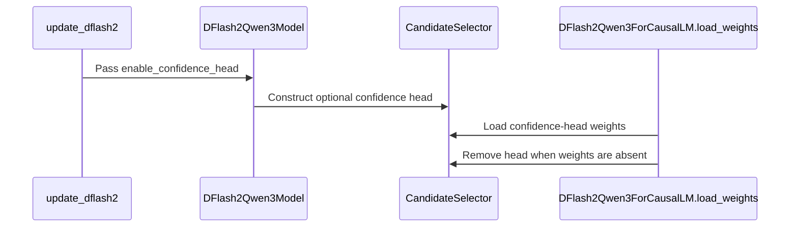

# [Spec Decode] Support optional DFlash2 confidence-based adaptive verification

[Upstream PR](https://github.com/vllm-project/vllm/pull/55668) · state: closed · merged: False

## Original PR description

## Purpose

Support optional confidence-head loading for DFlash2 checkpoints.

## Test Plan

Main + #54154 + #54475 + this PR

```bash
vllm serve ornith-ai/Ornith-1.5-35B-A3B \
  --tensor-parallel-size 1 \
  --enable-prefix-caching \
  --enable-auto-tool-choice \
  --tool-call-parser qwen3_xml \
  --reasoning-parser qwen3 \
  --speculative-config '{
    "method": "dflash",
    "model": "DaoCloud/Ornith-1.5-35B-A3B-DFlash2-2.6B-A0.3B",
    "num_speculative_tokens": 7
  }'
```

## Test Result

https://huggingface.co/DaoCloud/Ornith-1.5-35B-A3B-DFlash2-2.6B-A0.3B

---
<details>
<summary> Essential Elements of an Effective PR Description Checklist </summary>

- [x] The purpose of the PR, such as "Fix some issue (link existing issues this PR will resolve)".
- [x] The test plan, such as providing test command.
- [x] The test results, such as pasting the results comparison before and after, or e2e results
- [ ] (Optional) The necessary documentation update, such as updating `supported_models.md` and `examples` for a new model.
</details>


## Review and discussion

### reviews

- claude[bot] · COMMENTED · 2026-09-07T07:10:58Z · [source](https://github.com/vllm-project/vllm/pull/55668#pullrequestreview-5129022767)

## Claude Code Review

This pull request is from a fork — automated review is disabled. A repository maintainer can comment `@claude review` to run a one-time review.

- copilot-pull-request-reviewer[bot] · COMMENTED · 2026-09-07T07:21:34Z · [source](https://github.com/vllm-project/vllm/pull/55668#pullrequestreview-5129123000)

### 🟡 Changes recommended

`DFlash2Qwen3ForCausalLM.load_weights` is annotated to return `set[str]` but currently returns `None` via `super().load_weights(...)`, which can break typing/CI expectations and should be made consistent.

*Once you've addressed the issues Copilot identified, you can request another Copilot review.*

<details>
<summary>Pull request overview</summary>

This PR adds support for DFlash2 checkpoints that optionally include a trained “confidence head” in the candidate selector, ensuring such checkpoints can be loaded without triggering unknown-parameter errors.

**Changes:**
- Propagate `enable_confidence_head` from speculators-format configs into the generated `dflash_config`.
- Add an optional `confidence_head` module to the DFlash2 Qwen3 candidate selector and guard against config/weights mismatches during weight loading.
</details>

<details>
<summary>File summaries</summary>

| File | Description |
| ---- | ----------- |
| vllm/transformers_utils/configs/speculators/algos.py | Ensures `enable_confidence_head` is copied into `dflash_config` for DFlash2 when present in the speculators config. |
| vllm/model_executor/models/qwen3_dflash2.py | Adds optional `confidence_head` construction and adjusts weight-loading logic to disable the head if weights don’t include it. |
</details>

<details>
<summary>Review details</summary>

- **Files reviewed:** 2/2 changed files
- **Comments generated:** 1
- **Review effort level:** Lite
</details>

---

💡 <a href="/vllm-project/vllm/new/main?filename=.github/skills/code-review/SKILL.md" class="Link--inTextBlock" target="_blank" rel="noopener noreferrer">Add a `code-review` agent skill</a> or configure MCP servers for context-aware, tailored reviews. <a href="https://docs.github.com/copilot/how-tos/use-copilot-agents/request-a-code-review/use-code-review?tool=webui#mcp-servers-and-agent-skills" class="Link--inTextBlock" target="_blank" rel="noopener noreferrer">Learn more in the docs.</a>

### issue_comments

- coderabbitai[bot] · comment · 2026-09-07T07:11:49Z · [source](https://github.com/vllm-project/vllm/pull/55668#issuecomment-5566543138)

<!-- This is an auto-generated comment: summarize by coderabbit.ai -->
<!-- review_stack_entry_start -->

[](https://app.coderabbit.ai/change-stack/vllm-project/vllm/pull/55668)

<!-- review_stack_entry_end -->
<!-- recent_review_start -->

No actionable comments were generated in the recent review. 🎉

<details>
<summary>ℹ️ Recent review info</summary>

<details>
<summary>⚙️ Run configuration</summary>

**Configuration used**: Repository UI

**Review profile**: CHILL

**Plan**: Team

**Run ID**: `daca5e03-e7e9-4d5b-89a4-3ff852af3195`

</details>

<details>
<summary>📥 Commits</summary>

Reviewing files that changed from the base of the PR and between 6fbb00b18874e27ba7d7adc0a3b8e93fee763ab1 and 7fc582bfa339582c5b3080a836acd1a48e85f823.

</details>

<details>
<summary>📒 Files selected for processing (2)</summary>

* `vllm/model_executor/models/qwen3_dflash2.py`
* `vllm/transformers_utils/configs/speculators/algos.py`

</details>

**Included review availability:** Your plan provides up to 10 included reviews per hour; 8 remain after this review.

</details>

---


<!-- recent_review_end -->
<!-- walkthrough_start -->

## Walkthrough

### Changes

**DFlash2 confidence-head support**

|Layer / File(s)|Summary|
|---|---|
|**Configuration propagation** <br> `vllm/transformers_utils/configs/speculators/algos.py`|`update_dflash2` forwards `enable_confidence_head` into the generated DFlash2 configuration.|
|**Confidence-head construction and loading** <br> `vllm/model_executor/models/qwen3_dflash2.py`|`CandidateSelector` conditionally creates the confidence head. `load_weights` keeps the head when checkpoint weights exist and removes it otherwise.|

**Estimated code review effort:** 3 (Moderate) | ~20 minutes

<!-- final_review_risk_start -->
**Merge Risk:** _⚪ Minimal_ · up to `7fc58`
<!-- final_review_risk_coverage:{"sourceCommitId":"7fc582bfa339582c5b3080a836acd1a48e85f823","coveredCommitId":"7fc582bfa339582c5b3080a836acd1a48e85f823","kind":"reviewed"} -->

This change enables optional DFlash2 confidence-head checkpoint loading while preserving checkpoints without confidence-head weights. No merge-blocking risk is identified.
<!-- final_review_risk_end -->

### Sequence Diagram(s)



**Suggested reviewers:** `fynnsu`

<!-- walkthrough_end -->
<!-- pre_merge_checks_walkthrough_start -->

<details>
<summary>🚥 Pre-merge checks | ✅ 4 | ❌ 1</summary>

### ❌ Failed checks (1 warning)

|     Check name     | Status     | Explanation                                                                                                                                                                                | Resolution                                                                         |
| :----------------: | :--------- | :----------------------------------------------------------------------------------------------------------------------------------------------------------------------------------------- | :--------------------------------------------------------------------------------- |
| Docstring Coverage | ⚠️ Warning | Docstring coverage is 14.29% which is insufficient. The required threshold is 80.00%. Docstring coverage is scoped to functions touched by this diff. Analyzed 7 functions across 2 files. | Write docstrings for the functions missing them to satisfy the coverage threshold. |

<details>
<summary>✅ Passed checks (4 passed)</summary>

|         Check name         | Status   | Explanation                                                                                                                                          |
| :------------------------: | :------- | :--------------------------------------------------------------------------------------------------------------------------------------------------- |
|     Linked Issues check    | ✅ Passed | Check skipped because no linked issues were found for this pull request.                                                                             |
| Out of Scope Changes check | ✅ Passed | Check skipped because no linked issues were found for this pull request.                                                                             |
|         Title check        | ✅ Passed | The title clearly identifies the main change: support for optional DFlash2 confidence-based adaptive verification.                                   |
|      Description check     | ✅ Passed | The description directly explains optional confidence-head loading, provides a test plan, and references test results for the related DFlash2 model. |

</details>

</details>

<!-- pre_merge_checks_walkthrough_end -->
<!-- tips_start -->

---

Thanks for using [CodeRabbit](https://coderabbit.ai?utm_source=oss&utm_medium=github&utm_campaign=vllm-project/vllm&utm_content=55668)! It's free for OSS, and your support helps us grow. If you like it, consider giving us a shout-out.

<details>
<summary>❤️ Share</summary>

- [X](https://twitter.com/intent/tweet?text=I%20just%20used%20%40coderabbitai%20for%20my%20code%20review%2C%20and%20it%27s%20fantastic%21%20It%27s%20free%20for%20OSS%20and%20offers%20a%20free%20trial%20for%20the%20proprietary%20code.%20Check%20it%20out%3A&url=https%3A//coderabbit.ai)
- [Mastodon](https://mastodon.social/share?text=I%20just%20used%20%40coderabbitai%20for%20my%20code%20review%2C%20and%20it%27s%20fantastic%21%20It%27s%20free%20for%20OSS%20and%20offers%20a%20free%20trial%20for%20the%20proprietary%20code.%20Check%20it%20out%3A%20https%3A%2F%2Fcoderabbit.ai)
- [Reddit](https://www.reddit.com/submit?title=Great%20tool%20for%20code%20review%20-%20CodeRabbit&text=I%20just%20used%20CodeRabbit%20for%20my%20code%20review%2C%20and%20it%27s%20fantastic%21%20It%27s%20free%20for%20OSS%20and%20offers%20a%20free%20trial%20for%20proprietary%20code.%20Check%20it%20out%3A%20https%3A//coderabbit.ai)
- [LinkedIn](https://www.linkedin.com/sharing/share-offsite/?url=https%3A%2F%2Fcoderabbit.ai&mini=true&title=Great%20tool%20for%20code%20review%20-%20CodeRabbit&summary=I%20just%20used%20CodeRabbit%20for%20my%20code%20review%2C%20and%20it%27s%20fantastic%21%20It%27s%20free%20for%20OSS%20and%20offers%20a%20free%20trial%20for%20proprietary%20code)

</details>


<sub>Comment `@coderabbitai help` to get the list of available commands.</sub>

<!-- tips_end -->

- mergify[bot] · comment · 2026-09-09T14:24:11Z · [source](https://github.com/vllm-project/vllm/pull/55668#issuecomment-5603477001)

Documentation preview: https://vllm--55668.org.readthedocs.build/en/55668/

- mergify[bot] · comment · 2026-09-15T03:46:38Z · [source](https://github.com/vllm-project/vllm/pull/55668#issuecomment-5674425616)

This pull request has merge conflicts that must be resolved before it can be
merged. Please rebase the PR, @qianlihuang.

https://docs.github.com/en/pull-requests/collaborating-with-pull-requests/working-with-forks/syncing-a-fork


- qianlihuang · comment · 2026-10-29T05:18:19Z · [source](https://github.com/vllm-project/vllm/pull/55668#issuecomment-6488650000)

https://github.com/vllm-project/vllm/pull/63205

### inline_comments

- copilot-pull-request-reviewer[bot] · comment · 2026-09-07T07:21:34Z · [source](https://github.com/vllm-project/vllm/pull/55668#discussion_r3947411338)

File: `vllm/model_executor/models/qwen3_dflash2.py` · line 354

`load_weights` is annotated to return `set[str]`, but `super().load_weights(...)` in `DFlashQwen3ForCausalLM` returns `None` (and this override currently returns that `None`). This is a type/contract mismatch that can trip mypy and makes the signature misleading; either return a real set of loaded parameter names or update this override to return `None` like the parent implementation.

## Changed files and fixed code

- `docs/features/speculative_decoding/adaptive_verification.md` · modified · additions 5 / deletions 1
  - [head](https://github.com/qianlihuang/vllm/blob/fbc7d1270189d53cc2dbef89d2102c38a4670dec/docs/features/speculative_decoding/adaptive_verification.md)
  - [base](https://github.com/vllm-project/vllm/blob/6fbb00b18874e27ba7d7adc0a3b8e93fee763ab1/docs/features/speculative_decoding/adaptive_verification.md)
- `tests/v1/spec_decode/test_dflash2.py` · modified · additions 161 / deletions 1
  - [head](https://github.com/qianlihuang/vllm/blob/fbc7d1270189d53cc2dbef89d2102c38a4670dec/tests/v1/spec_decode/test_dflash2.py)
  - [base](https://github.com/vllm-project/vllm/blob/6fbb00b18874e27ba7d7adc0a3b8e93fee763ab1/tests/v1/spec_decode/test_dflash2.py)
- `vllm/config/speculative.py` · modified · additions 14 / deletions 3
  - [head](https://github.com/qianlihuang/vllm/blob/fbc7d1270189d53cc2dbef89d2102c38a4670dec/vllm/config/speculative.py)
  - [base](https://github.com/vllm-project/vllm/blob/6fbb00b18874e27ba7d7adc0a3b8e93fee763ab1/vllm/config/speculative.py)
- `vllm/model_executor/models/qwen3_dflash2.py` · modified · additions 69 / deletions 2
  - [head](https://github.com/qianlihuang/vllm/blob/fbc7d1270189d53cc2dbef89d2102c38a4670dec/vllm/model_executor/models/qwen3_dflash2.py)
  - [base](https://github.com/vllm-project/vllm/blob/6fbb00b18874e27ba7d7adc0a3b8e93fee763ab1/vllm/model_executor/models/qwen3_dflash2.py)
- `vllm/transformers_utils/configs/speculators/algos.py` · modified · additions 1 / deletions 0
  - [head](https://github.com/qianlihuang/vllm/blob/fbc7d1270189d53cc2dbef89d2102c38a4670dec/vllm/transformers_utils/configs/speculators/algos.py)
  - [base](https://github.com/vllm-project/vllm/blob/6fbb00b18874e27ba7d7adc0a3b8e93fee763ab1/vllm/transformers_utils/configs/speculators/algos.py)
- `vllm/v1/worker/gpu/spec_decode/dflash2/speculator.py` · modified · additions 48 / deletions 2
  - [head](https://github.com/qianlihuang/vllm/blob/fbc7d1270189d53cc2dbef89d2102c38a4670dec/vllm/v1/worker/gpu/spec_decode/dflash2/speculator.py)
  - [base](https://github.com/vllm-project/vllm/blob/6fbb00b18874e27ba7d7adc0a3b8e93fee763ab1/vllm/v1/worker/gpu/spec_decode/dflash2/speculator.py)

## Evidence and interpretation boundary

[Original JSON, discussions and patches](../../../../../../evidence/prs/vllm-project--vllm/55668-77c9c85b0ac9c4966dede90387029ce5d28794167acc6b9c036764f668c34952.json) · SHA-256 `77c9c85b0ac9c4966dede90387029ce5d28794167acc6b9c036764f668c34952`.

Diff complete: True. Missing/binary/truncated patches require pinned source inspection. This is a source page, not an independently verified optimization case. Open, merged and released are different states; recheck the deployed dependency.
