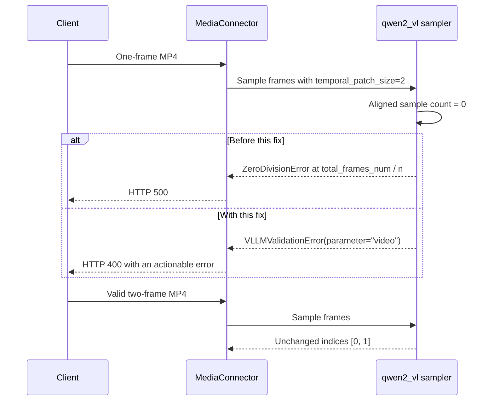

# [Bugfix][Multimodal] Reject empty Qwen2-VL video samples

[Upstream PR](https://github.com/vllm-project/vllm/pull/58379) · state: open · merged: False

## Original PR description

## Problem

Fixes #58353.

Qwen2-VL rounds the frame count down to a multiple of `temporal_patch_size`. A one-frame video with the default patch size of two produces `n = 0`, which is then used as the divisor in `torch.arange(0, total_frames_num, total_frames_num / n)`. The request fails with an internal arithmetic error instead of an input validation error. See the [sampler before this change](https://github.com/vllm-project/vllm/blob/88afb9dcac7672f8e4a16590e67c2f09fe173dff/vllm/multimodal/video.py#L453-L466).

The same empty sample can result from a `max_frames` limit below one temporal patch, even when the source video contains enough frames.

## Change

Reject a nonpositive aligned sample count with `VLLMValidationError` before constructing the indices. The message names the `qwen2_vl` sampler and reports the source frame count, temporal patch size, and aligned frame limit; the API identifies the invalid parameter as `video`. It asks the caller to check the source and sampling settings rather than suggesting that increasing `max_frames` will fix a one-frame source.

This is a sampler-specific check, not a model-name check. The loader is registered for `Qwen2VLVideoProcessor`, which is also used by Qwen2.5-VL.

This chooses explicit rejection rather than introducing frame repetition. Valid inputs keep the existing sampling formula and indices. Model execution, frame padding, decoder selection, and the other video samplers are unchanged.



## Validation

Revalidated after rebasing onto main `0c63ce9f0e0b5b2782f0f30cb491069dac158bb2`, without incorporating #64899. All results below cover the final commit `55fa9f08af0c2aee3d34fd068c37496a28efcea9` (2026-10-31). The update also adds explicit `num_frames=4` regression coverage and documents the input requirement.

The tests ran in an existing private Linux environment with Python 3.12.13, torch 2.10.0 and transformers 5.20.2. They exercise CPU preprocessing; no model weights, model generation or GPU kernels were used.

- Focused sampling and connector regressions: **13 passed**. Running the same tests with main's sampler produced nine `ZeroDivisionError` failures and four passing valid-input controls.
- Selected surrounding video tests: **53 passed, 67 deselected**.
- Selected media connector tests: **17 passed, 67 deselected**.
- Existing API exception-handling suite: **49 passed**.
- Real `vllm launch render` HTTP regressions: **2 passed, 8 deselected**, covering default sampling and `num_frames=4`. Each case returns HTTP 400 with `param="video"` for a one-frame clip, then HTTP 200 for a valid two-frame clip. With main's sampler, both regression cases fail because the one-frame request returns HTTP 500 with `division by zero`.
- All applicable manual-stage pre-commit checks passed, including formatting, lint, mypy for Python 3.11 and CI test tethering. Windows-compatible hooks ran locally; the shell-only Dockerfile graph hook ran unchanged on Linux and exited successfully.
- A dedicated private Codex review of the final commit against the recorded base found no actionable regressions. The review itself did not run pytest; the separate Linux runs above provide the test evidence.

The selections overlap and should not be added together as a unique test count. They omit optional hardware decoder suites and downloaded-model/video sampling comparisons. The HTTP tests use real model configuration and preprocessing without loading model weights. For accepted inputs, the sampling formula is unchanged and regressions check the exact frame indices.

Commands:

```bash
pytest tests/multimodal/test_video.py tests/multimodal/media/test_connector.py -k qwen2vl_ -vv
pytest tests/multimodal/test_video.py -k 'not processor_from_model_repo and not torchcodec and not pynvvideocodec and not deepstream and not video_loader_frames_sampling and not codec_parity' -vv
pytest tests/multimodal/media/test_connector.py -k 'qwen2vl or data_url or error_conversion or placeholder_range or cache_' -vv
pytest tests/entrypoints/serve/exception_handling -vv
pytest tests/entrypoints/scale_out/render/test_launch_render.py -k qwen2vl -vv
```

### Upstream CI status

The private results above are separate from upstream CI. For this commit, upstream checks stopped at the repository's admission gate:

- [GitHub Actions pre-run-check](https://github.com/vllm-project/vllm/actions/runs/41228099744/job/124616392426) failed because the PR lacked a `verified`, `ready` or `ready-run-all-tests` label and the author had one merged PR, below the threshold of four. The actual pre-commit job was **skipped**.
- [Read the Docs build 35548431](https://app.readthedocs.org/projects/vllm/builds/35548431/) exited during `docs/pre_run_check.sh` because that pre-run-check had failed. The documentation build itself **did not run**.

These statuses do not establish an upstream test or documentation-build failure. Full upstream CI remains outstanding; no upstream CI pass is claimed.

## Related Work

Checked the issue comments, issue-number PR search, and open video-sampling PRs before starting. #54390 and #54396 address source-FPS validation, not the zero aligned sample count here. The issue also distinguishes the closed, unmerged #33746 and #33956 from this Qwen2-VL video-URL path.

AI assistance was used for implementation, test development, and review. A dedicated local Codex review found no actionable defects.


## Review and discussion

### reviews

- claude[bot] · COMMENTED · 2026-09-23T15:07:52Z · [source](https://github.com/vllm-project/vllm/pull/58379#pullrequestreview-5292831173)

## Claude Code Review

This pull request is from a fork — automated review is disabled. A repository maintainer can comment `@claude review` to run a one-time review.

### issue_comments

- mergify[bot] · comment · 2026-10-29T12:23:26Z · [source](https://github.com/vllm-project/vllm/pull/58379#issuecomment-6496573045)

This pull request has merge conflicts that must be resolved before it can be
merged. Please rebase the PR, @shipiyouniao.

https://docs.github.com/en/pull-requests/collaborating-with-pull-requests/working-with-forks/syncing-a-fork


- justjk · comment · 2026-10-31T17:25:41Z · [source](https://github.com/vllm-project/vllm/pull/58379#issuecomment-6546722494)

#64899 (fixing #64882) changes the same function: `Qwen2VLVideoBackend.compute_frames_index_to_sample` now has an explicit `num_frames` branch, and the fps calculation moves into an `else:`. The one-frame case breaks there too. `max_frames` rounds down to 0, so `n` ends up 0 either way. On that branch, a 1-frame clip raises `ZeroDivisionError` both with no `num_frames` and with `num_frames=4`.

So whichever of the two PRs merges second will need a rebase. Once both are in, the `n <= 0` check needs to sit after the `if/else`, not inside the fps path, so it covers both. I'm happy to move it on my side if mine lands second. A `num_frames=4` case in your test would catch it either way.

- mergify[bot] · comment · 2026-10-31T18:10:34Z · [source](https://github.com/vllm-project/vllm/pull/58379#issuecomment-6547239202)

Documentation preview: https://vllm--58379.org.readthedocs.build/en/58379/

### inline_comments

## Changed files and fixed code

- `docs/features/multimodal_inputs.md` · modified · additions 7 / deletions 0
  - [head](https://github.com/shipiyouniao/vllm/blob/55fa9f08af0c2aee3d34fd068c37496a28efcea9/docs/features/multimodal_inputs.md)
  - [base](https://github.com/vllm-project/vllm/blob/0c63ce9f0e0b5b2782f0f30cb491069dac158bb2/docs/features/multimodal_inputs.md)
- `tests/entrypoints/scale_out/render/test_launch_render.py` · modified · additions 56 / deletions 0
  - [head](https://github.com/shipiyouniao/vllm/blob/55fa9f08af0c2aee3d34fd068c37496a28efcea9/tests/entrypoints/scale_out/render/test_launch_render.py)
  - [base](https://github.com/vllm-project/vllm/blob/0c63ce9f0e0b5b2782f0f30cb491069dac158bb2/tests/entrypoints/scale_out/render/test_launch_render.py)
- `tests/multimodal/media/test_connector.py` · modified · additions 16 / deletions 0
  - [head](https://github.com/shipiyouniao/vllm/blob/55fa9f08af0c2aee3d34fd068c37496a28efcea9/tests/multimodal/media/test_connector.py)
  - [base](https://github.com/vllm-project/vllm/blob/0c63ce9f0e0b5b2782f0f30cb491069dac158bb2/tests/multimodal/media/test_connector.py)
- `tests/multimodal/test_video.py` · modified · additions 66 / deletions 0
  - [head](https://github.com/shipiyouniao/vllm/blob/55fa9f08af0c2aee3d34fd068c37496a28efcea9/tests/multimodal/test_video.py)
  - [base](https://github.com/vllm-project/vllm/blob/0c63ce9f0e0b5b2782f0f30cb491069dac158bb2/tests/multimodal/test_video.py)
- `vllm/multimodal/video.py` · modified · additions 9 / deletions 0
  - [head](https://github.com/shipiyouniao/vllm/blob/55fa9f08af0c2aee3d34fd068c37496a28efcea9/vllm/multimodal/video.py)
  - [base](https://github.com/vllm-project/vllm/blob/0c63ce9f0e0b5b2782f0f30cb491069dac158bb2/vllm/multimodal/video.py)

## Evidence and interpretation boundary

[Original JSON, discussions and patches](../../../../../../evidence/prs/vllm-project--vllm/58379-ff6d7d273f34d3ac02256cfbc18cd991e30b59cc0ab5fecb10ea0466a8f6791b.json) · SHA-256 `ff6d7d273f34d3ac02256cfbc18cd991e30b59cc0ab5fecb10ea0466a8f6791b`.

Diff complete: True. Missing/binary/truncated patches require pinned source inspection. This is a source page, not an independently verified optimization case. Open, merged and released are different states; recheck the deployed dependency.
