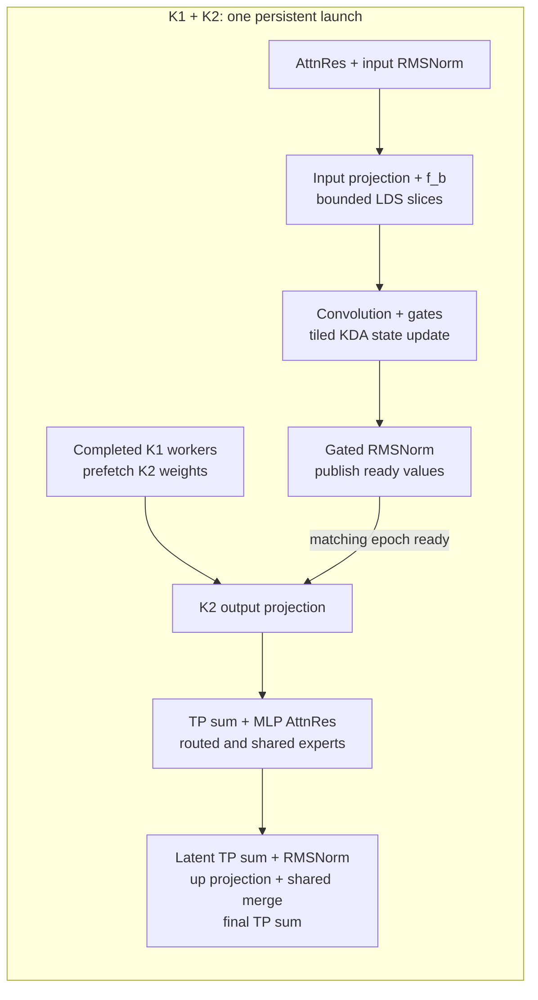
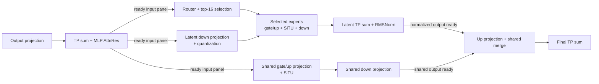

# [ROCm][Perf][Kimi-K3] Limit mono verification to conc4 shapes through M32

[Upstream PR](https://github.com/vllm-project/vllm/pull/61694) · state: open · merged: False

## Original PR description

## Summary

Optimize Kimi-K3 mono speculative verification for conc4 serving on MI355X TP8, with selected batches through **32 verification tokens per step (M32)**. This covers four requests with up to eight verification tokens each. Dispatch follows the model step's row count; batches above M32 use the existing vLLM operators.

- **K1:** bounded LDS staging, tiled state updates and shape-specific worker assignments.
- **K1/K2 fusion:** one persistent launch with worker reuse for eligible batches through M16.
- **K2:** compact routing and cached expert intermediates through M32, with projection-panel pipelining at M28/M30/M32.
- **Graph replay:** immutable pinned argument tables remain alive across capture and replay.

This extends #60683 at `9c6c96d8ef` with K1/K2 worker reuse and panel-based K2 scheduling for speculative verification. The scope differs from #61435's row-tiling and MLA prologue/epilogue fusion; MLA attention and DCP output merging complete before this PR's K2 consumes their output.

## Performance — AgenticX conc4

**Kimi-K3 · 8× MI355X · TP8/DCP1 · DSpark k5 · 3600 seconds.** FP8 GPU KV cache, offload disabled, prefix caching enabled, FULL_AND_PIECEWISE graphs; synthetic acceptance length 3.62, seed 42. Concurrency 4 refers to AgenticX session trees.

| Metric | Base (no mono) | #60683 | #61694 | vs base | vs #60683 |
|---|---:|---:|---:|---:|---:|
| Output tok/s | 159.84 | 181.91 | 190.84 | +19.4% | +4.9% |
| Total tok/s | 22453.69 | 24149.27 | 25436.55 | +13.3% | +5.3% |
| Mean / median TTFT ms | 1061.39 / 521.11 | 790.88 / 525.92 | 828.82 / 523.70 | −21.9% | +4.8% |
| Mean / median TPOT ms | 5.47 / 6.36 | 4.82 / 4.47 | 4.80 / 4.39 | −12.2% | −0.4% |
| Mean ITL ms | 5.47 | 4.82 | 4.80 | −12.2% | −0.4% |
| p90 interactivity tok/s | 118.98 | 123.45 | 146.53 | +23.2% | +18.7% |

Percentage changes compare #61694 with each reference and use the mean for paired latency rows. Interactivity follows AgenticX's definition: `1 / p90 ITL` with ITL in seconds; higher is better. All three benchmark results passed validation; successful/failed profiling requests were 475/2, 507/3 and 538/2, respectively.

*Measurement scope: one run per build. The #60683 reference is `9c6c96d8ef`; the #61694 candidate was measured before the M32 cap, on a different MI355X TP8 system from Base/#60683, with different KV-cache capacity. These comparisons do not isolate the kernel effect; throughput of the current M32 revision remains pending.*

## Kernel design

K1 covers attention residual mixing and normalization, input projection, convolution, KDA state updates and gated RMSNorm. K2 covers output projection, TP reduction, MLP residual mixing, routed/shared experts and the final reductions.

| Rows in the step | Selected implementation |
|---|---|
| 1–16 | K2; eligible KDA verification lengths 2, 4, 6 or 8 use combined K1/K2 outside FULL graphs |
| 18, 20, 24 | K2 with compact routing metadata, sparse expert-pick lists and expert intermediates cached in LDS |
| 28, 30, 32 | The same K2 schedule, with projection consumers advancing on ready input panels |
| Other widths | Existing projection and MoE operators; eligible K1/post-projection KDA paths are also bounded by M32 |

### Small batches: reuse K1 workers in K2

The #60683 snapshot uses separate K1 and K2 launches for batches through eight rows. This PR combines eligible batches through sixteen rows:



Each CTA reuses its workers and private LDS as its work completes. Epoch-tagged handoffs prevent K2 from reading unfinished K1 output; TP consumers also wait for the required peer data. FULL graph execution uses separate launches.

### M18–M32: compact K2 routing and panel handoffs

Wide K2 stores compact routing metadata and sparse expert-pick lists, keeping expert intermediates in LDS. At M28/M30/M32, the output-projection reduction and MLP AttnRes publish input panels for the router, latent projection and shared-expert projection. M30/M32 KDA uses the existing input projection followed by eligible fused post-projection work. Deep residual-block schedules use streamed AttnRes staging to bound LDS usage.



Panel handoffs apply to the front of K2; the final merge waits for the completed latent-normalization and shared-output stages. Cross-CTA handoffs use global/peer memory and readiness tags. Scratch and peer buffers are sized for M32. The diagrams show dependencies; actual overlap depends on the selected shape and worker schedule.

## Validation

| Check | Result |
|---|---|
| K1 numerics, state updates and dispatch/fallback | 92 passed |
| TP8 K2 numerics and K1/K2 graph replay | 10 passed |
| Changed-file pre-commit, including mypy | Passed |
| Diff checks | Passed |
| GSM8K smoke, 64 samples, 5-shot, conc4/k5 | 61/64 (95.31%); no empty or truncated outputs |

The 102 kernel/dispatch cases cover M24/M28/M30/M32, deep residual blocks, block resets, changed-input graph replay, scratch allocation and fallback above M32. The GSM8K smoke used an earlier candidate, seed 42, temperature 0, thinking disabled and a 4096-token output limit. Full-model accuracy equivalence of the current M32 revision remains pending.

<details>
<summary>Test commands</summary>

```bash
.venv/bin/python -m pytest -q -s tests/models/kimi_k3/test_amd_mono.py \
  -k 'dispatch_falls_back or serving_dispatch or k1_matches_vllm_ops or kda_graph_replays_changed_state_slots'
.venv/bin/python -m pytest -q -s tests/models/kimi_k3/test_amd_mono.py \
  -k 'k2_sparse_routes or k1_k2_serving_replays'
```

</details>

AI assistance: OpenAI Codex.


## Review and discussion

### reviews

- claude[bot] · COMMENTED · 2026-10-15T21:20:17Z · [source](https://github.com/vllm-project/vllm/pull/61694#pullrequestreview-5540078462)

## Claude Code Review

This pull request is from a fork — automated review is disabled. A repository maintainer can comment `@claude review` to run a one-time review.

- AndreasKaratzas · CHANGES_REQUESTED · 2026-10-16T02:40:45Z · [source](https://github.com/vllm-project/vllm/pull/61694#pullrequestreview-5542382530)

KK3 is a massive model. We need a more efficient way on ci to test for this 
CC @Fangzhou-Ai 

### issue_comments

- mergify[bot] · comment · 2026-10-14T20:43:44Z · [source](https://github.com/vllm-project/vllm/pull/61694#issuecomment-6178030142)

This pull request has merge conflicts that must be resolved before it can be
merged. Please rebase the PR, @jiacao-amd.

https://docs.github.com/en/pull-requests/collaborating-with-pull-requests/working-with-forks/syncing-a-fork


### inline_comments

- AndreasKaratzas · comment · 2026-10-16T02:39:38Z · [source](https://github.com/vllm-project/vllm/pull/61694#discussion_r4290324117)

File: `.buildkite/test_areas/models_basic.yaml` · line 281

This is definitely something that we need to think through.

## Changed files and fixed code

- `.buildkite/test_areas/models_basic.yaml` · modified · additions 15 / deletions 0
  - [head](https://github.com/jiacao-amd/vllm/blob/7f5944c9a846f60a2398964eaad5c3d0c59c2a9f/.buildkite/test_areas/models_basic.yaml)
  - [base](https://github.com/vllm-project/vllm/blob/984c242ede0beaf1c3ba9eb4c01b98bed8973eac/.buildkite/test_areas/models_basic.yaml)
- `tests/models/kimi_k3/test_amd_mono.py` · added · additions 1441 / deletions 0
  - [head](https://github.com/jiacao-amd/vllm/blob/7f5944c9a846f60a2398964eaad5c3d0c59c2a9f/tests/models/kimi_k3/test_amd_mono.py)
  - [base](https://github.com/vllm-project/vllm/blob/984c242ede0beaf1c3ba9eb4c01b98bed8973eac/tests/models/kimi_k3/test_amd_mono.py)
- `vllm/envs.py` · modified · additions 1 / deletions 1
  - [head](https://github.com/jiacao-amd/vllm/blob/7f5944c9a846f60a2398964eaad5c3d0c59c2a9f/vllm/envs.py)
  - [base](https://github.com/vllm-project/vllm/blob/984c242ede0beaf1c3ba9eb4c01b98bed8973eac/vllm/envs.py)
- `vllm/models/kimi_k3/amd/kda.py` · modified · additions 21 / deletions 0
  - [head](https://github.com/jiacao-amd/vllm/blob/7f5944c9a846f60a2398964eaad5c3d0c59c2a9f/vllm/models/kimi_k3/amd/kda.py)
  - [base](https://github.com/vllm-project/vllm/blob/984c242ede0beaf1c3ba9eb4c01b98bed8973eac/vllm/models/kimi_k3/amd/kda.py)
- `vllm/models/kimi_k3/amd/linear.py` · modified · additions 87 / deletions 0
  - [head](https://github.com/jiacao-amd/vllm/blob/7f5944c9a846f60a2398964eaad5c3d0c59c2a9f/vllm/models/kimi_k3/amd/linear.py)
  - [base](https://github.com/vllm-project/vllm/blob/984c242ede0beaf1c3ba9eb4c01b98bed8973eac/vllm/models/kimi_k3/amd/linear.py)
- `vllm/models/kimi_k3/amd/mla.py` · modified · additions 13 / deletions 1
  - [head](https://github.com/jiacao-amd/vllm/blob/7f5944c9a846f60a2398964eaad5c3d0c59c2a9f/vllm/models/kimi_k3/amd/mla.py)
  - [base](https://github.com/vllm-project/vllm/blob/984c242ede0beaf1c3ba9eb4c01b98bed8973eac/vllm/models/kimi_k3/amd/mla.py)
- `vllm/models/kimi_k3/amd/mono/README.md` · added · additions 73 / deletions 0
  - [head](https://github.com/jiacao-amd/vllm/blob/7f5944c9a846f60a2398964eaad5c3d0c59c2a9f/vllm/models/kimi_k3/amd/mono/README.md)
  - [base](https://github.com/vllm-project/vllm/blob/984c242ede0beaf1c3ba9eb4c01b98bed8973eac/vllm/models/kimi_k3/amd/mono/README.md)
- `vllm/models/kimi_k3/amd/mono/__init__.py` · added · additions 2 / deletions 0
  - [head](https://github.com/jiacao-amd/vllm/blob/7f5944c9a846f60a2398964eaad5c3d0c59c2a9f/vllm/models/kimi_k3/amd/mono/__init__.py)
  - [base](https://github.com/vllm-project/vllm/blob/984c242ede0beaf1c3ba9eb4c01b98bed8973eac/vllm/models/kimi_k3/amd/mono/__init__.py)
- `vllm/models/kimi_k3/amd/mono/attention/__init__.py` · added · additions 2 / deletions 0
  - [head](https://github.com/jiacao-amd/vllm/blob/7f5944c9a846f60a2398964eaad5c3d0c59c2a9f/vllm/models/kimi_k3/amd/mono/attention/__init__.py)
  - [base](https://github.com/vllm-project/vllm/blob/984c242ede0beaf1c3ba9eb4c01b98bed8973eac/vllm/models/kimi_k3/amd/mono/attention/__init__.py)
- `vllm/models/kimi_k3/amd/mono/attention/back.py` · added · additions 502 / deletions 0
  - [head](https://github.com/jiacao-amd/vllm/blob/7f5944c9a846f60a2398964eaad5c3d0c59c2a9f/vllm/models/kimi_k3/amd/mono/attention/back.py)
  - [base](https://github.com/vllm-project/vllm/blob/984c242ede0beaf1c3ba9eb4c01b98bed8973eac/vllm/models/kimi_k3/amd/mono/attention/back.py)
- `vllm/models/kimi_k3/amd/mono/attention/kda.py` · added · additions 1761 / deletions 0
  - [head](https://github.com/jiacao-amd/vllm/blob/7f5944c9a846f60a2398964eaad5c3d0c59c2a9f/vllm/models/kimi_k3/amd/mono/attention/kda.py)
  - [base](https://github.com/vllm-project/vllm/blob/984c242ede0beaf1c3ba9eb4c01b98bed8973eac/vllm/models/kimi_k3/amd/mono/attention/kda.py)
- `vllm/models/kimi_k3/amd/mono/attention/local_post.py` · added · additions 240 / deletions 0
  - [head](https://github.com/jiacao-amd/vllm/blob/7f5944c9a846f60a2398964eaad5c3d0c59c2a9f/vllm/models/kimi_k3/amd/mono/attention/local_post.py)
  - [base](https://github.com/vllm-project/vllm/blob/984c242ede0beaf1c3ba9eb4c01b98bed8973eac/vllm/models/kimi_k3/amd/mono/attention/local_post.py)
- `vllm/models/kimi_k3/amd/mono/attention/parallel.py` · added · additions 872 / deletions 0
  - [head](https://github.com/jiacao-amd/vllm/blob/7f5944c9a846f60a2398964eaad5c3d0c59c2a9f/vllm/models/kimi_k3/amd/mono/attention/parallel.py)
  - [base](https://github.com/vllm-project/vllm/blob/984c242ede0beaf1c3ba9eb4c01b98bed8973eac/vllm/models/kimi_k3/amd/mono/attention/parallel.py)
- `vllm/models/kimi_k3/amd/mono/common/__init__.py` · added · additions 2 / deletions 0
  - [head](https://github.com/jiacao-amd/vllm/blob/7f5944c9a846f60a2398964eaad5c3d0c59c2a9f/vllm/models/kimi_k3/amd/mono/common/__init__.py)
  - [base](https://github.com/vllm-project/vllm/blob/984c242ede0beaf1c3ba9eb4c01b98bed8973eac/vllm/models/kimi_k3/amd/mono/common/__init__.py)
- `vllm/models/kimi_k3/amd/mono/common/debug.py` · added · additions 105 / deletions 0
  - [head](https://github.com/jiacao-amd/vllm/blob/7f5944c9a846f60a2398964eaad5c3d0c59c2a9f/vllm/models/kimi_k3/amd/mono/common/debug.py)
  - [base](https://github.com/vllm-project/vllm/blob/984c242ede0beaf1c3ba9eb4c01b98bed8973eac/vllm/models/kimi_k3/amd/mono/common/debug.py)
- `vllm/models/kimi_k3/amd/mono/common/mx.py` · added · additions 84 / deletions 0
  - [head](https://github.com/jiacao-amd/vllm/blob/7f5944c9a846f60a2398964eaad5c3d0c59c2a9f/vllm/models/kimi_k3/amd/mono/common/mx.py)
  - [base](https://github.com/vllm-project/vllm/blob/984c242ede0beaf1c3ba9eb4c01b98bed8973eac/vllm/models/kimi_k3/amd/mono/common/mx.py)
- `vllm/models/kimi_k3/amd/mono/common/ops.py` · added · additions 435 / deletions 0
  - [head](https://github.com/jiacao-amd/vllm/blob/7f5944c9a846f60a2398964eaad5c3d0c59c2a9f/vllm/models/kimi_k3/amd/mono/common/ops.py)
  - [base](https://github.com/vllm-project/vllm/blob/984c242ede0beaf1c3ba9eb4c01b98bed8973eac/vllm/models/kimi_k3/amd/mono/common/ops.py)
- `vllm/models/kimi_k3/amd/mono/common/peer_memory.py` · added · additions 133 / deletions 0
  - [head](https://github.com/jiacao-amd/vllm/blob/7f5944c9a846f60a2398964eaad5c3d0c59c2a9f/vllm/models/kimi_k3/amd/mono/common/peer_memory.py)
  - [base](https://github.com/vllm-project/vllm/blob/984c242ede0beaf1c3ba9eb4c01b98bed8973eac/vllm/models/kimi_k3/amd/mono/common/peer_memory.py)
- `vllm/models/kimi_k3/amd/mono/common/plan.py` · added · additions 236 / deletions 0
  - [head](https://github.com/jiacao-amd/vllm/blob/7f5944c9a846f60a2398964eaad5c3d0c59c2a9f/vllm/models/kimi_k3/amd/mono/common/plan.py)
  - [base](https://github.com/vllm-project/vllm/blob/984c242ede0beaf1c3ba9eb4c01b98bed8973eac/vllm/models/kimi_k3/amd/mono/common/plan.py)
- `vllm/models/kimi_k3/amd/mono/common/ranks.py` · added · additions 30 / deletions 0
  - [head](https://github.com/jiacao-amd/vllm/blob/7f5944c9a846f60a2398964eaad5c3d0c59c2a9f/vllm/models/kimi_k3/amd/mono/common/ranks.py)
  - [base](https://github.com/vllm-project/vllm/blob/984c242ede0beaf1c3ba9eb4c01b98bed8973eac/vllm/models/kimi_k3/amd/mono/common/ranks.py)
- `vllm/models/kimi_k3/amd/mono/common/sync.py` · added · additions 235 / deletions 0
  - [head](https://github.com/jiacao-amd/vllm/blob/7f5944c9a846f60a2398964eaad5c3d0c59c2a9f/vllm/models/kimi_k3/amd/mono/common/sync.py)
  - [base](https://github.com/vllm-project/vllm/blob/984c242ede0beaf1c3ba9eb4c01b98bed8973eac/vllm/models/kimi_k3/amd/mono/common/sync.py)
- `vllm/models/kimi_k3/amd/mono/common/tiles.py` · added · additions 39 / deletions 0
  - [head](https://github.com/jiacao-amd/vllm/blob/7f5944c9a846f60a2398964eaad5c3d0c59c2a9f/vllm/models/kimi_k3/amd/mono/common/tiles.py)
  - [base](https://github.com/vllm-project/vllm/blob/984c242ede0beaf1c3ba9eb4c01b98bed8973eac/vllm/models/kimi_k3/amd/mono/common/tiles.py)
- `vllm/models/kimi_k3/amd/mono/layer.py` · added · additions 855 / deletions 0
  - [head](https://github.com/jiacao-amd/vllm/blob/7f5944c9a846f60a2398964eaad5c3d0c59c2a9f/vllm/models/kimi_k3/amd/mono/layer.py)
  - [base](https://github.com/vllm-project/vllm/blob/984c242ede0beaf1c3ba9eb4c01b98bed8973eac/vllm/models/kimi_k3/amd/mono/layer.py)
- `vllm/models/kimi_k3/amd/mono/overlap.py` · added · additions 868 / deletions 0
  - [head](https://github.com/jiacao-amd/vllm/blob/7f5944c9a846f60a2398964eaad5c3d0c59c2a9f/vllm/models/kimi_k3/amd/mono/overlap.py)
  - [base](https://github.com/vllm-project/vllm/blob/984c242ede0beaf1c3ba9eb4c01b98bed8973eac/vllm/models/kimi_k3/amd/mono/overlap.py)
- `vllm/models/kimi_k3/amd/mono/runner.py` · added · additions 141 / deletions 0
  - [head](https://github.com/jiacao-amd/vllm/blob/7f5944c9a846f60a2398964eaad5c3d0c59c2a9f/vllm/models/kimi_k3/amd/mono/runner.py)
  - [base](https://github.com/vllm-project/vllm/blob/984c242ede0beaf1c3ba9eb4c01b98bed8973eac/vllm/models/kimi_k3/amd/mono/runner.py)
- `vllm/models/kimi_k3/amd/mono/stages/__init__.py` · added · additions 2 / deletions 0
  - [head](https://github.com/jiacao-amd/vllm/blob/7f5944c9a846f60a2398964eaad5c3d0c59c2a9f/vllm/models/kimi_k3/amd/mono/stages/__init__.py)
  - [base](https://github.com/vllm-project/vllm/blob/984c242ede0beaf1c3ba9eb4c01b98bed8973eac/vllm/models/kimi_k3/amd/mono/stages/__init__.py)
- `vllm/models/kimi_k3/amd/mono/stages/gemv.py` · added · additions 167 / deletions 0
  - [head](https://github.com/jiacao-amd/vllm/blob/7f5944c9a846f60a2398964eaad5c3d0c59c2a9f/vllm/models/kimi_k3/amd/mono/stages/gemv.py)
  - [base](https://github.com/vllm-project/vllm/blob/984c242ede0beaf1c3ba9eb4c01b98bed8973eac/vllm/models/kimi_k3/amd/mono/stages/gemv.py)
- `vllm/models/kimi_k3/amd/mono/stages/moe.py` · added · additions 1844 / deletions 0
  - [head](https://github.com/jiacao-amd/vllm/blob/7f5944c9a846f60a2398964eaad5c3d0c59c2a9f/vllm/models/kimi_k3/amd/mono/stages/moe.py)
  - [base](https://github.com/vllm-project/vllm/blob/984c242ede0beaf1c3ba9eb4c01b98bed8973eac/vllm/models/kimi_k3/amd/mono/stages/moe.py)
- `vllm/models/kimi_k3/amd/mono_decode.py` · added · additions 707 / deletions 0
  - [head](https://github.com/jiacao-amd/vllm/blob/7f5944c9a846f60a2398964eaad5c3d0c59c2a9f/vllm/models/kimi_k3/amd/mono_decode.py)
  - [base](https://github.com/vllm-project/vllm/blob/984c242ede0beaf1c3ba9eb4c01b98bed8973eac/vllm/models/kimi_k3/amd/mono_decode.py)

## Evidence and interpretation boundary

[Original JSON, discussions and patches](../../../../../../evidence/prs/vllm-project--vllm/61694-a5adc7d027aa1b76b1ab731e9f180afb4d50b753a05974497e12ccd836cef028.json) · SHA-256 `a5adc7d027aa1b76b1ab731e9f180afb4d50b753a05974497e12ccd836cef028`.

Diff complete: True. Missing/binary/truncated patches require pinned source inspection. This is a source page, not an independently verified optimization case. Open, merged and released are different states; recheck the deployed dependency.
