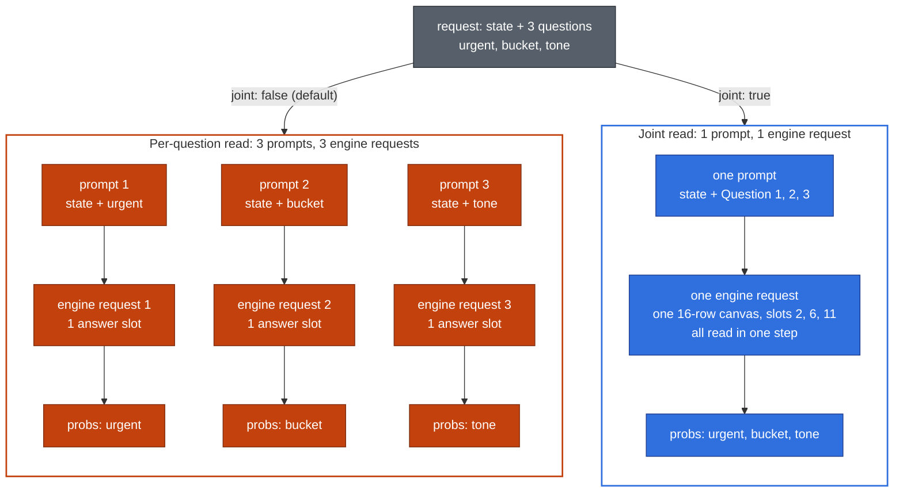

# [Frontend] DiffusionGemma joint reads on /v1/systemone and /v1/decisions

[Upstream PR](https://github.com/vllm-project/vllm/pull/62437) · state: open · merged: False

## Original PR description

<!-- markdownlint-disable -->

## Overview

This PR adds an opt-in `"joint": true` field to `/v1/systemone` and `/v1/decisions`. With it, DiffusionGemma answers several questions from one canvas in one read-only denoising step. Without it, the server still sends one engine request per question. `examples/features/structured_diffusion/structured_server.py` already reads jointly from outside the server; this brings the idea into the builtin endpoints.

The same request with 3 questions, read both ways:



`joint` defaults to `false`, which keeps one engine request per question. A request with one question reads per question even with `"joint": true`, and its response has `"joint": null`. Models without joint reads (next-token models, Clef, or DiffusionGemma when the startup line check fails) return 400 for `"joint": true`.

`/v1/systemone` now also rejects unknown top-level fields with a 400. A client can tell a joint read by the `joint` object in the response, which older servers do not return.

## Claims

- `joint` defaults to `false`, so requests without it read as before. It must be a JSON boolean. Models without joint reads return 400 for `"joint": true`, also with one question.
- A joint decision takes one engine request per canvas instead of one per question: on one H200 at 32 concurrent decisions, 11.0 decisions/s against 3.6 for 40 questions.
- A request with one question reads per question, with or without `joint`.
- On my case set, accuracy is within one question of per-question reads.
- Joint reads have no limits of their own. Questions that do not fit one canvas are split across canvases. The 64-question limit, the thinking check and the `max_model_len` check are the ones every request already has.

## Validation

One H200, TP1, `google/diffusiongemma-26B-A4B-it` in BF16, `--max-model-len 32768 --max-logprobs 32 --enable-prefix-caching`. "Per-question" is the same request without `joint`.

Joint reads are unconstrained, so they also work at TP2. On two H200s at served canvas 256, joint argmax matches TP1 on 264/265 case-set questions (per-question: 263/265). Mixed load with aborts at c=32 for 90 s gives 0 errors and 0 answer flips, with 0 running, 0 waiting and 0% KV cache at the end.

### Throughput

```mermaid
%%{init: {"themeVariables": {"xyChart": {"plotColorPalette": "#c2410c, #2f6fde", "backgroundColor": "transparent"}}, "xyChart": {"width": 900, "height": 420}}}%%
xychart-beta
  title "Decisions/s at c=32, served canvas 256 (higher is better)"
  x-axis ["8 q per-question 17.1", "8 q joint 50.9", "40 q per-question 3.6", "40 q joint 11.0", "64 q per-question 2.2", "64 q joint 6.6"]
  y-axis "decisions/s" 0 --> 55
  %% -10 is below the axis, so each series draws only in its own columns
  bar [17.1, -10, 3.6, -10, 2.2, -10]
  bar [-10, 50.9, -10, 11.0, -10, 6.6]
```



- From 8 questions up, joint gives 2.8-3.2x the decisions/s at c=32. Canvas 64 looks the same (16.9 / 47.7, 3.5 / 11.0, 2.3 / 6.9).
- 0 errors over all runs.

<details>
<summary>Full throughput grid</summary>

Decisions/s, per-question / joint, mean of 2 runs. Each decision has its own state, with mixed 26-way choices, 10-level scores and nouls. A one-question decision reads per question in both arms, so it has no row here.

| questions | canvas 64, c=1 | canvas 64, c=32 | canvas 256, c=1 | canvas 256, c=32 |
|---|---|---|---|---|
| 8 | 15.2 / 14.7 | 16.9 / 47.7 | 12.5 / 15.3 | 17.1 / 50.9 |
| 40 | 3.1 / 4.9 | 3.5 / 11.0 | 3.1 / 6.4 | 3.6 / 11.0 |
| 64 | 2.0 / 3.8 | 2.3 / 6.9 | 2.1 / 3.9 | 2.2 / 6.6 |

- A cell can move by up to about 10% between server starts. Six more runs of the 8-question rows, on two GPUs and then with the GPUs swapped, average 50.0 joint decisions/s at canvas 64 and c=32 (44.6-52.6).
</details>

### Case set: accuracy and latency

31 contexts, 265 questions: 89 regular (85 labelled) and 176 stress questions in decisions of 8-40 questions. Served canvas 256.

Accuracy: per-question reads get 85/85 regular and 165/176 stress questions right, joint reads 84/85 and 167/176.

Latency: joint takes 1.0 engine request per decision instead of 4.0 (regular) and 19.6 (stress), and the median drops from 40 to 31 ms and from 94 to 40 ms.

- Joint and per-question argmax agree on 256/265 questions. Six of the 9 flips are one letter-counting case where every variant is near chance.
- Reversing the question order changes 3/265 joint answers, all in that case. A repeat joint run gives the same argmax on 265/265.

<details>
<summary>Case set table</summary>

| variant | acc regular | acc stress | engine req / decision (reg / stress) | median ms (reg / stress) |
|---|---|---|---|---|
| per-question | 85/85 | 165/176 | 4.0 / 19.6 | 40 / 94 |
| `joint: true` | 84/85 | 167/176 | 1.0 / 1.0 | 31 / 40 |

- At served canvas 64 the accuracy is the same (84/85 and 167/176 against 85/85 and 165/176), with 1.9 canvases per stress decision and 257/265 argmax agreement.
</details>

### JevBench public set (231 items)

With one item per request, joint sends the per-question read and matches it on 231/231 items. With 4 items per request, joint scores higher (Intelligence 80.8-81.3 against 76.4). With 8, it scores lower (76.2 against 78.5, 1 run).

<details>
<summary>JevBench table</summary>

I used a small client that sends noul and score items natively, as PR 60696 does, and scores with JevBench's own `scoring` and `composite_v13` modules. Served canvas 64, 3 runs per arm unless noted.

| setup | arm | Intelligence | Calibration | ECE | label_mass |
|---|---|---|---|---|---|
| one item per request | per-question | 81.9-83.0 | 65.6-68.6 | 0.073-0.080 | 0.938-0.943 |
| one item per request | `joint: true` | 83.0 | 68.6 | 0.073 | 0.943 |
| 4 items per request | per-question | 76.4 | 60.5-63.3 | 0.104-0.113 | 0.937-0.942 |
| 4 items per request | `joint: true` | 80.8-81.3 | 67.3-70.2 | 0.086-0.098 | 0.995-0.996 |
| 8 items per request (1 run) | per-question | 78.5 | 67.2 | 0.091 | 0.938 |
| 8 items per request (1 run) | `joint: true` | 76.2 | 63.4 | 0.111 | 0.996 |

- With one item per request, `joint: true` sends the per-question read, and its probabilities equal the warm per-question runs on 231/231 items in all 3 runs. The low end of the per-question range is the first run, on a cold prefix cache.
- No two public items share a state, so the packed runs put 4 or 8 independent cases into one state, and each question says which case it is about.
</details>

### Stress

No 500s and no engine errors on TP1 servers at served canvas 16, 64 and 256, and at `max_model_len` 1024.

<details>
<summary>Stress cases</summary>

- Edge cases (0, 1, 63, 64 and 65 questions, odd ids and labels, huge states and instructions, media, thinking, unknown fields) give the expected 200, 400 or 404 on both endpoints.
- Chunk borders on 60 requests per canvas size match the CPU split, keep request order and a pad row, and give `output_tokens` = the sum of each canvas's last slot + 1. One-question joint requests return `"joint": null` and the per-question usage.
- 30 shuffled question orders per server map every answer back to its question.
- Mixed load with 12% aborts and 8% invalid requests, c=64 for 150 s at canvas 64 and c=128 for 240 s at canvas 256: 0 errors, 0 answer flips, and 0 running, 0 waiting and 0% KV cache at the end.
- At canvas 16 with `--max-num-queued-reqs 16`, a 16-canvas joint request is admitted and a 17-canvas one gets a 503, before and after load with aborts.
- At `max_model_len` 1024, prompt plus canvas totals of 1022-1024 are 200 and 1025-1026 are 400 with a clear message, for 1 and 30 questions.
</details>

### Tests

Unit tests: 195 passed. `test_joint_e2e.py` on one H200: 4 passed. `test_structured_decisions_e2e.py` (Qwen3-0.6B): 13 passed.

```bash
pytest tests/entrypoints/generate/structured_decisions/ -q
pytest tests/entrypoints/generate/structured_decisions/test_joint_e2e.py -v -s  # 80 GB GPU
```

<details>
<summary>Tests in detail</summary>

- `test_strategies.py` has 6 new test functions, on CPU: canvas layout, label math, determinism and the startup tokenizer check; the split at served canvas 256, 64, 32 and 16, with run-on numbering and a pad row on every canvas; and the request checks (one question, thinking, the 64-question limit, the 400 on next-token models) on both endpoints. `test_question_types.py` has 1 new test.
- `test_joint_e2e.py` has 4 tests that serve DiffusionGemma at canvas 64: the `joint` block, agreement with per-question reads, label mass on a two-question canvas, and 64 "letter n" questions over several canvases.
- The e2e file needs an 80 GB GPU and the 49 GB checkpoint, so `large_gpu_mark(min_gb=80)` skips it on the H200 MIG 35 GB runner that runs `entrypoints/generate` in CI. I ran it on a full H200.

Results on this branch:

- Unit tests: 195 passed (`structured_decisions/` without the two GPU files, `generative_scoring/test_generative_scoring.py`, `unit_tests/test_non_object_body_validation.py`).
- `test_joint_e2e.py` on one H200: 4 passed.
- Joint `label_mass` with the pad row: 3 score questions fill exactly 16 rows, so their canvas is 32 wide, and their `label_mass` is 0.985-0.99 at served canvas 256 and 64. A 16-wide canvas without the pad row reads 0.73-0.80. 40 nouls at served canvas 256 read 0.9995-1.0.
- `test_structured_decisions_e2e.py` (Qwen3-0.6B) on one H200: 13 passed, so the stricter request model does not break the existing e2e bodies.
- `ruff check` and `ruff format --check` (0.14.0) pass, and mypy (1.20.2) passes on the changed modules.

The diff is 11 files, +771/-72: source +319/-69, tests +425/-1, docs +27/-2.
</details>

## Details

```json
{"state": "Everything is down since 9am. Your invoice double charged us. Fix this NOW.",
 "questions": {"urgent": {"type": "noul", ...}, "bucket": {"type": "choice", ...}, "tone": {"type": "score", ...}},
 "joint": true}
```

```json
"usage": {"input_tokens": 148, "output_tokens": 12},
"joint": {"canvases": [{"questions": ["urgent", "bucket", "tone"], "width": 16, "slots": [2, 6, 11]}]}
```

The canvas for this request, one token per row. Each slot holds sha256-seeded noise until the read:

```text
row    0  1  2       3   4  5  6       7   8  9  10  11      12  13       14   15
       1  :  [slot]  \n  2  :  [slot]  \n  3  :  ␠   [slot]  \n  <turn|>  pad  pad
             urgent           bucket                 tone
```

`output_tokens` is 12 = last slot 11 + 1. The width rounds up to a multiple of 16 with at least one pad row.

How a joint read runs: the questions are split into the fewest even, order-preserving runs that fit the served canvas. Each run gets its own prompt and canvas and one read-only, unconstrained step. The label reads at every slot give `probs` and `label_mass` per question, and `joint.canvases` lists the canvases in the response.

- Admission counts canvases, on both endpoints. `/v1/decisions` takes `joint` as a vLLM extension next to `cache_salt`; its response schema is unchanged.
- No engine, scheduler or model runner code changes. `read_joint` shares prompt rendering and the label read with the per-question path.

<details>
<summary>How it works, step by step</summary>

1. At startup, `_init_joint_lines` checks that every answer line `k: label` ends in exactly one label token, for k = 1..64 and every label of every question type, and that lines joined by "\n" tokenize as the concatenation. This takes about 0.2 s. Question ids never reach the model, so an id cannot merge with a label. If the check fails, joint reads are off with a warning and joint requests get the 400.
2. A request with one question goes to the per-question read, and its `joint` is `null`. One question takes one engine request either way, and on JevBench with one item per request the joint prompt scored about 4 Intelligence points below the per-question prompt.
3. `_joint_chunks` splits the questions into the fewest even, order-preserving runs that fit the served canvas with at least one pad row after `<turn|>`. Admission counts canvases.
4. The prompt uses the builtin format: the state first, then "Question k: ..." for each question, then an instruction to reply with one `number: answer` line per question. Questions and lines are numbered by their place in the request, so numbering runs on across canvases. The thought block stays in the prompt. Each canvas's prompt is rendered on its own.
5. The canvas is `1: X\n2: Y\n...<turn|>` plus at least one pad row, rounded up to a multiple of 16 (at most the served canvas). Each slot holds sha256-seeded noise, as in the per-question read. One read-only step, unconstrained.
6. `next_token_label_reads(..., slots=...)` takes the full-vocabulary logprobs at each slot. A label counts with and without its leading space and scores its larger token, as a per-question read scores a label's tokens. `probs` and `label_mass` are then computed as in a per-question read.

`/v1/decisions` already forbids extra fields, so a server without this PR rejects `joint` instead of ignoring it. Admission there now counts `strategy.num_requests`, as on `/v1/systemone`.

The source diff is +319/-69. Most of it is in `strategies.py`: the startup check, the chunking, the canvas layout and `read_joint`. `read_joint` shares `_prompts`, `_question_read`, `_read_params` and `next_token_label_reads(slots=...)` with the per-question path, so the per-question read keeps one code path.
</details>

Answers depend on question order and on chunk borders, which is why the field is opt-in.

<details>
<summary>Tradeoffs</summary>

- Answers depend on question order and on chunk borders. That is why the field is opt-in.
- `usage.output_tokens` counts canvas rows up to the last slot, once per canvas (12 for 3 questions, against 2 per question for per-question reads).
- Each canvas's prompt holds all of its questions, so a joint read reaches `max_model_len` sooner.
- Each canvas renders the full prompt, state included: about 41 ms of CPU time per extra canvas on a 27k-token state. 64 questions take 6 canvases at served canvas 64 (+204 ms) and 2 at 256 (+41 ms). A per-question read renders the state 64 times.
- Rejecting unknown top-level fields breaks clients that send extras to `/v1/systemone`, such as the structured example server's own extensions (`samples`, `seed`, `think`, `steps` and the like), which the builtin endpoint never read.
- Constrained reads are faster at TP1, but they make `label_mass` about 1 and fail at TP>1, so this PR does not use them.
</details>

### Known limitations

- **Large canvases return many logprobs.** Counting each label with and without its leading space puts up to 66 ids in `logprob_token_ids`, and the engine returns them at every canvas position, not only at the slots. This likely limits joint throughput at 40-64 questions, where joint is still 2.8-3.2x per-question reads. I will profile and fix this in a follow-up PR.

---

<details>
<summary> Pull Request Checklist </summary>

- [x] I used vLLM's `/pr-checklist` skill. (Mandatory for agents, optional for humans).
- [x] AI assistance was used during the creation of this PR.

- [x] **Design Fit:** Minimizes impact on core components, reuses existing functionality, and justifies added complexity.
- [x] **Testing and Validation:** Validates the change and ensures any added tests are meaningful and reliable, with CI coverage or documented CI resource constraints and validation performed outside CI.
- [x] **Code Quality and Style:** Keeps code and comments clear and concise, and updates relevant documentation and examples.
- [x] **Pull Request Contents:** Includes a brief summary and relevant links, supports claims with evidence, explains root causes and implementation trade-offs, and follows the contributing guide.
</details>

🤖 Generated with [Claude Code](https://claude.com/claude-code)


## Review and discussion

### reviews

- claude[bot] · COMMENTED · 2026-10-19T13:29:01Z · [source](https://github.com/vllm-project/vllm/pull/62437#pullrequestreview-5572262416)

## Claude Code Review

This pull request is from a fork — automated review is disabled. A repository maintainer can comment `@claude review` to run a one-time review.

### issue_comments

- mergify[bot] · comment · 2026-10-19T08:54:55Z · [source](https://github.com/vllm-project/vllm/pull/62437#issuecomment-6263462016)

Documentation preview: https://vllm--62437.org.readthedocs.build/en/62437/

- mergify[bot] · comment · 2026-10-19T08:54:58Z · [source](https://github.com/vllm-project/vllm/pull/62437#issuecomment-6263462787)

This pull request has merge conflicts that must be resolved before it can be
merged. Please rebase the PR, @simon-veitner-redhat.

https://docs.github.com/en/pull-requests/collaborating-with-pull-requests/working-with-forks/syncing-a-fork


### inline_comments

## Changed files and fixed code

- `docs/models/structured_decisions_models.md` · modified · additions 27 / deletions 2
  - [head](https://github.com/simon-veitner-redhat/vllm/blob/6c59889e9b4a46e622e3afcdafd64287aa5a6457/docs/models/structured_decisions_models.md)
  - [base](https://github.com/vllm-project/vllm/blob/283d48f4ebb404b00e76264ad8f759d7e9a05dfd/docs/models/structured_decisions_models.md)
- `tests/entrypoints/generate/structured_decisions/test_joint_e2e.py` · added · additions 145 / deletions 0
  - [head](https://github.com/simon-veitner-redhat/vllm/blob/6c59889e9b4a46e622e3afcdafd64287aa5a6457/tests/entrypoints/generate/structured_decisions/test_joint_e2e.py)
  - [base](https://github.com/vllm-project/vllm/blob/283d48f4ebb404b00e76264ad8f759d7e9a05dfd/tests/entrypoints/generate/structured_decisions/test_joint_e2e.py)
- `tests/entrypoints/generate/structured_decisions/test_question_types.py` · modified · additions 9 / deletions 0
  - [head](https://github.com/simon-veitner-redhat/vllm/blob/6c59889e9b4a46e622e3afcdafd64287aa5a6457/tests/entrypoints/generate/structured_decisions/test_question_types.py)
  - [base](https://github.com/vllm-project/vllm/blob/283d48f4ebb404b00e76264ad8f759d7e9a05dfd/tests/entrypoints/generate/structured_decisions/test_question_types.py)
- `tests/entrypoints/generate/structured_decisions/test_strategies.py` · modified · additions 271 / deletions 1
  - [head](https://github.com/simon-veitner-redhat/vllm/blob/6c59889e9b4a46e622e3afcdafd64287aa5a6457/tests/entrypoints/generate/structured_decisions/test_strategies.py)
  - [base](https://github.com/vllm-project/vllm/blob/283d48f4ebb404b00e76264ad8f759d7e9a05dfd/tests/entrypoints/generate/structured_decisions/test_strategies.py)
- `vllm/entrypoints/generate/label_reads.py` · modified · additions 18 / deletions 13
  - [head](https://github.com/simon-veitner-redhat/vllm/blob/6c59889e9b4a46e622e3afcdafd64287aa5a6457/vllm/entrypoints/generate/label_reads.py)
  - [base](https://github.com/vllm-project/vllm/blob/283d48f4ebb404b00e76264ad8f759d7e9a05dfd/vllm/entrypoints/generate/label_reads.py)
- `vllm/entrypoints/generate/structured_decisions/protocol.py` · modified · additions 17 / deletions 1
  - [head](https://github.com/simon-veitner-redhat/vllm/blob/6c59889e9b4a46e622e3afcdafd64287aa5a6457/vllm/entrypoints/generate/structured_decisions/protocol.py)
  - [base](https://github.com/vllm-project/vllm/blob/283d48f4ebb404b00e76264ad8f759d7e9a05dfd/vllm/entrypoints/generate/structured_decisions/protocol.py)
- `vllm/entrypoints/generate/structured_decisions/serving.py` · modified · additions 14 / deletions 2
  - [head](https://github.com/simon-veitner-redhat/vllm/blob/6c59889e9b4a46e622e3afcdafd64287aa5a6457/vllm/entrypoints/generate/structured_decisions/serving.py)
  - [base](https://github.com/vllm-project/vllm/blob/283d48f4ebb404b00e76264ad8f759d7e9a05dfd/vllm/entrypoints/generate/structured_decisions/serving.py)
- `vllm/entrypoints/openai/decisions/protocol.py` · modified · additions 3 / deletions 0
  - [head](https://github.com/simon-veitner-redhat/vllm/blob/6c59889e9b4a46e622e3afcdafd64287aa5a6457/vllm/entrypoints/openai/decisions/protocol.py)
  - [base](https://github.com/vllm-project/vllm/blob/283d48f4ebb404b00e76264ad8f759d7e9a05dfd/vllm/entrypoints/openai/decisions/protocol.py)
- `vllm/entrypoints/openai/decisions/question_types.py` · modified · additions 5 / deletions 2
  - [head](https://github.com/simon-veitner-redhat/vllm/blob/6c59889e9b4a46e622e3afcdafd64287aa5a6457/vllm/entrypoints/openai/decisions/question_types.py)
  - [base](https://github.com/vllm-project/vllm/blob/283d48f4ebb404b00e76264ad8f759d7e9a05dfd/vllm/entrypoints/openai/decisions/question_types.py)
- `vllm/entrypoints/openai/decisions/serving.py` · modified · additions 18 / deletions 3
  - [head](https://github.com/simon-veitner-redhat/vllm/blob/6c59889e9b4a46e622e3afcdafd64287aa5a6457/vllm/entrypoints/openai/decisions/serving.py)
  - [base](https://github.com/vllm-project/vllm/blob/283d48f4ebb404b00e76264ad8f759d7e9a05dfd/vllm/entrypoints/openai/decisions/serving.py)
- `vllm/entrypoints/openai/decisions/strategies.py` · modified · additions 244 / deletions 48
  - [head](https://github.com/simon-veitner-redhat/vllm/blob/6c59889e9b4a46e622e3afcdafd64287aa5a6457/vllm/entrypoints/openai/decisions/strategies.py)
  - [base](https://github.com/vllm-project/vllm/blob/283d48f4ebb404b00e76264ad8f759d7e9a05dfd/vllm/entrypoints/openai/decisions/strategies.py)

## Evidence and interpretation boundary

[Original JSON, discussions and patches](../../../../../../evidence/prs/vllm-project--vllm/62437-94f39649d00748a0b5ca3912daa5416a09296eef37147c25920fc8982ac36929.json) · SHA-256 `94f39649d00748a0b5ca3912daa5416a09296eef37147c25920fc8982ac36929`.

Diff complete: True. Missing/binary/truncated patches require pinned source inspection. This is a source page, not an independently verified optimization case. Open, merged and released are different states; recheck the deployed dependency.
