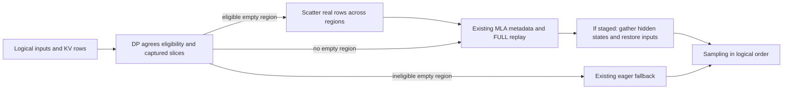

# [MRV2] Stage imbalanced MLA decode rows for FULL microbatch graphs

[Upstream PR](https://github.com/vllm-project/vllm/pull/63556) · state: open · merged: False

## Original PR description

## Overview

Keep eligible MRV2 single-token MLA decode on its captured FULL microbatch graph when uneven DP loads leave the last region empty. This PR adds the complete staging, metadata, replay and restoration path; it does not enable DBO itself.

**Evidence:** serving A/B measured **+15.52% output throughput**, with TPOT p95 improving from **132.017 to 113.930 ms**, when generalized decode staging replaced eager fallback with FULL replay under a 63/97 load and bucket 128. The directed model regression on PR head `b6660643fb` exercises the staging path successfully. A separate ShareGPT comparison completed 9,216 requests with **zero staging activations** under default buckets and normal routing. Test configurations and source versions are documented below.

## Claims

- Reuse captured slices to distribute real token rows, preserving input/position/KV-slot correspondence.
- Restore hidden states and input buffers to logical order before sampling.
- Agree eligibility in the existing DP collective and keep eager fallback for unsupported configurations.

## Details

### Problem and concrete example

For DP loads `[63,97]` and graph bucket 128, the captured regions are `[0,64)` and `[64,128)`. The smaller rank's contiguous 63 rows leave its second region empty, so the group uses eager. Staging places 32 real rows at `[0,32)` and 31 at `[64,95)`; the remaining rows are padding.

This is conditional on the selected bucket. With the normal dense bucket 104, 63/97 already reaches both regions and needs no staging; 40/97 still leaves a region empty. The regression fixes bucket 128 to exercise the branch, rather than representing its frequency under normal traffic.



### Implementation and tradeoff

1. `gpu/dp_utils.py` carries one staging-capability bit per rank in the existing CPU collective. All ranks must support staging and agree on FULL single-token decode. The existing `is_last_ubatch_empty()` handles the boundary, including equality at the split.
2. `gpu/ubatch_utils.py` reuses `create_ubatch_slices()`. It distributes `n // k + (i < n % k)` real rows per region, checks capacity before mutation, and scatters IDs, positions, block-table rows and KV slots together. Temporary buffers protect overlapping sources; padding slots remain `-1`.
3. `UBatchRunner.prepare()` uses `_slice_input_batch()` for logical sequence metadata and each region's actual capacity for padding. It reuses persistent query/sequence buffers and `DefaultModelState.prepare_attn()`, preserving graph addresses and the backend's metadata contract.
4. `gpu/model_runner.py` gathers model outputs using `staged_rows`, then restores IDs, positions, block tables, slots and padding before post-forward consumers run. Restoring only hidden states would leave sampling with reordered inputs.

Production scope is **+162/−7 lines across three files**; the full PR is +360/−15 including tests, CI and docs. The cost is temporary device storage, scatter/gather and restoration writes on staged steps. The capability vote adds CPU metadata to existing coordination. There is no additional collective, graph-bucket policy, communication stream or dispatch-capacity change; these costs have not been isolated by profiling.

### Compatibility and related work

Supported: default model state, NIXL EP, `FLASH_ATTN_MLA`, unquantized BF16 weights/KV, TP1 and single-token decode. Prompt embeddings, EPLB, KV transfer and returned routes retain eager fallback. Existing DBO restrictions for LoRA, speculation, PP/CP and multimodal models remain enforced by `VllmConfig`; existing token-threshold validation is reused.

- #57020 fixes the empty-region boundary with eager fallback. This PR retains fallback and adds an eligible graph-preserving path; the overlapping boundary change needs reconciliation when either merges.
- Closed prototype #57184 supplied the review context; this replacement follows its captured-slice and input-restoration guidance. No equivalent open staging implementation was found in the refreshed search.
- #63485 independently changes NIXL runtime capacity. It is **not a prerequisite**.
- #63567 depends on this PR and adds returned-route support. FA3 and broader backend microbatch support remain follow-ups.

## Validation

### Serving measurements and configuration comparison

Serving A/B measurements used three formal trials per arm after warmup. Throughput is total output tokens divided by whole-round duration.

| DeepSeek-V2-Lite workload | Reference DBO requesting graphs | Staging | Throughput change |
| --- | ---: | ---: | ---: |
| DP2/EP2, rank-directed 63/97, 160 requests; generalized implementation | 1195.53 ± 6.81 tok/s | 1381.12 ± 7.89 tok/s | **+15.52%** |
| DP2/EP2, random 1024 requests, concurrency 256; prototype | 1995.81 tok/s | 2207.42 tok/s | +10.60% |
| DP8/EP8, random 1024 requests, concurrency 256; prototype | 7646.60 ± 17.61 tok/s | 7626.20 ± 53.81 tok/s | −0.27% |

Values are means; ± is sample SD where retained in the report. Source versions and implementation differences are listed below.

**The directed DP2 comparison verifies the mechanism:** the reference recorded 499–501 eager fallback steps per rank and zero replay calls per trial; staging recorded zero fallback steps and 496–498 actual `CUDAGraph.replay()` calls per rank. The smaller rank staged 32/31 rows, and both ranks used FULL with two microbatches throughout the verified common decode window. Prefill and request-drain steps were outside that window. Both arms used the same CPU-only observer; GPU resources were shared.

The same paired runs also improved decode and end-to-end latency. Percentiles pool 480 requests per arm across the three trials:

| Latency | Reference | Staging |
| --- | ---: | ---: |
| TPOT p50 | 131.128 ms | **113.426 ms** |
| TPOT p95 | 132.017 ms | **113.930 ms** |
| End-to-end p50 | 68.145 s | **58.948 s** |
| End-to-end p95 | 68.873 s | **59.621 s** |

**Shared DP2 deployment settings:** single-host 2×H200, identical DeepSeek-V2-Lite weights (revision `604d5664dddd88a0433dbae533b7fe9472482de0`), BF16, DP2/EP2/TP1, NIXL EP, `FLASH_ATTN_MLA`, `batched_triton`, DBO with two microbatches, max sequences 256 and token budget 8192. Neither serving setup includes #63485's NIXL runtime-capacity optimization.

| Setting | Directed DP2 A/B | ShareGPT serving |
| --- | --- | --- |
| Rank loads / routing | Directed 63/97 | Normal HTTP DP routing |
| Graph capture buckets | Explicit `[1,2,4,8,16,32,64,128,256]`; 63/97 selects 128 | Default dense buckets; 63/97 can select 104 |
| Request lengths / termination | 128 input / 512 output tokens; greedy, ignore EOS | Natural prompt/reply lengths; greedy, EOS enabled |
| Prefix caching | Off | On |
| Scheduling | Async setting not explicitly recorded | Default async scheduling on |
| KV budget / max model length | GPU memory utilization 0.85; no explicit max-length override | 8 GiB KV/rank; max length 2048 |
| Runtime versions | Exact dependency inventory unavailable | Native Torch 2.13/cu129, NIXL 1.5 |

**Bucket choice explains why 63/97 can need staging in one setup and not the other.** Bucket 128 splits at row 64 and leaves an empty region; bucket 104 splits at row 52 and already fills both regions. Both source versions generate dense defaults; the directed A/B explicitly configured sparse buckets. Other legal imbalances, such as 40/97 at bucket 104, still leave a region empty under the source admission rules. ShareGPT runs below observed zero activation and therefore do not repeat the active-staging comparison.

### DP8 balanced control and multi-rank decode coverage

8×H200, DeepSeek-V2-Lite BF16, DP8/EP8/TP1, NIXL EP, `FLASH_ATTN_MLA`, two microbatches, decode threshold 32. Each request used 128 input / 512 output tokens, greedy and ignore EOS. Each matched-load comparison used three trials per arm after warmup:

| Rank loads | Reference path | Staging-arm path | Reference output tok/s | Staging-arm output tok/s | Change |
| --- | --- | --- | ---: | ---: | ---: |
| `80×8` | FULL | FULL, no staging | 9514.35 | 9550.04 | +0.38% |
| `63/97/80×6` | Eager fallback | Staging + FULL | 4068.87 | 9619.33 | **+136.41%** |

The balanced control remained close while the imbalanced case recovered FULL execution. For the imbalanced case, TPOT p50 changed from **154.26 to 63.14 ms**, and end-to-end p95 from **80.75 to 33.99 s**.

The staging arm also covered **16 load patterns × 3 trials**, including mixed loads and rank rotation: **40,605 formal requests**, **20,789,760 output tokens**, zero request failures. Its verified common decode windows contained **188,686 rank-step observations**, all FULL with two microbatches; **29,419** involved staging. Prefill and drain steps are excluded from the FULL assertion. These are request-completion and execution-path checks, not model-output parity checks.

These DP8 measurements used the prototype identified in the source notes below. Its omitted input restoration changes active-step cost relative to the complete implementation.


### Source versions, implementation comparison and measurement records

The directed A/B reference was `73d2a8cf86c46e21af723ffd34ce0d56668fdd14`; its generalized arm was the working tree recorded in report A23. It uses the generalized scatter-and-restore design. The exact measured working-tree patch/hash chain and original trial directories are no longer retained; reports preserve trial values and execution counts. Full-model numerical parity was not established for those measured versions. The head-specific regression below supplies separate model-output coverage.

The prototype DP2/DP8 measurements, including the DP8 matched-load control and load-pattern coverage above, used the fixed-two-region implementation (DP8 source `a1270ac5f0baaae674275199b85ef07b1e36e60d`). It omitted logical input restoration and was subsequently found to have position-dependent sampling defects. All used greedy/ignore-EOS. The random runs did not record staging activation counts; their throughput changes cannot be attributed entirely to staging. The directed DP8 runs recorded path counts as shown above. Prototype timings do not include this head's input-restoration work. The +15.52% measurement belongs to the A23 generalized implementation identified above.

[Measurement records, configuration and provenance](https://gist.github.com/algebra-MCX/2bdf65eb2b4151e706a7f952882d740f).


### Directed correctness and regression coverage

Model source: current head `b6660643fb`; 2×H200, DeepSeek-V2-Lite BF16, DP2/EP2/TP1, NIXL 1.5, `batched_triton`, MLA. The public `AsyncLLM` test directs 63/97 requests, generates eight greedy tokens, and compares eager DBO with staged FULL DBO.

| Check | Result and limit |
| --- | --- |
| Current-head model regression | **1 passed**, 160 requests per arm; both ranks observed the expected FULL128 replay. The assertion requires an observation, not every decode step. |
| Model-output comparison | Repository comparator passed; 8/160 greedy sequences diverged and were accepted by its mutual-top-5 rule at the first divergence. This does not establish exact token/logprob equality. |
| Earlier integration components retained in this diff | **39 cases passed** in that earlier run, covering slices, row restoration and split boundaries. Six removed FA3 cases are excluded; this is not a fresh current-head component run. |
| Capacity rejection | Four cases fail without the capacity guard and pass with it, before any input mutation. |
| Shared DP coordination | **2 passed**, covering existing skip-drafts/DP1 semantics. |
| Applicable local pre-commit, including mypy | **Passed**. |

Helper tests with odd sizes and k=2/3/4/8 check row-layout behavior; they do not validate NIXL model execution with k>2.

### Reproduction, environment and CI status

```bash
.venv/bin/python -m pytest -q tests/v1/worker/test_gpu_ubatch_slicing.py
.venv/bin/python -m pytest -q tests/v1/worker/test_gpu_dp_utils.py
VLLM_USE_V2_MODEL_RUNNER=1 VLLM_WORKER_MULTIPROC_METHOD=spawn \
  VLLM_GPU_SYNC_CHECK=error .venv/bin/python -m pytest -v -s \
  tests/v1/distributed/test_dbo.py -m nixl_ep
```

Model runs used native torch 2.13/cu129 + NIXL 1.5 with current-source stable C/MoE extensions, without a binding alias shim. Directed settings: max length 256, max sequences 128, token budget 2048, 1 GiB KV/rank, FULL bucket `[128]`, prefix caching/async scheduling off, 20 distinct synthetic prompts across 160 requests. This is controlled branch coverage.

The new two-H100 Buildkite step installs NIXL with the existing installer and selects `nixl_ep`; existing DeepEP steps exclude that marker. Upstream CI has **not** passed: the [author/label pre-run gate](https://github.com/vllm-project/vllm/actions/runs/40180424122/job/121130105206) stopped execution before pre-commit. Read the Docs also stopped at that gate. Local hook results are separate from upstream CI.


### Current-head natural ShareGPT serving

Same clean head, normal HTTP DP routing, default graph buckets, async scheduling/prefix caching on, EOS enabled, natural prompt/reply lengths. Two workloads: 512 requests at concurrency 128, and 512 with modeled Poisson arrivals at 8 requests/s. Three trials per arm after warmup, counterbalanced launch order.

`staging off` overrides only the capability method on the **same source**, retaining DBO and safe fallback; it is not an upstream-base comparison. `DBO off` omits DBO. #63485 is absent.

Mean ± sample SD; throughput is output tokens divided by whole-round duration:

| Load | Configuration | Output tok/s | Mean TTFT ms | Mean TPOT ms |
| --- | --- | ---: | ---: | ---: |
| Concurrency 128 | DBO off | 1432.28 ± 165.31 | 338.05 ± 28.92 | 60.65 ± 0.73 |
| Concurrency 128 | DBO on, staging off | 1012.59 ± 81.56 | 376.31 ± 3.70 | 96.40 ± 0.16 |
| Concurrency 128 | DBO on, staging on | 1013.07 ± 78.20 | 406.37 ± 43.60 | 96.77 ± 0.47 |
| Arrival rate 8 req/s (Poisson) | DBO off | 1288.88 ± 70.31 | 170.78 ± 3.89 | 59.20 ± 0.25 |
| Arrival rate 8 req/s (Poisson) | DBO on, staging off | 988.85 ± 27.20 | 228.47 ± 3.20 | 90.57 ± 0.60 |
| Arrival rate 8 req/s (Poisson) | DBO on, staging on | 986.45 ± 18.74 | 229.05 ± 0.28 | 90.93 ± 0.61 |

All **9,216/9,216** formal requests completed, zero request failures; all nine servers exited 0 without forced cleanup. Native staging eligibility was true, but observed staging calls were **zero**. Thus these results establish zero activation on this load; they do not measure active scatter/restore cost or prove a staging speedup/regression. DBO itself was slower than disabled here.

The same CPU-only observer ran on both staging arms, with no tensor reads or GPU synchronization. Generated output lengths differed across launches; this benchmark did not evaluate numerical parity. Settings differ from the directed test: max length 2048, max sequences 256, token budget 8192, 8 GiB KV/rank. ShareGPT is conversation data with modeled arrivals, not production telemetry. [Protocol, provenance, every trial and independent recomputation](https://gist.github.com/algebra-MCX/2bdf65eb2b4151e706a7f952882d740f#file-s01-natural-summary-md).

### Remaining review and validation

The key value question is whether real supported workloads trigger staging often enough to repay its copies; the natural run above does not demonstrate that. Active staging with default async scheduling, other graph/load combinations and multi-node behavior still need validation.

I do not have multi-node GPU access. Help testing a supported BF16/NIXL-EP/MLA/TP1 deployment would be useful: compare DBO off, DBO on/staging off and DBO on/staging on, keep #63485 constant, and report activation/FULL/eager counts, throughput, TTFT/TPOT and model outputs. DBO's communication-overlap motivation makes wide-EP worth testing; a cluster gain is a hypothesis, not an established result.

---

### Pull Request Checklist

- [x] I used vLLM's `/pr-checklist` skill.
- [x] AI assistance: OpenAI Codex assisted with implementation, validation and documentation.
- [x] **Design Fit:** Existing slices, metadata builders, configuration checks and replay are reused.
- [x] **Testing and Validation:** Serving measurements, model regression, source versions and outstanding coverage are documented.
- [x] **Code Quality and Style:** Applicable local hooks passed; rendered compatibility docs are included.
- [x] **Pull Request Contents:** Problem, implementation, cost, dependencies, results and reproduction are documented.


## Review and discussion

### reviews

- claude[bot] · COMMENTED · 2026-10-25T09:30:57Z · [source](https://github.com/vllm-project/vllm/pull/63556#pullrequestreview-5642496755)

## Claude Code Review

This pull request is from a fork — automated review is disabled. A repository maintainer can comment `@claude review` to run a one-time review.

### issue_comments

- mergify[bot] · comment · 2026-10-25T09:06:36Z · [source](https://github.com/vllm-project/vllm/pull/63556#issuecomment-6395745829)

Documentation preview: https://vllm--63556.org.readthedocs.build/en/63556/

- algebra-MCX · comment · 2026-10-26T05:01:56Z · [source](https://github.com/vllm-project/vllm/pull/63556#issuecomment-6408628147)

Hi @specture724 @aoshen02, could you take a look at this PR when you have time?

**PR #63556 — MRV2 MLA Decode Staging**
https://github.com/vllm-project/vllm/pull/63556

**Problem**

Uneven DP decode loads can leave a captured microbatch region empty, forcing eager fallback despite an available FULL CUDA Graph.

**Proposed Fix**

Spread real decode tokens across the existing captured regions, reuse the attention metadata builder, and restore logical outputs and inputs before sampling. Eligibility is agreed across DP ranks, with eager fallback for unsupported configurations.

This is the focused staging replacement for the closed prototype #57184.

**Validation**

- Model regression: passed on 2×H200, DP2/EP2/TP1, DeepSeek-V2-Lite BF16, NIXL EP/MLA, using the repository's output comparator.
- Directed correctness case: 63/97 requests, graph bucket 128, eight output tokens; actual FULL replay observed on both ranks.
- Applicable pre-commit hooks, including mypy: passed.
- Model runs used torch 2.13/cu129; pinned torch 2.14 model validation remains pending.
- Current-head production performance is unmeasured. Commands and detailed limitations are in the description.

**Related PRs**

- #63567 adds returned-route compatibility and depends on this PR.
- #63485 independently optimizes NIXL dispatch sizing.

cc @njhill

- specture724 · comment · 2026-10-28T06:53:24Z · [source](https://github.com/vllm-project/vllm/pull/63556#issuecomment-6462703367)

Marked, I'll review next monday.

- mergify[bot] · comment · 2026-10-28T21:00:23Z · [source](https://github.com/vllm-project/vllm/pull/63556#issuecomment-6480570986)

This pull request has merge conflicts that must be resolved before it can be
merged. Please rebase the PR, @algebra-MCX.

https://docs.github.com/en/pull-requests/collaborating-with-pull-requests/working-with-forks/syncing-a-fork


### inline_comments

## Changed files and fixed code

- `.buildkite/test_areas/distributed.yaml` · modified · additions 19 / deletions 3
  - [head](https://github.com/algebra-MCX/vllm/blob/b6660643fbd0514faa08bfcdb7d29bbac1b57ac9/.buildkite/test_areas/distributed.yaml)
  - [base](https://github.com/vllm-project/vllm/blob/921ed7fa11c41b89ce36e81f50fb3b1c293dc8f7/.buildkite/test_areas/distributed.yaml)
- `docs/design/dbo.md` · modified · additions 9 / deletions 1
  - [head](https://github.com/algebra-MCX/vllm/blob/b6660643fbd0514faa08bfcdb7d29bbac1b57ac9/docs/design/dbo.md)
  - [base](https://github.com/vllm-project/vllm/blob/921ed7fa11c41b89ce36e81f50fb3b1c293dc8f7/docs/design/dbo.md)
- `pyproject.toml` · modified · additions 1 / deletions 0
  - [head](https://github.com/algebra-MCX/vllm/blob/b6660643fbd0514faa08bfcdb7d29bbac1b57ac9/pyproject.toml)
  - [base](https://github.com/vllm-project/vllm/blob/921ed7fa11c41b89ce36e81f50fb3b1c293dc8f7/pyproject.toml)
- `tests/v1/distributed/test_dbo.py` · modified · additions 127 / deletions 0
  - [head](https://github.com/algebra-MCX/vllm/blob/b6660643fbd0514faa08bfcdb7d29bbac1b57ac9/tests/v1/distributed/test_dbo.py)
  - [base](https://github.com/vllm-project/vllm/blob/921ed7fa11c41b89ce36e81f50fb3b1c293dc8f7/tests/v1/distributed/test_dbo.py)
- `tests/v1/worker/test_gpu_ubatch_slicing.py` · modified · additions 42 / deletions 4
  - [head](https://github.com/algebra-MCX/vllm/blob/b6660643fbd0514faa08bfcdb7d29bbac1b57ac9/tests/v1/worker/test_gpu_ubatch_slicing.py)
  - [base](https://github.com/vllm-project/vllm/blob/921ed7fa11c41b89ce36e81f50fb3b1c293dc8f7/tests/v1/worker/test_gpu_ubatch_slicing.py)
- `vllm/v1/worker/gpu/dp_utils.py` · modified · additions 24 / deletions 5
  - [head](https://github.com/algebra-MCX/vllm/blob/b6660643fbd0514faa08bfcdb7d29bbac1b57ac9/vllm/v1/worker/gpu/dp_utils.py)
  - [base](https://github.com/vllm-project/vllm/blob/921ed7fa11c41b89ce36e81f50fb3b1c293dc8f7/vllm/v1/worker/gpu/dp_utils.py)
- `vllm/v1/worker/gpu/model_runner.py` · modified · additions 9 / deletions 0
  - [head](https://github.com/algebra-MCX/vllm/blob/b6660643fbd0514faa08bfcdb7d29bbac1b57ac9/vllm/v1/worker/gpu/model_runner.py)
  - [base](https://github.com/vllm-project/vllm/blob/921ed7fa11c41b89ce36e81f50fb3b1c293dc8f7/vllm/v1/worker/gpu/model_runner.py)
- `vllm/v1/worker/gpu/ubatch_utils.py` · modified · additions 129 / deletions 2
  - [head](https://github.com/algebra-MCX/vllm/blob/b6660643fbd0514faa08bfcdb7d29bbac1b57ac9/vllm/v1/worker/gpu/ubatch_utils.py)
  - [base](https://github.com/vllm-project/vllm/blob/921ed7fa11c41b89ce36e81f50fb3b1c293dc8f7/vllm/v1/worker/gpu/ubatch_utils.py)

## Evidence and interpretation boundary

[Original JSON, discussions and patches](../../../../../../evidence/prs/vllm-project--vllm/63556-c77b16ab1a736265ed74944fa73265d5ea90b5f3ca315547df979c127d44cf26.json) · SHA-256 `c77b16ab1a736265ed74944fa73265d5ea90b5f3ca315547df979c127d44cf26`.

Diff complete: True. Missing/binary/truncated patches require pinned source inspection. This is a source page, not an independently verified optimization case. Open, merged and released are different states; recheck the deployed dependency.
