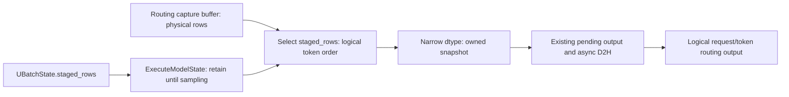

# [MRV2] Support routed-expert returns with decode staging

[Upstream PR](https://github.com/vllm-project/vllm/pull/63567) · state: open · merged: False

## Original PR description

**Depends on #63556 (open).** Both PRs target `main`; this branch contains the parent plus one commit. [Review only this increment](https://github.com/algebra-MCX/vllm/commit/21a107b5733b8c031126835e422c54b462e5d246): **production +25/−6; total +70/−9 across seven files**. The full GitHub diff includes the parent.

## Overview

Allow returned routed experts with eligible MRV2 FULL decode staging. **The parent safely falls back to eager for this combination**; this is a compatibility extension, not a fix for incorrect routing in that parent path.

The functional benefit is retaining FULL replay while returning correctly ordered expert IDs. Production throughput benefit and the frequency of this combination under natural traffic remain unmeasured.

## Claims

- Select routing rows in logical token order using the parent's existing map.
- Keep the routing snapshot valid after capture-buffer reuse, through the existing asynchronous output path.
- Lift only the returned-routes staging exclusion; retain the parent's remaining compatibility gates.

## Details

### Problem: routing storage still has the staged layout

With 63 real tokens and graph bucket 128, the parent stages real rows at `[0,32)` and `[64,95)`. It restores hidden states and input buffers before sampling, but the separate routing capture buffer still uses physical graph rows.

Logical token **32** therefore reads capture row **64**, not row 32. Taking a contiguous 63-row prefix after enabling staging would include padding and omit valid tail rows. The parent avoids that unsupported combination by selecting eager; this PR supplies the missing snapshot mapping.



### Implementation, ownership and cost

1. `gpu/model_runner.py` retains `UBatchState.staged_rows` in `ExecuteModelState` across execute→sample, then passes it to `AuxOutputWorkerConnector.prepare_output()`. This uses per-execution state instead of a mutable runner-wide map.
2. `aux_output_connector/worker.py` keeps the existing logical request IDs, token starts and query boundaries, and forwards the map to the existing capturer snapshot.
3. `routed_experts_capturer.py` selects `device_buffer[token_indices]`, then converts int32 IDs to the existing uint8/uint16 output dtype. That conversion creates owned storage before buffer reuse; no additional clone is needed. With `token_indices=None`, the original contiguous-prefix path is retained.
4. `gpu/ubatch_utils.py` removes the returned-routes exclusion after this output path is connected. NIXL EP, MLA, unquantized BF16 weights/KV, TP1/default model state and the parent's remaining restrictions still apply.

The map is reused rather than reconstructed from already-restored inputs. Existing rank-localization/capture-offset logic solves different problems and cannot replace within-rank row selection. Merged #63372 handles microbatch write offsets; this change handles snapshot row order. #63485 is independent.

Indexed selection adds an int32 gather temporary before dtype conversion on staged routing steps. Its isolated memory/time cost has not been measured. Existing pending-output ownership, copy-stream ordering and D2H transfer are reused; this PR adds no communication stream, collective, dispatch-capacity change or fused kernel.

## Validation

### Current-head results

Source: `21a107b573`; DeepSeek-V2-Lite BF16, 2×H200, DP2/EP2/TP1, NIXL EP/MLA, DBO on. The model regression compares eager and FULL runs with returned routes and prefix caching enabled.

| Check | Result | What it establishes |
| --- | --- | --- |
| Component suites | **92 passed** | Indexed/default snapshots, dtype, row layout and snapshot survival after capture-buffer overwrite. |
| Contributed model regression | **1 passed**, 160 requests per arm | Completion, route shape/expert-ID range, standard model-output comparison and actual FULL128 observations on both ranks. |
| Separate same-execution route diagnostic | **160/160 responses; 2,716 token rows matched** | Final returned routes match independently selected physical capture rows for the corresponding logical tokens. |
| Negative control: drop the map in an already-staged run | **31 incorrect responses / 217 wrong rows detected** | The diagnostic detects lost row correspondence. This is fault injection, not the parent's safe eager behavior. |
| Applicable local pre-commit, including mypy | **Passed** | Local static/style checks. |

The routing reference uses the same execution's capture buffer and independently constructs the two-region selection; it does not reuse the passed map or perform a second router forward. This verifies selection/return identity, not independent router numerical correctness.

**Coverage gap:** the contributed model test checks route shape/range, but its output comparator does not compare returned routes. Exact response-to-row identity is currently a local diagnostic, not an upstream CI assertion. The standard eager/FULL comparator allows mutual-top-5 alternatives; it does not prove exact token or numerical-logprob equality.

<details>
<summary>Reproduction, configuration and diagnostic boundaries</summary>

```bash
# Components: 92 passed.
.venv/bin/python -m pytest -q tests/v1/worker/test_gpu_ubatch_slicing.py \
  tests/model_executor/test_routed_experts_capture.py

# Returned-routes model case: 1 passed.
VLLM_USE_V2_MODEL_RUNNER=1 VLLM_WORKER_MULTIPROC_METHOD=spawn \
  VLLM_GPU_SYNC_CHECK=error .venv/bin/python -m pytest -v -s \
  tests/v1/distributed/test_dbo.py \
  -k 'test_mrv2_imbalanced_decode_keeps_full_graph and True'
```

Model/diagnostic runs used native torch 2.13/cu129 + NIXL 1.5 with current-source stable C/MoE extensions, no binding alias shim. Components used torch 2.14/cu126. Full model validation on torch 2.14 remains pending.

Directed settings: loads 63/97, FULL bucket `[128]`, prompt lengths 8/12 and eight output tokens for the contributed model test; max length 256, max sequences 128, token budget 2048, 1 GiB KV/rank, greedy with five logprobs. Prefix caching was on and async scheduling off. Existing async output transfer was exercised; active staging with async scheduling is still unvalidated. FULL assertions require observations, not every decode step.

The separate identity diagnostic uses 160 distinct synthetic prompts. Its observer/fault injection is outside the production diff and adds GPU copies, so it is not performance evidence. An initial post-pytest diagnostic failed while joining internal/external request IDs; ID normalization was corrected and the diagnostic rerun completed successfully. The model pytest itself had passed. The successful diagnostic required forced engine cleanup after its shutdown grace period; clean teardown is not established by that run.

[Configurations, diagnostic code and results](https://gist.github.com/algebra-MCX/2bdf65eb2b4151e706a7f952882d740f).

</details>

### Performance, CI and remaining work

The 63/97 eight-token cases are directed correctness workloads, not representative production traffic. No isolated gather-cost or representative serving-speedup claim is made. The [parent's current-head natural ShareGPT run](https://gist.github.com/algebra-MCX/2bdf65eb2b4151e706a7f952882d740f#file-s01-natural-summary-md) used returned routes **off** and activated staging **zero times**; it does not validate this feature's correctness or performance.

This regression reuses the parent's two-H100 NIXL Buildkite step; component checks remain in the existing suites. Future changes limited to capturer/aux-output files may require those paths to be added to that step's source dependencies. Upstream CI is not green: the [author/label pre-run gate](https://github.com/vllm-project/vllm/actions/runs/40182150450/job/121135263508) failed before pre-commit, and [Read the Docs](https://app.readthedocs.org/projects/vllm/builds/35389933/) reports failure. Local passes are separate from upstream CI.

This PR stays **Draft** while #63556 is reviewed. Remaining validation includes a deterministic CI check for lost row mapping, the pinned torch 2.14 model stack, active staging with async scheduling, and multi-node NIXL EP. I lack multi-node GPU access; after establishing a supported staging workload for #63556, help measuring the incremental routing cost and returned-row correctness would be useful. A multi-node benefit is not yet established.

---

<details>
<summary> Pull Request Checklist </summary>

- [x] I used vLLM's `/pr-checklist` skill.
- [x] AI assistance: OpenAI Codex assisted with implementation, validation and documentation.
- [x] **Design Fit:** Reuses the parent map and existing snapshot/output flow; scope and gather cost are explained.
- [x] **Testing and Validation:** Model, exact-row diagnostic and fault injection are distinguished from CI coverage and performance.
- [x] **Code Quality and Style:** Applicable local hooks passed; compatibility docs are included.
- [x] **Pull Request Contents:** Dependency, incremental review entry, problem, diagram, implementation and remaining gaps are explicit.

</details>

---
<a href="https://app.blacksmith.sh/vllm-project/codesmith/vllm/pr/63567?autoLogin=true&ref=codesmith_pr_footer"><picture><source media="(prefers-color-scheme: dark)" srcset="https://pr-comments-assets.blacksmith.sh/codesmith/view-with-codesmith-dark-v3.svg"><source media="(prefers-color-scheme: light)" srcset="https://pr-comments-assets.blacksmith.sh/codesmith/view-with-codesmith-light-v3.svg"></picture></a> <a href="https://backend.blacksmith.sh/track/enable-autofix?expires=1795513664&installation_model_id=425286&pr_number=63567&ref=codesmith_pr_footer&repository=vllm-project%2Fvllm&return_to=https%3A%2F%2Fgithub.com%2Fvllm-project%2Fvllm%2Fpull%2F63567&signature=7971437ea0c6a9056e3029e51196b99bbee2d2185af39390b44cd7f53084be61"><picture><source media="(prefers-color-scheme: dark)" srcset="https://pr-comments-assets.blacksmith.sh/codesmith/autofix-with-codesmith-dark.svg"><source media="(prefers-color-scheme: light)" srcset="https://pr-comments-assets.blacksmith.sh/codesmith/autofix-with-codesmith-light.svg"></picture></a>
<sup>Need help on this PR? Tag <code>@codesmith-bot</code> with what you need.</sup>

<!-- codesmith:autofix:disabled -->
<!-- /codesmith:footer -->

## Review and discussion

### reviews

### issue_comments

- mergify[bot] · comment · 2026-10-25T09:48:07Z · [source](https://github.com/vllm-project/vllm/pull/63567#issuecomment-6396131030)

Documentation preview: https://vllm--63567.org.readthedocs.build/en/63567/

- algebra-MCX · comment · 2026-10-26T05:02:00Z · [source](https://github.com/vllm-project/vllm/pull/63567#issuecomment-6408628837)

Hi @specture724 @njhill, could you take a look at this PR when you have time?

**PR #63567 — Returned Routes with MRV2 Decode Staging**
https://github.com/vllm-project/vllm/pull/63567

**Problem**

The parent #63556 safely falls back to eager when returned routed experts are enabled, so route returns and FULL decode staging cannot be used together.

**Proposed Fix**

Carry the parent's staged-row map into the existing routing snapshot to return expert IDs in logical token order, with stable ownership through asynchronous output.

The production increment is **+25/−6 lines**. [Review this increment](https://github.com/algebra-MCX/vllm/commit/21a107b5733b8c031126835e422c54b462e5d246).

**Validation**

- Setup: 2×H200, DP2/EP2/TP1, DeepSeek-V2-Lite BF16, NIXL EP/MLA.
- Component tests: 92 passed. Model regression: 1 passed.
- Same-execution reference: all 2,716 returned token rows matched across 160 responses.
- Negative control: dropping the row map detected 217 wrong rows in 31 responses.
- Model runs used torch 2.13/cu129 + NIXL 1.5; torch 2.14 model validation remains pending.
- Production performance is unmeasured.

**Related PRs**

- #63556 is the prerequisite. This PR remains Draft while the parent is reviewed.
- #63372 already merged the separate microbatch capture-offset fix.
- #63485 is independent.

cc @mgoin @aoshen02

- mergify[bot] · comment · 2026-10-28T21:00:37Z · [source](https://github.com/vllm-project/vllm/pull/63567#issuecomment-6480575708)

This pull request has merge conflicts that must be resolved before it can be
merged. Please rebase the PR, @algebra-MCX.

https://docs.github.com/en/pull-requests/collaborating-with-pull-requests/working-with-forks/syncing-a-fork


### inline_comments

## Changed files and fixed code

- `.buildkite/test_areas/distributed.yaml` · modified · additions 19 / deletions 3
  - [head](https://github.com/algebra-MCX/vllm/blob/21a107b5733b8c031126835e422c54b462e5d246/.buildkite/test_areas/distributed.yaml)
  - [base](https://github.com/vllm-project/vllm/blob/24324ef0f667c633ee9bbb9412343d829f7e6d4e/.buildkite/test_areas/distributed.yaml)
- `docs/design/dbo.md` · modified · additions 11 / deletions 1
  - [head](https://github.com/algebra-MCX/vllm/blob/21a107b5733b8c031126835e422c54b462e5d246/docs/design/dbo.md)
  - [base](https://github.com/vllm-project/vllm/blob/24324ef0f667c633ee9bbb9412343d829f7e6d4e/docs/design/dbo.md)
- `pyproject.toml` · modified · additions 1 / deletions 0
  - [head](https://github.com/algebra-MCX/vllm/blob/21a107b5733b8c031126835e422c54b462e5d246/pyproject.toml)
  - [base](https://github.com/vllm-project/vllm/blob/24324ef0f667c633ee9bbb9412343d829f7e6d4e/pyproject.toml)
- `tests/v1/distributed/test_dbo.py` · modified · additions 135 / deletions 0
  - [head](https://github.com/algebra-MCX/vllm/blob/21a107b5733b8c031126835e422c54b462e5d246/tests/v1/distributed/test_dbo.py)
  - [base](https://github.com/vllm-project/vllm/blob/24324ef0f667c633ee9bbb9412343d829f7e6d4e/tests/v1/distributed/test_dbo.py)
- `tests/v1/worker/test_gpu_ubatch_slicing.py` · modified · additions 74 / deletions 4
  - [head](https://github.com/algebra-MCX/vllm/blob/21a107b5733b8c031126835e422c54b462e5d246/tests/v1/worker/test_gpu_ubatch_slicing.py)
  - [base](https://github.com/vllm-project/vllm/blob/24324ef0f667c633ee9bbb9412343d829f7e6d4e/tests/v1/worker/test_gpu_ubatch_slicing.py)
- `vllm/distributed/aux_output_connector/worker.py` · modified · additions 6 / deletions 2
  - [head](https://github.com/algebra-MCX/vllm/blob/21a107b5733b8c031126835e422c54b462e5d246/vllm/distributed/aux_output_connector/worker.py)
  - [base](https://github.com/vllm-project/vllm/blob/24324ef0f667c633ee9bbb9412343d829f7e6d4e/vllm/distributed/aux_output_connector/worker.py)
- `vllm/model_executor/layers/fused_moe/routed_experts_capturer.py` · modified · additions 9 / deletions 2
  - [head](https://github.com/algebra-MCX/vllm/blob/21a107b5733b8c031126835e422c54b462e5d246/vllm/model_executor/layers/fused_moe/routed_experts_capturer.py)
  - [base](https://github.com/vllm-project/vllm/blob/24324ef0f667c633ee9bbb9412343d829f7e6d4e/vllm/model_executor/layers/fused_moe/routed_experts_capturer.py)
- `vllm/v1/worker/gpu/dp_utils.py` · modified · additions 24 / deletions 5
  - [head](https://github.com/algebra-MCX/vllm/blob/21a107b5733b8c031126835e422c54b462e5d246/vllm/v1/worker/gpu/dp_utils.py)
  - [base](https://github.com/vllm-project/vllm/blob/24324ef0f667c633ee9bbb9412343d829f7e6d4e/vllm/v1/worker/gpu/dp_utils.py)
- `vllm/v1/worker/gpu/model_runner.py` · modified · additions 19 / deletions 1
  - [head](https://github.com/algebra-MCX/vllm/blob/21a107b5733b8c031126835e422c54b462e5d246/vllm/v1/worker/gpu/model_runner.py)
  - [base](https://github.com/vllm-project/vllm/blob/24324ef0f667c633ee9bbb9412343d829f7e6d4e/vllm/v1/worker/gpu/model_runner.py)
- `vllm/v1/worker/gpu/ubatch_utils.py` · modified · additions 128 / deletions 2
  - [head](https://github.com/algebra-MCX/vllm/blob/21a107b5733b8c031126835e422c54b462e5d246/vllm/v1/worker/gpu/ubatch_utils.py)
  - [base](https://github.com/vllm-project/vllm/blob/24324ef0f667c633ee9bbb9412343d829f7e6d4e/vllm/v1/worker/gpu/ubatch_utils.py)

## Evidence and interpretation boundary

[Original JSON, discussions and patches](../../../../../../evidence/prs/vllm-project--vllm/63567-77b94d2448cebc61cb5dfa28760be8cb562ac0c4b304e0811fea573b00b82029.json) · SHA-256 `77b94d2448cebc61cb5dfa28760be8cb562ac0c4b304e0811fea573b00b82029`.

Diff complete: True. Missing/binary/truncated patches require pinned source inspection. This is a source page, not an independently verified optimization case. Open, merged and released are different states; recheck the deployed dependency.
