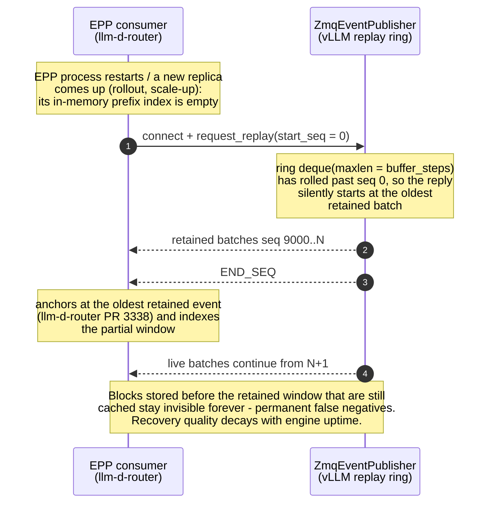
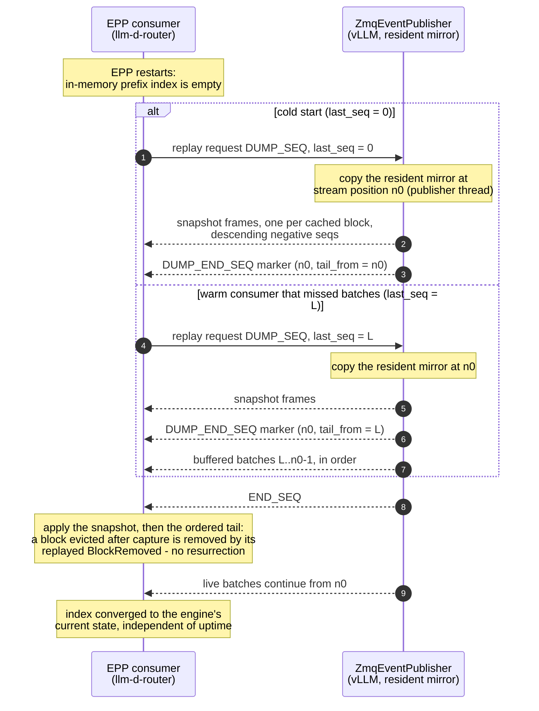

# [KV Events] Add snapshot dump handshake to ZMQ event replay

[Upstream PR](https://github.com/vllm-project/vllm/pull/63571) · state: closed · merged: False

## Original PR description

## Overview

- Adds an additive **snapshot dump handshake** to the KV-events ZMQ publisher's replay ROUTER, so external consumers can recover the engine's *complete* currently-cached block state after a restart/rollout, instead of only the last `buffer_steps` batches the replay ring still holds.
- Closes #63570

## Claims

- A cold-starting consumer (`last_seq == 0`) receives the full resident-block snapshot and no duplicate history — recovery no longer decays with engine uptime.
- A warm consumer with a gap (`last_seq > 0`) receives the snapshot plus exactly the `[last_seq, n0)` batches it may have missed; if the ring no longer reaches back that far, `tail_from` in the `DUMP_END_SEQ` marker makes the discontinuity detectable.
- Fully backward compatible: the protocol is additive (a 4-frame request with a reserved sentinel); consumers that never send `DUMP_SEQ` see zero behavior change.
- Publisher-side cost is bounded: one retained payload per currently cached block (shared for multi-block span events), on the same order as the existing replay ring; the dump itself is a CPU-only send loop in the existing publisher thread.

## Validation

- 5 new unit tests in `tests/distributed/test_events.py`:
  - `test_dump_cold_start_returns_snapshot_only` — cold start returns the resident snapshot only, `tail_from == n0`.
  - `test_dump_warm_consumer_replays_missed_window` — warm consumer gets the exact missed `[last_seq, n0)` tail.
  - `test_dump_after_all_blocks_cleared` — `AllBlocksCleared` wipes the mirror.
  - `test_dump_ignores_non_kv_event_batches` — non-KV batches leave the mirror empty.
  - `test_plain_replay_still_works_after_dump` — plain replay semantics unchanged.
- Full suite: `pytest tests/distributed/test_events.py` → **21 passed** (16 existing + 5 new), zero regressions.
- `pre-commit run --files …` passes with the repo's pinned hooks (ruff-check v0.14.0, ruff-format, typos, mypy for the oldest supported Python).

## Details

**Motivation.** The replay buffer is history-based and bounded (`deque(maxlen=buffer_steps)`, default 10,000 *batches*). Once the ring rolls, a consumer that cold-starts can only recover the retained window; blocks stored before the oldest retained batch that are still resident are permanently invisible — no future event ever mentions them again. Recovery quality therefore decays with pod uptime, which is backwards for prefix-aware routing. The primary downstream consumer (llm-d-router's EPP prefix-cache index) already handles the truncated window as best it can (llm-d/llm-d-router#3124 → #3338: anchor at the oldest retained event; "a partial window can only make the pod look colder than it is"), which documents exactly the residual false-negative gap this PR closes.

**Why a publisher-side mirror, not an engine-table walk.** `KVCacheBlock` no longer retains `token_ids` or parent hashes (they live on requests, which cached blocks outlive), so `BlockStored` events cannot be reconstructed from the block table. Instead the publisher maintains a *resident-block mirror* incrementally as it publishes: `BlockStored` records the encoded payload under each `(block_hash, medium, group_idx)` it stores — the exact bytes consumers already decode — `BlockRemoved` drops matching entries, and `AllBlocksCleared` wipes the mirror. Store/remove keys match on every emission site (block pool and the offloading connector both carry `medium` + `group_idx`). The mirror is only touched on the publisher thread, so a dump is a race-free `dict` copy taken at position `n0`.

**Protocol.** Request: `(client_id, "", DUMP_SEQ, last_seq)`. Response: snapshot frames tagged with descending negative sequence numbers → `DUMP_END_SEQ` marker carrying `n0` + `tail_from` (8-byte BE each) → buffered batches with `seq >= tail_from` → the regular `END_SEQ`.

**Correctness invariant.** Every event with `seq < n0` is already reflected in the snapshot, and every event with `seq >= n0` is published live afterwards, so snapshot + ordered tail + live stream converges to the publisher's state. Ordered application is the correctness mechanism; idempotent add/evict is only a tolerance layer — without ordering, a block captured in the snapshot and evicted right after would be resurrected permanently (its `BlockRemoved` is emitted exactly once).

**Limitations.** The tail covers only what the ring retains between `tail_from` and `n0`; if the ring has rolled past `last_seq`, the pre-ring delta is lost (detectable via `tail_from`), but the snapshot itself remains complete. Consumers must opt in and handle the new frame kinds; llm-d-router will carry the counterpart change.

---

 Pull Request Checklist 

- [x] I used vLLM's `/pr-checklist` skill. (Mandatory for agents, optional for humans).
- [x] AI assistance was used during the creation of this PR.

- [x] **Design Fit:** Minimizes impact on core components, reuses existing functionality, and justifies added complexity.
- [x] **Testing and Validation:** Validates the change and ensures any added tests are meaningful and reliable, with CI coverage or documented CI resource constraints and validation performed outside CI.
- [x] **Code Quality and Style:** Keeps code and comments clear and concise, and updates relevant documentation and examples.
- [x] **Pull Request Contents:** Includes a brief summary and relevant links, supports claims with evidence, explains root causes and implementation trade-offs, and follows the contributing guide.

## Review and discussion

### reviews

### issue_comments

- zhouyou9505 · comment · 2026-10-25T10:58:03Z · [source](https://github.com/vllm-project/vllm/pull/63571#issuecomment-6396777603)

Closing as a duplicate of #57789; the consumer side has already merged in llm-d-router, so we'll follow that protocol.

### inline_comments

## Changed files and fixed code

- `tests/distributed/conftest.py` · modified · additions 63 / deletions 1
  - [head](https://github.com/zhouyou9505/vllm/blob/1216632f0452b1386d1d0fbe8f61c2013c41a67e/tests/distributed/conftest.py)
  - [base](https://github.com/vllm-project/vllm/blob/24324ef0f667c633ee9bbb9412343d829f7e6d4e/tests/distributed/conftest.py)
- `tests/distributed/test_events.py` · modified · additions 167 / deletions 0
  - [head](https://github.com/zhouyou9505/vllm/blob/1216632f0452b1386d1d0fbe8f61c2013c41a67e/tests/distributed/test_events.py)
  - [base](https://github.com/vllm-project/vllm/blob/24324ef0f667c633ee9bbb9412343d829f7e6d4e/tests/distributed/test_events.py)
- `vllm/distributed/kv_events.py` · modified · additions 111 / deletions 4
  - [head](https://github.com/zhouyou9505/vllm/blob/1216632f0452b1386d1d0fbe8f61c2013c41a67e/vllm/distributed/kv_events.py)
  - [base](https://github.com/vllm-project/vllm/blob/24324ef0f667c633ee9bbb9412343d829f7e6d4e/vllm/distributed/kv_events.py)

## Evidence and interpretation boundary

[Original JSON, discussions and patches](../../../../../../evidence/prs/vllm-project--vllm/63571-6eeae50ccfcf21ba9d10a3a9d6ba02c4b0004f5325c2cf846de1ead6ab6b5db1.json) · SHA-256 `6eeae50ccfcf21ba9d10a3a9d6ba02c4b0004f5325c2cf846de1ead6ab6b5db1`.

Diff complete: True. Missing/binary/truncated patches require pinned source inspection. This is a source page, not an independently verified optimization case. Open, merged and released are different states; recheck the deployed dependency.
