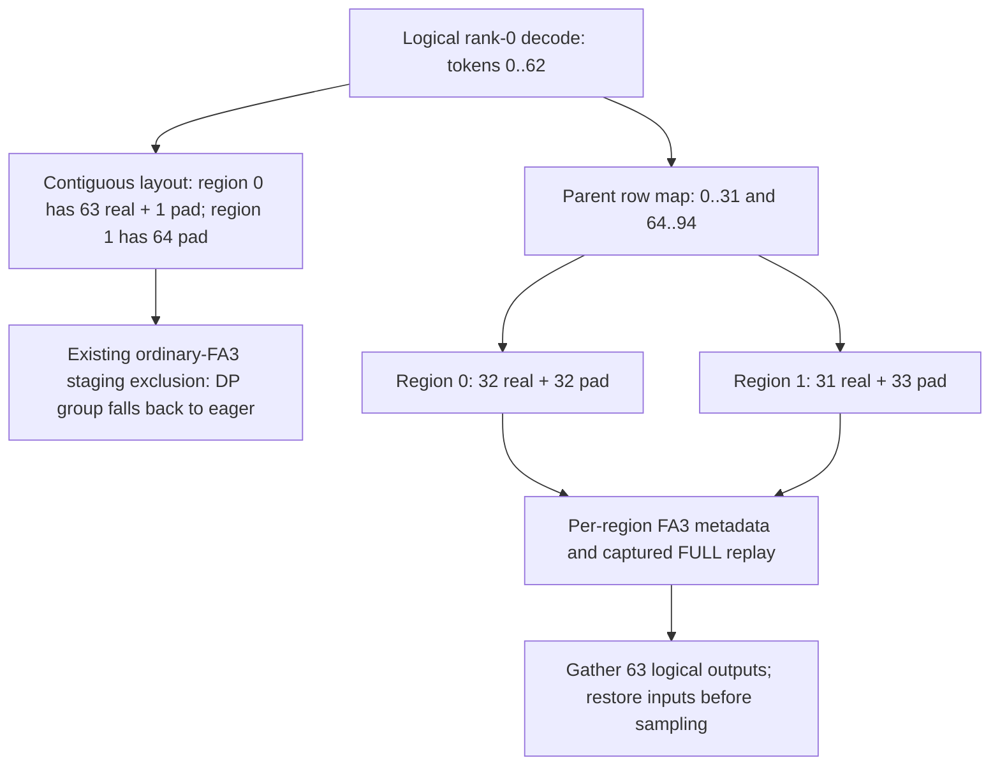

# [MRV2] Support ordinary FA3 decode staging under DP imbalance

[Upstream PR](https://github.com/vllm-project/vllm/pull/64278) · state: open · merged: False

## Original PR description

<!-- markdownlint-disable -->

## Overview

Extend the decode-staging implementation in **#63556** to ordinary causal **FlashAttention 3**, so eligible NIXL EP / BF16 / TP1 workloads such as Qwen3 MoE can retain FULL microbatch graphs under uneven DP loads.

**Depends on #63556.** This branch contains that parent plus one FA3 extension. [Review only the FA3 increment](https://github.com/algebra-MCX/vllm/compare/b6660643fbd0514faa08bfcdb7d29bbac1b57ac9...5092aabda3ad04554c00cb23954d128eecb86cf8). The full GitHub diff against `main` includes the parent. #63567 is a separate returned-routing extension and is not required here.

**Incremental production diff: +39/-9 lines in one file (net +30).** Including the parent, the complete production change is +193/-8 across three files. Tests, CI and rendered documentation are separate from those counts.

## Claims

- Admit ordinary FA3 only with causal full attention, BF16 KV, AOT scheduling and persistent FULL-graph metadata; retain the parent's NIXL, BF16-weight, TP1 and default-model-state restrictions.
- Reuse the parent's row mapping, per-region metadata construction, DP capability agreement, FULL replay, output gather and input restoration.
- Restore the previously validated FA3 metadata regressions, add Qwen/FA3 to the existing real-model regression, and document the supported configuration.

This extends where staging can run. It adds no faster attention kernel, NIXL capacity change, communication-stream change or new microbatch-count policy. **No current-head throughput improvement over all-padding replay is claimed.**

## Validation

### Checks for this submission

| Check | Result and scope |
| --- | --- |
| CPU portion of `test_gpu_ubatch_slicing.py` | **28 passed, 17 skipped**. Six restored FA3 cases and eleven existing hardware-dependent cases are not GPU passes. |
| Ruff check / format, Python compilation, whitespace | Passed. |
| Repository type checker | Passed: no issues in the three changed Python source files. |
| Test tethering and Buildkite keys | Passed (direct repository scripts). |
| New Qwen/FA3 model parameter on this exact head | **Not run locally.** It is selected by the two-H100 NIXL staging CI step. |

The initial CPU-only attempt used the archived, unregistered `cuda_only` marker and reached a CUDA fixture without a detected device: 28 passed, 11 skipped, 6 setup errors. The restored cases now use the suite's explicit hardware-availability convention and are selected in the H100 step. No CUDA failure is presented as a CPU pass.

Shared Python environments were reused; no new environment or GPU campaign was created. Direct repository checks replace hook-managed Python environments to respect the workspace environment limit. Local checks are separate from upstream CI.

```bash
# CPU checks (CUDA-dependent cases are not executed here).
CUDA_VISIBLE_DEVICES='' HF_HUB_OFFLINE=1 PYTHONPATH=. \
  .venv/bin/python -m pytest tests/v1/worker/test_gpu_ubatch_slicing.py -q

# GPU components and the Qwen model regression, selected in CI.
.venv/bin/python -m pytest tests/v1/worker/test_gpu_ubatch_slicing.py -v
VLLM_USE_V2_MODEL_RUNNER=1 VLLM_WORKER_MULTIPROC_METHOD=spawn \
  VLLM_GPU_SYNC_CHECK=error .venv/bin/python -m pytest -v -s \
  tests/v1/distributed/test_dbo.py \
  -k 'test_mrv2_imbalanced_decode_keeps_full_graph and fa3'
```

The model test reuses the parent's public AsyncLLM workload and standard `check_logprobs_close` comparator: 63/97 requests, FULL bucket 128, eight greedy output tokens, actual FULL observations on both ranks. The comparator is not a bit-exact guarantee. `DBO_TEST_FA3_MODEL` can select a local Qwen checkpoint. The original MLA parameter remains selected too; the existing H100 job gets additional source dependencies and a 30-minute limit for both models.

### Existing FA3 correctness evidence

These are **historical measurements**, reused rather than rerun. They support the mechanism and measured configurations, not a claim that this exact head has completed a new GPU/model campaign.

| Level | Workload and result |
| --- | --- |
| Single attention layer, 2026-09-18 | Nine FA3 captures, 72 replays, 45 staged replays; odd/even capacities 127/128/129 and k=2/3/4. Staged output versus compact FA3: max absolute difference 0; complete test KV matched exactly. |
| Extended attention matrix, 2026-09-20 | Twelve graphs, 156 replays, 100 staged; k=2/3/4/8. Compact FA3 output difference 0, full test KV exact. Independent PyTorch attention reference: max absolute difference 0.015625, within the existing BF16 combined tolerance. These are component results, not NIXL full-model k>2 qualification. |
| Qwen3-30B-A3B, FA3, DP2 | Eight consecutive steps, sixteen FULL rank-replays; complete logits, hidden states and all 48 layers' test KV had max absolute difference 0 against eager. Eager/eager repeat difference and top-1 mismatch were 0. Active-slot writes were checked. |
| Qwen3-30B-A3B, FA3, DP8 | Eight steps x eight ranks, 64 FULL rank-replays and 14 staged rank-steps; the same logits/hidden/full-test-KV comparisons had max absolute difference 0. |
| Prior production integration, 2026-10-25 | Slurm 14459: **45 passed**, including the six FA3 component cases restored here. Four metadata cases failed before production staging was connected because no staged row map was produced. Those four cases then passed after integration. FA3 was subsequently removed from #63556 to keep that parent MLA-only. |

The Qwen full-model checks used NIXL EP, BF16, TP1, k=2, short independent KV histories and fixed inputs. Some historical engine workers required forced teardown after the grace period; clean lifecycle compatibility was not established. The ordinary-FA3 cases do not establish long-context/task-quality coverage, async scheduling, quantization, sliding-window attention or k>2 full-model support. Counts across these suites overlap and should not be summed.

The parent already contains the staging and region-metadata preparation used here. This increment changes eligibility and tests; it does not rewrite those functions or the FA3 builder. [Archived Qwen DP2 report](https://github.com/algebra-MCX/vllm-pr-experiments/blob/main/source-files/PR_57184_docs/12-qwen-dp2-performance.md), [DP8 report](https://github.com/algebra-MCX/vllm-pr-experiments/blob/main/source-files/PR_57184_docs/16-h200-dp842-validation.md), [experiment summaries and provenance](https://github.com/algebra-MCX/vllm-pr-experiments/blob/main/reports/2026-10-25-experiments.md).

## Details

### Motivation and row layout

With DP loads 63/97 and a 128-row graph split at 64, contiguous real rows on the smaller rank leave its second captured region empty. The parent safely chooses eager for ordinary FA3 because that backend is excluded from staging. This extension allows the parent's existing layout repair when all ranks support it.



The other rank's 97 rows occupy 64/33 and need no staging. Each physical region retains its captured capacity. This depends on the selected bucket: dense default buckets can avoid an empty region, so the directed example is not an estimate of activation frequency.

### Modules, contracts and reuse

| Module | Responsibility | What this increment does |
| --- | --- | --- |
| `UBatchRunner._supports_decode_staging` | Decide whether every input/attention group can safely use the row-reordering path | Add the ordinary-FA3 eligibility branch. Require exact `FullAttentionSpec`, BF16, causal global attention, AOT-enabled `FlashAttentionMetadataBuilder` instances and FULL persistent metadata. Exclude batch-invariant mode. |
| `create_ubatch_slices` and `stage_decode_tokens` in the parent | Use actual captured regions; scatter IDs, positions, block tables and KV slots together; retain logical-to-physical rows | Reused unchanged. Temporary storage protects overlapping sources; region capacity is checked before mutation. |
| `UBatchRunner.prepare` in the parent | Obtain real sequence metadata from logical source slices, then pad to each physical region's capacity | Reused unchanged for FA3. Padding queries/sequence lengths are zero; padded KV slots are -1. |
| `DefaultModelState.prepare_attn` / `build_attn_metadata` | Call the actual attention backend builder for each microbatch | Reused unchanged; no parallel metadata implementation. |
| `FlashAttentionMetadataBuilder` | Construct the AOT schedule and update persistent scheduler storage used by capture/replay; clear unused metadata tail | Reused unchanged. This is why the gate checks actual AOT/FULL builders instead of only the backend's name. |
| DP coordination and forward contexts | Agree eligibility within the existing collective; carry each physical slice's padded size into EP metadata | Reused unchanged; no extra collective or local-empty EP shortcut. |
| Runner output gather / `restore_staged_inputs` | Restore logical hidden-state order and input state before sampling and other consumers | Reused unchanged. Returned-routing compatibility remains outside this increment. |


The benefit comes from replacing eager fallback with FULL replay. It is not an acceleration of FA3's attention arithmetic. Row copies and restoration remain costs on staged steps.

### Relationship to all-padding replay (#63823)

#63823 addresses the same empty-region problem with a **materially different data flow**: keep real rows contiguous, preserve captured request boundaries, and execute the empty region as graph padding. This PR follows the row-staging design already under review in #63556 and adds a backend to it; it is not a second implementation of #63823's slice fix.

All-padding avoids staging's scatter/gather/restoration and routing-order adaptations. Its exact head and all supported backend contracts still need their own qualification. **This FA3 extension does not establish that staging is required or faster.** If ordinary FA3 all-padding replay proves correct and sufficient, its simpler data flow may supersede this approach. No extra FA3 speedup over padding should be inferred merely from enabling the backend here.

## Workload and performance evidence

### FA3 + microbatch staging versus eager fallback: Qwen

Historical Qwen3-30B-A3B revision `ad44e777bcd18fa416d9da3bd8f70d33ebb85d39`, H200, BF16 weights/KV, ordinary FA3 AOT, NIXL EP, `batched_triton`, TP1, two microbatches. Fixed bucket `[128]`, decode threshold 2, max length 64, max requests/tokens 128 per rank, KV 1 GiB/rank, prefix caching off. Eight input tokens / 32 output tokens, greedy, ignore EOS; offline engine API, not HTTP serving. Each arm had three timed trials after separate path diagnostics; timing wrappers were removed.

| Topology / rank loads | Staging off tok/s, mean +/- sample SD | Staging on tok/s, mean +/- sample SD | Throughput change | Mean TPOT off -> on, ms | TPOT p99 off -> on, ms |
| --- | ---: | ---: | ---: | ---: | ---: |
| DP2: 63/97 | 842.45 +/- 39.49 | 1013.36 +/- 6.46 | +20.29% | 163.13 -> 133.68 | 182.97 -> 137.18 |
| DP8: 63/97/80/80/80/80/80/80 | 3551.88 +/- 18.98 | 8430.41 +/- 336.22 | +137.35% | 160.886 -> 61.147 | 170.507 -> 64.471 |
| DP8: 63/62/61/60/59/58/57/97 | 2860.89 +/- 28.94 | 7130.38 +/- 202.62 | +149.24% | 157.394 -> 56.945 | 170.929 -> 60.562 |

DP2 throughput trials, in trial order: off **864.106029 / 866.365397 / 796.867235**; on **1020.562215 / 1011.462964 / 1008.066730** tok/s. Three trials per arm covered 960 timed requests for this load, 32 output tokens each. DP2 mean TTFT slightly increased, 0.365 -> 0.379 seconds; mean E2E decreased, 5.422 -> 4.523 seconds. The balanced DP2 common-window throughput was 1114.22 -> 1109.69 tok/s (-0.41%); whole-round differences included drain-stage activation and are not a pure staging-overhead measurement.

Diagnostics confirmed uneven-load eager fallback when off and FULL with actual staging when on. DP2 devices were shared and occupancy changed; DP8's reports also record teardown limitations. Short output length, low threshold, fixed bucket and cohort admission materially affect these figures. DP8 retains archived mean/SD summaries, not a complete retained per-trial raw-data chain. These measurements show recovery from eager fallback in the recorded workloads; they do not measure this submission's exact head or ordinary FA3 against all-padding replay.

### Direct staging versus all-padding A/B: MLA only

This is the closest existing mechanism comparison, **not a Qwen/ordinary-FA3 result**. [Published full comparison and limitations](https://github.com/vllm-project/vllm/pull/63823#issuecomment-6461061974).

Same two H200s, DeepSeek-V2-Lite revision `604d5664dddd88a0433dbae533b7fe9472482de0`, BF16, DP2/EP2/TP1, NIXL EP, `batched_triton`, `FLASH_ATTN_MLA`, MRV2, DBO on, FULL128/k2; max length 1024, max sequences 128/rank, token budget 8192, KV 4 GiB/rank. Prefix caching and async scheduling off. Unique 128-token synthetic prompts / exactly 512 output tokens, greedy, ignore EOS. Three paired trials, alternating launch order after warmup.

Measured source was #63556 at `b6660643fb`; padding was an experimental helper on that same source, retaining the capability vote and static NIXL capacity. It was **not #63823's exact head**. Neither arm included #63485's runtime-capacity optimization.

| Rank loads | Arm | Output tok/s, mean +/- sample SD | TPOT mean / p95, ms | E2E mean / p95, s |
| --- | --- | ---: | ---: | ---: |
| 63/97 | Staging, real rows 32/31 | 1336.44 +/- 2.40 | 118.449 / 118.739 | 61.730 / 62.012 |
| 63/97 | All-padding, real rows 63/0 | 1360.56 +/- 8.80 | 116.327 / 117.209 | 60.505 / 60.804 |
| 65/97 | Staging arm, no staging: 64/1 | 1378.17 +/- 9.72 | 116.216 / 116.852 | 60.464 / 60.802 |
| 65/97 | Padding arm, same 64/1 path | 1370.12 +/- 1.69 | 116.916 / 117.190 | 60.866 / 60.919 |

| Rank loads | Arm | HTTP TTFT mean / p95, ms | Resume-to-first-token mean / p95, ms | ITL p95 / p99, ms |
| --- | --- | ---: | ---: | ---: |
| 63/97 | Staging | 1202.79 / 1510.76 | 725.24 / 904.92 | 120.139 / 125.141 |
| 63/97 | All-padding | 1061.93 / 1509.57 | 725.14 / 906.05 | 118.449 / 121.631 |
| 65/97 | Staging arm | 1078.15 / 1546.79 | 757.68 / 1152.81 | 118.414 / 120.756 |
| 65/97 | Padding arm | 1122.34 / 1385.43 | 749.49 / 1135.42 | 118.849 / 120.951 |

At 63/97, staging's paired throughput changes were **-2.35% / -1.28% / -1.68%**, mean **-1.77%**, 95% paired t interval **[-3.12%, -0.42%]**; mean TPOT changed **+1.83%**, interval **[+0.41%, +3.25%]**. At 65/97 neither arm stages: throughput difference **+0.59%**, interval **[-0.92%, +2.10%]**, which crosses zero. There are only three independent trial pairs. HTTP TTFT includes intentional pause/admission waiting and is not a prefill-speed claim.

All 1,932 performance requests completed; all twelve timed cohorts recorded **510 actual FULL128/k2 decode replays per rank** with the intended layouts. Prefill and drain are separate. Performance used matched CPU counters and `VLLM_GPU_SYNC_CHECK=error`; routing tensor copies were off.

Strict correctness **did not pass**: a separate 1,932-request audit found legal local routing/weights, padding/mapping and paired receive-count checks, but staged-versus-padding full sequences matched only 153/160 and 161/162 requests. Identical-prefix logprob differences exceeded the preset 0.1 tolerance at 16/10 positions, maximum 0.250703. Eager's own repeated-prefix control also exceeded it at 5/7 positions; the 65/97 arms use the same non-staging path. These observations do not isolate a staging or padding bug. Task-answer accuracy and strict interchangeability are not established by request completion.

<details>
<summary>Earlier MLA integration sanity checks (not ordinary-FA3 qualification)</summary>

The 2026-10-24 S-stack campaign used DeepSeek-V2-Lite, DP2/EP2, NIXL, MLA, FULL graphs and explicit DBO. GSM8K used 1,319 questions, five-shot and greedy decoding, one run per checkpoint:

| Historical checkpoint | GSM8K accuracy | Invalid-answer fraction | Targeted NONE/97 decode-preparation steps per rank |
| --- | ---: | ---: | ---: |
| Base `fdc5fde9d7` | 0.344200 | 0.006 | 375 |
| S11 `17c49bfba9` | 0.351024 | 0.003 | 0 |
| S17 `6f88c103ed` | 0.347233 | 0.007 | 0 |

These are integrated historical checkpoints containing additional S-series changes, including stream changes later abandoned. The run used a Torch 2.14 / NIXL Torch-2.13 binding alias shim. The counts observe the preparation path, not CUDA completion. GSM8K was mostly balanced and had weak active-staging coverage; single-run accuracy does not establish equality or an improvement. Returned routes were off, and ordinary FA3 was not exercised. These results are context for #63556, not model-quality validation of this FA3 extension. [Archived accuracy and path records](https://github.com/algebra-MCX/vllm-pr-experiments/blob/main/reports/2026-10-25-experiments.md).

For the parent's historical directed MLA eager-fallback comparison, throughput was 1195.53 +/- 6.81 -> 1381.12 +/- 7.89 tok/s (+15.52%, three trials/arm), and TPOT p95 132.017 -> 113.930 ms. That older serving comparison also does not establish an advantage over all-padding; its provenance limits are documented in #63556.

</details>

The parent's natural ShareGPT campaign additionally completed 9,216 requests with **zero staging activations** under default buckets and normal routing. It does not measure active-staging speed. Thus neither directed FA3 gains nor the MLA padding comparison should be presented as universal serving gains.

**Missing comparison:** ordinary FA3 + microbatch staging versus ordinary FA3 all-padding replay on identical source, model, buckets and traffic. The existing data cannot establish the throughput/TPOT winner for that comparison. Fixed captured shape also does not imply identical effective work: actual query/sequence lengths, routing counts and scheduling can differ.

---

<details>
<summary> Pull Request Checklist </summary>

- [x] I used vLLM's `/pr-checklist` skill.
- [x] AI assistance was used during the creation of this PR: OpenAI Codex assisted with implementation, validation and the evidence summary.
- [x] **Design Fit:** Extends the parent eligibility gate and reuses staging, metadata, DP and output contracts.
- [ ] **Testing and Validation:** Historical GPU/model evidence and current CPU checks are distinguished; exact-head FA3 model/GPU validation and matched padding comparison remain pending.
- [x] **Code Quality and Style:** Ruff, repository mypy and applicable direct static checks passed. Full hook-managed pre-commit was not run.
- [x] **Pull Request Contents:** Parent, competing solution, module roles, diagrams, workloads, repeated measurements and limits are explicit.

</details>

I have not yet compared end-to-end performance with this FA3 extension enabled. Its incremental throughput and TPOT benefit, including against all-padding replay, remains unmeasured.


## Review and discussion

### reviews

- claude[bot] · COMMENTED · 2026-10-28T13:08:04Z · [source](https://github.com/vllm-project/vllm/pull/64278#pullrequestreview-5683050584)

## Claude Code Review

This pull request is from a fork — automated review is disabled. A repository maintainer can comment `@claude review` to run a one-time review.

### issue_comments

- mergify[bot] · comment · 2026-10-28T13:08:37Z · [source](https://github.com/vllm-project/vllm/pull/64278#issuecomment-6469805358)

Documentation preview: https://vllm--64278.org.readthedocs.build/en/64278/

- algebra-MCX · comment · 2026-10-28T15:44:59Z · [source](https://github.com/vllm-project/vllm/pull/64278#issuecomment-6473567572)

@LucasWilkinson I'd appreciate your perspective on this FA3 extension of #63556, particularly in light of your all-padding FULL replay approach in #63823.

This PR extends row staging to ordinary causal FA3 for eligible Qwen MoE / NIXL EP workloads under DP imbalance. It reuses the parent's row mapping and persistent FULL-graph metadata; the FA3-specific production increment is +39/-9 lines. Historical H200 Qwen DP2/DP8 tests support correctness and show gains over eager fallback, but the current PR head has not yet completed its new GPU E2E run.

Importantly, I am **not claiming staging is faster than all-padding replay**. The existing direct staging-versus-padding A/B was for MLA, not ordinary FA3, and the strict sequence/logprob comparison was inconclusive. Your approach avoids staging's row copies and restoration, and may be preferable if the relevant attention and EP paths safely support an entirely empty microbatch.

Would you be willing to share your thoughts on the FA3 all-padding correctness contract and whether a matched-source, matched-workload FA3 A/B would be the right next step? In particular, I'm interested in all-zero query/sequence lengths, persistent AOT metadata, and EP participation. Thanks!

- mergify[bot] · comment · 2026-10-28T20:26:40Z · [source](https://github.com/vllm-project/vllm/pull/64278#issuecomment-6479898164)

This pull request has merge conflicts that must be resolved before it can be
merged. Please rebase the PR, @algebra-MCX.

https://docs.github.com/en/pull-requests/collaborating-with-pull-requests/working-with-forks/syncing-a-fork


### inline_comments

## Changed files and fixed code

- `.buildkite/test_areas/distributed.yaml` · modified · additions 22 / deletions 3
  - [head](https://github.com/algebra-MCX/vllm/blob/5092aabda3ad04554c00cb23954d128eecb86cf8/.buildkite/test_areas/distributed.yaml)
  - [base](https://github.com/vllm-project/vllm/blob/0beab6c251e8046c0c6cf2fef114cd23b58cda74/.buildkite/test_areas/distributed.yaml)
- `docs/design/dbo.md` · modified · additions 21 / deletions 1
  - [head](https://github.com/algebra-MCX/vllm/blob/5092aabda3ad04554c00cb23954d128eecb86cf8/docs/design/dbo.md)
  - [base](https://github.com/vllm-project/vllm/blob/0beab6c251e8046c0c6cf2fef114cd23b58cda74/docs/design/dbo.md)
- `pyproject.toml` · modified · additions 1 / deletions 0
  - [head](https://github.com/algebra-MCX/vllm/blob/5092aabda3ad04554c00cb23954d128eecb86cf8/pyproject.toml)
  - [base](https://github.com/vllm-project/vllm/blob/0beab6c251e8046c0c6cf2fef114cd23b58cda74/pyproject.toml)
- `tests/v1/distributed/test_dbo.py` · modified · additions 138 / deletions 0
  - [head](https://github.com/algebra-MCX/vllm/blob/5092aabda3ad04554c00cb23954d128eecb86cf8/tests/v1/distributed/test_dbo.py)
  - [base](https://github.com/vllm-project/vllm/blob/0beab6c251e8046c0c6cf2fef114cd23b58cda74/tests/v1/distributed/test_dbo.py)
- `tests/v1/worker/test_gpu_ubatch_slicing.py` · modified · additions 183 / deletions 4
  - [head](https://github.com/algebra-MCX/vllm/blob/5092aabda3ad04554c00cb23954d128eecb86cf8/tests/v1/worker/test_gpu_ubatch_slicing.py)
  - [base](https://github.com/vllm-project/vllm/blob/0beab6c251e8046c0c6cf2fef114cd23b58cda74/tests/v1/worker/test_gpu_ubatch_slicing.py)
- `vllm/v1/worker/gpu/dp_utils.py` · modified · additions 24 / deletions 5
  - [head](https://github.com/algebra-MCX/vllm/blob/5092aabda3ad04554c00cb23954d128eecb86cf8/vllm/v1/worker/gpu/dp_utils.py)
  - [base](https://github.com/vllm-project/vllm/blob/0beab6c251e8046c0c6cf2fef114cd23b58cda74/vllm/v1/worker/gpu/dp_utils.py)
- `vllm/v1/worker/gpu/model_runner.py` · modified · additions 9 / deletions 0
  - [head](https://github.com/algebra-MCX/vllm/blob/5092aabda3ad04554c00cb23954d128eecb86cf8/vllm/v1/worker/gpu/model_runner.py)
  - [base](https://github.com/vllm-project/vllm/blob/0beab6c251e8046c0c6cf2fef114cd23b58cda74/vllm/v1/worker/gpu/model_runner.py)
- `vllm/v1/worker/gpu/ubatch_utils.py` · modified · additions 160 / deletions 3
  - [head](https://github.com/algebra-MCX/vllm/blob/5092aabda3ad04554c00cb23954d128eecb86cf8/vllm/v1/worker/gpu/ubatch_utils.py)
  - [base](https://github.com/vllm-project/vllm/blob/0beab6c251e8046c0c6cf2fef114cd23b58cda74/vllm/v1/worker/gpu/ubatch_utils.py)

## Evidence and interpretation boundary

[Original JSON, discussions and patches](../../../../../../evidence/prs/vllm-project--vllm/64278-2cb5538c67dbade66795b87abc11ba94d4c06d31eb85ca420211099da9aadf3d.json) · SHA-256 `2cb5538c67dbade66795b87abc11ba94d4c06d31eb85ca420211099da9aadf3d`.

Diff complete: True. Missing/binary/truncated patches require pinned source inspection. This is a source page, not an independently verified optimization case. Open, merged and released are different states; recheck the deployed dependency.
