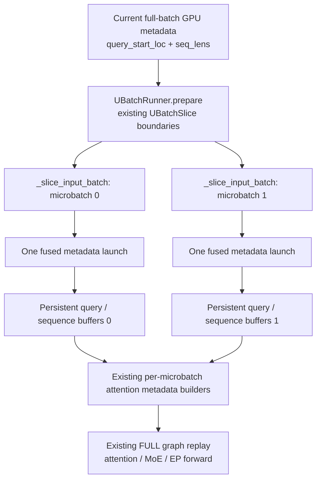
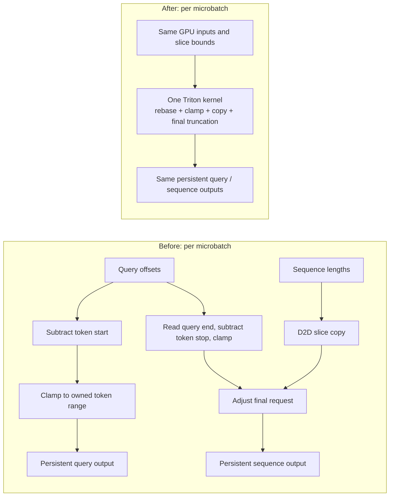

# [Perf][MRV2] Fuse DBO microbatch metadata preparation

[Upstream PR](https://github.com/vllm-project/vllm/pull/64293) · state: open · merged: False

## Original PR description

## Overview

Fuse MRV2 DBO's per-microbatch query-offset and sequence-length preparation into one Triton launch, writing to the persistent buffers read by FULL CUDA Graph replay. Related to #64100; based directly on main (`ed6b8f4cd2`), no prerequisite PR.

## Claims

- One launch per microbatch replaces five elementwise kernels plus one D2D copy: **12 → 2 GPU operations** for two microbatches.
- On H200, two-microbatch metadata preparation drops **69.7–75.0%** across 11 layouts (decode-256: **114.22 → 34.44 µs**, host enqueue plus GPU completion). This is a component number, **not a serving gain**.
- Outputs match the replaced PyTorch ops exactly, including straddling requests, padded rows and empty tails, under CUDA graph replay with updated device metadata.
- Slice bounds are `do_not_specialize`, so new per-step bounds never JIT a new kernel variant on the serving path.

## Validation

### Correctness and checks

| Check | Result |
| --- | --- |
| Worker GPU suite, 1× H200, 2026-10-29 | **49 passed**, 0 failed, 0 skipped (27.4 s) |
| CPU run of the same file | **10 passed**, 39 GPU-only cases skipped |
| mypy, production module + worker suite | No issues in 2 source files |
| Ruff check / format, production + tests | Passed |

The slicing tests run on CUDA with real `InputBuffers`, `InputBatch`, `UBatchSlice` and CUDA graphs. The replay test compares against the replaced PyTorch ops over the five existing layouts, request padding, odd decode counts, an all-padding tail and a 258-request case crossing the 128-element tile, with 2 and 3 microbatches, after three device metadata updates per captured graph. The recompile test drives slice bounds of 0, 1, multiples of 16 and odd values through `_slice_input_batch` and asserts no new compiled variant. CI runs the file in the existing H200 *V1 Executor + Worker* step (`pytest v1/worker`) and its AMD mirror.

```bash
.venv/bin/python -m pytest tests/v1/worker/test_gpu_ubatch_slicing.py -q
CUDA_VISIBLE_DEVICES='' VLLM_TARGET_DEVICE=cpu .venv/bin/python -m pytest tests/v1/worker/test_gpu_ubatch_slicing.py -q
.venv/bin/python tools/pre_commit/mypy.py 3.11 vllm/v1/worker/gpu/ubatch_utils.py tests/v1/worker/test_gpu_ubatch_slicing.py
```

### Component performance

**1× H200 (shared node), PyTorch 2.13.0+cu129, Triton 3.7.1, 2026-10-29, this PR's head.** The fused arm calls the production launcher `_slice_query_and_seq_lens`; the baseline is main's PyTorch ops. The script, adapted from the earlier [benchmark](https://github.com/algebra-MCX/vllm/blob/0d34d8982968c8358548aaf9657d91b8ebc081e5/benchmarks/kernels/benchmark_ubatch_metadata.py), is not part of this PR. Six interleaved rounds × 500 calls per arm, warmup excluded; median and min–max over rounds.

| Layout (two microbatches) | PyTorch median µs (min–max) | Fused median µs (min–max) | Reduction |
| --- | ---: | ---: | ---: |
| `decode_32` | 113.76 (113.00–114.62) | 34.47 (34.16–34.52) | 69.70% |
| `decode_64` | 114.17 (113.77–114.40) | 33.96 (33.81–34.08) | 70.25% |
| `decode_128` | 113.98 (113.77–114.13) | 34.15 (34.05–34.24) | 70.03% |
| `decode_256` | 114.22 (113.88–118.35) | 34.44 (34.36–34.49) | 69.85% |
| `decode_512` | 151.02 (150.77–151.26) | 37.85 (37.74–38.67) | 74.93% |
| `decode_padded` | 150.12 (149.33–151.20) | 37.47 (37.44–37.53) | 75.04% |
| `decode_odd` | 149.16 (148.27–149.41) | 37.58 (37.44–37.76) | 74.80% |
| `prefill_straddle` | 151.31 (151.05–151.61) | 38.20 (37.89–38.54) | 74.75% |
| `prefill_aligned` | 150.90 (150.67–151.22) | 37.78 (37.62–37.91) | 74.96% |
| `mixed` | 151.62 (150.76–157.77) | 37.86 (37.76–37.99) | 75.03% |
| `eager_empty_tail` | 150.23 (149.70–150.63) | 37.67 (37.50–39.43) | 74.92% |

Layouts: padded decode is 44 requests padded to 64; odd decode is 63 requests; straddling prefill `[300, 500, 224]`; aligned prefill `[256, 256, 256, 256]`; mixed is 30 decodes plus a 994-token prefill; empty-tail eager is 32 decodes in a 128-token extent. No attention, experts or communication in the timed region.

Decode-256 GPU profile:

| Activity, two microbatches | Original | Fused |
| --- | ---: | ---: |
| Query rebase / final sequence adjustment elementwise operations | 6 kernels | — |
| Query / truncation clamp operations | 4 kernels | — |
| Sequence slice copy | 2 D2D copies | — |
| Fused query + sequence metadata preparation | — | 2 kernels |
| **Total** | **12 GPU operations** | **2 GPU operations** |

CUDA event spans include host launch gaps, so they are not kernel durations.

### Historical prototype

Standalone prototype, 2026-10-22, job 13614, same stack; motivation only, not a measurement of this PR.

| Historical metadata workload | PyTorch µs | Prototype µs |
| --- | ---: | ---: |
| decode-64 | 123.18 | 37.59 |
| decode-256 | 127.37 | 39.33 |
| padded decode | 169.35 | 42.26 |
| straddling prefill | 161.72 | 41.73 |
| empty eager tail | 211.65 | 46.59 |

### End-to-end serving A/B

| Metric, mean ± sample SD across 3 trials | Main PyTorch metadata | Fused metadata | Change of means |
| --- | ---: | ---: | ---: |
| Output throughput (tok/s; higher is better) | 1104.791 ± 2.604 | 1098.284 ± 12.423 | -0.59% |
| Mean TPOT (ms; lower is better) | 113.614 ± 0.275 | 114.320 ± 1.321 | +0.62% |
| Trial p95 TPOT (ms; lower is better) | 113.643 ± 0.269 | 114.332 ± 1.324 | +0.61% |
| Mean completion time after release (s) | 29.651 ± 0.070 | 29.832 ± 0.338 | +0.61% |
| Trial p95 completion time after release (s) | 29.659 ± 0.070 | 29.837 ± 0.339 | +0.60% |

**No end-to-end speedup was established.** Paired throughput changes are −2.12%, −0.06%, +0.42% (95% interval [−3.94%, +2.77%], n=3); TPOT also crosses zero. All 768 requests completed; every cohort ran 255 FULL microbatch replays per rank; **384/384 paired 256-token outputs match exactly**. Measured on the previous kernel; not re-run for this revision.

Setup: MRV2, DeepSeek-V2-Lite BF16, 2× H200, DP2/TP1/EP2, NIXL EP, `batched_triton`, `FLASH_ATTN_MLA`, DBO, FULL capture size 64, max model length 512, 64 requests/rank × 128-token prompts × 256 greedy output tokens, AB/BA/AB order. The baseline restores only main's `_slice_input_batch`.

| Pair / order | PyTorch tok/s | Fused tok/s | Throughput change | PyTorch mean TPOT ms | Fused mean TPOT ms |
| --- | ---: | ---: | ---: | ---: | ---: |
| 1: PyTorch → fused | 1107.798 | 1084.287 | -2.12% | 113.296584 | 115.809687 |
| 2: fused → PyTorch | 1103.239 | 1102.559 | -0.06% | 113.763357 | 113.859385 |
| 3: PyTorch → fused | 1103.336 | 1108.004 | +0.42% | 113.782810 | 113.291657 |

<details>
<summary>All component completion-time samples (µs; six rounds per arm)</summary>

| Layout | PyTorch rounds | Fused rounds |
| --- | --- | --- |
| `decode_32` | 113.988, 113.662, 113.862, 113.001, 113.340, 114.621 | 34.511, 34.457, 34.491, 34.525, 34.158, 34.209 |
| `decode_64` | 114.297, 114.130, 114.401, 114.214, 114.056, 113.766 | 34.054, 33.844, 33.813, 33.910, 34.079, 34.018 |
| `decode_128` | 114.021, 113.936, 114.134, 114.004, 113.959, 113.770 | 34.195, 34.134, 34.240, 34.145, 34.164, 34.049 |
| `decode_256` | 118.351, 114.384, 114.210, 113.885, 114.236, 114.146 | 34.453, 34.363, 34.433, 34.387, 34.492, 34.466 |
| `decode_512` | 151.229, 151.119, 150.772, 150.914, 150.824, 151.255 | 38.668, 37.893, 37.759, 37.742, 37.976, 37.815 |
| `decode_padded` | 150.880, 151.200, 149.587, 150.287, 149.330, 149.956 | 37.449, 37.532, 37.509, 37.498, 37.444, 37.438 |
| `decode_odd` | 149.412, 149.071, 148.268, 149.411, 149.254, 148.706 | 37.760, 37.444, 37.447, 37.497, 37.699, 37.669 |
| `prefill_straddle` | 151.100, 151.045, 151.331, 151.489, 151.612, 151.292 | 38.294, 37.887, 38.116, 37.916, 38.542, 38.323 |
| `prefill_aligned` | 150.671, 151.215, 151.162, 150.928, 150.700, 150.871 | 37.911, 37.750, 37.913, 37.811, 37.685, 37.623 |
| `mixed` | 151.612, 151.343, 150.757, 157.768, 151.629, 152.060 | 37.954, 37.927, 37.761, 37.786, 37.994, 37.758 |
| `eager_empty_tail` | 150.194, 150.628, 150.047, 150.257, 149.698, 150.580 | 37.792, 39.430, 37.723, 37.617, 37.620, 37.505 |

</details>

## Details

### Motivation

FULL replay still needs each step's query offsets and sequence lengths written into the persistent storage its attention ops read. `UBatchRunner.prepare()` slices them per microbatch before replay, previously with several small launches and a copy each. This does **not** explain the DBO regression in #64100 or establish a decode crossover.

### Architecture and reused modules





| Module / existing mechanism | Purpose in this change |
| --- | --- |
| `UBatchSlice` / `create_ubatch_slices` | Supply the existing request and token ranges, including straddling requests and padded tails. The partition policy is reused. |
| `_slice_input_batch` | Calls the fused launcher for the device query offsets and sequence lengths. Host-side fields and returned `InputBatch` stay on their existing path. |
| `_slice_query_and_seq_lens_kernel` | Load current device metadata, derive both outputs in one launch and write directly to caller-owned storage. A 128-element tile and multiple CTAs handle larger request sets without requiring one large register tile. |
| `UBatchRunner` persistent buffer pairs | Keep per-microbatch lifetimes and graph-visible addresses stable; neither an output allocation nor a temporary GPU tensor is added. |
| Existing DCP local-length preparation | Consume the resulting truncated sequence lengths after this kernel on the same stream; no DCP distribution policy changes. |
| Existing attention builders / graph manager | Consume the same metadata representation and graph buffers. Capture/replay contracts and backend selection are reused. |
| `vllm.triton_utils` | Reuse the project's Triton import path and its optional-platform handling; no new package dependency. |

### Integer semantics at a straddling request

For a slice with request range `[rs, re)` and token range `[ts, te)`, the outputs are:

```text
local_query[i] = clamp(global_query[rs + i] - ts, 0, te - ts),  0 <= i <= re-rs
truncated = max(global_query[re] - te, 0)
local_seq[i] = global_seq[rs + i] - (truncated if i == re-rs-1 else 0)
```

For example, global query offsets `[0, 3, 12, 15]` and sequence lengths `[70, 300, 41]`, split at token 7:

| Microbatch | Request range | Local queries | Local sequences |
| --- | --- | --- | --- |
| Tokens `[0, 7)` | `[0, 2)` | `[0, 3, 7]` | `[70, 295]` |
| Tokens `[7, 15)` | `[1, 3)` | `[0, 5, 8]` | `[300, 41]` |

The second microbatch keeps the shared request's full length: its earlier tokens were computed by the first microbatch. The kernel reads GPU sequence lengths, not `seq_lens_cpu_upper_bound`, which async execution can make differ.

### Scope and non-duplication

- No change to model math, routing, collectives, request partitioning or graph admission; no new host read or sync. DBO+DCP/spec-decode gates are unchanged.
- #63556, #64278, #63823 and #63485 (staging, all-padding replay, NIXL capacity) solve different problems. #61464 overlaps the slicing code but not this fusion. #62749 leaves microbatching on the eager-build path; #63307/#63308 fuse other prologues. Open-PR searches (`DBO metadata fuse`, `UBatchRunner metadata`, `slice_query_start_loc`, `64100 in:body`) found no equivalent.
- Production change is one module. The `is_padding` list annotation is required by mypy and has no runtime effect.
- Local GPU validation is H200 only; AMD is covered by the CI mirror.

AI assistance (OpenAI Codex, Claude Code) was used for the implementation, tests and description under the submitter's direction; commands and results above were run and checked by the submitter.

---

<details>
<summary> Pull Request Checklist </summary>

- [x] I used vLLM's `/pr-checklist` skill. (Mandatory for agents, optional for humans).
- [x] AI assistance was used during the creation of this PR.

- [x] **Design Fit:** Minimizes impact on core components, reuses existing functionality, and justifies added complexity.
- [x] **Testing and Validation:** Validates the change and ensures any added tests are meaningful and reliable, with CI coverage or documented CI resource constraints and validation performed outside CI.
- [x] **Code Quality and Style:** Keeps code and comments clear and concise, and updates relevant documentation and examples.
- [x] **Pull Request Contents:** Includes a brief summary and relevant links, supports claims with evidence, explains root causes and implementation trade-offs, and follows the contributing guide.
</details>


## Review and discussion

### reviews

- claude[bot] · COMMENTED · 2026-10-28T14:22:55Z · [source](https://github.com/vllm-project/vllm/pull/64293#pullrequestreview-5684205762)

## Claude Code Review

This pull request is from a fork — automated review is disabled. A repository maintainer can comment `@claude review` to run a one-time review.

### issue_comments

- mergify[bot] · comment · 2026-10-28T14:23:28Z · [source](https://github.com/vllm-project/vllm/pull/64293#issuecomment-6471562829)

Documentation preview: https://vllm--64293.org.readthedocs.build/en/64293/

- algebra-MCX · comment · 2026-10-28T14:51:30Z · [source](https://github.com/vllm-project/vllm/pull/64293#issuecomment-6472263801)

cc @LucasWilkinson — would appreciate your feedback on this MRV2 DBO metadata-preparation fusion. Correctness checks and the H200 component/serving A/B results are in the description; the serving A/B did not establish an end-to-end speedup.

- algebra-MCX · comment · 2026-10-29T11:27:24Z · [source](https://github.com/vllm-project/vllm/pull/64293#issuecomment-6495392829)

cc @SageMoore @specture724 — as the original authors of DBO (#23693) and MRV2 DBO (#50945), would appreciate your review of this metadata fusion in `_slice_input_batch`.

Latest push (`76ef485860`): the kernel's slice bounds are now `do_not_specialize`, so per-step bounds no longer JIT new Triton variants on the serving path (new regression test); the CPU fallback is dropped since MRV2 DBO is CUDA-only; the diff is down to `ubatch_utils.py` plus tests. H200: 49/49 worker tests pass; metadata prep is 69.7–75.0% faster than main across 11 layouts (component-level, no serving gain claimed).

### inline_comments

## Changed files and fixed code

- `tests/v1/worker/test_gpu_ubatch_slicing.py` · modified · additions 129 / deletions 15
  - [head](https://github.com/algebra-MCX/vllm/blob/76ef4858601b592ecef79301fc7a6990dcc1b1aa/tests/v1/worker/test_gpu_ubatch_slicing.py)
  - [base](https://github.com/vllm-project/vllm/blob/df028dffa548710fb77320a5c08b87ae58757933/tests/v1/worker/test_gpu_ubatch_slicing.py)
- `vllm/v1/worker/gpu/ubatch_utils.py` · modified · additions 63 / deletions 47
  - [head](https://github.com/algebra-MCX/vllm/blob/76ef4858601b592ecef79301fc7a6990dcc1b1aa/vllm/v1/worker/gpu/ubatch_utils.py)
  - [base](https://github.com/vllm-project/vllm/blob/df028dffa548710fb77320a5c08b87ae58757933/vllm/v1/worker/gpu/ubatch_utils.py)

## Evidence and interpretation boundary

[Original JSON, discussions and patches](../../../../../../evidence/prs/vllm-project--vllm/64293-415928877fcab55a040fc9981b0f4390b0ded69846812f551107b820c9e111c7.json) · SHA-256 `415928877fcab55a040fc9981b0f4390b0ded69846812f551107b820c9e111c7`.

Diff complete: True. Missing/binary/truncated patches require pinned source inspection. This is a source page, not an independently verified optimization case. Open, merged and released are different states; recheck the deployed dependency.
