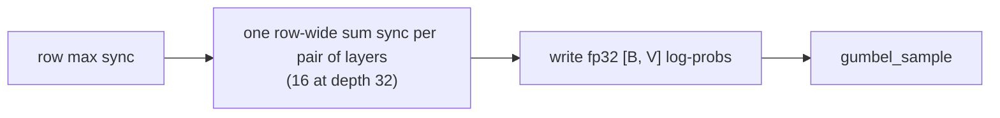
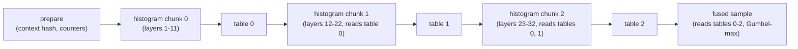

# [Perf] Fused SynthID-Text sampling with bucketed tournament layers

[Upstream PR](https://github.com/vllm-project/vllm/pull/64724) · state: open · merged: False

## Original PR description

<!-- markdownlint-disable -->

## Summary

This builds on #58426 (SynthID-Text watermarking by @sebfelix, with kernel work by @simon-veitner-redhat). It replaces the one-kernel tournament with a bucketed implementation: the layers of the tournament run on small per-row tables instead of on the full vocabulary, and the last pass samples with Gumbel-max without writing a `[B, V]` buffer. It also **changes the default `depth` from 32 to 22**, which changes the sampled tokens of existing `synthid_text` configurations that do not set `depth`. Set `depth` to 32 to keep the previous behaviour.

Cost against sampling without a watermark, on one B200 (Qwen2.5-3B-Instruct, CUDA graphs, decode step time with offline `LLM.generate`):

| | Batch 1 | Batch 32 | Batch 256 |
|---|---|---|---|
| #58426 head, depth 22 | +6.4% | +9.5% | +23.2% |
| This PR, depth 22 (default) | +1.8% | +2.6% | +8.3% |
| This PR, depth 32 | +2.4% | +3.2% | +11.0% |
| Gumbel watermark, #58426 head | +4.0% | +3.0% | +3.9% |
| Gumbel watermark, this PR | +0.4% | -1.1% | +0.4% |

The Triton context kernels of this PR also serve the Gumbel watermark, which makes the Gumbel step cheaper as well. Within this PR, the extra cost of SynthID over Gumbel at depth 22 is +1.4, +3.7, +7.9 points at batch 1, 32 and 256, and at depth 32 +2.0, +4.3, +10.6 points. The sampling call of SynthID-Text is still slower than the Gumbel watermark's. At depth 22 it takes 2.4x, 2.8x, 3.2x the time of the Gumbel call at batch 1, 32 and 256, and at depth 32 2.9x, 3.5x, 4.1x (see Results). At depth 22 the detection power measured on Qwen2.5-3B-Instruct is not distinguishable from depth 32 at the resolution of the study (see Detectability).

## How it works

SynthID-Text watermarks text by nudging the sampling distribution. Let `p` be the probability of a token. The watermark has a number of layers, its `depth` (22 by default, at most 32). Each token gets one pseudo-random number, a hash of the recent context and the token. Layer k uses bit k of it as that token's `g`. A layer moves probability toward the tokens with `g = 1`. The detector later checks whether text favours those tokens.

The per-layer rule: let `m` be the share of the total probability held by the tokens with `g = 1`. Multiply every token by `1 + g - m`. A `g = 1` token gets `2 - m`, a `g = 0` token gets `1 - m`, and the total stays the same.

```
p[t] = p[t] * (1 + g[t] - m),   m = sum of p[t] over tokens with g[t] = 1, divided by sum of p
```

Example with 8 tokens and 2 layers, probabilities in %. In layer 1, `m = 20 + 16 + 6 + 4 + 4 = 50%`, so `g = 1` tokens get x1.5 and `g = 0` tokens x0.5. In layer 2, `m = 16 + 24 = 40%`, so `g = 1` tokens get x1.6 and `g = 0` tokens x0.6.

| Token | p | g, layer 1 | g, layer 2 | after layer 1 | after layer 2 |
|---|---|---|---|---|---|
| A | 32 | 0 | 1 | 16 | 25.6 |
| B | 20 | 1 | 0 | 30 | 18 |
| C | 16 | 1 | 1 | 24 | 38.4 |
| D | 10 | 0 | 0 | 5 | 3 |
| E | 8 | 0 | 0 | 4 | 2.4 |
| F | 6 | 1 | 0 | 9 | 5.4 |
| G | 4 | 1 | 0 | 6 | 3.6 |
| H | 4 | 1 | 0 | 6 | 3.6 |

`m` changes from layer to layer, so each layer must wait for the previous layer's full sum. Each layer needs a sum over the whole vocabulary of about 150k tokens, so depth 32 means 32 dependent full-vocabulary reductions.

The trick: tokens with the same bit pattern always get the same multiplier. Here B, F, G and H all have pattern `10` (layer 1 bit first). So collapse the 8 tokens into 4 buckets, one per pattern, holding their summed probability, and run the 2 layers on the buckets:

| Pattern | Tokens | mass | after layer 1 | after layer 2 | total multiplier |
|---|---|---|---|---|---|
| `00` | D, E | 18 | 9 | 5.4 | x0.3 |
| `01` | A | 32 | 16 | 25.6 | x0.8 |
| `10` | B, F, G, H | 34 | 51 | 30.6 | x0.9 |
| `11` | C | 16 | 24 | 38.4 | x2.4 |

The bucket masses give the same `m`, 50% then 40%. A token's final probability is its start probability times its bucket's multiplier. For F that is 6 x 0.9 = 5.4, the same as above. The kernel keeps the logarithm of these multipliers as a per-row table with one entry per pattern. The cost of a layer no longer depends on the vocabulary size.

With `c` layers per chunk there are `2**c` buckets, and `2**11 = 2048` buckets fit in GPU shared memory. The layers are split into `ceil(depth / 11)` chunks of equal size, up to 11 layers each:

| Depth | Chunks (layers) | Histogram passes | Total passes |
|---|---|---|---|
| 1 to 11 | 1 | 1 | 2 |
| 12 to 22 | 2 (6+6 up to 11+11) | 2 | 3 |
| 23 to 32 | 3 (8+8+7 up to 11+11+10) | 3 | 4 |

Each histogram pass reads the logits once. For every token it looks up the multipliers of the earlier chunks' tables, takes its bucket from this chunk's bits, and adds its probability to that bucket with integer atomics in shared memory (a fixed-point histogram, 48 bits, so the sum is deterministic). The last program of each row then runs the chunk's layers on the `2**c` bucket masses and writes the chunk's log-multiplier table. A layer with `m < 0.5` is applied as an offset from 1 instead of `1 - m`, because rounding `1 - m` would move every `g = 0` token the same way and compound over the layers. The final pass computes `logit + table_0[bits] + table_1[bits] + ...` and picks the token with Gumbel-max, with the same noise as the existing `gumbel_sample`. The cost steps up when the depth crosses 11 or 22.

Before, in #58426 (one kernel, and the row-wide syncs make blocks spin-wait on each other):



After, in this PR (depth 32 shown; depth 22 has two chunks; nothing of size `[B, V]` is written):



The result is the same distribution, the same `g` bits and the same `SynthIDWatermarkDetector`, up to fp32 rounding and a fixed-point truncation of about `2**-48` of the mass scale.

## Results

### Cost against no watermark and against the Gumbel watermark

Setup: one NVIDIA B200, Qwen2.5-3B-Instruct (bf16, vocabulary 151936), CUDA graphs on, offline `LLM.generate` with 512 prompt tokens, 256 output tokens, temperature 1, `ignore_eos`, and the batch size in flight. Each arm is run for 5 rounds interleaved over all arms in one job, with 3 timed iterations per round. Decode step time is (latency at 256 output tokens minus latency at 1 output token) / 255. The overhead is the median step time of the arm over the median step time without a watermark, minus 1. The sampling call is one CUDA-graph replay of the context gather, the repeated-context skip mask and the sampling of the watermarker, taken as the median of 3 passes with top-k off. The no-watermark sampling call is the `RandomSampler` alone.

Each cell is the sampling call in microseconds / the decode step overhead against no watermark. The no-watermark cells show the sampling call / the decode step time.

| Arm | Batch 1 | Batch 32 | Batch 256 |
|---|---|---|---|
| No watermark | 14.5 us / 2.480 ms | 31.0 us / 2.619 ms | 145.3 us / 4.156 ms |
| Gumbel watermark, #58426 head | 60.0 us / +4.0% | 71.7 us / +3.0% | 209.8 us / +3.9% |
| Gumbel watermark, this PR | 23.6 us / +0.4% | 38.9 us / -1.1% | 159.8 us / +0.4% |
| SynthID, depth 22, #58426 head | 95.5 us / +6.4% | 202.6 us / +9.5% | 1038.5 us / +23.2% |
| SynthID, depth 22, this PR | 57.0 us / +1.8% | 108.4 us / +2.6% | 503.4 us / +8.3% |
| SynthID, depth 32, #58426 head | 114.9 us / +7.3% | 251.4 us / +11.7% | 1347.0 us / +30.9% |
| SynthID, depth 32, this PR | 68.5 us / +2.4% | 137.9 us / +3.2% | 651.1 us / +11.0% |

The overhead is the median over 5 interleaved rounds. At batch 256 the rounds of the depth 22 arm spread from +7.9% to +9.7%. The Gumbel rows of the #58426 head come from an earlier run of the same setup, where the Gumbel watermark builds its contexts with torch operations, as the head does. The Gumbel rows of this PR come from the same run as the SynthID rows.

The sampling call of this PR against the Gumbel call is 2.4x, 2.8x, 3.2x at depth 22 and 2.9x, 3.5x, 4.1x at depth 32, at batch 1, 32 and 256. Against the no-watermark call it is 3.9x, 3.5x, 3.5x at depth 22 and 4.7x, 4.4x, 4.5x at depth 32. The gap grows with the batch size, as each row reads its whole vocabulary once per histogram pass. A measurement made in review put the sampling call at 3.4x to 6.5x the Gumbel call. The setups were not compared, so the difference with the ratios above is not explained.

Against #58426 at its head, the sampling call at depth 22 is 1.7x, 1.9x and 2.1x faster at batch 1, 32 and 256, and the decode step overhead falls from +6.4%, +9.5% and +23.2% to +1.8%, +2.6% and +8.3%.

### Detectability against depth

Depth 22 is the default because it keeps the detection power of depth 32 within the resolution of the study, at 2 histogram passes instead of 3.

Setup: Qwen2.5-3B-Instruct, one engine per depth, key 42, context width 4, temperature 1, `top_p` 1, no top-k, no repetition penalty, up to 512 new tokens, chat template. There are 200 prompts for each of five domains, sampled with a fixed seed:

- Creative: `euclaise/writingprompts` test split (prompts of 12 to 60 words), asked for a story of about 500 words.
- QA: `sentence-transformers/eli5` (questions of 8 to 40 words), asked for a detailed explanation in simple terms.
- Code: MBPP test split, asked to write the function and explain it.
- Math: GSM8K test split. The prompt is the chat template of the model with its default system prompt and one user turn, `<question>\nSolve this step by step and give the final answer.`
- Rewrite: CNN/DailyMail 3.0.0 test split (articles of 350 to 650 words), asked to rewrite the article in the model's own words.

Unwatermarked texts (one arm per temperature) are the null set. Each is scored with the true key and with 20 random wrong keys. Each watermarked text is scored with the true key only. A text is scored on its first L tokens, and only texts with at least L tokens count, so the number of positives falls as L grows (at L = 200 and depth 22: Creative 195, QA 198, Code 199, Math 177, Rewrite 191). The statistic is z = (S - n*d/2) / sqrt(n*d/4), where S is the number of `g` bits equal to 1 over the n scored tokens and d is the depth. It is monotone in the binomial p-value of `SynthIDWatermarkDetector`, and it avoids p-value underflow. The threshold is the 99th percentile of the pooled null z (true key and wrong keys) for each domain, depth and prefix length, so the false-positive rate is 1%. The scores of the depth-d watermark read bits 0 to d-1 of the 32 bits per token, and equality with `SynthIDWatermarkDetector(depth=d).detect(prefix)` was checked on a sample. Intervals are bootstrap 95% CIs with 1000 resamples (positives resampled by sequence, nulls by text). Tokens whose 4-token context was already seen in the scored text are skipped (`deduplicate_contexts`), which masks about 0.2% of the scored tokens on creative text and 13 to 15% on math, at L = 200.

TPR at 1% FPR, unweighted-mean detector, temperature 1, L = 200:

| Depth | Creative | QA | Code | Math | Rewrite |
|---|---|---|---|---|---|
| 1 | 0.98 | 0.75 | 0.29 | 0.09 | 0.51 |
| 2 | 1.00 | 0.97 | 0.45 | 0.17 | 0.75 |
| 4 | 1.00 | 1.00 | 0.60 | 0.34 | 0.97 |
| 6 | 1.00 | 1.00 | 0.70 | 0.49 | 0.99 |
| 8 | 1.00 | 1.00 | 0.78 | 0.60 | 0.99 |
| 12 | 1.00 | 1.00 | 0.85 | 0.59 | 1.00 |
| 16 | 1.00 | 1.00 | 0.91 | 0.61 | 0.99 |
| 20 | 1.00 | 1.00 | 0.84 | 0.66 | 0.99 |
| 22 | 1.00 | 1.00 | 0.87 | 0.69 | 0.99 |
| 24 | 1.00 | 1.00 | 0.85 | 0.68 | 1.00 |
| 32 | 1.00 | 1.00 | 0.88 | 0.74 | 0.99 |

TPR at 1% FPR, L = 100:

| Depth | Creative | QA | Code | Math | Rewrite |
|---|---|---|---|---|---|
| 1 | 0.80 | 0.38 | 0.15 | 0.10 | 0.20 |
| 2 | 0.97 | 0.64 | 0.32 | 0.12 | 0.36 |
| 4 | 1.00 | 0.89 | 0.43 | 0.26 | 0.69 |
| 6 | 1.00 | 0.93 | 0.52 | 0.51 | 0.80 |
| 8 | 1.00 | 0.95 | 0.66 | 0.47 | 0.82 |
| 12 | 1.00 | 1.00 | 0.70 | 0.53 | 0.89 |
| 16 | 1.00 | 0.99 | 0.72 | 0.52 | 0.89 |
| 20 | 1.00 | 0.99 | 0.74 | 0.62 | 0.93 |
| 22 | 1.00 | 0.98 | 0.72 | 0.60 | 0.90 |
| 24 | 1.00 | 0.99 | 0.68 | 0.62 | 0.91 |
| 32 | 1.00 | 0.99 | 0.71 | 0.64 | 0.89 |

AUROC, L = 100:

| Depth | Creative | QA | Code | Math | Rewrite |
|---|---|---|---|---|---|
| 1 | 0.9897 | 0.9309 | 0.8028 | 0.7359 | 0.8697 |
| 2 | 0.9977 | 0.9634 | 0.8785 | 0.7744 | 0.9211 |
| 4 | 1.0000 | 0.9955 | 0.9076 | 0.8502 | 0.9709 |
| 6 | 1.0000 | 0.9964 | 0.9353 | 0.9142 | 0.9837 |
| 8 | 1.0000 | 0.9952 | 0.9489 | 0.9258 | 0.9922 |
| 12 | 1.0000 | 0.9998 | 0.9629 | 0.9406 | 0.9940 |
| 16 | 1.0000 | 0.9999 | 0.9678 | 0.9350 | 0.9949 |
| 20 | 1.0000 | 0.9998 | 0.9698 | 0.9612 | 0.9948 |
| 22 | 1.0000 | 0.9995 | 0.9616 | 0.9620 | 0.9940 |
| 24 | 1.0000 | 0.9998 | 0.9504 | 0.9658 | 0.9962 |
| 32 | 1.0000 | 0.9994 | 0.9587 | 0.9652 | 0.9899 |

Tokens needed to reach a TPR of 95% at 1% FPR (the smallest prefix length in the grid 25, 50, 75, 100, 150, 200, 300, 400, 512 that reaches it):

| Depth | Creative | QA | Code | Math | Rewrite |
|---|---|---|---|---|---|
| 1 | 150 | 400 | not reached | not reached | not reached |
| 2 | 100 | 200 | not reached | not reached | not reached |
| 4 | 75 | 150 | 512 | not reached | 200 |
| 6 | 50 | 150 | 400 | not reached | 200 |
| 8 | 50 | 100 | 400 | not reached | 150 |
| 12 | 50 | 75 | 300 | not reached | 150 |
| 16 | 25 | 75 | 300 | not reached | 150 |
| 20 | 50 | 75 | 300 | not reached | 150 |
| 22 | 50 | 100 | 400 | not reached | 150 |
| 24 | 50 | 75 | 300 | not reached | 150 |
| 32 | 50 | 75 | 300 | not reached | 150 |

Difference in TPR, depth 22 minus depth 32, with 95% CI:

| Prefix length (tokens) | Creative | QA | Code | Math | Rewrite |
|---|---|---|---|---|---|
| 100 | +0.000 [+0.000, +0.000] | -0.005 [-0.035, +0.015] | +0.005 [-0.080, +0.105] | -0.035 [-0.160, +0.075] | +0.015 [-0.055, +0.080] |
| 200 | +0.000 [+0.000, +0.000] | +0.000 [+0.000, +0.000] | -0.010 [-0.080, +0.055] | -0.048 [-0.150, +0.066] | +0.005 [-0.010, +0.026] |
| 512 | +0.000 [+0.000, +0.000] | +0.000 [+0.000, +0.000] | -0.012 [-0.036, +0.000] | - | - |

Difference in AUROC, depth 22 minus depth 32, with 95% CI:

| Prefix length (tokens) | Creative | QA | Code | Math | Rewrite |
|---|---|---|---|---|---|
| 100 | +0.0000 [+0.0000, +0.0000] | +0.0001 [-0.0008, +0.0013] | +0.0028 [-0.0179, +0.0214] | -0.0031 [-0.0196, +0.0142] | +0.0041 [-0.0029, +0.0114] |
| 200 | +0.0000 [+0.0000, +0.0000] | -0.0000 [-0.0000, +0.0000] | -0.0026 [-0.0093, +0.0045] | -0.0020 [-0.0157, +0.0123] | +0.0010 [-0.0001, +0.0028] |
| 512 | +0.0000 [+0.0000, +0.0000] | +0.0000 [+0.0000, +0.0000] | -0.0006 [-0.0020, +0.0000] | - | - |

No TPR difference is significant. "No significant difference" is not an equivalence test. Where the intervals are wide (math, code), the data cannot rule out a loss of several points. Depth 16 is distinguishable from depth 32 on math (-0.13 [-0.23, -0.01] at L = 200). Depths 20, 22 and 24 are not distinguishable on any of the five types.

Weighted-mean detector (the weighted-mean statistic of the SynthID-Text paper, with layer weights decreasing linearly from 10 to 1 and normalised, instead of the unweighted mean of `SynthIDWatermarkDetector`), depths 22 and 32, temperature 1, TPR at 1% FPR:

| Detector | Depth | L | Creative | QA | Code | Math | Rewrite |
|---|---|---|---|---|---|---|---|
| mean | 22 | 100 | 1.00 | 0.98 | 0.72 | 0.60 | 0.90 |
| mean | 22 | 200 | 1.00 | 1.00 | 0.87 | 0.69 | 0.99 |
| mean | 32 | 100 | 1.00 | 0.99 | 0.71 | 0.64 | 0.89 |
| mean | 32 | 200 | 1.00 | 1.00 | 0.88 | 0.74 | 0.99 |
| weighted | 22 | 100 | 1.00 | 0.99 | 0.76 | 0.62 | 0.94 |
| weighted | 22 | 200 | 1.00 | 1.00 | 0.89 | 0.71 | 1.00 |
| weighted | 32 | 100 | 1.00 | 0.99 | 0.76 | 0.70 | 0.94 |
| weighted | 32 | 200 | 1.00 | 1.00 | 0.94 | 0.77 | 0.99 |

Temperature 0.7 (two depths measured), unweighted-mean detector, TPR at 1% FPR:

| Depth | L | Creative | QA | Code | Math | Rewrite |
|---|---|---|---|---|---|---|
| 8 | 100 | 0.99 | 0.81 | 0.25 | 0.22 | 0.49 |
| 8 | 200 | 1.00 | 0.98 | 0.46 | 0.21 | 0.88 |
| 32 | 100 | 1.00 | 0.85 | 0.34 | 0.40 | 0.49 |
| 32 | 200 | 1.00 | 0.99 | 0.41 | 0.47 | 0.87 |

At temperature 0.7 the code and math results are noisy and not monotone in depth (code: depth 32 below depth 8), and no conclusion is drawn from them.

### Text quality and diversity

Mean log-probability per token of the generated text under the unwatermarked model, with its standard error, by depth (temperature 1):

| Arm | Creative | QA | Code | Math | Rewrite |
|---|---|---|---|---|---|
| No watermark | -2.629 +- 0.029 | -1.326 +- 0.014 | -0.548 +- 0.012 | -0.299 +- 0.010 | -0.934 +- 0.018 |
| Depth 1 | -2.604 +- 0.026 | -1.352 +- 0.016 | -0.560 +- 0.012 | -0.293 +- 0.008 | -0.918 +- 0.018 |
| Depth 2 | -2.602 +- 0.027 | -1.319 +- 0.015 | -0.560 +- 0.013 | -0.310 +- 0.010 | -0.921 +- 0.017 |
| Depth 4 | -2.609 +- 0.027 | -1.315 +- 0.016 | -0.572 +- 0.014 | -0.300 +- 0.010 | -0.941 +- 0.018 |
| Depth 6 | -2.626 +- 0.024 | -1.347 +- 0.015 | -0.579 +- 0.012 | -0.303 +- 0.010 | -0.938 +- 0.017 |
| Depth 8 | -2.568 +- 0.025 | -1.361 +- 0.016 | -0.570 +- 0.012 | -0.298 +- 0.010 | -0.922 +- 0.017 |
| Depth 12 | -2.616 +- 0.028 | -1.331 +- 0.015 | -0.594 +- 0.015 | -0.295 +- 0.009 | -0.959 +- 0.018 |
| Depth 16 | -2.596 +- 0.026 | -1.339 +- 0.015 | -0.621 +- 0.013 | -0.306 +- 0.012 | -0.956 +- 0.019 |
| Depth 20 | -2.589 +- 0.028 | -1.340 +- 0.015 | -0.621 +- 0.014 | -0.322 +- 0.012 | -0.969 +- 0.018 |
| Depth 22 | -2.573 +- 0.027 | -1.314 +- 0.015 | -0.628 +- 0.014 | -0.314 +- 0.011 | -0.950 +- 0.017 |
| Depth 24 | -2.587 +- 0.028 | -1.336 +- 0.016 | -0.644 +- 0.014 | -0.319 +- 0.011 | -0.950 +- 0.018 |
| Depth 32 | -2.566 +- 0.025 | -1.321 +- 0.016 | -0.645 +- 0.014 | -0.307 +- 0.010 | -0.939 +- 0.018 |

The mean log-probability is flat across depths for creative, QA, math and rewrite text. For code it falls from the unwatermarked value to the depth-32 value, monotonically in depth. The cause was not determined.

<details>
<summary>Distinct-2 ratio and mean length</summary>

Distinct-2 (fraction of distinct bigrams):

| Arm | Creative | QA | Code | Math | Rewrite |
|---|---|---|---|---|---|
| No watermark | 0.927 | 0.866 | 0.718 | 0.560 | 0.908 |
| Depth 1 | 0.926 | 0.864 | 0.720 | 0.558 | 0.905 |
| Depth 2 | 0.928 | 0.860 | 0.718 | 0.564 | 0.905 |
| Depth 4 | 0.926 | 0.859 | 0.724 | 0.557 | 0.908 |
| Depth 6 | 0.925 | 0.865 | 0.723 | 0.560 | 0.906 |
| Depth 8 | 0.926 | 0.871 | 0.723 | 0.551 | 0.903 |
| Depth 12 | 0.926 | 0.863 | 0.723 | 0.558 | 0.907 |
| Depth 16 | 0.926 | 0.864 | 0.725 | 0.556 | 0.905 |
| Depth 20 | 0.928 | 0.870 | 0.730 | 0.559 | 0.906 |
| Depth 22 | 0.927 | 0.864 | 0.725 | 0.559 | 0.908 |
| Depth 24 | 0.927 | 0.858 | 0.730 | 0.567 | 0.908 |
| Depth 32 | 0.926 | 0.864 | 0.733 | 0.563 | 0.906 |

Mean generated length in tokens:

| Arm | Creative | QA | Code | Math | Rewrite |
|---|---|---|---|---|---|
| No watermark | 503.1 | 445.9 | 458.2 | 321.8 | 319.7 |
| Depth 1 | 505.9 | 442.3 | 455.3 | 329.0 | 327.7 |
| Depth 2 | 505.1 | 446.6 | 455.2 | 326.7 | 327.4 |
| Depth 4 | 501.8 | 447.7 | 458.3 | 329.6 | 324.7 |
| Depth 6 | 502.2 | 452.8 | 453.4 | 325.4 | 328.5 |
| Depth 8 | 504.7 | 432.9 | 452.4 | 325.9 | 332.7 |
| Depth 12 | 503.8 | 445.5 | 446.5 | 326.6 | 321.9 |
| Depth 16 | 502.6 | 440.4 | 442.2 | 328.7 | 328.8 |
| Depth 20 | 503.0 | 433.3 | 442.4 | 331.3 | 328.1 |
| Depth 22 | 497.9 | 433.2 | 439.2 | 328.3 | 319.5 |
| Depth 24 | 498.0 | 440.5 | 429.6 | 323.1 | 317.9 |
| Depth 32 | 497.6 | 435.5 | 429.2 | 321.0 | 321.9 |

</details>

TPR counts only texts with at least L tokens, as stated in the setup. For math at depth 32 and L = 200, 175 of the 200 texts reach 200 tokens, and the TPR over those is 0.74 [0.67, 0.81]. Counting the 25 shorter texts as misses gives 130/200 = 0.65. At L = 100 all 200 texts count and the TPR is 0.64 [0.56, 0.72]. A TPR of 0.600 [0.53, 0.70] on GSM8K reported in review lies inside the L = 100 interval and overlaps the L = 200 interval above (its upper bound 0.70 is above 0.67), and the 0.65 count is close to it. A difference in the prompt format or in the handling of short texts could explain the gap between the point estimates. This was not tested.

The detector must be built with the same `depth` as the sampler. This follows from the algorithm and was not measured: bit k of the pseudo-random number of a token is layer k, a sampler of depth d biases only layers 0 to d-1, and a detector that reads more layers adds unbiased bits to the score.

No Gumbel detection numbers were measured, so there is no detection comparison against the Gumbel watermark.

Caveats: one model, one key and 200 prompts per domain. The confidence intervals are about +-0.07 for code and math. Two depths only were measured at temperature 0.7. The studies use public models and public datasets.

## Fallbacks and portability

- The fused path runs on NVIDIA GPUs with compute capability 8.0 or newer and Triton 3.8 or newer, where Triton Gluon imports. The sampler passes it the `RandomSampler` fields (also with fp64 Gumbel noise).
- On a CUDA-like platform that needs the kernels but cannot run them (Triton older than 3.8, or ROCm), `VllmConfig` raises a `ValueError` at startup (`check_synthid_text_platform`).
- If the first fused call fails (for example a Gluon compile failure), startup fails with a `RuntimeError`. This first call happens in the startup profiling run, before CUDA graph capture.
- CPUs and NVIDIA GPUs below compute capability 8.0 use the pure-torch tournament in `SynthIDWatermarker.watermark_logits()`, with a one-time warning. fp64 logits also use it, because the kernels do not take them.
- The warmup in `watermark_sample_warmup.py` compiles one variant of the sampling call per logits dtype, with a skip mask, because the sampler passes one on every watermarked step.
- The context and skip-mask Triton kernels run on CUDA tensors only. The CPU worker, which subclasses the GPU model runner, takes the torch skip mask and the torch context builder in `GPUWatermarkSampler`. The skip mask follows #61194, which skips rows whose context is still incomplete.
- SynthID-Text does not run with speculative decoding (the config rejects it), so the kernels have no drafting or `logits_cache` mode.

## Limitations

- Gluon is experimental. The correctness tests ran on Triton 3.8 on H100 only. The timings come from B200 and B300.
- It uses generic blocked and swizzled shared-memory layouts, integer shared-memory atomics and a global atomic ticket, with no Hopper-specific instruction. Other sm80 and newer GPUs are expected to work and were not tested for correctness.
- Each token's mass is rounded down to a multiple of `2**-48`, in units of the largest token mass seen by its split of the row (chunk 0) or of the row total (later chunks). The integer adds make each histogram deterministic.
- The cost is flat inside a chunk range and steps up by one histogram pass at depth 12 and at depth 23.

<details>
<summary>Validation</summary>

- Outside the tree, with the same noise, the fused path picked the same token as the #58426 head sampler on 100% of 512 full-vocabulary rows at depths 1, 7, 12, 22, 30 and 32, with fp32 and with fp64 Gumbel noise. Rows included masked tokens, partial (-1) contexts and skipped rows.
- `tests/watermarking/test_synthid.py` calls the production entry point `synthid_sample` and compares it with an fp64 torch reference of the tournament. Rows mix greedy, -1 padded, skipped and several temperatures. It covers depths 1 to 32 (one to three histogram passes), a 131849-token vocabulary (split across programs), 600 rows by 65000 tokens (the 31-tile cap), and one row at vocabulary 151936. Samples must match exactly except for rows whose reference sample changes under a tiny perturbation (near ties), and at least 99% of the rows must be stable.
- Skipped rows are bit-equal to `gumbel_sample` for fp32 and fp64 noise. The fused kernel calls the same `gumbel_noise` helper.
- Tests cover the startup failure when the fused kernels cannot run, the failure of the first fused call, and the torch tournament on CPU.
- `tests/watermarking/test_watermarking.py` compares the Triton context and skip-mask kernels with expected values written out by hand, including a padded and a repeated-context row.
- On one H100 (Triton 3.8), `pytest tests/watermarking tests/model_executor/test_watermark_sample_warmup.py tests/v1/worker/test_gpu_rejection_sampler_i64.py` gives 305 passed, 3 skipped.

To reproduce, run `pytest tests/watermarking/`. The CUDA tests need a GPU with compute capability 8.0 or newer and skip elsewhere.

</details>

---

<details>
<summary> Pull Request Checklist </summary>

- [ ] I used vLLM's `/pr-checklist` skill. (Mandatory for agents, optional for humans).
- [x] AI assistance was used during the creation of this PR.

- [ ] **Design Fit:** Minimizes impact on core components, reuses existing functionality, and justifies added complexity.
- [ ] **Testing and Validation:** Validates the change and ensures any added tests are meaningful and reliable, with CI coverage or documented CI resource constraints and validation performed outside CI.
- [ ] **Code Quality and Style:** Keeps code and comments clear and concise, and updates relevant documentation and examples.
- [ ] **Pull Request Contents:** Includes a brief summary and relevant links, supports claims with evidence, explains root causes and implementation trade-offs, and follows the contributing guide.
</details>


## Review and discussion

### reviews

### issue_comments

- mergify[bot] · comment · 2026-10-30T11:05:17Z · [source](https://github.com/vllm-project/vllm/pull/64724#issuecomment-6521142534)

Documentation preview: https://vllm--64724.org.readthedocs.build/en/64724/

- mergify[bot] · comment · 2026-11-03T02:31:54Z · [source](https://github.com/vllm-project/vllm/pull/64724#issuecomment-6593929985)

This pull request has merge conflicts that must be resolved before it can be
merged. Please rebase the PR, @TQCB.

https://docs.github.com/en/pull-requests/collaborating-with-pull-requests/working-with-forks/syncing-a-fork


- sebfelix · comment · 2026-11-03T08:28:13Z · [source](https://github.com/vllm-project/vllm/pull/64724#issuecomment-6598908676)

@TQCB Just a quick heads-up; I rebased #58426 by adding a the `watermark_config.enforce` field in a new commit, since that was easier than retroactively rewriting the git history in this case. You can just rebase onto #58426 again

- simon-veitner-redhat · comment · 2026-11-03T16:51:52Z · [source](https://github.com/vllm-project/vllm/pull/64724#issuecomment-6610096425)

Thanks for the update. I re-reviewed `9c90c2735` (and `f0677fb34` on top). It fixes most of the earlier list and adds a stricter fused-sample test.

I have three commits on `simon-veitner-redhat/vllm`, branch `pr-64724-offer`, on top of `f0677fb34`. To take them, cherry-pick `f0677fb34..pr-64724-offer`:

1. `[Misc] SynthID-Text: fail clearly when the fused kernels cannot run`
2. `[Misc] SynthID-Text: warn once when sampling with the torch tournament`
3. `[Misc] SynthID-Text: import the fused kernels lazily`

They leave the fused kernels alone. With them, the watermarking and warmup tests pass (309 passed, 3 two-GPU skips), and tokens match the PR (64/64 sequences at depth 22).

Numbers are from a B200 (sm_100), Qwen2.5-3B-Instruct, V=151,936, CUDA graphs, unless labelled B300 (sm_103).

## 1. fp64 Gumbel sampling

[Edit: `f0677fb34` fixes this the same way, so I dropped my commit for it.]

~~The new `gumbel_noise` helper returns fp64 from its `USE_FP64` branch and fp32 after it. Triton rejects that ("Return type mismatch"), so `gumbel_sample(use_fp64=True)` fails to compile even with no watermark. That is the `ModelConfig.use_fp64_gumbel` path, which works on main. Three tests fail on it, and a fourth does not pass main's new `is_drafting` argument.~~

~~Commit 4 assigns the noise in both constexpr branches and returns it once, as `gumbel_noised_argmax` did. The fp64 branch keeps fp64 noise. All four tests then pass, and fp64 sampling returns the same tokens as main.~~

## 2. Fused-kernel failures and the platform gate

If the first fused call in `SynthIDWatermarker.sample` raises, the PR logs one warning and uses the torch tournament for the rest of the process. That call is the profile run's dummy pass, so the deployment serves on the torch path for good. On a B300 (sm_103) at depth 32, that path adds +71% / +169% / +762% per decode step at B=1/32/256, against +3% / +10% / +17% fused (old head). I'd rather not have a path that does this after one warning.

- **It catches every `Exception`**, an OOM included.
- **`is_supported()` ignores the tensor.** On a CUDA machine, CPU-tensor calls enter `synthid_sample`, raise, and the fallback rescues them. The GPU test run logs the fallback warning twice.
- **There is no Triton version check.** With Triton 3.7.1 the new head starts, logs one warning, and runs the torch tournament on every step.
- **ROCm** takes the torch path silently.

Commit 1 replaces the fallback with an error. `is_supported()` requires Triton 3.8, and `VllmConfig.__post_init__` rejects `synthid_text` on sm80+ with older Triton, and on ROCm, naming the requirement. With Triton 3.7.1 the offer stops there, before the model loads. `_use_fused(logits)` checks `logits.is_cuda`, so CPU tensors take the torch path directly.

Commit 2 keeps the torch tournament for CPUs and GPUs below sm80, with one warning per process. It is correct: fused and forced-torch runs gave 64/64 identical sequences at depths 22 and 32.

## 3. Overhead

Sampling call, and decode step against no watermark, on one GPU:

| B | No watermark | Gumbel | This PR, d22 | This PR, d32 |
|---|---|---|---|---|
| 1 | 8.1 µs, 2.293 ms | 8.2 µs, +2.8% | 41.6 µs, +1.5% | 53.0 µs, +2.4% |
| 32 | 23.2 µs, 2.456 ms | 24.2 µs, +3.0% | 92.0 µs, +3.9% | 120.6 µs, +6.6% |
| 256 | 137.5 µs, 4.293 ms | 143.5 µs, +10.1% | 485.1 µs, +6.1% | 633.5 µs, +11.6% |

Gumbel is main's. Over two GPUs the PR adds about +1.5%, +3 to 6% and +5 to 11% per step, which is about Gumbel's level. The sampling call is still 3.4x to 6.5x Gumbel's.

Could the PR body replace the earlier head's H100 numbers with B200 or B300 numbers at B=1/32/256, with a Gumbel baseline, and state the remaining large-batch gap in the sampling call?

## 4. Import cycle

The top-level kernel import in `vllm/v1/watermarking/synthid.py` still forms a cycle through `sample/watermark.py`. Importing `sample/synthid.py` or `spec_decode/rejection_sampler_utils` first raises `ImportError`, so `test_gpu_rejection_sampler_i64.py` fails to collect. Commit 3 imports the kernels where they are used, as #58426 does. The i64 file then passes.

## 5. Scope

The PR is quite large (+981 / -272 non-test lines). It would be worth trimming it down a bit before merge. The Triton context and skip-mask kernels, for example, also change the Gumbel path. Gumbel tokens are unchanged (64/64 identical against main), and its step gets a little cheaper.

## 6. Detection and the default depth

+1 to depth 22. In a three-model, multi-domain study, depth 22 minus depth 32 in TPR at 1% FPR is +0.023 [+0.015, +0.030], with non-inferiority at -0.05 everywhere except code at 400 tokens. Could the PR body and docs cite a study like this, and say the detector's depth must match?

On a B300 (sm_103), math at depth 32 gives 0.600 [0.53, 0.70] on 200 GSM8K questions, against 0.74 in the description. Could you share the prompt format? A Gumbel row would also help: at 200 tokens Gumbel leads depth 32 by +0.104 [+0.068, +0.136] on Llama-3.1-8B.

## 7. Fused-sample test

The new test catches a wrong token on every 64th row in all 10 cases, and excuses at most 0.4% of rows. Still, `stable.float().mean() > 0.9` would let 10% skip the exact check. Could it require above 0.99? V=151,936 at B=1 is not covered.

## 8. Nits and docs

- The float64 guard from #58426 is dropped. fp64 logits are cast to fp32 in the kernels. Intentional?
- `watermark_sample_warmup.py:61-67` warms a `skip_mask=None` variant that is never reached now.
- 46 of 50 golden `"depth"` entries, and the docs example (`docs/features/watermarking.md:247`), use 32.
- The docs should state the CUDA sm80+ and Triton 3.8 requirement, and the cost steps at depths 12 and 23.

_Drafted with Claude Code._


- mergify[bot] · comment · 2026-11-04T15:56:12Z · [source](https://github.com/vllm-project/vllm/pull/64724#issuecomment-6635314574)

This pull request has merge conflicts that must be resolved before it can be
merged. Please rebase the PR, @TQCB.

https://docs.github.com/en/pull-requests/collaborating-with-pull-requests/working-with-forks/syncing-a-fork


### inline_comments

## Changed files and fixed code

- `docs/features/watermarking.md` · modified · additions 46 / deletions 17
  - [head](https://github.com/TQCB/vllm_fork/blob/d944547b53a638c6208aea051bed56fafcb56236/docs/features/watermarking.md)
  - [base](https://github.com/vllm-project/vllm/blob/75f67614971a44050140e3422c1a65fe5004a72b/docs/features/watermarking.md)
- `tests/model_executor/test_watermark_sample_warmup.py` · modified · additions 190 / deletions 98
  - [head](https://github.com/TQCB/vllm_fork/blob/d944547b53a638c6208aea051bed56fafcb56236/tests/model_executor/test_watermark_sample_warmup.py)
  - [base](https://github.com/vllm-project/vllm/blob/75f67614971a44050140e3422c1a65fe5004a72b/tests/model_executor/test_watermark_sample_warmup.py)
- `tests/test_config.py` · modified · additions 22 / deletions 0
  - [head](https://github.com/TQCB/vllm_fork/blob/d944547b53a638c6208aea051bed56fafcb56236/tests/test_config.py)
  - [base](https://github.com/vllm-project/vllm/blob/75f67614971a44050140e3422c1a65fe5004a72b/tests/test_config.py)
- `tests/watermarking/golden_candidates.py` · modified · additions 58 / deletions 21
  - [head](https://github.com/TQCB/vllm_fork/blob/d944547b53a638c6208aea051bed56fafcb56236/tests/watermarking/golden_candidates.py)
  - [base](https://github.com/vllm-project/vllm/blob/75f67614971a44050140e3422c1a65fe5004a72b/tests/watermarking/golden_candidates.py)
- `tests/watermarking/test_prf.py` · modified · additions 76 / deletions 0
  - [head](https://github.com/TQCB/vllm_fork/blob/d944547b53a638c6208aea051bed56fafcb56236/tests/watermarking/test_prf.py)
  - [base](https://github.com/vllm-project/vllm/blob/75f67614971a44050140e3422c1a65fe5004a72b/tests/watermarking/test_prf.py)
- `tests/watermarking/test_synthid.py` · added · additions 661 / deletions 0
  - [head](https://github.com/TQCB/vllm_fork/blob/d944547b53a638c6208aea051bed56fafcb56236/tests/watermarking/test_synthid.py)
  - [base](https://github.com/vllm-project/vllm/blob/75f67614971a44050140e3422c1a65fe5004a72b/tests/watermarking/test_synthid.py)
- `tests/watermarking/test_watermarking.py` · modified · additions 35 / deletions 3
  - [head](https://github.com/TQCB/vllm_fork/blob/d944547b53a638c6208aea051bed56fafcb56236/tests/watermarking/test_watermarking.py)
  - [base](https://github.com/vllm-project/vllm/blob/75f67614971a44050140e3422c1a65fe5004a72b/tests/watermarking/test_watermarking.py)
- `tests/watermarking/test_watermarking_e2e.py` · modified · additions 18 / deletions 5
  - [head](https://github.com/TQCB/vllm_fork/blob/d944547b53a638c6208aea051bed56fafcb56236/tests/watermarking/test_watermarking_e2e.py)
  - [base](https://github.com/vllm-project/vllm/blob/75f67614971a44050140e3422c1a65fe5004a72b/tests/watermarking/test_watermarking_e2e.py)
- `tests/watermarking/watermarking_goldens.json` · modified · additions 314 / deletions 0
  - [head](https://github.com/TQCB/vllm_fork/blob/d944547b53a638c6208aea051bed56fafcb56236/tests/watermarking/watermarking_goldens.json)
  - [base](https://github.com/vllm-project/vllm/blob/75f67614971a44050140e3422c1a65fe5004a72b/tests/watermarking/watermarking_goldens.json)
- `vllm/config/vllm.py` · modified · additions 16 / deletions 0
  - [head](https://github.com/TQCB/vllm_fork/blob/d944547b53a638c6208aea051bed56fafcb56236/vllm/config/vllm.py)
  - [base](https://github.com/vllm-project/vllm/blob/75f67614971a44050140e3422c1a65fe5004a72b/vllm/config/vllm.py)
- `vllm/config/watermarking.py` · modified · additions 9 / deletions 5
  - [head](https://github.com/TQCB/vllm_fork/blob/d944547b53a638c6208aea051bed56fafcb56236/vllm/config/watermarking.py)
  - [base](https://github.com/vllm-project/vllm/blob/75f67614971a44050140e3422c1a65fe5004a72b/vllm/config/watermarking.py)
- `vllm/model_executor/warmup/watermark_sample_warmup.py` · modified · additions 36 / deletions 94
  - [head](https://github.com/TQCB/vllm_fork/blob/d944547b53a638c6208aea051bed56fafcb56236/vllm/model_executor/warmup/watermark_sample_warmup.py)
  - [base](https://github.com/vllm-project/vllm/blob/75f67614971a44050140e3422c1a65fe5004a72b/vllm/model_executor/warmup/watermark_sample_warmup.py)
- `vllm/v1/watermarking/__init__.py` · modified · additions 3 / deletions 0
  - [head](https://github.com/TQCB/vllm_fork/blob/d944547b53a638c6208aea051bed56fafcb56236/vllm/v1/watermarking/__init__.py)
  - [base](https://github.com/vllm-project/vllm/blob/75f67614971a44050140e3422c1a65fe5004a72b/vllm/v1/watermarking/__init__.py)
- `vllm/v1/watermarking/factory.py` · modified · additions 5 / deletions 0
  - [head](https://github.com/TQCB/vllm_fork/blob/d944547b53a638c6208aea051bed56fafcb56236/vllm/v1/watermarking/factory.py)
  - [base](https://github.com/vllm-project/vllm/blob/75f67614971a44050140e3422c1a65fe5004a72b/vllm/v1/watermarking/factory.py)
- `vllm/v1/watermarking/gpu_sampler.py` · modified · additions 34 / deletions 6
  - [head](https://github.com/TQCB/vllm_fork/blob/d944547b53a638c6208aea051bed56fafcb56236/vllm/v1/watermarking/gpu_sampler.py)
  - [base](https://github.com/vllm-project/vllm/blob/75f67614971a44050140e3422c1a65fe5004a72b/vllm/v1/watermarking/gpu_sampler.py)
- `vllm/v1/watermarking/gumbel.py` · modified · additions 1 / deletions 12
  - [head](https://github.com/TQCB/vllm_fork/blob/d944547b53a638c6208aea051bed56fafcb56236/vllm/v1/watermarking/gumbel.py)
  - [base](https://github.com/vllm-project/vllm/blob/75f67614971a44050140e3422c1a65fe5004a72b/vllm/v1/watermarking/gumbel.py)
- `vllm/v1/watermarking/prfs/philox.py` · modified · additions 42 / deletions 4
  - [head](https://github.com/TQCB/vllm_fork/blob/d944547b53a638c6208aea051bed56fafcb56236/vllm/v1/watermarking/prfs/philox.py)
  - [base](https://github.com/vllm-project/vllm/blob/75f67614971a44050140e3422c1a65fe5004a72b/vllm/v1/watermarking/prfs/philox.py)
- `vllm/v1/watermarking/synthid.py` · added · additions 287 / deletions 0
  - [head](https://github.com/TQCB/vllm_fork/blob/d944547b53a638c6208aea051bed56fafcb56236/vllm/v1/watermarking/synthid.py)
  - [base](https://github.com/vllm-project/vllm/blob/75f67614971a44050140e3422c1a65fe5004a72b/vllm/v1/watermarking/synthid.py)
- `vllm/v1/watermarking/watermarker.py` · modified · additions 12 / deletions 0
  - [head](https://github.com/TQCB/vllm_fork/blob/d944547b53a638c6208aea051bed56fafcb56236/vllm/v1/watermarking/watermarker.py)
  - [base](https://github.com/vllm-project/vllm/blob/75f67614971a44050140e3422c1a65fe5004a72b/vllm/v1/watermarking/watermarker.py)
- `vllm/v1/worker/gpu/sample/gumbel.py` · modified · additions 18 / deletions 10
  - [head](https://github.com/TQCB/vllm_fork/blob/d944547b53a638c6208aea051bed56fafcb56236/vllm/v1/worker/gpu/sample/gumbel.py)
  - [base](https://github.com/vllm-project/vllm/blob/75f67614971a44050140e3422c1a65fe5004a72b/vllm/v1/worker/gpu/sample/gumbel.py)
- `vllm/v1/worker/gpu/sample/synthid.py` · added · additions 748 / deletions 0
  - [head](https://github.com/TQCB/vllm_fork/blob/d944547b53a638c6208aea051bed56fafcb56236/vllm/v1/worker/gpu/sample/synthid.py)
  - [base](https://github.com/vllm-project/vllm/blob/75f67614971a44050140e3422c1a65fe5004a72b/vllm/v1/worker/gpu/sample/synthid.py)
- `vllm/v1/worker/gpu/sample/watermark.py` · modified · additions 107 / deletions 0
  - [head](https://github.com/TQCB/vllm_fork/blob/d944547b53a638c6208aea051bed56fafcb56236/vllm/v1/worker/gpu/sample/watermark.py)
  - [base](https://github.com/vllm-project/vllm/blob/75f67614971a44050140e3422c1a65fe5004a72b/vllm/v1/worker/gpu/sample/watermark.py)

## Evidence and interpretation boundary

[Original JSON, discussions and patches](../../../../../../evidence/prs/vllm-project--vllm/64724-c1ede8755c654bda75b0dc5b0126bd5fb063278ae8937e3a2b6a9cb7ac04d8ad.json) · SHA-256 `c1ede8755c654bda75b0dc5b0126bd5fb063278ae8937e3a2b6a9cb7ac04d8ad`.

Diff complete: True. Missing/binary/truncated patches require pinned source inspection. This is a source page, not an independently verified optimization case. Open, merged and released are different states; recheck the deployed dependency.
