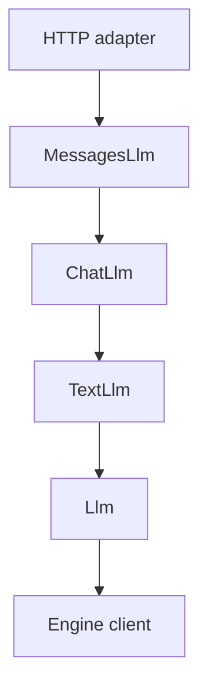

# [Rust Frontend] add `/v1/messages` support

[Upstream PR](https://github.com/vllm-project/vllm/pull/64998) · state: open · merged: False

## Original PR description

Serve text conversations through `/v1/messages` and `/v1/messages/count_tokens` using existing chat request lowering and rendering. Generation shares the typed Chat Completions execution path, preserving its model resolution, logging, usage and engine errors before Anthropic serialization.

Dependency chain:

Thinking follows tools in the stack to validate mixed thinking/text/tool output; reasoning itself does not require tool support.

Part of a stack in this fork. Planned scope and acceptance criteria:

PR | Scope | Acceptance
-- | -- | --
1 (curr) | Text generation and counting through ChatLlm | Identical rendered input; OpenAI tests remain passing
2 | Streaming from internal chat events | Ordered events, final usage, error handling and cancellation
3 | Client tools using existing tool context and parsers | Stable IDs and block order; counting without an output parser
4 | Thinking history, output and configuration | Preserved block order; signatures before thinking-block closure

## Review and discussion

### reviews

- claude[bot] · COMMENTED · 2026-11-01T16:36:42Z · [source](https://github.com/vllm-project/vllm/pull/64998#pullrequestreview-5729125263)

## Claude Code Review

This pull request is from a fork — automated review is disabled. A repository maintainer can comment `@claude review` to run a one-time review.

### issue_comments

- mergify[bot] · comment · 2026-11-01T15:11:13Z · [source](https://github.com/vllm-project/vllm/pull/64998#issuecomment-6559780031)

Documentation preview: https://vllm--64998.org.readthedocs.build/en/64998/

- BugenZhao · comment · 2026-11-03T09:33:11Z · [source](https://github.com/vllm-project/vllm/pull/64998#issuecomment-6600092719)

Thanks @sagearc! I spent some time reviewing the entire stack with my Claude agent - it seems to reuse `ChatLlm` cleanly so both non-streaming and streaming paths share single source of truth.

Here are some other points I talked with Claude, so I just paste the original output here 😀

---

Comments below cover the whole stack (02 here, 03/04 on your fork, and the planned thinking layer), roughly in order of impact.

**1. Reasoning output turns a finished generation into a 400 (02, blocking).**
With an auto-selected reasoning parser (e.g. Qwen3), any response containing reasoning is discarded after generation and returned as `invalid_request_error`. On 03/04 this becomes a 500 mid-stream. The same request on `/v1/chat/completions` returns 200. This is server output, not a client error. Please land thinking before client tools, since it doesn't depend on tools:
- Output reasoning as `thinking` blocks. Give each block a random signature, as Python does.
- On replay, read `thinking` text as reasoning; ignore `signature` and skip `redacted_thinking`.
- Lower `thinking.type` / `output_config.effort` to `chat_options.reasoning_effort`, so `--reasoning-effort-map` and the renderer handle it. Don't inject `chat_template_kwargs.enable_thinking` in the handler.

**2. One terminal mapping for both modes (03/04).**
In 04, the stop reason, tool input, usage, and logging are built twice: once in `create` after `collect_message`, once in the `Done` arm of `messages_stream`. The two copies already diverge:
- complete-output logging (`Response` with token IDs vs `StreamComplete` without);
- reasoning handling (400 vs mid-stream 500);
- `input_tokens` (`message_start` counts cached tokens, the final usage doesn't).

The Messages output is fully determined by `Done.message` plus the finish reason; the protocol layer only adds per-block mapping and an index. So keep non-streaming as a fold over `ChatEventStream` (`collect_message`), and have both modes call one shared finish builder for content blocks, `stop_reason`/`stop_sequence`, usage, and logging. Streaming then calls it only at `Done`. With that in place, the order of the streaming and non-streaming layers doesn't matter.

**3. Drop the tool-input check at `Done` in streaming (04).**
`tool_input(&call.arguments)?` runs after every `input_json_delta` has already been sent, so it turns a fully streamed response into an error. Python's streaming path doesn't do this. If invalid JSON needs handling, it belongs only in the non-streaming fold, where `input` must be an object.

**4. Unknown fields break every Claude Code request (02+).**
`deny_unknown_fields` on the request and on every block rejects what Claude Code always sends:
- `metadata`;
- `cache_control` on system and message blocks;
- `thinking.display`;
- `output_config`;
- `context_management`.

Python ignores unknown fields. Please type these explicitly and accept them as documented no-ops. vLLM's prefix caching is automatic, so `cache_control` has nothing to do. For fields with real semantics that aren't implemented yet, return an explicit "not supported yet" instead of serde's unknown-field error. Also, the untagged `TextContent`/`Content` enums report only "did not match any variant". A small visitor that dispatches on the JSON type keeps the per-block error.

**5. Inline `role: "system"` messages (02+).**
Claude Code sends per-turn reminders as `role: "system"` in `messages`; they currently fail with 400. Please lower them to `ChatMessage::developer` and leave template compatibility to the HF renderer. vllm-project/vllm#65294 keeps developer messages in place when the template allows it, and otherwise merges them into the leading system or an adjacent user turn. Please don't port Python's handler-side `_should_merge_inline_system` probe. Also strip `x-anthropic-billing-header` from inline system messages, not just the top-level `system`, as Python does; otherwise its per-request hash defeats prefix caching.

**6. Drop `MessagesLlm` and mirror the Responses layout (02).**
`MessagesLlm` is rebuilt per request, only wraps `&ChatLlm` plus a few options, and its name suggests a layer beside `ChatLlm`/`TextLlm`. Please instead:
- make lowering a plain function next to the DTOs;
- have the handlers call `state.chat` directly;
- use `routes/anthropic/{types,convert,stream}.rs`, like `routes/openai/responses/`.

Nothing outside the routes uses the top-level `server/src/anthropic.rs`.

**7. Offload the new routes (02).**
Add `/v1/messages` and `/v1/messages/count_tokens` to `OFFLOADED_PATHS` in `middleware/offload.rs`. Rendering and tokenization currently run on the HTTP runtime.

**8. Types and DTOs (02+).**
- Make `stop_reason`, `StopDelta.stop_reason`, the message `type`, and the error `type` `snake_case` enums instead of `&'static str`.
- Keep request and response DTOs separate. The response currently flattens the request `Message` (with `deny_unknown_fields`), and in 04 that carries request-only variants such as `ToolResult`.
- In 03/04, `MessagesInput` reads better than a request that flattens a `CountTokensRequest`.

**9. Differences from Python (fix, or state in the PR description).**
- `count_tokens` with `stream: true` fails with "Streaming Messages is not supported yet". Python's count request has no `stream` field.
- 409 maps to `conflict_error`, which isn't an Anthropic error type. Python maps it to `invalid_request_error`.
- Abort and repetition return 500. Python returns 200 with `stop_reason: null`.
- Empty user messages and empty text blocks are rendered. Python skips them.
- A trailing assistant message is continued (`ContinueFinalAssistant`). This matches Anthropic prefill semantics better than Python, which opens a new turn. Keep it and note it.

**10. Commits, tests, docs.**
- 04 moves `StreamDeltaLog` from `chat_completions.rs` to `output_log.rs` inside a merge commit. Please make that a separate mechanical commit with the comments kept verbatim.
- Put the Messages route tests in their own module (e.g. `routes/tests/messages.rs`) rather than the ~10k-line `routes/tests.rs`.
- Consider running Python's `tests/entrypoints/anthropic/test_messages.py` against the Rust frontend in CI as a wire-shape check.
- rustfmt skips the long async block in `create`; it needs manual formatting.
- Please drop the "Rust frontend support" section from `claude_code.md`. The Rust frontend docs don't restate per-endpoint support.

- sagearc · comment · 2026-11-03T14:29:22Z · [source](https://github.com/vllm-project/vllm/pull/64998#issuecomment-6606459980)

thanks @BugenZhao! I'll go through all these in the next few days

### inline_comments

## Changed files and fixed code

- `docs/serving/integrations/claude_code.md` · modified · additions 15 / deletions 0
  - [head](https://github.com/sagearc/vllm/blob/1adba1d6e75ef05ce877a48973d90c00bb969d15/docs/serving/integrations/claude_code.md)
  - [base](https://github.com/vllm-project/vllm/blob/a487973b6f64972fa8dcdcf752f0902297d99c9b/docs/serving/integrations/claude_code.md)
- `rust/src/server/src/anthropic.rs` · added · additions 340 / deletions 0
  - [head](https://github.com/sagearc/vllm/blob/1adba1d6e75ef05ce877a48973d90c00bb969d15/rust/src/server/src/anthropic.rs)
  - [base](https://github.com/vllm-project/vllm/blob/a487973b6f64972fa8dcdcf752f0902297d99c9b/rust/src/server/src/anthropic.rs)
- `rust/src/server/src/error.rs` · modified · additions 21 / deletions 19
  - [head](https://github.com/sagearc/vllm/blob/1adba1d6e75ef05ce877a48973d90c00bb969d15/rust/src/server/src/error.rs)
  - [base](https://github.com/vllm-project/vllm/blob/a487973b6f64972fa8dcdcf752f0902297d99c9b/rust/src/server/src/error.rs)
- `rust/src/server/src/lib.rs` · modified · additions 1 / deletions 0
  - [head](https://github.com/sagearc/vllm/blob/1adba1d6e75ef05ce877a48973d90c00bb969d15/rust/src/server/src/lib.rs)
  - [base](https://github.com/vllm-project/vllm/blob/a487973b6f64972fa8dcdcf752f0902297d99c9b/rust/src/server/src/lib.rs)
- `rust/src/server/src/routes.rs` · modified · additions 5 / deletions 4
  - [head](https://github.com/sagearc/vllm/blob/1adba1d6e75ef05ce877a48973d90c00bb969d15/rust/src/server/src/routes.rs)
  - [base](https://github.com/vllm-project/vllm/blob/a487973b6f64972fa8dcdcf752f0902297d99c9b/rust/src/server/src/routes.rs)
- `rust/src/server/src/routes/anthropic.rs` · added · additions 90 / deletions 0
  - [head](https://github.com/sagearc/vllm/blob/1adba1d6e75ef05ce877a48973d90c00bb969d15/rust/src/server/src/routes/anthropic.rs)
  - [base](https://github.com/vllm-project/vllm/blob/a487973b6f64972fa8dcdcf752f0902297d99c9b/rust/src/server/src/routes/anthropic.rs)
- `rust/src/server/src/routes/tests.rs` · modified · additions 190 / deletions 10
  - [head](https://github.com/sagearc/vllm/blob/1adba1d6e75ef05ce877a48973d90c00bb969d15/rust/src/server/src/routes/tests.rs)
  - [base](https://github.com/vllm-project/vllm/blob/a487973b6f64972fa8dcdcf752f0902297d99c9b/rust/src/server/src/routes/tests.rs)

## Evidence and interpretation boundary

[Original JSON, discussions and patches](../../../../../../evidence/prs/vllm-project--vllm/64998-fdffbe3948e3f97b04200e108709d053100ba4a1123c877a63ad9063aa3f35be.json) · SHA-256 `fdffbe3948e3f97b04200e108709d053100ba4a1123c877a63ad9063aa3f35be`.

Diff complete: True. Missing/binary/truncated patches require pinned source inspection. This is a source page, not an independently verified optimization case. Open, merged and released are different states; recheck the deployed dependency.
