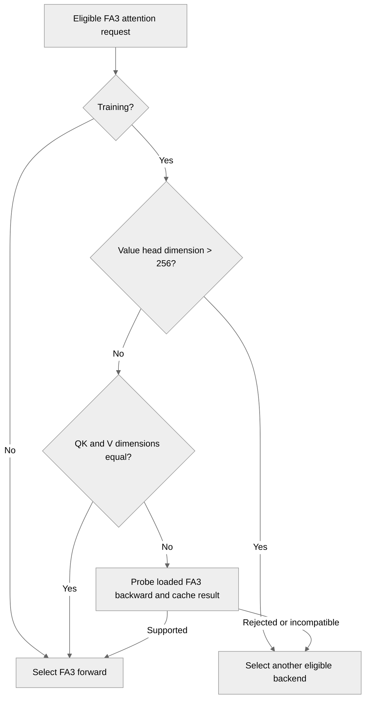

# [PyT] Check FA3 backward compatibility during backend selection

[Upstream PR](https://github.com/NVIDIA/TransformerEngine/pull/3490) · state: open · merged: False

## Original PR description

# Description

Related to #3481.

Check FA3 backward compatibility when selecting the attention backend for training:

- Value head dimensions above 256 require a fallback. Existing forward eligibility checks already bound the QK dimension to 256.
- Unequal QK/V dimensions also require the loaded FA3 backward implementation to accept their shapes. Older implementations fall back; supported newer implementations retain FA3.

Unequal-dimension backward support was added in [flash-attention#1604](https://github.com/Dao-AILab/flash-attention/pull/1604). Builds before and after that change can both report package version `3.0.0b1` and expose the same Python signature. The original unconditional unequal-dimension restriction was too broad for newer builds, while checking only V > 256 re-enabled the original backward crash on older builds.

## Type of change

- [x] Bug fix (non-breaking change which fixes an issue)

## Changes

- Register the active FA3 backward callable after a successful import.
- For otherwise eligible unequal-dimension training, call that implementation with empty dense sequences. The native shape checks execute before the empty-work fast path; no attention kernels run. Cache the result by callable, device, dtype, and dimension pair without retaining tensors. A rejected shape or incompatible API selects another eligible backend.
- Preserve the V > 256 training restriction and forward-supported inference configurations. Equal-dimension configurations do not need this compatibility probe.
- Document the compatibility behavior and why the package version is insufficient.
- Test selector behavior, real outputs and Q/K/V gradients, and cold-cache capability queries in eager execution, `torch.compile`, and CUDA Graph capture.

## Validation

Validated on 2026-10-09 using 8 H200 GPUs (SM90), distributing cases among independent GPU workers. Both real FA3 installations report package version `3.0.0b1`.

| FA3 implementation / variant | Passed | Expected backward failures |
| --- | ---: | ---: |
| `v2.8.3/hopper`, compatibility check enabled | 91 | 0 |
| `75f90d60f348af768625b6ab6ce13e800c5bc48a` (parent of #1604), compatibility check enabled | 91 | 0 |
| Same legacy build, remove only the compatibility check | 12 | 12 |

All 206 cases ran with no skips, collection errors, or unexpected outcomes. Each fixed variant includes:

- 24 selector cases plus one unavailable-backward case.
- 18 capability-query cases: FP16/BF16, QK/V dimensions 192/128, 64/128, and 64/256, with eager execution, cold-cache `torch.compile(..., backend="eager", fullgraph=True)`, and cold-cache CUDA Graph capture. These also check unchanged RNG state and cache reuse.
- 48 numerical cases: FP16/BF16, `bshd`/`sbhd`, training/inference, dimensions 192/128, 64/128, 64/256, 64/264, 64/512, and 128/128. Outputs and Q/K/V gradients are compared with an independent FP32 attention reference using unchanged tolerances, then the selected backend is asserted. FA3 and UnfusedAttention are enabled for this comparison.

Expected support is established independently through the public FA3 autograd interface with **nonempty** tensors. It is not inferred from the new empty-sequence probe. The legacy control reproduces native `out must have shape` errors in all 12 unequal-dimension training cases; the corresponding 12 inference cases pass.

A separate probe profile on the modern build recorded zero CUDA kernels, unchanged allocated CUDA storage, and unchanged RNG state. The compatibility check targets the native backward shape contract; this validation does not cover every custom FA3 build configuration.

Environment and source identity:

- Python 3.12; PyTorch 2.9.1+cu128; CUDA 12.8 / nvcc 12.8.61; cuDNN 9.12.0.46; NCCL 2.27.5; driver 595.58.03.
- Reused the previously validated runtime without changing it. This retains the previously approved cuDNN 9.12 replacement for the PyTorch wheel's cuDNN 9.10.2.21 pin.
- Reused identical validated TE common/PyTorch native extensions because this revision changes only Python and documentation. Checked the staged Git tree, Python source hashes, import paths, loaded libraries, and native-library hashes for each variant.
- Built the legacy FA3 source against its pinned CUTLASS revision `62750a2b75c802660e4894434dc55e839f322277` with the same CUDA/PyTorch runtime. Native and interface sources were unchanged; the offline setup adjustment only avoids re-downloading the pinned submodule. The legacy build retained the tested SM90 forward/backward paths while disabling optional SM80, FP8, paged-KV, append-KV, local, and softcap paths.

The focused tests can be run on an SM90 device with either FA3 implementation and the repository's attention-test dependencies:

```bash
NVTE_FLASH_ATTN=1 NVTE_FLASH_ATTN_V3=1 python -m pytest -v \
  tests/pytorch/attention/test_attention.py::test_fa3_mismatched_head_dims_mode_selection \
  tests/pytorch/attention/test_attention.py::test_fa3_backward_unavailable \
  tests/pytorch/attention/test_attention.py::test_fa3_backward_capability_query \
  tests/pytorch/attention/test_attention.py::test_dpa_fa3_mla
```

Changed-file pre-commit, `L0_license`, and the Python portion of `L0_pytorch_lint` passed. The full TE test suites were not run. These results cover numerical correctness, backend selection, and capability-query execution behavior; distributed communication and performance were not evaluated.

## Checklist

- [x] I have read the contributing guidelines.
- [x] The change and its regression tests are complete.
- [x] Backward limits and compatibility behavior are documented.
- [x] Focused numerical, gradient, and backend-selection tests pass with both FA3 implementations.
- [x] Changed-file pre-commit, license, and Python lint checks pass.
- [ ] Full TE test suites have been run.


## Review and discussion

### reviews

- greptile-apps[bot] · COMMENTED · 2026-09-07T04:08:14Z · [source](https://github.com/NVIDIA/TransformerEngine/pull/3490#pullrequestreview-5127969114)

(No body; status only.)

- yuweih205 · COMMENTED · 2026-09-10T08:27:22Z · [source](https://github.com/NVIDIA/TransformerEngine/pull/3490#pullrequestreview-5164697216)

(No body; status only.)

- ptrendx · COMMENTED · 2026-09-16T17:14:06Z · [source](https://github.com/NVIDIA/TransformerEngine/pull/3490#pullrequestreview-5225903814)

(No body; status only.)

- yuweih205 · COMMENTED · 2026-09-17T10:40:02Z · [source](https://github.com/NVIDIA/TransformerEngine/pull/3490#pullrequestreview-5234440804)

(No body; status only.)

- yuweih205 · COMMENTED · 2026-09-21T04:11:09Z · [source](https://github.com/NVIDIA/TransformerEngine/pull/3490#pullrequestreview-5262996753)

(No body; status only.)

- yuweih205 · COMMENTED · 2026-09-21T06:13:56Z · [source](https://github.com/NVIDIA/TransformerEngine/pull/3490#pullrequestreview-5263549340)

(No body; status only.)

- yuweih205 · COMMENTED · 2026-09-24T12:22:13Z · [source](https://github.com/NVIDIA/TransformerEngine/pull/3490#pullrequestreview-5304324888)

(No body; status only.)

- greptile-apps[bot] · COMMENTED · 2026-10-08T07:32:37Z · [source](https://github.com/NVIDIA/TransformerEngine/pull/3490#pullrequestreview-5453235731)

(No body; status only.)

- yuweih205 · COMMENTED · 2026-10-09T09:56:36Z · [source](https://github.com/NVIDIA/TransformerEngine/pull/3490#pullrequestreview-5468545876)

(No body; status only.)

### issue_comments

- greptile-apps[bot] · comment · 2026-09-07T04:08:11Z · [source](https://github.com/NVIDIA/TransformerEngine/pull/3490#issuecomment-5564881820)

<!-- greptile_summary -->

<h2><a href="https://app.greptile.com/api/retrigger?id=61097364"><picture><source media="(prefers-color-scheme: dark)" srcset="https://greptile-static-assets.s3.amazonaws.com/badges/RetriggerDark.svg?v=2"><source media="(prefers-color-scheme: light)" srcset="https://greptile-static-assets.s3.amazonaws.com/badges/Retrigger.svg?v=2"></picture></a>Confidence Score: 5/5</h2>

**[High impact]** The PR appears safe to merge; the earlier compatibility and coverage concerns are resolved in the current code.

<h3>Summary</h3>

This PR makes FlashAttention 3 backend selection account for the loaded implementation’s backward shape compatibility.
- Registers the active FA3 backward callable after successful extension loading.
- Probes and caches unequal-QK/V backward compatibility using empty sequences.
- Preserves the training fallback for value dimensions above 256 while retaining supported inference paths.
- Adds selector, numerical, gradient, compilation, and CUDA Graph coverage.
- Documents the compatibility behavior and why package versions cannot determine support.

<h3>Diagram</h3>



<!-- greptile_confidence_score:5 -->

<sub>Reviews (9) · Last reviewed commit: ["Merge branch &#39;main&#39; into fa3-mismatched-..."](https://github.com/nvidia/transformerengine/commit/f75fe97ce4d654493d9b5749e111e013f4f3addd) · [Reviewed by Greptile](https://www.greptile.com/?utm_source=greptile_expert&utm_medium=github&utm_campaign=code_reviews&utm_content=nvidia/transformerengine)</sub>

### inline_comments

- greptile-apps[bot] · comment · 2026-09-07T04:08:14Z · [source](https://github.com/NVIDIA/TransformerEngine/pull/3490#discussion_r3946472932)

File: `transformer_engine/pytorch/attention/dot_product_attention/utils.py` · line None

<a href="#"></a> **Mode Behavior Lacks Coverage**

This new training-only FA3 restriction has no automated regression test. Existing attention tests do not assert that unequal QK/V head dimensions reject FA3 during training or confirm that inference retains FA3. A future selector change could therefore restore the backward crash or unnecessarily disable the supported forward-only path. Please add coverage for both modes, including representative configurations from each unequal-dimension support branch.

**Knowledge Base Used:** [PyTorch attention execution](https://app.greptile.com/nvidia-public-github/-/custom-context/knowledge-base/nvidia/transformerengine/-/docs/pytorch-attention.md)

Note: If this suggestion doesn't match your team's coding style, reply to this and let me know. I'll remember it for next time!

- yuweih205 · comment · 2026-09-10T08:27:22Z · [source](https://github.com/NVIDIA/TransformerEngine/pull/3490#discussion_r3977093032)

File: `transformer_engine/pytorch/attention/dot_product_attention/utils.py` · line None

OK, thanks for pointing this out. Added selector tests in d471a85d covering training fallback and inference retention for both unequal-head-dimension support branches.

- ptrendx · comment · 2026-09-16T17:14:06Z · [source](https://github.com/NVIDIA/TransformerEngine/pull/3490#discussion_r4028740648)

File: `tests/pytorch/attention/test_attention.py` · line None

I do not like this test - it does technically check that the PR is doing what it claims to be doing, but it does not check that this fixes the actual problem, which is attention working for those mismatching head dimensions. @yuweih205 could you instead add the coverage of those mismatching head dimensions to the regular tests that check if the result is correct?

- yuweih205 · comment · 2026-09-17T10:40:02Z · [source](https://github.com/NVIDIA/TransformerEngine/pull/3490#discussion_r4035856016)

File: `tests/pytorch/attention/test_attention.py` · line None

Thanks — added `test_dpa_fa3_mla`: it runs the regular `test_dot_product_attention` comparison on two mismatched configurations (`dqk=192, dv=128` DeepSeek-style and `dqk=64, dv=512`, the other branch of `_is_fa3_supported`), with `NVTE_FUSED_ATTN=0` so backend selection has to reject FA3 on its own rather than being rescued by cuDNN. Forward and backward both run on the fallback backend and are checked against the reference, which is what was crashing before. The selection-only test stays as the narrow regression guard for the filter itself.

- yuweih205 · comment · 2026-09-21T04:11:09Z · [source](https://github.com/NVIDIA/TransformerEngine/pull/3490#discussion_r4059213266)

File: `tests/pytorch/attention/test_attention.py` · line None

Follow-up in `fe895a96`: I strengthened `test_dpa_fa3_mla` to exercise the actual forward/backward path, not just backend selection.

- 32 numerical/routing cases: FP16/BF16 × bshd/sbhd × training/inference × QK/V dimensions 192/128, 64/512, 64/128 and 128/128.
- FA3 remains enabled; FA2, FA4 and cuDNN fused attention are disabled. The test checks the actual selected backend, including retaining FA3 for inference and equal-dimension training.
- Outputs and dQ/dK/dV are checked for finiteness and compared against an independent FP32 scaled-dot-product attention reference. Every training case explicitly runs backward.

This also corrects a gap in my earlier reply: the shared cross-backend helper can re-enable cuDNN and fall back to inference-only comparisons, so using it did not reliably prove the intended training fallback. The updated test calls `DotProductAttention` directly.

Local pre-commit checks pass. GPU validation is **pending**, not reported as passed: the earlier H200 attempt failed during collection because the image's prebuilt TE extension did not match the PR's Python source. I am rerunning with PR-matched native extensions and an explicit FA3 dependency, including a control with only the production training guard removed. I will post the actual results separately. Leaving the review thread open for your assessment.


- yuweih205 · comment · 2026-09-21T06:13:56Z · [source](https://github.com/NVIDIA/TransformerEngine/pull/3490#discussion_r4059672788)

File: `tests/pytorch/attention/test_attention.py` · line None

GPU validation update (test code remains at `fe895a96`): the PR-matched TE core and PyTorch extensions now build successfully, but the separate FA3 build fails with CUDA 13.1 `ptxas` internal compiler error C7907. A fresh build with reduced ptxas optimization also reproduces it. Neither attempt reached pytest, so there are still **no new GPU numerical results** to report.

The new-head pre-commit/DCO checks pass. I am keeping the GPU-validation gap explicit while arranging a compatible toolchain; this does not change the test assertions, production fix, or the open review thread.


- yuweih205 · comment · 2026-09-24T12:22:12Z · [source](https://github.com/NVIDIA/TransformerEngine/pull/3490#discussion_r4093523280)

File: `tests/pytorch/attention/test_attention.py` · line None

GPU validation for `fe895a96e620e7bca0668a8c2aae9bc4cd358921` is now complete (2026-09-24). This supersedes my earlier pending/CUDA 13.1 build-failure updates; the PR source, test assertions and tolerances are unchanged.

Environment: H200, Python 3.12, PyTorch `2.9.1+cu128`, nvcc `12.8.61`, cuDNN `9.10.2.21`, NCCL `2.27.5`, driver `595.58.03`; FA3 built from `flash-attention@v2.8.3/hopper` (`flash-attn-3==3.0.0b1`). I rebuilt the TE core/PyTorch extensions and FA3 for this environment, generated the source-package metadata with `setup.py egg_info`, and verified the loaded native libraries. Installation/import checks remained enabled.

Fixed PR head: **36 passed, 0 failed, 0 skipped**, comprising 32 numerical/routing cases and 4 selector cases:

- FP16/BF16 × BSHD/SBHD × training/inference × QK/V head dimensions 192/128, 64/512, 64/128 and 128/128.
- Outputs and training dQ/dK/dV are finite and match the independent FP32 reference.
- Actual dispatch is checked: mismatched-dimension training uses the unfused fallback; inference and equal-dimension training retain FA3. FA2, FA4 and cuDNN fused attention are disabled in this matrix.

Negative control: remove only the production training guard, keeping the same tests and native binaries. The 32 controls give **20 passes and 12 expected failures**, with no skips or collection errors:

| QK/V head dimensions | Fixed head | Guard removed |
| --- | --- | --- |
| 192/128 | 8 passed | 4 inference passed; 4 training dispatch-assertion failures |
| 64/512 | 8 passed | 4 inference passed; 4 training FA3-backward failures |
| 64/128 | 8 passed | 4 inference passed; 4 training dispatch-assertion failures |
| 128/128 | 8 passed | 8 passed |

All four 64/512 control traces fail at `out.backward(d_out)` → `_flash_attn_backward` → `flash_attn_3_cuda.bwd`. The exception text says `FlashAttention forward only supports head dimension at most 256`, but the failing call is in backward; all corresponding inference controls pass. The other eight expected failures are dispatch-regression checks, not evidence that this FA3 build fails backward for 192/128 or 64/128.

Fixed-head test targets for reproduction, with the matching TE/FA3 environment above:

```bash
python -m pytest -q \
  tests/pytorch/attention/test_attention.py::test_dpa_fa3_mla \
  tests/pytorch/attention/test_attention.py::test_fa3_mismatched_head_dims_mode_selection
```

The scoped FA3 build excluded SM80, FP8, paged/append KV, local attention and softcap; the tested dtypes, head dimensions and backward support were retained. Its numerical kernels were not modified (the setup-only offline-build patch avoids downloading a different compiler).

I preserved build/import logs, manifests and JUnit XML, and independently reconciled all 68 cases, expected exit codes, matrix coverage and fixed/control binary hashes. This is validation of the targeted attention regression, not a full TE-suite or performance result. Leaving this review thread open for your assessment.


- greptile-apps[bot] · comment · 2026-10-08T07:32:36Z · [source](https://github.com/NVIDIA/TransformerEngine/pull/3490#discussion_r4216220096)

File: `transformer_engine/pytorch/attention/dot_product_attention/utils.py` · line 1151

<a href="#"></a> **FA3 Crash Path Re-enabled**

For training with `head_dim_qk=192` and `head_dim_v=128`, this condition is false, so FA3 remains selected. This re-enables the unequal-dimension backward path that the PR identifies as unsupported, causing training to crash instead of falling back to another backend. The training restriction must continue to reject unequal dimensions unless backward support is reliably established for the active FA3 implementation.

**Knowledge Base Used:** [PyTorch attention execution](https://app.greptile.com/nvidia-public-github/-/custom-context/knowledge-base/nvidia/transformerengine/-/docs/pytorch-attention.md)

- yuweih205 · comment · 2026-10-09T09:56:36Z · [source](https://github.com/NVIDIA/TransformerEngine/pull/3490#discussion_r4228885588)

File: `transformer_engine/pytorch/attention/dot_product_attention/utils.py` · line 1151

Addressed in c34ecfe02c7a738ad174c2140755fb6a59d63985.

This is a real compatibility issue: FA3 builds before and after Dao-AILab/flash-attention#1604 can both report `3.0.0b1` and expose the same backward signature. Backend selection now checks the **loaded backward implementation** for eligible unequal-dimension training, using empty dense sequences that execute native shape checks without launching attention kernels. The result is cached by callable, device, dtype, and dimension pair. A rejected shape or incompatible API falls back; the `V > 256` training restriction remains.

Validated on 8 H200 GPUs with two real FA3 builds:

- `v2.8.3/hopper`: **91/91 passed**, retaining supported unequal-dimension training.
- `75f90d60f348af768625b6ab6ce13e800c5bc48a` (the parent of #1604): **91/91 passed**, selecting the fallback for unequal-dimension training.
- Removing only the new compatibility guard from the legacy variant reproduces **12 native backward errors** for 192/128, 64/128, and 64/256 across FP16/BF16 and `bshd`/`sbhd`; the corresponding **12 inference cases pass**.

The tests independently establish support through nonempty public FA3 autograd calls, compare TE outputs and Q/K/V gradients against an FP32 reference, and cover cold-cache compilation, CUDA Graph capture, unchanged RNG state, and cache reuse. Updated the PR description and documentation with the compatibility conditions and test scope.

## Changed files and fixed code

- `docs/envvars.rst` · modified · additions 12 / deletions 0
  - [head](https://github.com/yuweih205/TransformerEngine/blob/f75fe97ce4d654493d9b5749e111e013f4f3addd/docs/envvars.rst)
  - [base](https://github.com/NVIDIA/TransformerEngine/blob/39c30c577f5dd4f9fba921ee011b5cd797ae667e/docs/envvars.rst)
- `tests/pytorch/attention/test_attention.py` · modified · additions 254 / deletions 0
  - [head](https://github.com/yuweih205/TransformerEngine/blob/f75fe97ce4d654493d9b5749e111e013f4f3addd/tests/pytorch/attention/test_attention.py)
  - [base](https://github.com/NVIDIA/TransformerEngine/blob/39c30c577f5dd4f9fba921ee011b5cd797ae667e/tests/pytorch/attention/test_attention.py)
- `transformer_engine/pytorch/attention/dot_product_attention/backends.py` · modified · additions 2 / deletions 0
  - [head](https://github.com/yuweih205/TransformerEngine/blob/f75fe97ce4d654493d9b5749e111e013f4f3addd/transformer_engine/pytorch/attention/dot_product_attention/backends.py)
  - [base](https://github.com/NVIDIA/TransformerEngine/blob/39c30c577f5dd4f9fba921ee011b5cd797ae667e/transformer_engine/pytorch/attention/dot_product_attention/backends.py)
- `transformer_engine/pytorch/attention/dot_product_attention/utils.py` · modified · additions 82 / deletions 0
  - [head](https://github.com/yuweih205/TransformerEngine/blob/f75fe97ce4d654493d9b5749e111e013f4f3addd/transformer_engine/pytorch/attention/dot_product_attention/utils.py)
  - [base](https://github.com/NVIDIA/TransformerEngine/blob/39c30c577f5dd4f9fba921ee011b5cd797ae667e/transformer_engine/pytorch/attention/dot_product_attention/utils.py)

## Evidence and interpretation boundary

[Original JSON, discussions and patches](../../evidence/prs/NVIDIA--TransformerEngine/3490-2ac2182b6e70db5dc970898be883c7e88af30a174229f39fbf815df2b2679c4b.json) · SHA-256 `2ac2182b6e70db5dc970898be883c7e88af30a174229f39fbf815df2b2679c4b`.

Diff complete: True. Missing/binary/truncated patches require pinned source inspection. This is a source page, not an independently verified optimization case. Open, merged and released are different states; recheck the deployed dependency.
