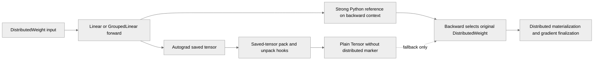

# [PyTorch] Keep DistributedWeight objects on ctx across saved-tensor hooks

[Upstream PR](https://github.com/NVIDIA/TransformerEngine/pull/3545) · state: open · merged: False

## Original PR description

# Description

_Linear and _GroupedLinear save the DistributedWeight parameter itself for
backward and gate their distributed-weight path on getting that object back
(is_distributed_weight(saved_weight)). That holds only while no
torch.autograd.graph.saved_tensors_hooks are installed: with hooks active,
SavedVariable::unpack rebuilds a fresh plain tensor from the unpack hook's
result, dropping the Python subclass and its is_distributed_weight marker.
The backward then takes the plain-parameter branch, whose weakrefs point at
the transient all-gathered weights, and fails with
"weight was removed while fuse_wgrad_accumulation=True".

Seen with Megatron-Core fine-grained activation offloading (which installs
such hooks around expert fc1/act) on bf16 GTP-sharded GroupedLinear experts.
Quantized weights were unaffected because their storage objects already stay
on ctx via prepare_for_saving/restore_from_saved, and the op-fuser path reads
the module's own weight attribute instead of the saved tensor.

Keep the DistributedWeight objects as ordinary ctx / LinearBwdArgs references
and prefer them over the saved tensors in backward.

## Type of change

- [ ] Documentation change (change only to the documentation, either a fix or a new content)
- [x] Bug fix (non-breaking change which fixes an issue)
- [ ] New feature (non-breaking change which adds functionality)
- [ ] Breaking change (fix or feature that would cause existing functionality to not work as expected)
- [ ] Infra/Build change
- [ ] Code refactoring

## Changes

Please list the changes introduced in this PR:

- Change A
- Change B

# Checklist:

- [ ] I have read and followed the [contributing guidelines](https://github.com/NVIDIA/TransformerEngine/blob/main/CONTRIBUTING.rst)
- [ ] The functionality is complete
- [ ] I have commented my code, particularly in hard-to-understand areas
- [ ] I have made corresponding changes to the documentation
- [ ] My changes generate no new warnings
- [ ] I have added tests that prove my fix is effective or that my feature works
- [ ] New and existing unit tests pass locally with my changes

## Review and discussion

### reviews

- greptile-apps[bot] · COMMENTED · 2026-09-18T08:31:51Z · [source](https://github.com/NVIDIA/TransformerEngine/pull/3545#pullrequestreview-5245816354)

(No body; status only.)

- greptile-apps[bot] · COMMENTED · 2026-09-28T12:56:09Z · [source](https://github.com/NVIDIA/TransformerEngine/pull/3545#pullrequestreview-5338924700)

(No body; status only.)

- greptile-apps[bot] · COMMENTED · 2026-09-28T13:36:05Z · [source](https://github.com/NVIDIA/TransformerEngine/pull/3545#pullrequestreview-5339414811)

(No body; status only.)

### issue_comments

- greptile-apps[bot] · comment · 2026-09-18T08:31:47Z · [source](https://github.com/NVIDIA/TransformerEngine/pull/3545#issuecomment-5727392309)

<!-- greptile_summary -->

<h2><a href="https://app.greptile.com/api/retrigger?id=65948964"><picture><source media="(prefers-color-scheme: dark)" srcset="https://greptile-static-assets.s3.amazonaws.com/badges/RetriggerDark.svg?v=2"><source media="(prefers-color-scheme: light)" srcset="https://greptile-static-assets.s3.amazonaws.com/badges/Retrigger.svg?v=2"></picture></a>Confidence Score: 4/5</h2>

**[Medium impact]** Fixes distributed weight handling under PyTorch saved\-tensor hooks\.

The PR is not yet safe to merge because the existing retained-graph backward issue remains unresolved.

<h2>Findings</h2>

1. &nbsp;**Second backward loses distributed weights** <a href="https://github.com/NVIDIA/TransformerEngine/pull/3545#discussion_r4122770182">▶</a>

<h3>Summary</h3>

This PR preserves original `DistributedWeight` Python objects outside autograd’s saved-tensor mechanism so saved-tensor hooks cannot erase the marker used for distributed backward dispatch.
- Stores original distributed weights on the Linear backward arguments and GroupedLinear autograd context.
- Prefers those original objects over hook-unpacked plain tensors during backward.
- Adds CUDA regression coverage for Linear and both GroupedLinear execution paths, including fused weight-gradient accumulation.
- Runs the new regression suite in the L0 PyTorch test job.
- Restricts native grouped-tensor coverage to supported E4M3 configurations.

<h3>Diagram</h3>

<!-- greptile_confidence_score:4 -->

Reviews (10) · Last reviewed commit: ["Merge branch &#39;xren/dist-weight-saved-ten..."](https://github.com/nvidia/transformerengine/commit/f77ecf660eb2d2b289f0e3f48c8a5a29f713325e) · [Reviewed by Greptile](https://www.greptile.com/?utm_source=greptile_expert&utm_medium=github&utm_campaign=code_reviews&utm_content=nvidia/transformerengine)

- fanshiqing · comment · 2026-09-21T23:51:11Z · [source](https://github.com/NVIDIA/TransformerEngine/pull/3545#issuecomment-5769218248)

LGTM, thanks for the fix!

- ksivaman · comment · 2026-09-25T20:09:39Z · [source](https://github.com/NVIDIA/TransformerEngine/pull/3545#issuecomment-5838853539)

@xrennvidia Can you rebase this with main? #3517 has been merged

- xrennvidia · comment · 2026-09-28T12:29:16Z · [source](https://github.com/NVIDIA/TransformerEngine/pull/3545#issuecomment-5869842995)

> @xrennvidia Can you rebase this with main? #3517 has been merged

Done.

- greptile-apps[bot] · comment · 2026-09-28T12:32:12Z · [source](https://github.com/NVIDIA/TransformerEngine/pull/3545#issuecomment-5869886160)

<!-- greptile_outside_diff -->

<h3>Comments Outside Diff</h3>

No findings outside the diff remain.

- greptile-apps[bot] · comment · 2026-09-28T13:02:59Z · [source](https://github.com/NVIDIA/TransformerEngine/pull/3545#issuecomment-5870406396)

Want your agent to iterate on Greptile's feedback? Try [*greploops*](https://github.com/greptileai/skills/blob/main/greploop/SKILL.md).

- ksivaman · comment · 2026-09-29T17:58:44Z · [source](https://github.com/NVIDIA/TransformerEngine/pull/3545#issuecomment-5895735492)

/te-ci pytorch L0

### inline_comments

- greptile-apps[bot] · comment · 2026-09-18T08:31:50Z · [source](https://github.com/NVIDIA/TransformerEngine/pull/3545#discussion_r4045110075)

File: `transformer_engine/pytorch/module/grouped_linear.py` · line 986

 **Missing hook regression coverage**

This compatibility fix has no regression test covering `saved_tensors_hooks` with a `DistributedWeight`. Please add coverage for both Linear and GroupedLinear, especially with fused weight-gradient accumulation, to verify that backward retains the distributed path after hooks unpack the saved weight as a plain tensor.

Note: If this suggestion doesn't match your team's coding style, reply to this and let me know. I'll remember it for next time!

- greptile-apps[bot] · comment · 2026-09-28T12:56:06Z · [source](https://github.com/NVIDIA/TransformerEngine/pull/3545#discussion_r4122381254)

File: `tests/pytorch/test_module_distributed_weight_saved_tensor_hooks.py` · line 196

 **Native path coverage can disappear**

If the CUDA device or cuBLASLt version does not support the native grouped-tensor path, `GroupedLinear` silently falls back to split-quantize. This `grouped-tensor` case then repeats the other test case, so a regression in native backward dispatch could pass CI unnoticed. Check that native dispatch is supported before counting this case as coverage for it.

- greptile-apps[bot] · comment · 2026-09-28T13:36:04Z · [source](https://github.com/NVIDIA/TransformerEngine/pull/3545#discussion_r4122770182)

File: `transformer_engine/pytorch/module/grouped_linear.py` · line 1107

 **Second backward loses distributed weights**

When `GroupedLinear` runs under saved-tensor hooks and its output is backpropagated twice with `retain_graph=True`, the first backward clears `ctx.dist_weights` here; the split backward path clears it too. On the second backward, the saved weights unpack as plain tensors, so the distributed-weight path is lost again. Backward can then fail when it tries to use the unsaved gathered weights, or skip distributed gradient finalization. Keep the original weights available for each backward while the graph is retained.

## Changed files and fixed code

- `qa/L0_pytorch_unittest/test.sh` · modified · additions 1 / deletions 0
  - [head](https://github.com/xrennvidia/TransformerEngine/blob/f77ecf660eb2d2b289f0e3f48c8a5a29f713325e/qa/L0_pytorch_unittest/test.sh)
  - [base](https://github.com/NVIDIA/TransformerEngine/blob/2e959f352c8e2d4b2709e6775867f2c7494656f3/qa/L0_pytorch_unittest/test.sh)
- `tests/pytorch/test_module_distributed_weight_saved_tensor_hooks.py` · added · additions 237 / deletions 0
  - [head](https://github.com/xrennvidia/TransformerEngine/blob/f77ecf660eb2d2b289f0e3f48c8a5a29f713325e/tests/pytorch/test_module_distributed_weight_saved_tensor_hooks.py)
  - [base](https://github.com/NVIDIA/TransformerEngine/blob/2e959f352c8e2d4b2709e6775867f2c7494656f3/tests/pytorch/test_module_distributed_weight_saved_tensor_hooks.py)
- `transformer_engine/pytorch/module/grouped_linear.py` · modified · additions 21 / deletions 1
  - [head](https://github.com/xrennvidia/TransformerEngine/blob/f77ecf660eb2d2b289f0e3f48c8a5a29f713325e/transformer_engine/pytorch/module/grouped_linear.py)
  - [base](https://github.com/NVIDIA/TransformerEngine/blob/2e959f352c8e2d4b2709e6775867f2c7494656f3/transformer_engine/pytorch/module/grouped_linear.py)
- `transformer_engine/pytorch/module/linear.py` · modified · additions 9 / deletions 0
  - [head](https://github.com/xrennvidia/TransformerEngine/blob/f77ecf660eb2d2b289f0e3f48c8a5a29f713325e/transformer_engine/pytorch/module/linear.py)
  - [base](https://github.com/NVIDIA/TransformerEngine/blob/2e959f352c8e2d4b2709e6775867f2c7494656f3/transformer_engine/pytorch/module/linear.py)

## Evidence and interpretation boundary

[Original JSON, discussions and patches](../../evidence/prs/NVIDIA--TransformerEngine/3545-546b7ed54571a39d97c694280c1067ef6d757c0ad6145a7888cc277b4e65ce5c.json) · SHA-256 `546b7ed54571a39d97c694280c1067ef6d757c0ad6145a7888cc277b4e65ce5c`.

Diff complete: True. Missing/binary/truncated patches require pinned source inspection. This is a source page, not an independently verified optimization case. Open, merged and released are different states; recheck the deployed dependency.
