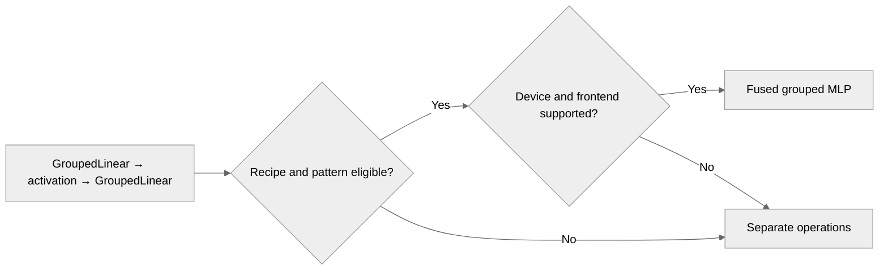

# [PyTorch] Deprecate grouped linear and MLP environment gates

[Upstream PR](https://github.com/NVIDIA/TransformerEngine/pull/3584) · state: open · merged: False

## Original PR description

# Description

Please include a brief summary of the changes, relevant motivation and context.

Fixes # (issue)

## Type of change

- [ ] Documentation change (change only to the documentation, either a fix or a new content)
- [ ] Bug fix (non-breaking change which fixes an issue)
- [ ] New feature (non-breaking change which adds functionality)
- [ ] Breaking change (fix or feature that would cause existing functionality to not work as expected)
- [ ] Infra/Build change
- [ ] Code refactoring

## Changes

Please list the changes introduced in this PR:

- Change A
- Change B

# Checklist:

- [ ] I have read and followed the [contributing guidelines](https://github.com/NVIDIA/TransformerEngine/blob/main/CONTRIBUTING.rst)
- [ ] The functionality is complete
- [ ] I have commented my code, particularly in hard-to-understand areas
- [ ] I have made corresponding changes to the documentation
- [ ] My changes generate no new warnings
- [ ] I have added tests that prove my fix is effective or that my feature works
- [ ] New and existing unit tests pass locally with my changes


## Review and discussion

### reviews

- greptile-apps[bot] · COMMENTED · 2026-09-29T16:31:55Z · [source](https://github.com/NVIDIA/TransformerEngine/pull/3584#pullrequestreview-5355537046)

(No body; status only.)

- timmoon10 · COMMENTED · 2026-09-30T23:03:08Z · [source](https://github.com/NVIDIA/TransformerEngine/pull/3584#pullrequestreview-5371841341)

(No body; status only.)

- greptile-apps[bot] · COMMENTED · 2026-09-30T23:03:54Z · [source](https://github.com/NVIDIA/TransformerEngine/pull/3584#pullrequestreview-5372930056)

(No body; status only.)

- zhongbozhu · COMMENTED · 2026-10-01T23:03:44Z · [source](https://github.com/NVIDIA/TransformerEngine/pull/3584#pullrequestreview-5386619641)

(No body; status only.)

- zhongbozhu · COMMENTED · 2026-10-01T23:05:42Z · [source](https://github.com/NVIDIA/TransformerEngine/pull/3584#pullrequestreview-5386631239)

(No body; status only.)

- zhongbozhu · COMMENTED · 2026-10-01T23:06:58Z · [source](https://github.com/NVIDIA/TransformerEngine/pull/3584#pullrequestreview-5386638974)

(No body; status only.)

- zhongbozhu · COMMENTED · 2026-10-01T23:07:22Z · [source](https://github.com/NVIDIA/TransformerEngine/pull/3584#pullrequestreview-5386641303)

(No body; status only.)

- greptile-apps[bot] · COMMENTED · 2026-10-01T23:13:43Z · [source](https://github.com/NVIDIA/TransformerEngine/pull/3584#pullrequestreview-5386681075)

(No body; status only.)

- vthumbe1503 · DISMISSED · 2026-10-05T01:42:04Z · [source](https://github.com/NVIDIA/TransformerEngine/pull/3584#pullrequestreview-5409284717)

(No body; status only.)

- greptile-apps[bot] · COMMENTED · 2026-10-05T23:43:27Z · [source](https://github.com/NVIDIA/TransformerEngine/pull/3584#pullrequestreview-5422036141)

(No body; status only.)

- vthumbe1503 · DISMISSED · 2026-10-06T00:57:34Z · [source](https://github.com/NVIDIA/TransformerEngine/pull/3584#pullrequestreview-5422575581)

(No body; status only.)

- timmoon10 · DISMISSED · 2026-10-06T01:03:21Z · [source](https://github.com/NVIDIA/TransformerEngine/pull/3584#pullrequestreview-5422619663)

LGTM

- pggPL · CHANGES_REQUESTED · 2026-10-06T21:41:45Z · [source](https://github.com/NVIDIA/TransformerEngine/pull/3584#pullrequestreview-5434884749)

We need to investigate https://github.com/NVIDIA/TransformerEngine/issues/3640 before merging that PR

- greptile-apps[bot] · COMMENTED · 2026-10-07T00:30:28Z · [source](https://github.com/NVIDIA/TransformerEngine/pull/3584#pullrequestreview-5436087142)

(No body; status only.)

- zhongbozhu · COMMENTED · 2026-10-07T21:12:47Z · [source](https://github.com/NVIDIA/TransformerEngine/pull/3584#pullrequestreview-5448425016)

(No body; status only.)

- greptile-apps[bot] · COMMENTED · 2026-10-07T21:13:17Z · [source](https://github.com/NVIDIA/TransformerEngine/pull/3584#pullrequestreview-5448429744)

(No body; status only.)

- zhongbozhu · COMMENTED · 2026-10-07T21:14:05Z · [source](https://github.com/NVIDIA/TransformerEngine/pull/3584#pullrequestreview-5448437448)

(No body; status only.)

- greptile-apps[bot] · COMMENTED · 2026-10-07T21:14:47Z · [source](https://github.com/NVIDIA/TransformerEngine/pull/3584#pullrequestreview-5448444938)

(No body; status only.)

### issue_comments

- greptile-apps[bot] · comment · 2026-09-29T16:31:50Z · [source](https://github.com/NVIDIA/TransformerEngine/pull/3584#issuecomment-5894395533)

<!-- greptile_summary -->

<h2><a href="https://app.greptile.com/api/retrigger?id=71449391"><picture><source media="(prefers-color-scheme: dark)" srcset="https://greptile-static-assets.s3.amazonaws.com/badges/RetriggerDark.svg?v=2"><source media="(prefers-color-scheme: light)" srcset="https://greptile-static-assets.s3.amazonaws.com/badges/Retrigger.svg?v=2"></picture></a>Confidence Score: 4/5</h2>

**[Medium impact]** Removes environment variable gates for grouped linear and MLP features\.

The PR is not yet safe to merge because the outstanding CUDA-free grouped-MLP support check can raise instead of returning unsupported.

<h2>Findings</h2>

1. &nbsp;**CUDA\-free support checks raise** <a href="https://github.com/NVIDIA/TransformerEngine/pull/3584#discussion_r4190017007">▶</a>

<h3>Summary</h3>

The PR removes environment gates for grouped parameters and grouped-MLP fusion, updates EP alignment defaults and examples, and expands grouped-operation coverage. Changes since the previous review also add compiled attention and operation tests, FP8 recipe parameter restoration, and native kernel synchronization safeguards.

<h3>Diagram</h3>



<!-- greptile_confidence_score:4 -->

<sub>Reviews (10) · Last reviewed commit: ["attempt to fix ci issue"](https://github.com/nvidia/transformerengine/commit/b2ebc26e9e90f1b98a32ced26030c67ff47aa76c) · [Reviewed by Greptile](https://www.greptile.com/?utm_source=greptile_expert&utm_medium=github&utm_campaign=code_reviews&utm_content=nvidia/transformerengine)</sub>

- zhongbozhu · comment · 2026-09-29T16:39:32Z · [source](https://github.com/NVIDIA/TransformerEngine/pull/3584#issuecomment-5894519972)

/te-ci pytorch L1

- zhongbozhu · comment · 2026-09-30T17:39:08Z · [source](https://github.com/NVIDIA/TransformerEngine/pull/3584#issuecomment-5916488744)

/te-ci pytorch L1

- zhongbozhu · comment · 2026-10-01T23:09:33Z · [source](https://github.com/NVIDIA/TransformerEngine/pull/3584#issuecomment-5942446799)

/te-ci pytorch L1

- vthumbe1503 · comment · 2026-10-05T01:41:42Z · [source](https://github.com/NVIDIA/TransformerEngine/pull/3584#issuecomment-5986673131)

LGTM. Thanks for cleaning these env variables. All @timmoon10's  comments seem to be resolved as well. @zhongbozhu I resolved the merge conflicts.

- vthumbe1503 · comment · 2026-10-05T01:41:50Z · [source](https://github.com/NVIDIA/TransformerEngine/pull/3584#issuecomment-5986674226)

/te-ci pytorch

- zhongbozhu · comment · 2026-10-05T23:40:05Z · [source](https://github.com/NVIDIA/TransformerEngine/pull/3584#issuecomment-6005605106)

/te-ci pytorch

- zhongbozhu · comment · 2026-10-06T22:35:27Z · [source](https://github.com/NVIDIA/TransformerEngine/pull/3584#issuecomment-6026700399)

/te-ci pytorch

- zhongbozhu · comment · 2026-10-07T21:18:56Z · [source](https://github.com/NVIDIA/TransformerEngine/pull/3584#issuecomment-6047060291)

/te-ci pytorch L1

- zhongbozhu · comment · 2026-10-08T08:34:30Z · [source](https://github.com/NVIDIA/TransformerEngine/pull/3584#issuecomment-6056000863)

/te-ci pytorch L1

- zhongbozhu · comment · 2026-10-09T02:20:41Z · [source](https://github.com/NVIDIA/TransformerEngine/pull/3584#issuecomment-6072932503)

/te-ci pytorch L1

### inline_comments

- greptile-apps[bot] · comment · 2026-09-29T16:31:54Z · [source](https://github.com/NVIDIA/TransformerEngine/pull/3584#discussion_r4135899000)

File: `transformer_engine/pytorch/ops/fused/grouped_mlp.py` · line 3275

<a href="#"></a> **Fusion checks the wrong GPU** If a grouped MLP runs on a different GPU from the current CUDA device, the newly registered fusion checks the current device’s capability, not the GPU holding the inputs. For example, it can select an SM100 fused kernel for an SM9 workload and fail instead of using the unfused operations. The support and fusion-plan caches can retain that decision.

**Knowledge Base Used:** [PyTorch tensor and operator abstractions](https://app.greptile.com/nvidia-public-github/-/custom-context/knowledge-base/nvidia/transformerengine/-/docs/pytorch-tensors-and-ops.md)

- greptile-apps[bot] · comment · 2026-09-29T16:31:54Z · [source](https://github.com/NVIDIA/TransformerEngine/pull/3584#discussion_r4135899017)

File: `docs/examples/te_mixtral/run_finetune_ep.py` · line 23

<a href="#"></a> **Legacy fusion is not registered** If improvement 3 runs with an older TE implementation covered by the example’s compatibility patch, removing the pre-import setting means TE skips fusion registration during import. The patch runs only during model initialization and cannot restore that registration, so the example silently runs unfused despite advertising a fused grouped-MLP kernel.

- greptile-apps[bot] · comment · 2026-09-29T16:31:54Z · [source](https://github.com/NVIDIA/TransformerEngine/pull/3584#discussion_r4135899026)

File: `tests/pytorch/test_grouped_mlp.py` · line None

<a href="#"></a> **Deprecated gate values remain untested** The new registration test deletes `NVTE_CUTEDSL_FUSED_GROUPED_MLP`, but the documented behavior also requires ignoring explicit `0` and `1` values. Testing only the unset case could miss a reintroduced environment dependency. Please cover both set values.

**Knowledge Base Used:** [Verification and CI matrix](https://app.greptile.com/nvidia-public-github/-/custom-context/knowledge-base/nvidia/transformerengine/-/docs/verification-and-ci.md)

Note: If this suggestion doesn't match your team's coding style, reply to this and let me know. I'll remember it for next time!

- timmoon10 · comment · 2026-09-30T20:50:38Z · [source](https://github.com/NVIDIA/TransformerEngine/pull/3584#discussion_r4149216890)

File: `transformer_engine/pytorch/ops/fused/grouped_mlp.py` · line None

Redundant with the call in `fuse_grouped_mlp_ops`:
```suggestion
```

- timmoon10 · comment · 2026-09-30T20:50:57Z · [source](https://github.com/NVIDIA/TransformerEngine/pull/3584#discussion_r4149219305)

File: `transformer_engine/pytorch/ops/fused/grouped_mlp.py` · line 3256

Redundant with the call in `fuse_grouped_mlp_ops`:
```suggestion
```

- timmoon10 · comment · 2026-09-30T20:54:25Z · [source](https://github.com/NVIDIA/TransformerEngine/pull/3584#discussion_r4149247172)

File: `transformer_engine/pytorch/ops/fused/grouped_mlp.py` · line 3275

We assume that all kernels run by the current process are run on the current CUDA device.

- timmoon10 · comment · 2026-09-30T20:57:36Z · [source](https://github.com/NVIDIA/TransformerEngine/pull/3584#discussion_r4149273089)

File: `docs/envvars.rst` · line None

I prefer if the docs reflect the code as it is today. Users can go through the Git history if they want to understand history.
```suggestion
```

- timmoon10 · comment · 2026-09-30T22:04:06Z · [source](https://github.com/NVIDIA/TransformerEngine/pull/3584#discussion_r4149778480)

File: `docs/examples/te_mixtral/tutorial_accelerate_hf_mixtral_with_te.ipynb` · line None

The alert is no longer meaningful.

- timmoon10 · comment · 2026-09-30T22:24:54Z · [source](https://github.com/NVIDIA/TransformerEngine/pull/3584#discussion_r4149918343)

File: `tests/pytorch/test_grouped_mlp.py` · line None

Why is contract worth enforcing? It seems reasonable to me for the op fuser to check the current CUDA device or the cuDNN version, even if it doesn't end up applying the grouped MLP fusion.

- timmoon10 · comment · 2026-09-30T22:35:52Z · [source](https://github.com/NVIDIA/TransformerEngine/pull/3584#discussion_r4149984535)

File: `tests/pytorch/test_grouped_mlp.py` · line None

It seems dangerous to initialize an MXFP8 recipe on systems that don't support MXFP8. It may work currently if we monkeypatch `get_device_compute_capability` to return Blackwell, but it doesn't seem wise to rely on it.

- timmoon10 · comment · 2026-09-30T22:38:00Z · [source](https://github.com/NVIDIA/TransformerEngine/pull/3584#discussion_r4149996410)

File: `tests/pytorch/test_grouped_mlp.py` · line None

What's the value of supporting grouped MLP when there's no GPU to run it?

- timmoon10 · comment · 2026-09-30T22:38:32Z · [source](https://github.com/NVIDIA/TransformerEngine/pull/3584#discussion_r4149999236)

File: `transformer_engine/pytorch/ops/fused/grouped_mlp.py` · line None

I'm skeptical whether this contract is worth it.
```suggestion
```

- greptile-apps[bot] · comment · 2026-09-30T23:03:54Z · [source](https://github.com/NVIDIA/TransformerEngine/pull/3584#discussion_r4150142397)

File: `transformer_engine/pytorch/ops/fused/grouped_mlp.py` · line 3275

Understood. Given the project invariant that every kernel in a process runs on the current CUDA device, the capability check evaluates the correct device and my multi-GPU scenario does not apply. I retract this finding; no change is needed for this comment.

- zhongbozhu · comment · 2026-10-01T23:03:43Z · [source](https://github.com/NVIDIA/TransformerEngine/pull/3584#discussion_r4161371563)

File: `docs/envvars.rst` · line None

sounds good 

- zhongbozhu · comment · 2026-10-01T23:05:41Z · [source](https://github.com/NVIDIA/TransformerEngine/pull/3584#discussion_r4161382111)

File: `tests/pytorch/test_grouped_mlp.py` · line None

removed

- zhongbozhu · comment · 2026-10-01T23:06:58Z · [source](https://github.com/NVIDIA/TransformerEngine/pull/3584#discussion_r4161388933)

File: `tests/pytorch/test_grouped_mlp.py` · line None

that's some defensive programming code from agents, removed~

- zhongbozhu · comment · 2026-10-01T23:07:21Z · [source](https://github.com/NVIDIA/TransformerEngine/pull/3584#discussion_r4161390955)

File: `tests/pytorch/test_grouped_mlp.py` · line None

removed~

- greptile-apps[bot] · comment · 2026-10-01T23:13:42Z · [source](https://github.com/NVIDIA/TransformerEngine/pull/3584#discussion_r4161425225)

File: `transformer_engine/pytorch/ops/fused/grouped_mlp.py` · line None

<a href="#"></a> **Unrelated forwards initialize CUDA** If a machine has a GPU, the first forward of even an unrelated CPU-only `Sequential` now queries the current CUDA device before checking whether the operations or recipe could use grouped-MLP fusion. The unary fusion callback also checks support before candidacy. This can initialize CUDA in a process that later forks workers, causing a worker to fail when it tries to use CUDA. Check the recipe and operation pattern before probing the device.

**Knowledge Base Used:** [PyTorch tensor and operator abstractions](https://app.greptile.com/nvidia-public-github/-/custom-context/knowledge-base/nvidia/transformerengine/-/docs/pytorch-tensors-and-ops.md)

- greptile-apps[bot] · comment · 2026-10-05T23:43:26Z · [source](https://github.com/NVIDIA/TransformerEngine/pull/3584#discussion_r4190017007)

File: `transformer_engine/pytorch/ops/fused/grouped_mlp.py` · line 1189

<a href="#"></a> **CUDA-free support checks raise** If CUDA is unavailable, `is_supported()` now calls `get_device_compute_capability()` instead of returning `False`. That helper calls `torch.cuda.current_device()`, so the support check raises rather than letting the caller use the unfused path. The unary-fusion callback can hit this check while building a plan, before checking whether the recipe or operations are candidates for fusion.

**Knowledge Base Used:** [PyTorch tensor and operator abstractions](https://app.greptile.com/nvidia-public-github/-/custom-context/knowledge-base/nvidia/transformerengine/-/docs/pytorch-tensors-and-ops.md)

- greptile-apps[bot] · comment · 2026-10-07T00:30:27Z · [source](https://github.com/NVIDIA/TransformerEngine/pull/3584#discussion_r4201781684)

File: `transformer_engine/pytorch/ep.py` · line 343

<a href="#"></a> **Default padding exceeds receive capacity** If an existing EP caller omits `alignment` and sizes `recv_capacity_per_rank` for routed tokens without padding, the new default pads each expert’s receive slab to 256 tokens while dispatch still allocates outputs using the original capacity. When the padded total exceeds that capacity, dispatch can fail or drop tokens instead of processing the routing that worked before. The updated examples explicitly use `alignment=0` to retain their unpadded capacity.

**Knowledge Base Used:** [PyTorch distributed execution](https://app.greptile.com/nvidia-public-github/-/custom-context/knowledge-base/nvidia/transformerengine/-/docs/pytorch-distributed-execution.md)

- greptile-apps[bot] · comment · 2026-10-07T00:30:27Z · [source](https://github.com/NVIDIA/TransformerEngine/pull/3584#discussion_r4201781692)

File: `transformer_engine/pytorch/ep.py` · line 343

<a href="#"></a> **Mixed EP alignments fail** If a process prepares an explicitly unaligned EP buffer and then prepares another buffer using the new 256-token default, the backend rejects the second alignment because it pins the first one per device. A caller that previously mixed an explicit `alignment=0` buffer with a default buffer can therefore fail during preparation instead of dispatching the second layer’s tokens.

**Knowledge Base Used:** [PyTorch distributed execution](https://app.greptile.com/nvidia-public-github/-/custom-context/knowledge-base/nvidia/transformerengine/-/docs/pytorch-distributed-execution.md)

- zhongbozhu · comment · 2026-10-07T21:12:47Z · [source](https://github.com/NVIDIA/TransformerEngine/pull/3584#discussion_r4212042771)

File: `transformer_engine/pytorch/ep.py` · line 343

256 alignment is for GEMM & fused quantization kernel in mxfp8 and nvfp4 so we cannot really do alignment 0, and it's user's responsibility to have the same alignment, or they should just use the default 

- greptile-apps[bot] · comment · 2026-10-07T21:13:17Z · [source](https://github.com/NVIDIA/TransformerEngine/pull/3584#discussion_r4212047027)

File: `transformer_engine/pytorch/ep.py` · line 343

Understood. Since 256-token alignment is required by the MXFP8/NVFP4 grouped GEMM and fused quantization paths, callers using fixed-capacity dispatch must size `recv_capacity_per_rank` for the aligned/padded counts (or rely on the default configuration). The updated `EpBuffer` documentation states this contract, so my compatibility concern is not actionable for this intentional API change; I’ll withdraw the finding.

- zhongbozhu · comment · 2026-10-07T21:14:05Z · [source](https://github.com/NVIDIA/TransformerEngine/pull/3584#discussion_r4212053835)

File: `transformer_engine/pytorch/ep.py` · line 343

same comment here: 256 alignment is for GEMM & fused quantization kernel in mxfp8 and nvfp4 so we cannot really do alignment 0, and it's user's responsibility to have the same alignment, or they should just use the default

- greptile-apps[bot] · comment · 2026-10-07T21:14:47Z · [source](https://github.com/NVIDIA/TransformerEngine/pull/3584#discussion_r4212059649)

File: `transformer_engine/pytorch/ep.py` · line 343

That context makes sense. Since 256-token alignment is required for the MXFP8/NVFP4 grouped GEMM and fused quantization paths, callers using those paths must use a consistent alignment across their buffers; `alignment=0` is not supported for them. The documentation now states that the backend and `EpBuffer` must use the same alignment and that capacity must include padding, so I agree this is caller responsibility rather than a defect in this change. I’m withdrawing the comment.

## Changed files and fixed code

- `benchmarks/linear/benchmark_graph_safe_grouped_mlp.py` · modified · additions 0 / deletions 2
  - [head](https://github.com/zhongbozhu/TransformerEngine/blob/b2ebc26e9e90f1b98a32ced26030c67ff47aa76c/benchmarks/linear/benchmark_graph_safe_grouped_mlp.py)
  - [base](https://github.com/NVIDIA/TransformerEngine/blob/39c30c577f5dd4f9fba921ee011b5cd797ae667e/benchmarks/linear/benchmark_graph_safe_grouped_mlp.py)
- `docs/examples/te_mixtral/run_finetune_ep.py` · modified · additions 0 / deletions 12
  - [head](https://github.com/zhongbozhu/TransformerEngine/blob/b2ebc26e9e90f1b98a32ced26030c67ff47aa76c/docs/examples/te_mixtral/run_finetune_ep.py)
  - [base](https://github.com/NVIDIA/TransformerEngine/blob/39c30c577f5dd4f9fba921ee011b5cd797ae667e/docs/examples/te_mixtral/run_finetune_ep.py)
- `docs/examples/te_mixtral/te_mixtral_mxfp8.py` · modified · additions 6 / deletions 7
  - [head](https://github.com/zhongbozhu/TransformerEngine/blob/b2ebc26e9e90f1b98a32ced26030c67ff47aa76c/docs/examples/te_mixtral/te_mixtral_mxfp8.py)
  - [base](https://github.com/NVIDIA/TransformerEngine/blob/39c30c577f5dd4f9fba921ee011b5cd797ae667e/docs/examples/te_mixtral/te_mixtral_mxfp8.py)
- `docs/examples/te_mixtral/tutorial_accelerate_hf_mixtral_with_te.ipynb` · modified · additions 2 / deletions 10
  - [head](https://github.com/zhongbozhu/TransformerEngine/blob/b2ebc26e9e90f1b98a32ced26030c67ff47aa76c/docs/examples/te_mixtral/tutorial_accelerate_hf_mixtral_with_te.ipynb)
  - [base](https://github.com/NVIDIA/TransformerEngine/blob/39c30c577f5dd4f9fba921ee011b5cd797ae667e/docs/examples/te_mixtral/tutorial_accelerate_hf_mixtral_with_te.ipynb)
- `docs/examples/te_mixtral/utils.py` · modified · additions 0 / deletions 71
  - [head](https://github.com/zhongbozhu/TransformerEngine/blob/b2ebc26e9e90f1b98a32ced26030c67ff47aa76c/docs/examples/te_mixtral/utils.py)
  - [base](https://github.com/NVIDIA/TransformerEngine/blob/39c30c577f5dd4f9fba921ee011b5cd797ae667e/docs/examples/te_mixtral/utils.py)
- `examples/pytorch/ep/bench/ep_bench.py` · modified · additions 1 / deletions 0
  - [head](https://github.com/zhongbozhu/TransformerEngine/blob/b2ebc26e9e90f1b98a32ced26030c67ff47aa76c/examples/pytorch/ep/bench/ep_bench.py)
  - [base](https://github.com/NVIDIA/TransformerEngine/blob/39c30c577f5dd4f9fba921ee011b5cd797ae667e/examples/pytorch/ep/bench/ep_bench.py)
- `examples/pytorch/ep/ep_moe.py` · modified · additions 1 / deletions 0
  - [head](https://github.com/zhongbozhu/TransformerEngine/blob/b2ebc26e9e90f1b98a32ced26030c67ff47aa76c/examples/pytorch/ep/ep_moe.py)
  - [base](https://github.com/NVIDIA/TransformerEngine/blob/39c30c577f5dd4f9fba921ee011b5cd797ae667e/examples/pytorch/ep/ep_moe.py)
- `qa/L0_pytorch_debug_unittest/test.sh` · modified · additions 1 / deletions 1
  - [head](https://github.com/zhongbozhu/TransformerEngine/blob/b2ebc26e9e90f1b98a32ced26030c67ff47aa76c/qa/L0_pytorch_debug_unittest/test.sh)
  - [base](https://github.com/NVIDIA/TransformerEngine/blob/39c30c577f5dd4f9fba921ee011b5cd797ae667e/qa/L0_pytorch_debug_unittest/test.sh)
- `qa/L0_pytorch_unittest/test.sh` · modified · additions 3 / deletions 3
  - [head](https://github.com/zhongbozhu/TransformerEngine/blob/b2ebc26e9e90f1b98a32ced26030c67ff47aa76c/qa/L0_pytorch_unittest/test.sh)
  - [base](https://github.com/NVIDIA/TransformerEngine/blob/39c30c577f5dd4f9fba921ee011b5cd797ae667e/qa/L0_pytorch_unittest/test.sh)
- `tests/pytorch/distributed/run_ep.py` · modified · additions 48 / deletions 54
  - [head](https://github.com/zhongbozhu/TransformerEngine/blob/b2ebc26e9e90f1b98a32ced26030c67ff47aa76c/tests/pytorch/distributed/run_ep.py)
  - [base](https://github.com/NVIDIA/TransformerEngine/blob/39c30c577f5dd4f9fba921ee011b5cd797ae667e/tests/pytorch/distributed/run_ep.py)
- `tests/pytorch/distributed/run_test_ep.sh` · modified · additions 1 / deletions 1
  - [head](https://github.com/zhongbozhu/TransformerEngine/blob/b2ebc26e9e90f1b98a32ced26030c67ff47aa76c/tests/pytorch/distributed/run_test_ep.sh)
  - [base](https://github.com/NVIDIA/TransformerEngine/blob/39c30c577f5dd4f9fba921ee011b5cd797ae667e/tests/pytorch/distributed/run_test_ep.sh)
- `tests/pytorch/distributed/test_fusible_ops.py` · modified · additions 9 / deletions 4
  - [head](https://github.com/zhongbozhu/TransformerEngine/blob/b2ebc26e9e90f1b98a32ced26030c67ff47aa76c/tests/pytorch/distributed/test_fusible_ops.py)
  - [base](https://github.com/NVIDIA/TransformerEngine/blob/39c30c577f5dd4f9fba921ee011b5cd797ae667e/tests/pytorch/distributed/test_fusible_ops.py)
- `tests/pytorch/test_grouped_linear.py` · modified · additions 48 / deletions 18
  - [head](https://github.com/zhongbozhu/TransformerEngine/blob/b2ebc26e9e90f1b98a32ced26030c67ff47aa76c/tests/pytorch/test_grouped_linear.py)
  - [base](https://github.com/NVIDIA/TransformerEngine/blob/39c30c577f5dd4f9fba921ee011b5cd797ae667e/tests/pytorch/test_grouped_linear.py)
- `tests/pytorch/test_grouped_mlp.py` · modified · additions 50 / deletions 44
  - [head](https://github.com/zhongbozhu/TransformerEngine/blob/b2ebc26e9e90f1b98a32ced26030c67ff47aa76c/tests/pytorch/test_grouped_mlp.py)
  - [base](https://github.com/NVIDIA/TransformerEngine/blob/39c30c577f5dd4f9fba921ee011b5cd797ae667e/tests/pytorch/test_grouped_mlp.py)
- `tests/pytorch/test_grouped_tensor.py` · modified · additions 0 / deletions 5
  - [head](https://github.com/zhongbozhu/TransformerEngine/blob/b2ebc26e9e90f1b98a32ced26030c67ff47aa76c/tests/pytorch/test_grouped_tensor.py)
  - [base](https://github.com/NVIDIA/TransformerEngine/blob/39c30c577f5dd4f9fba921ee011b5cd797ae667e/tests/pytorch/test_grouped_tensor.py)
- `tests/pytorch/test_module_grouped_linear_distributed_weight.py` · modified · additions 1 / deletions 2
  - [head](https://github.com/zhongbozhu/TransformerEngine/blob/b2ebc26e9e90f1b98a32ced26030c67ff47aa76c/tests/pytorch/test_module_grouped_linear_distributed_weight.py)
  - [base](https://github.com/NVIDIA/TransformerEngine/blob/39c30c577f5dd4f9fba921ee011b5cd797ae667e/tests/pytorch/test_module_grouped_linear_distributed_weight.py)
- `tests/pytorch/test_sanity.py` · modified · additions 2 / deletions 6
  - [head](https://github.com/zhongbozhu/TransformerEngine/blob/b2ebc26e9e90f1b98a32ced26030c67ff47aa76c/tests/pytorch/test_sanity.py)
  - [base](https://github.com/NVIDIA/TransformerEngine/blob/39c30c577f5dd4f9fba921ee011b5cd797ae667e/tests/pytorch/test_sanity.py)
- `transformer_engine/pytorch/ep.py` · modified · additions 8 / deletions 2
  - [head](https://github.com/zhongbozhu/TransformerEngine/blob/b2ebc26e9e90f1b98a32ced26030c67ff47aa76c/transformer_engine/pytorch/ep.py)
  - [base](https://github.com/NVIDIA/TransformerEngine/blob/39c30c577f5dd4f9fba921ee011b5cd797ae667e/transformer_engine/pytorch/ep.py)
- `transformer_engine/pytorch/module/grouped_linear.py` · modified · additions 7 / deletions 12
  - [head](https://github.com/zhongbozhu/TransformerEngine/blob/b2ebc26e9e90f1b98a32ced26030c67ff47aa76c/transformer_engine/pytorch/module/grouped_linear.py)
  - [base](https://github.com/NVIDIA/TransformerEngine/blob/39c30c577f5dd4f9fba921ee011b5cd797ae667e/transformer_engine/pytorch/module/grouped_linear.py)
- `transformer_engine/pytorch/ops/basic/grouped_linear.py` · modified · additions 6 / deletions 10
  - [head](https://github.com/zhongbozhu/TransformerEngine/blob/b2ebc26e9e90f1b98a32ced26030c67ff47aa76c/transformer_engine/pytorch/ops/basic/grouped_linear.py)
  - [base](https://github.com/NVIDIA/TransformerEngine/blob/39c30c577f5dd4f9fba921ee011b5cd797ae667e/transformer_engine/pytorch/ops/basic/grouped_linear.py)
- `transformer_engine/pytorch/ops/fused/grouped_mlp.py` · modified · additions 38 / deletions 23
  - [head](https://github.com/zhongbozhu/TransformerEngine/blob/b2ebc26e9e90f1b98a32ced26030c67ff47aa76c/transformer_engine/pytorch/ops/fused/grouped_mlp.py)
  - [base](https://github.com/NVIDIA/TransformerEngine/blob/39c30c577f5dd4f9fba921ee011b5cd797ae667e/transformer_engine/pytorch/ops/fused/grouped_mlp.py)
- `transformer_engine/pytorch/utils.py` · modified · additions 4 / deletions 17
  - [head](https://github.com/zhongbozhu/TransformerEngine/blob/b2ebc26e9e90f1b98a32ced26030c67ff47aa76c/transformer_engine/pytorch/utils.py)
  - [base](https://github.com/NVIDIA/TransformerEngine/blob/39c30c577f5dd4f9fba921ee011b5cd797ae667e/transformer_engine/pytorch/utils.py)

## Evidence and interpretation boundary

[Original JSON, discussions and patches](../../evidence/prs/NVIDIA--TransformerEngine/3584-29ee8d1431fe51f478b3cfc07f36027053accd1ce153e8ebb973e4c456167d2d.json) · SHA-256 `29ee8d1431fe51f478b3cfc07f36027053accd1ce153e8ebb973e4c456167d2d`.

Diff complete: True. Missing/binary/truncated patches require pinned source inspection. This is a source page, not an independently verified optimization case. Open, merged and released are different states; recheck the deployed dependency.
