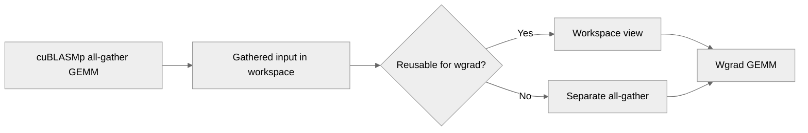

# Reuse cuBLASMp's all-gathered grad_output in the wgrad GEMM

[Upstream PR](https://github.com/NVIDIA/TransformerEngine/pull/3629) · state: open · merged: False

## Original PR description

# Description

Please include a brief summary of the changes, relevant motivation and context.

Fixes # (issue)

## Type of change

- [ ] Documentation change (change only to the documentation, either a fix or a new content)
- [ ] Bug fix (non-breaking change which fixes an issue)
- [x] New feature (non-breaking change which adds functionality)
- [ ] Breaking change (fix or feature that would cause existing functionality to not work as expected)
- [ ] Infra/Build change
- [ ] Code refactoring

## Changes

Please list the changes introduced in this PR:

- Reuse cuBLASMp's all-gathered grad_output in the wgrad GEMM

# Checklist:

- [ ] I have read and followed the [contributing guidelines](https://github.com/NVIDIA/TransformerEngine/blob/main/CONTRIBUTING.rst)
- [ ] The functionality is complete
- [ ] I have commented my code, particularly in hard-to-understand areas
- [ ] I have made corresponding changes to the documentation
- [ ] My changes generate no new warnings
- [ ] I have added tests that prove my fix is effective or that my feature works
- [ ] New and existing unit tests pass locally with my changes

## Review and discussion

### reviews

- greptile-apps[bot] · COMMENTED · 2026-10-05T16:05:55Z · [source](https://github.com/NVIDIA/TransformerEngine/pull/3629#pullrequestreview-5417392793)

(No body; status only.)

### issue_comments

- greptile-apps[bot] · comment · 2026-10-05T16:05:50Z · [source](https://github.com/NVIDIA/TransformerEngine/pull/3629#issuecomment-5998260111)

<!-- greptile_summary -->

<h2><a href="https://app.greptile.com/api/retrigger?id=74933977"><picture><source media="(prefers-color-scheme: dark)" srcset="https://greptile-static-assets.s3.amazonaws.com/badges/RetriggerDark.svg?v=2"><source media="(prefers-color-scheme: light)" srcset="https://greptile-static-assets.s3.amazonaws.com/badges/Retrigger.svg?v=2"></picture></a>Confidence Score: 5/5</h2>

**[High risk]** Changes how distributed gradient computation reuses communication buffers\.

The PR appears mergeable, though the previously reported workspace-view lifetime concern remains open.

<h2>Findings</h2>

1. &nbsp;**Workspace view can become invalid** <a href="https://github.com/NVIDIA/TransformerEngine/pull/3629#discussion_r4186103095">▶</a>

<h3>Summary</h3>

This PR exposes cuBLASMp’s all-gathered input through a workspace view and reuses it for weight-gradient GEMMs when the data format and timing permit. Other cases retain a separate all-gather fallback.

<h3>Diagram</h3>

<!-- greptile_confidence_score:5 -->

Reviews (2) · Last reviewed commit: ["\[PyTorch\] Fall back to the all-gather wi..."](https://github.com/nvidia/transformerengine/commit/2ff7268a70eac49102cccca3ca3f3cdee4452fdd) · [Reviewed by Greptile](https://www.greptile.com/?utm_source=greptile_expert&utm_medium=github&utm_campaign=code_reviews&utm_content=nvidia/transformerengine)

### inline_comments

- greptile-apps[bot] · comment · 2026-10-05T16:05:54Z · [source](https://github.com/NVIDIA/TransformerEngine/pull/3629#discussion_r4186103095)

File: `transformer_engine/pytorch/csrc/extensions/comm_gemm_overlap.cpp` · line 335

 **Workspace view can become invalid** If a later operation grows the communicator’s workspace while wgrad still uses this view, cuBLASMp frees the allocation behind it. Wgrad could then read invalid memory. The view does not keep that allocation alive, so its lifetime needs to be protected until consumption finishes.

## Changed files and fixed code

- `transformer_engine/common/comm_gemm/comm_gemm.cpp` · modified · additions 20 / deletions 0
  - [head](https://github.com/almogsegal/TransformerEngine/blob/2ff7268a70eac49102cccca3ca3f3cdee4452fdd/transformer_engine/common/comm_gemm/comm_gemm.cpp)
  - [base](https://github.com/NVIDIA/TransformerEngine/blob/5e994640625626263aa62250c709e35601563566/transformer_engine/common/comm_gemm/comm_gemm.cpp)
- `transformer_engine/common/include/transformer_engine/comm_gemm.h` · modified · additions 14 / deletions 0
  - [head](https://github.com/almogsegal/TransformerEngine/blob/2ff7268a70eac49102cccca3ca3f3cdee4452fdd/transformer_engine/common/include/transformer_engine/comm_gemm.h)
  - [base](https://github.com/NVIDIA/TransformerEngine/blob/5e994640625626263aa62250c709e35601563566/transformer_engine/common/include/transformer_engine/comm_gemm.h)
- `transformer_engine/pytorch/csrc/extensions.h` · modified · additions 8 / deletions 0
  - [head](https://github.com/almogsegal/TransformerEngine/blob/2ff7268a70eac49102cccca3ca3f3cdee4452fdd/transformer_engine/pytorch/csrc/extensions.h)
  - [base](https://github.com/NVIDIA/TransformerEngine/blob/5e994640625626263aa62250c709e35601563566/transformer_engine/pytorch/csrc/extensions.h)
- `transformer_engine/pytorch/csrc/extensions/comm_gemm_overlap.cpp` · modified · additions 45 / deletions 7
  - [head](https://github.com/almogsegal/TransformerEngine/blob/2ff7268a70eac49102cccca3ca3f3cdee4452fdd/transformer_engine/pytorch/csrc/extensions/comm_gemm_overlap.cpp)
  - [base](https://github.com/NVIDIA/TransformerEngine/blob/5e994640625626263aa62250c709e35601563566/transformer_engine/pytorch/csrc/extensions/comm_gemm_overlap.cpp)
- `transformer_engine/pytorch/module/base.py` · modified · additions 50 / deletions 0
  - [head](https://github.com/almogsegal/TransformerEngine/blob/2ff7268a70eac49102cccca3ca3f3cdee4452fdd/transformer_engine/pytorch/module/base.py)
  - [base](https://github.com/NVIDIA/TransformerEngine/blob/5e994640625626263aa62250c709e35601563566/transformer_engine/pytorch/module/base.py)
- `transformer_engine/pytorch/module/layernorm_linear.py` · modified · additions 25 / deletions 13
  - [head](https://github.com/almogsegal/TransformerEngine/blob/2ff7268a70eac49102cccca3ca3f3cdee4452fdd/transformer_engine/pytorch/module/layernorm_linear.py)
  - [base](https://github.com/NVIDIA/TransformerEngine/blob/5e994640625626263aa62250c709e35601563566/transformer_engine/pytorch/module/layernorm_linear.py)
- `transformer_engine/pytorch/module/layernorm_mlp.py` · modified · additions 29 / deletions 15
  - [head](https://github.com/almogsegal/TransformerEngine/blob/2ff7268a70eac49102cccca3ca3f3cdee4452fdd/transformer_engine/pytorch/module/layernorm_mlp.py)
  - [base](https://github.com/NVIDIA/TransformerEngine/blob/5e994640625626263aa62250c709e35601563566/transformer_engine/pytorch/module/layernorm_mlp.py)
- `transformer_engine/pytorch/module/linear.py` · modified · additions 29 / deletions 12
  - [head](https://github.com/almogsegal/TransformerEngine/blob/2ff7268a70eac49102cccca3ca3f3cdee4452fdd/transformer_engine/pytorch/module/linear.py)
  - [base](https://github.com/NVIDIA/TransformerEngine/blob/5e994640625626263aa62250c709e35601563566/transformer_engine/pytorch/module/linear.py)
- `transformer_engine/pytorch/ops/fused/userbuffers_backward_linear.py` · modified · additions 25 / deletions 14
  - [head](https://github.com/almogsegal/TransformerEngine/blob/2ff7268a70eac49102cccca3ca3f3cdee4452fdd/transformer_engine/pytorch/ops/fused/userbuffers_backward_linear.py)
  - [base](https://github.com/NVIDIA/TransformerEngine/blob/5e994640625626263aa62250c709e35601563566/transformer_engine/pytorch/ops/fused/userbuffers_backward_linear.py)

## Evidence and interpretation boundary

[Original JSON, discussions and patches](../../evidence/prs/NVIDIA--TransformerEngine/3629-f96e41b7864ee925e16ae9b1cd39c72d5bb66fc1fe9923a5ba11703739872721.json) · SHA-256 `f96e41b7864ee925e16ae9b1cd39c72d5bb66fc1fe9923a5ba11703739872721`.

Diff complete: True. Missing/binary/truncated patches require pinned source inspection. This is a source page, not an independently verified optimization case. Open, merged and released are different states; recheck the deployed dependency.
