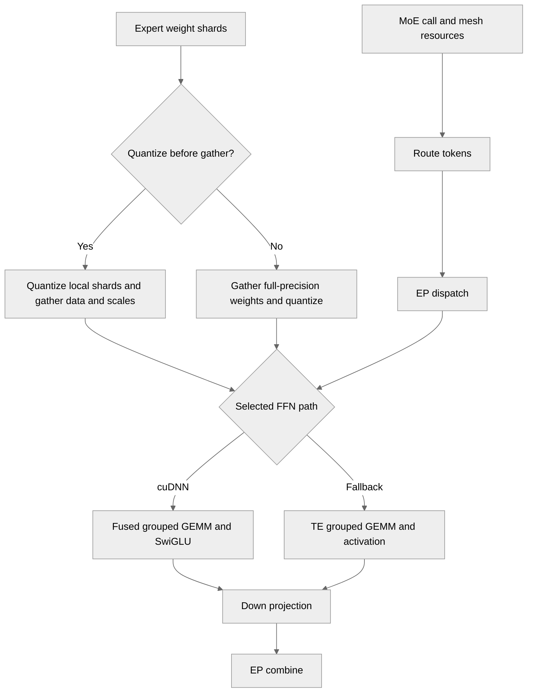

# [Draft][JAX] MoE block optimization

[Upstream PR](https://github.com/NVIDIA/TransformerEngine/pull/3638) · state: open · merged: False

## Original PR description

# Description

Please include a brief summary of the changes, relevant motivation and context.

Fixes # (issue)

## Type of change

- [ ] Documentation change (change only to the documentation, either a fix or a new content)
- [ ] Bug fix (non-breaking change which fixes an issue)
- [x] New feature (non-breaking change which adds functionality)
- [ ] Breaking change (fix or feature that would cause existing functionality to not work as expected)
- [ ] Infra/Build change
- [ ] Code refactoring

## Changes

Please list the changes introduced in this PR:

- Change A
- Change B

# Checklist:

- [ ] I have read and followed the [contributing guidelines](https://github.com/NVIDIA/TransformerEngine/blob/main/CONTRIBUTING.rst)
- [ ] The functionality is complete
- [ ] I have commented my code, particularly in hard-to-understand areas
- [ ] I have made corresponding changes to the documentation
- [ ] My changes generate no new warnings
- [ ] I have added tests that prove my fix is effective or that my feature works
- [ ] New and existing unit tests pass locally with my changes

## Review and discussion

### reviews

- greptile-apps[bot] · COMMENTED · 2026-10-06T20:15:01Z · [source](https://github.com/NVIDIA/TransformerEngine/pull/3638#pullrequestreview-5434068582)

(No body; status only.)

### issue_comments

- greptile-apps[bot] · comment · 2026-10-06T20:14:55Z · [source](https://github.com/NVIDIA/TransformerEngine/pull/3638#issuecomment-6024624883)

<!-- greptile_summary -->

<h2><a href="https://app.greptile.com/api/retrigger?id=75849987"><picture><source media="(prefers-color-scheme: dark)" srcset="https://greptile-static-assets.s3.amazonaws.com/badges/RetriggerDark.svg?v=2"><source media="(prefers-color-scheme: light)" srcset="https://greptile-static-assets.s3.amazonaws.com/badges/Retrigger.svg?v=2"></picture></a>Confidence Score: 2/5</h2>

**[High risk]** Adds MoE optimization paths with new kernel dispatch and weight handling\.

Fix the bootstrap axis count, expert-weight ordering, and optional-dependency test failure before merging.

<h2>Findings</h2>

1. &nbsp;**Separate DP and FSDP fail** <a href="https://github.com/NVIDIA/TransformerEngine/pull/3638#discussion_r4200000727">▶</a>
2. &nbsp;**Tokens use wrong experts** <a href="https://github.com/NVIDIA/TransformerEngine/pull/3638#discussion_r4200000734">▶</a>
3. &nbsp;**Optional package breaks tests** <a href="https://github.com/NVIDIA/TransformerEngine/pull/3638#discussion_r4200000742">▶</a>
4. &nbsp;**Fusion switch does nothing** <a href="https://github.com/NVIDIA/TransformerEngine/pull/3638#discussion_r4200000750">▶</a>

<h3>Summary</h3>

Adds cuDNN grouped GEMM/SwiGLU execution, quantized FSDP weight gathering, resource-based MoE configuration, and checkpoint names.
- Separate DP and FSDP axes still conflict with bootstrap output sizes.
- FSDP-first expert sharding can select the wrong expert weights.
- The default test launcher now fails without optional cuDNN JAX support.
- The new environment-variable documentation does not match the implementation.

<h3>Diagram</h3>

<!-- greptile_confidence_score:2 -->

Reviews (1) · Last reviewed commit: ["Preserve gate/up pairing in quantized JA..."](https://github.com/nvidia/transformerengine/commit/600bedabf49fdafa2c9a86b44d7ce6ebc34a0da0)

### inline_comments

- greptile-apps[bot] · comment · 2026-10-06T20:14:58Z · [source](https://github.com/NVIDIA/TransformerEngine/pull/3638#discussion_r4200000727)

File: `transformer_engine/jax/moe.py` · line 1192

 **Separate DP and FSDP fail**

With distinct DP and FSDP axes larger than one, `moe()` now shards batches and EP outputs across both axes. But `ep_bootstrap()` still calculates `num_ep_groups` from just one outer axis. On a DP2/FSDP2/EP2 mesh, EP outputs have leading size 4 but are partitioned across 8 devices, so compilation fails. Update bootstrap group counting alongside the new resource API.

- greptile-apps[bot] · comment · 2026-10-06T20:14:58Z · [source](https://github.com/NVIDIA/TransformerEngine/pull/3638#discussion_r4200000734)

File: `transformer_engine/jax/moe.py` · line 1211

 **Tokens use wrong experts**

When logical rules place `("fsdp", "ep")` on the expert dimension, gathering only FSDP does not recover the contiguous expert slice that EP routing expects. With 8 experts and EP2/FSDP2, EP rank 0 gathers experts `[0, 1, 4, 5]` instead of `[0, 1, 2, 3]`. The code accepts this order and uses those weights as EP-local experts, producing wrong outputs. Require EP before FSDP on this dimension, or restore the expected expert ownership before running the FFN.

- greptile-apps[bot] · comment · 2026-10-06T20:14:58Z · [source](https://github.com/NVIDIA/TransformerEngine/pull/3638#discussion_r4200000742)

File: `tests/jax/run_te_ep_moe.sh` · line None

 **Optional package breaks tests**

The launcher now always runs the cuDNN phase, but its tests import `cudnn.jax` without a skip. If that optional module is absent on a supported multi-GPU machine, the previously usable launcher fails with `ModuleNotFoundError` even when ordinary TE execution works. Skip the cuDNN-only tests when the required APIs are unavailable, or make this phase explicitly opt-in.

- greptile-apps[bot] · comment · 2026-10-06T20:14:58Z · [source](https://github.com/NVIDIA/TransformerEngine/pull/3638#discussion_r4200000750)

File: `docs/envvars.rst` · line None

 **Fusion switch does nothing**

This entry documents an environment variable that the implementation never reads. It also says fusion defaults off and backward uses ordinary TE execution, while `use_cudnn_fusion` defaults to `True` and fused backward calls `grouped_gemm_dswiglu`. Replace this entry with the actual argument and execution behavior so users do not rely on an ineffective switch.

Note: If this suggestion doesn't match your team's coding style, reply to this and let me know. I'll remember it for next time!

## Changed files and fixed code

- `docs/api/jax.rst` · modified · additions 50 / deletions 0
  - [head](https://github.com/jberchtold-nvidia/TransformerEngine/blob/48208161799a92b355bba389d18d689a8d02eaeb/docs/api/jax.rst)
  - [base](https://github.com/NVIDIA/TransformerEngine/blob/6d6a500860d0fb60bd4438a0df0dd4d5d0846f1b/docs/api/jax.rst)
- `tests/jax/conftest.py` · modified · additions 1 / deletions 0
  - [head](https://github.com/jberchtold-nvidia/TransformerEngine/blob/48208161799a92b355bba389d18d689a8d02eaeb/tests/jax/conftest.py)
  - [base](https://github.com/NVIDIA/TransformerEngine/blob/6d6a500860d0fb60bd4438a0df0dd4d5d0846f1b/tests/jax/conftest.py)
- `tests/jax/moe/test_moe_fsdp_layout.py` · added · additions 364 / deletions 0
  - [head](https://github.com/jberchtold-nvidia/TransformerEngine/blob/48208161799a92b355bba389d18d689a8d02eaeb/tests/jax/moe/test_moe_fsdp_layout.py)
  - [base](https://github.com/NVIDIA/TransformerEngine/blob/6d6a500860d0fb60bd4438a0df0dd4d5d0846f1b/tests/jax/moe/test_moe_fsdp_layout.py)
- `tests/jax/moe/test_moe_resource_api.py` · added · additions 143 / deletions 0
  - [head](https://github.com/jberchtold-nvidia/TransformerEngine/blob/48208161799a92b355bba389d18d689a8d02eaeb/tests/jax/moe/test_moe_resource_api.py)
  - [base](https://github.com/NVIDIA/TransformerEngine/blob/6d6a500860d0fb60bd4438a0df0dd4d5d0846f1b/tests/jax/moe/test_moe_resource_api.py)
- `tests/jax/run_te_ep_moe.sh` · modified · additions 10 / deletions 12
  - [head](https://github.com/jberchtold-nvidia/TransformerEngine/blob/48208161799a92b355bba389d18d689a8d02eaeb/tests/jax/run_te_ep_moe.sh)
  - [base](https://github.com/NVIDIA/TransformerEngine/blob/6d6a500860d0fb60bd4438a0df0dd4d5d0846f1b/tests/jax/run_te_ep_moe.sh)
- `tests/jax/test_custom_call_compute.py` · modified · additions 332 / deletions 0
  - [head](https://github.com/jberchtold-nvidia/TransformerEngine/blob/48208161799a92b355bba389d18d689a8d02eaeb/tests/jax/test_custom_call_compute.py)
  - [base](https://github.com/NVIDIA/TransformerEngine/blob/6d6a500860d0fb60bd4438a0df0dd4d5d0846f1b/tests/jax/test_custom_call_compute.py)
- `tests/jax/test_te_ep_moe.py` · modified · additions 421 / deletions 16
  - [head](https://github.com/jberchtold-nvidia/TransformerEngine/blob/48208161799a92b355bba389d18d689a8d02eaeb/tests/jax/test_te_ep_moe.py)
  - [base](https://github.com/NVIDIA/TransformerEngine/blob/6d6a500860d0fb60bd4438a0df0dd4d5d0846f1b/tests/jax/test_te_ep_moe.py)
- `transformer_engine/jax/cpp_extensions/__init__.py` · modified · additions 1 / deletions 0
  - [head](https://github.com/jberchtold-nvidia/TransformerEngine/blob/48208161799a92b355bba389d18d689a8d02eaeb/transformer_engine/jax/cpp_extensions/__init__.py)
  - [base](https://github.com/NVIDIA/TransformerEngine/blob/6d6a500860d0fb60bd4438a0df0dd4d5d0846f1b/transformer_engine/jax/cpp_extensions/__init__.py)
- `transformer_engine/jax/cpp_extensions/ep.py` · modified · additions 118 / deletions 57
  - [head](https://github.com/jberchtold-nvidia/TransformerEngine/blob/48208161799a92b355bba389d18d689a8d02eaeb/transformer_engine/jax/cpp_extensions/ep.py)
  - [base](https://github.com/NVIDIA/TransformerEngine/blob/6d6a500860d0fb60bd4438a0df0dd4d5d0846f1b/transformer_engine/jax/cpp_extensions/ep.py)
- `transformer_engine/jax/cpp_extensions/grouped_gemm_glu.py` · added · additions 256 / deletions 0
  - [head](https://github.com/jberchtold-nvidia/TransformerEngine/blob/48208161799a92b355bba389d18d689a8d02eaeb/transformer_engine/jax/cpp_extensions/grouped_gemm_glu.py)
  - [base](https://github.com/NVIDIA/TransformerEngine/blob/6d6a500860d0fb60bd4438a0df0dd4d5d0846f1b/transformer_engine/jax/cpp_extensions/grouped_gemm_glu.py)
- `transformer_engine/jax/flax/moe.py` · modified · additions 86 / deletions 66
  - [head](https://github.com/jberchtold-nvidia/TransformerEngine/blob/48208161799a92b355bba389d18d689a8d02eaeb/transformer_engine/jax/flax/moe.py)
  - [base](https://github.com/NVIDIA/TransformerEngine/blob/6d6a500860d0fb60bd4438a0df0dd4d5d0846f1b/transformer_engine/jax/flax/moe.py)
- `transformer_engine/jax/moe.py` · modified · additions 1447 / deletions 674
  - [head](https://github.com/jberchtold-nvidia/TransformerEngine/blob/48208161799a92b355bba389d18d689a8d02eaeb/transformer_engine/jax/moe.py)
  - [base](https://github.com/NVIDIA/TransformerEngine/blob/6d6a500860d0fb60bd4438a0df0dd4d5d0846f1b/transformer_engine/jax/moe.py)

## Evidence and interpretation boundary

[Original JSON, discussions and patches](../../evidence/prs/NVIDIA--TransformerEngine/3638-da29d4a8e2f8296e04ec2e89d02f6811ae97e7373ea8ae0b1655d761d4af44dd.json) · SHA-256 `da29d4a8e2f8296e04ec2e89d02f6811ae97e7373ea8ae0b1655d761d4af44dd`.

Diff complete: False. Missing/binary/truncated patches require pinned source inspection. This is a source page, not an independently verified optimization case. Open, merged and released are different states; recheck the deployed dependency.
