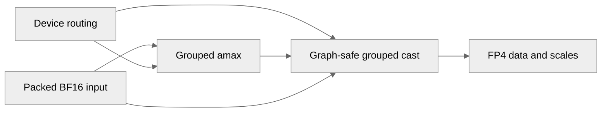

# [Common][PyTorch] Add NVFP4 row-scaled grouped cast with graph-safe path

[Upstream PR](https://github.com/NVIDIA/TransformerEngine/pull/3649) · state: open · merged: False

## Original PR description

# Description

Add a single-launch grouped row-scaled NVFP4 cast to the common layer, replacing the per-expert quantize loop used by MoE activations, together with a CUDA-graph-safe variant for dynamic-routing experts.

The grouped cast runs in two single-launch kernels: a grouped amax kernel over the packed (sum_M, K) buffer that produces per-expert rowwise [sum_M] and columnwise [num_tensors*K] amax vectors (both directions fused into one pass), followed by a grouped cast that consumes them. 

Both steps have a graph-safe counterpart that reads routing from the grouped tensor's device `first_dims`/`tensor_offsets` instead of host split metadata, so an MoE cast can be captured once and replayed with changed routing. The host-split and graph-safe kernels share the same device body, so their outputs are byte-identical.

## Type of change

- [ ] Documentation change (change only to the documentation, either a fix or a new content)
- [ ] Bug fix (non-breaking change which fixes an issue)
- [x] New feature (non-breaking change which adds functionality)
- [ ] Breaking change (fix or feature that would cause existing functionality to not work as expected)
- [ ] Infra/Build change
- [ ] Code refactoring

## Changes

Please list the changes introduced in this PR:

- Change A
- Change B

# Checklist:

- [ ] I have read and followed the [contributing guidelines](https://github.com/NVIDIA/TransformerEngine/blob/main/CONTRIBUTING.rst)
- [ ] The functionality is complete
- [ ] I have commented my code, particularly in hard-to-understand areas
- [ ] I have made corresponding changes to the documentation
- [ ] My changes generate no new warnings
- [ ] I have added tests that prove my fix is effective or that my feature works
- [x] New and existing unit tests pass locally with my changes

## Review and discussion

### reviews

- greptile-apps[bot] · COMMENTED · 2026-10-08T07:53:26Z · [source](https://github.com/NVIDIA/TransformerEngine/pull/3649#pullrequestreview-5453472565)

(No body; status only.)

### issue_comments

- greptile-apps[bot] · comment · 2026-10-08T07:53:21Z · [source](https://github.com/NVIDIA/TransformerEngine/pull/3649#issuecomment-6055366893)

<!-- greptile_summary -->

<h2><a href="https://app.greptile.com/api/retrigger?id=76929587"><picture><source media="(prefers-color-scheme: dark)" srcset="https://greptile-static-assets.s3.amazonaws.com/badges/RetriggerDark.svg?v=2"><source media="(prefers-color-scheme: light)" srcset="https://greptile-static-assets.s3.amazonaws.com/badges/Retrigger.svg?v=2"></picture></a>Confidence Score: 5/5</h2>

**[High impact]** The changes since the previous review appear safe to merge.

<h3>Summary</h3>

Adds grouped row-scaled NVFP4 casting and a CUDA-graph-safe path that reads expert routing from device buffers.
- The latest change sends mixed row-scaled and tensor-scaled quantizers through separate allocation and casting.
- Adds a regression test comparing mixed outputs with individual casts.
- No new actionable issues were found in the changes since the previous review.

<h3>Diagram</h3>

<!-- greptile_confidence_score:5 -->

Reviews (4) · Last reviewed commit: ["Fall back to per-expert cast for mixed N..."](https://github.com/nvidia/transformerengine/commit/5536e0c19550c241be4d3e625382b72ebcb3020b) · [Reviewed by Greptile](https://www.greptile.com/?utm_source=greptile_expert&utm_medium=github&utm_campaign=code_reviews&utm_content=nvidia/transformerengine)

### inline_comments

- greptile-apps[bot] · comment · 2026-10-08T07:53:24Z · [source](https://github.com/NVIDIA/TransformerEngine/pull/3649#discussion_r4216410760)

File: `transformer_engine/pytorch/csrc/extensions/cast.cpp` · line None

 **Supported casts now fail**

The new `split_quantize` selection does not check the grouped kernels' column alignment or 64-expert limit. BF16 input shaped `(256, 64)` with splits `[128, 128]` previously used the per-expert path, but now fails the grouped amax check. A request with 65 experts also now fails. Include both limits in the selection and keep the per-expert fallback.

**Knowledge Base Used:** [Native CUDA kernel platform](https://app.greptile.com/nvidia-public-github/-/custom-context/knowledge-base/nvidia/transformerengine/-/docs/native-kernels.md)

- greptile-apps[bot] · comment · 2026-10-08T07:53:24Z · [source](https://github.com/NVIDIA/TransformerEngine/pull/3649#discussion_r4216410765)

File: `transformer_engine/pytorch/csrc/extensions/cast.cpp` · line 2059

 **Empty routing now fails**

`split_quantize_nvfp4_row_scaled_impl` launches grouped work even when every split is empty. With input shaped `(0, 128)` and splits `[0, 0]`, the new selection succeeds, but grouped amax launches a zero-sized grid and the cast has no non-empty output. The previous per-expert path returned without launching work. Return early for empty input here.

**Knowledge Base Used:** [Native CUDA kernel platform](https://app.greptile.com/nvidia-public-github/-/custom-context/knowledge-base/nvidia/transformerengine/-/docs/native-kernels.md)

- greptile-apps[bot] · comment · 2026-10-08T07:53:24Z · [source](https://github.com/NVIDIA/TransformerEngine/pull/3649#discussion_r4216410772)

File: `transformer_engine/pytorch/csrc/extensions/cast.cpp` · line None

 **Strided input reads wrong values**

The new binding passes `tensor.data_ptr()` and sizes to a packed-layout kernel without checking or copying non-contiguous input. A transposed BF16 `(128, 128)` tensor passes the checks, but the kernel reads its storage in row order rather than its logical order. It therefore quantizes the wrong values. Make the input contiguous before wrapping it, or reject non-contiguous tensors.

- greptile-apps[bot] · comment · 2026-10-08T07:53:24Z · [source](https://github.com/NVIDIA/TransformerEngine/pull/3649#discussion_r4216410785)

File: `transformer_engine/pytorch/csrc/extensions/cast.cpp` · line 2059

 **Quantizer settings are ignored**

The new helper checks only `stochastic_rounding` before bypassing `NVFP4Quantizer::quantize_impl`. That previous path also rejects row-scaled requests with `with_rht`, `with_2d_quantization`, or `with_amax_reduction`. Those settings now silently produce a plain row-scaled cast. Keep the same checks here and in the new graph-safe binding so unsupported settings do not appear to work.

**Knowledge Base Used:** [Native GEMM and quantization kernels](https://app.greptile.com/nvidia-public-github/-/custom-context/knowledge-base/nvidia/transformerengine/-/docs/native-gemm-and-quantization.md)

## Changed files and fixed code

- `tests/cpp/operator/CMakeLists.txt` · modified · additions 1 / deletions 0
  - [head](https://github.com/cael-ling/TransformerEngine/blob/5536e0c19550c241be4d3e625382b72ebcb3020b/tests/cpp/operator/CMakeLists.txt)
  - [base](https://github.com/NVIDIA/TransformerEngine/blob/5e994640625626263aa62250c709e35601563566/tests/cpp/operator/CMakeLists.txt)
- `tests/cpp/operator/test_row_scaled_nvfp4_grouped_cast.cu` · added · additions 759 / deletions 0
  - [head](https://github.com/cael-ling/TransformerEngine/blob/5536e0c19550c241be4d3e625382b72ebcb3020b/tests/cpp/operator/test_row_scaled_nvfp4_grouped_cast.cu)
  - [base](https://github.com/NVIDIA/TransformerEngine/blob/5e994640625626263aa62250c709e35601563566/tests/cpp/operator/test_row_scaled_nvfp4_grouped_cast.cu)
- `tests/cpp/test_common.h` · modified · additions 8 / deletions 4
  - [head](https://github.com/cael-ling/TransformerEngine/blob/5536e0c19550c241be4d3e625382b72ebcb3020b/tests/cpp/test_common.h)
  - [base](https://github.com/NVIDIA/TransformerEngine/blob/5e994640625626263aa62250c709e35601563566/tests/cpp/test_common.h)
- `tests/pytorch/nvfp4/test_nvfp4_group_row_scaled_cast_graph_safe.py` · added · additions 329 / deletions 0
  - [head](https://github.com/cael-ling/TransformerEngine/blob/5536e0c19550c241be4d3e625382b72ebcb3020b/tests/pytorch/nvfp4/test_nvfp4_group_row_scaled_cast_graph_safe.py)
  - [base](https://github.com/NVIDIA/TransformerEngine/blob/5e994640625626263aa62250c709e35601563566/tests/pytorch/nvfp4/test_nvfp4_group_row_scaled_cast_graph_safe.py)
- `transformer_engine/common/cast/cast_grouped.cu` · modified · additions 93 / deletions 0
  - [head](https://github.com/cael-ling/TransformerEngine/blob/5536e0c19550c241be4d3e625382b72ebcb3020b/transformer_engine/common/cast/cast_grouped.cu)
  - [base](https://github.com/NVIDIA/TransformerEngine/blob/5e994640625626263aa62250c709e35601563566/transformer_engine/common/cast/cast_grouped.cu)
- `transformer_engine/common/cast/nvfp4/group_quantize_transpose_nvfp4.cuh` · modified · additions 743 / deletions 17
  - [head](https://github.com/cael-ling/TransformerEngine/blob/5536e0c19550c241be4d3e625382b72ebcb3020b/transformer_engine/common/cast/nvfp4/group_quantize_transpose_nvfp4.cuh)
  - [base](https://github.com/NVIDIA/TransformerEngine/blob/5e994640625626263aa62250c709e35601563566/transformer_engine/common/cast/nvfp4/group_quantize_transpose_nvfp4.cuh)
- `transformer_engine/common/include/transformer_engine/cast.h` · modified · additions 68 / deletions 0
  - [head](https://github.com/cael-ling/TransformerEngine/blob/5536e0c19550c241be4d3e625382b72ebcb3020b/transformer_engine/common/include/transformer_engine/cast.h)
  - [base](https://github.com/NVIDIA/TransformerEngine/blob/5e994640625626263aa62250c709e35601563566/transformer_engine/common/include/transformer_engine/cast.h)
- `transformer_engine/pytorch/csrc/extensions.h` · modified · additions 5 / deletions 0
  - [head](https://github.com/cael-ling/TransformerEngine/blob/5536e0c19550c241be4d3e625382b72ebcb3020b/transformer_engine/pytorch/csrc/extensions.h)
  - [base](https://github.com/NVIDIA/TransformerEngine/blob/5e994640625626263aa62250c709e35601563566/transformer_engine/pytorch/csrc/extensions.h)
- `transformer_engine/pytorch/csrc/extensions/cast.cpp` · modified · additions 181 / deletions 7
  - [head](https://github.com/cael-ling/TransformerEngine/blob/5536e0c19550c241be4d3e625382b72ebcb3020b/transformer_engine/pytorch/csrc/extensions/cast.cpp)
  - [base](https://github.com/NVIDIA/TransformerEngine/blob/5e994640625626263aa62250c709e35601563566/transformer_engine/pytorch/csrc/extensions/cast.cpp)
- `transformer_engine/pytorch/csrc/extensions/pybind.cpp` · modified · additions 5 / deletions 0
  - [head](https://github.com/cael-ling/TransformerEngine/blob/5536e0c19550c241be4d3e625382b72ebcb3020b/transformer_engine/pytorch/csrc/extensions/pybind.cpp)
  - [base](https://github.com/NVIDIA/TransformerEngine/blob/5e994640625626263aa62250c709e35601563566/transformer_engine/pytorch/csrc/extensions/pybind.cpp)
- `transformer_engine/pytorch/ep.py` · modified · additions 43 / deletions 0
  - [head](https://github.com/cael-ling/TransformerEngine/blob/5536e0c19550c241be4d3e625382b72ebcb3020b/transformer_engine/pytorch/ep.py)
  - [base](https://github.com/NVIDIA/TransformerEngine/blob/5e994640625626263aa62250c709e35601563566/transformer_engine/pytorch/ep.py)

## Evidence and interpretation boundary

[Original JSON, discussions and patches](../../evidence/prs/NVIDIA--TransformerEngine/3649-a16c9b8fd773203a32ed92baa532830cdb82d988433f29daa8135b0c85c5cd73.json) · SHA-256 `a16c9b8fd773203a32ed92baa532830cdb82d988433f29daa8135b0c85c5cd73`.

Diff complete: True. Missing/binary/truncated patches require pinned source inspection. This is a source page, not an independently verified optimization case. Open, merged and released are different states; recheck the deployed dependency.
