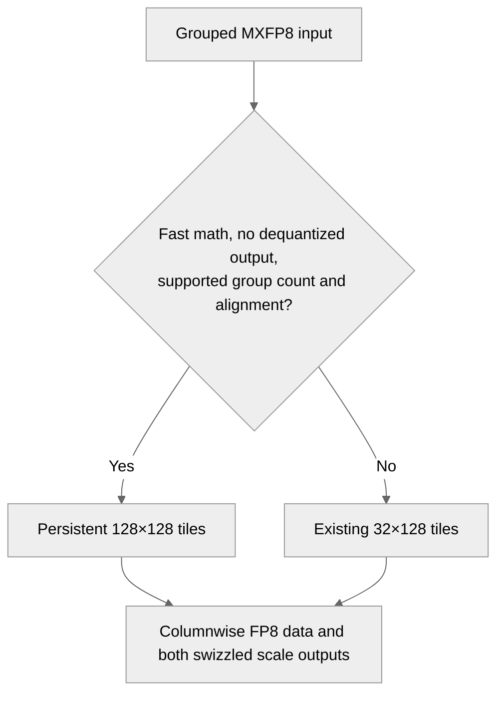

# [Common] Requantize grouped MXFP8 tensors with 128x128 tiles

[Upstream PR](https://github.com/NVIDIA/TransformerEngine/pull/3656) · state: closed · merged: True

## Original PR description

nvte_group_requantize turns a row-wise MXFP8 grouped tensor, such as tokens dispatched in FP8, into its column-wise copy with GEMM-swizzled scaling factors. Its kernel runs one 32x128 tile per 128-thread CTA, binary-searches the group offsets in thread 0 before the tile can finish, and writes both scale outputs one byte at a time; on a capacity-sized buffer every tile past the live rows still costs a CTA.

Add a kernel for the fast-math case without a dequantized output, the case the grouped MLP uses. A CTA owns a 128x128 tile and keeps it in registers, loading and storing coalesced 128-byte row segments; each swizzled scale output is one contiguous 512-byte block per tile; and the CTAs of a persistent grid walk the tiles in row-block order, so they stop at the first tile past the live rows. The arithmetic is that of the existing kernel and the outputs are bit-identical. Other cases keep the existing kernel.

# Description

Please include a brief summary of the changes, relevant motivation and context.

Fixes # (issue)

## Type of change

- [ ] Documentation change (change only to the documentation, either a fix or a new content)
- [ ] Bug fix (non-breaking change which fixes an issue)
- [ ] New feature (non-breaking change which adds functionality)
- [ ] Breaking change (fix or feature that would cause existing functionality to not work as expected)
- [ ] Infra/Build change
- [ ] Code refactoring

## Changes

Please list the changes introduced in this PR:

- Change A
- Change B

# Checklist:

- [ ] I have read and followed the [contributing guidelines](https://github.com/NVIDIA/TransformerEngine/blob/main/CONTRIBUTING.rst)
- [ ] The functionality is complete
- [ ] I have commented my code, particularly in hard-to-understand areas
- [ ] I have made corresponding changes to the documentation
- [ ] My changes generate no new warnings
- [ ] I have added tests that prove my fix is effective or that my feature works
- [ ] New and existing unit tests pass locally with my changes

## Review and discussion

### reviews

- phu0ngng · APPROVED · 2026-10-09T21:48:08Z · [source](https://github.com/NVIDIA/TransformerEngine/pull/3656#pullrequestreview-5475668115)

(No body; status only.)

### issue_comments

- greptile-apps[bot] · comment · 2026-10-08T19:02:25Z · [source](https://github.com/NVIDIA/TransformerEngine/pull/3656#issuecomment-6067011665)

<!-- greptile_summary -->

<h2><a href="https://app.greptile.com/api/retrigger?id=77302495"><picture><source media="(prefers-color-scheme: dark)" srcset="https://greptile-static-assets.s3.amazonaws.com/badges/RetriggerDark.svg?v=2"><source media="(prefers-color-scheme: light)" srcset="https://greptile-static-assets.s3.amazonaws.com/badges/Retrigger.svg?v=2"></picture></a>Confidence Score: 5/5</h2>

**[Medium impact]** The PR appears safe to merge; no actionable new issue was found.

<h3>Summary</h3>

Adds a persistent 128×128-tile kernel for grouped MXFP8 requantization when fast math is enabled and no dequantized output is requested.
- Moves FP8 data in packed words and writes scales in 512-byte blocks.
- Stops work at the live-row boundary instead of visiting the full capacity buffer.
- Keeps the existing kernel for other requests.
- No actionable new issues were found. Existing C++ tests cover both FP8 input types, empty groups, capacity tails, and the new dispatch combination; tests were not run.

<h3>Diagram</h3>

<!-- greptile_confidence_score:5 -->

Reviews (3) · Last reviewed commit: ["Merge branch &#39;main&#39; into sraman/mxfp8-gr..."](https://github.com/nvidia/transformerengine/commit/4cf5f31996bc48287e37d11722fb99d86303e39d) · [Reviewed by Greptile](https://www.greptile.com/?utm_source=greptile_expert&utm_medium=github&utm_campaign=code_reviews&utm_content=nvidia/transformerengine)

- phu0ngng · comment · 2026-10-08T23:55:00Z · [source](https://github.com/NVIDIA/TransformerEngine/pull/3656#issuecomment-6071377181)

/te-ci L1 Pytorch

- phu0ngng · comment · 2026-10-09T16:37:47Z · [source](https://github.com/NVIDIA/TransformerEngine/pull/3656#issuecomment-6085118544)

/te-ci

### inline_comments

## Changed files and fixed code

- `transformer_engine/common/cast/fused_group_requantize.cu` · modified · additions 189 / deletions 2
  - [head](https://github.com/sraman-rgb/TransformerEngine/blob/4cf5f31996bc48287e37d11722fb99d86303e39d/transformer_engine/common/cast/fused_group_requantize.cu)
  - [base](https://github.com/NVIDIA/TransformerEngine/blob/16580f9502dcfbf3245f1dbb4670c9c7aad50162/transformer_engine/common/cast/fused_group_requantize.cu)

## Evidence and interpretation boundary

[Original JSON, discussions and patches](../../evidence/prs/NVIDIA--TransformerEngine/3656-b25579667bcf5290d78ebf74ccb637099ded96c273f5f2e74ab1b7183c60ba84.json) · SHA-256 `b25579667bcf5290d78ebf74ccb637099ded96c273f5f2e74ab1b7183c60ba84`.

Diff complete: True. Missing/binary/truncated patches require pinned source inspection. This is a source page, not an independently verified optimization case. Open, merged and released are different states; recheck the deployed dependency.
