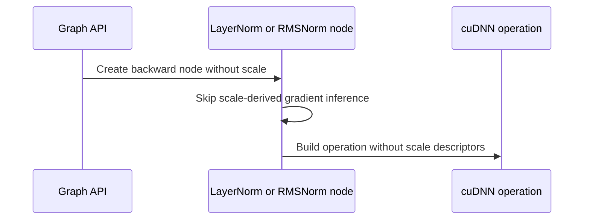

# [Auto-FE] norms: rmsnorm_backward and layernorm_backward take an optional scale (#188) -- fixes the validate() segfault on a null scale

[Upstream PR](https://github.com/NVIDIA/cudnn-frontend/pull/1555) · state: closed · merged: True

## Original PR description

## Before submitting

- [ ] I agree to license this contribution under the terms of [LICENSE.txt](https://github.com/NVIDIA/cudnn-frontend/blob/develop/LICENSE.txt).
- [x] I ran `pre-commit run` and committed any formatting changes.
- [x] I reviewed the Hard Rules in the `AGENTS.md` for each directory this PR touches (see [root AGENTS.md § Reviewing a PR](https://github.com/NVIDIA/cudnn-frontend/blob/develop/AGENTS.md#reviewing-a-pr-human-or-agent)) and my changes comply, or I explain the exception below.
- [x] I added GitHub labels: one `cat-*`, one or more `area:*` / `op:*`, and one `orig-*` (see [label list](https://github.com/NVIDIA/cudnn-frontend/labels)).

## Affected area

C++ frontend API or graph construction; Python API or bindings

## Summary

`rmsnorm_backward` and `layernorm_backward` now accept a null `scale` (Python: `scale=None`). This is the backward half of #188; #1542 and #1548 covered the forwards.

1. Without a scale, the node sets no `SCALE`, `DSCALE` or `DBIAS` descriptor, and `Graph` returns `nullptr` for `DScale` and `DBias`.
2. `rmsnorm_backward` with `has_dbias(true)` and no scale returns `INVALID_VALUE`, because `DBIAS` takes its dims from the scale.
3. Python changes:
   - The pybind `scale` argument defaults to `None` for both ops.
   - `_pygraph` returns `None` for `DScale` / `DBias` when there is no scale.
   - The structured builder skips an optional port passed positionally as `None`. Before this, only a keyword `None` was skipped.
4. `docs/operations/Normalizations.md` documents both.

## Why

On develop, `rmsnorm_backward(dy, x, nullptr, inv_var)` segfaults in `validate()`: `infer_properties_node` dereferences the null scale. `layernorm_backward` has the same dereference.

The backend accepts a `NORM_BACKWARD` without the scale descriptors. Measured with a standalone probe against a float64 host reference of the scale-free norm:

| op | x | saved stats | scale = 1 | no scale |
|---|---|---|---|---|
| rmsnorm / layernorm bwd | `{N,H,1,1}` | `{N,1,1,1}` | max \|dx − ref\| ≤ 3.8e-7 | same |
| rmsnorm / layernorm bwd | `{B,S,H}` | `{B,S,1}` | ≤ 3.8e-7 | same |
| rmsnorm / layernorm bwd | `{B,S,H}` | `{B,1,1}` | refused (rows mismatch) | ≤ 3.5e-7, normalizing S and H |

- This was measured on B200, H100 and A100 with cuDNN 9.27, and on H100 with 9.12, 9.14, 9.18, 9.20 and 9.24.
- The forward needs an axis check when there is no scale (#1542). The backward does not: the saved stats are inputs whose dims the caller sets, and the backend normalizes over exactly the axes they leave out.

## API and compatibility impact

- Additive. `scale` gains a default in both Python bindings; the signature order is unchanged.
- Graphs with a scale are unchanged.
- `adalayernorm_backward` and `batchnorm_backward` are unchanged.

## Testing

All on cuDNN 9.27, with the extension rebuilt from this branch:

| Where | Command | Result |
|---|---|---|
| C++ tests | `tests "[validate]"` (adds "Rmsnorm and Layernorm backward without scale") | 10 test cases / 106 assertions passed |
| C++ samples | `samples "[layernorm],[adalayernorm],[rmsnorm]"` | B200 21/21; H100, A100 17 passed / 4 skipped |
| Python | `pytest -m "L0 or L1 or L2 or L3 or L4" norm/graph/test_rmsnorm.py norm/graph/test_layernorm.py` | B200 67 passed; H100, A100 63 passed / 4 skipped |
| Python, B200 | `pytest -n 6 -m "L0 or L1 or L2 or L3 or L4" norm/graph` | 5203 passed, 1 skipped |
| Probe, develop | `rmsnorm_backward(dy, x, nullptr, inv_var)` | segfault |

New Python tests:
- `test_norm_backward_without_scale[{rmsnorm,layernorm} x {rows,batch} x {keyword,positional_none}]` checks DX against torch autograd and that `DScale` / `DBias` are `None`.
- `test_rmsnorm_backward_without_scale_refuses_dbias`.

Part of #188. With this, rmsnorm and layernorm take an optional scale in both directions: the forwards in #1542 and #1548, the backwards here. batchnorm and instancenorm still require one. adalayernorm requires one by design, since its scale is the per-sample modulation.

note to self: claude::fb66556f-59ca-4f79-8a53-539948bcd387 — "Cudnn fe autonomous evolution" · cwd /home/scratch.yanxu_libs/cudnn_frontend · workspace /home/scratch.yanxu_gpu/fe-autonomous-pipeline-20261002 (evidence/norm-bwd188)

🤖 Generated with [Claude Code](https://claude.com/claude-code)

<!-- This is an auto-generated comment: release notes by coderabbit.ai -->

## Summary by CodeRabbit

* **New Features**
  * LayerNorm and RMSNorm backward operations now accept an omitted scale input. When scale is omitted, scale and bias gradients are not returned; requesting an RMSNorm bias gradient without a scale is rejected.
  * Normalization axes can be determined from the supplied statistics, allowing backward operations without scale across supported axes.
* **Documentation**
  * Updated normalization guidance to describe optional scale behavior, gradient availability, axis selection, and verified backend versions.

<!-- end of auto-generated comment: release notes by coderabbit.ai -->

## Review and discussion

### reviews

- vedaanta · APPROVED · 2026-10-10T12:27:35Z · [source](https://github.com/NVIDIA/cudnn-frontend/pull/1555#pullrequestreview-5478937029)

**Codex bot review · model: `gpt-6-astra`**

Reviewed `2064396f941e70e575455fc8e3ce543cbc530682` against `1a465e4a75760d5703d971221adc22d03e6209ef`. No actionable findings. The no-scale path consistently omits SCALE/DSCALE/DBIAS, returns `None` for the absent gradients, preserves the existing scaled path, and rejects RMSNorm bias-gradient requests without scale. The positional-`None` handling preserves port positions and matches the existing keyword omission behavior.

Rebuilt the native extension from this revision and validated with cuDNN 9.27:

- **SM100: 77 passed** — all 67 RMSNorm/LayerNorm tests, eight independent numerical/replay controls, and two shared structured-builder checks.
- **H100: 17 passed** — all nine new regression cases and the eight independent controls.
- The independent controls cover float32/BF16, both normalization-axis choices, `execute` and `execute_plan_at_index`, poisoned outputs, and changed inputs/statistics across CUDA Graph replay, checked against FP64 formulas.

All eight changed files integrate cleanly with current develop. Style and Docs checks passed; the owner’s current-head CI run 72889776 is still underway. I did not independently run the C++ test binary or older cuDNN versions.

<!-- codex-fe-review:github-only:vedaanta:1555:2064396f941e70e575455fc8e3ce543cbc530682:complete -->

### issue_comments

- YangXu1990uiuc · comment · 2026-10-10T12:09:31Z · [source](https://github.com/NVIDIA/cudnn-frontend/pull/1555#issuecomment-6097335546)

@cudnn-ci-bot run python_tests

- cudnn-ci-bot · comment · 2026-10-10T12:09:35Z · [source](https://github.com/NVIDIA/cudnn-frontend/pull/1555#issuecomment-6097336021)

🏁 Pipeline finished

SHA: `2064396`
Targets: `python_tests`
Branch: [cudnn-gh/pr-1555-2064396](https://nv/cudnn-gitlab-ci/-/tree/cudnn-gh/pr-1555-2064396)
Pipeline: [72889776](https://nv/cudnn-gitlab-ci/-/pipelines/72889776)
Last updated: 2026-10-10 12:43 UTC

**26 passed, 11 manual**

### <code>manual</code>

- <code>manual:python_samples</code> - Manual
- <code>manual:python</code> - ✅ Passed
- <code>manual:python/sdpa/frost</code> - Manual
- <code>manual:python/linear_attention/frost</code> - Manual
- <code>manual:python/gemm/frost</code> - Manual
- <code>manual:python/*/frost</code> - Manual
- <code>manual:python/gemm/cutedsl</code> - Manual
- <code>manual:python/*/cutedsl</code> - Manual
- <code>manual:python/*/jax</code> - Manual
- <code>manual:pycudnn</code> - Manual
- <code>manual:multi_gpu</code> - Manual
- <code>manual:backend</code> - Manual

### <code>analysis</code>

- <code>analysis:cudnn_clang_disable_exception</code> - ✅ Passed
- <code>analysis:cudnn_v9_no_half_conversion</code> - ✅ Passed
- <code>analysis:cudnn_clang</code> - ✅ Passed
- <code>analysis:check-relative-includes</code> - ✅ Passed
- <code>analysis:check-CUDNN_FRONTEND_SKIP_JSON_LIB</code> - ✅ Passed
- <code>analysis:guardwords_scan</code> - ✅ Passed
- <code>analysis:jax-import-guard</code> - ✅ Passed
- <code>analysis:pytest-gpu</code> - ✅ Passed
- <code>san:build</code> - ✅ Passed

### <code>build</code>

- <code>analysis:api_index</code> - ✅ Passed
- <code>build:dev:linux:amd64</code> - ✅ Passed
- <code>build:rel:linux:amd64</code> - ✅ Passed
- <code>build:dev:linux:arm64</code> - ✅ Passed
- <code>build:rel:linux:arm64</code> - ✅ Passed
- <code>build:rel:win:amd64</code> - ✅ Passed

### <code>python_tests</code>

- <code>python:dev:sm80</code> - ✅ Passed
- <code>python:dev:sm90</code> - ✅ Passed
- <code>python:dev:sm100</code> - ✅ Passed
- <code>python:rel:sm80</code> - ✅ Passed
- <code>python:rel:sm90</code> - ✅ Passed
- <code>python:rel:sm100</code> - ✅ Passed

### <code>sanitizer_tests</code>

- <code>san:cpp_test:sm80</code> - ✅ Passed
- <code>san:cpp_test:sm90</code> - ✅ Passed
- <code>san:cpp_test:sm100</code> - ✅ Passed

### <code>triage</code>

- <code>triage:ai</code> - ✅ Passed

- coderabbitai · comment · 2026-10-10T12:10:09Z · [source](https://github.com/NVIDIA/cudnn-frontend/pull/1555#issuecomment-6097340243)

<!-- This is an auto-generated comment: summarize by coderabbit.ai -->
<!-- review_stack_entry_start -->

<a href="https://app.coderabbit.ai/change-stack/NVIDIA/cudnn-frontend/pull/1555?scope=ghh_OusAJGA4HG8ljoOV0wJvVx8NmnZIjc2DdjmxOu0xZWA&amp;cs_source=review_comment"><picture><source media="(prefers-color-scheme: dark)" srcset="https://storage.googleapis.com/coderabbit_public_assets/review-stack-in-coderabbit-ui-dark.svg?v=3"><source media="(prefers-color-scheme: light)" srcset="https://storage.googleapis.com/coderabbit_public_assets/review-stack-in-coderabbit-ui.svg?v=3"></picture></a>

<!-- review_stack_entry_end -->
<!-- recent_review_start -->

No actionable comments were generated in the recent review. 🎉

<strong>ℹ️ Recent review info</strong>

<dl>
<dd>

<strong>⚙️ Run configuration</strong>

<dl>
<dd>

- **Configuration used**: Repository: NVIDIA/cudnn-frontend/.coderabbit.yaml
- **Review profile**: CHILL
- **Plan**: Enterprise
- **Run ID**: `cf18f017-d5de-41a5-a116-f223288132fa`

</dd>
</dl>

<strong>📥 Commits</strong>

<dl>
<dd>

Reviewing files that changed from the base of the PR and between 1a465e4a75760d5703d971221adc22d03e6209ef and 2064396f941e70e575455fc8e3ce543cbc530682.

</dd>
</dl>

<strong>📒 Files selected for processing (8)</strong>

<dl>
<dd>

* `docs/operations/Normalizations.md`
* `include/cudnn_frontend/graph_interface.h`
* `include/cudnn_frontend/node/dln.h`
* `include/cudnn_frontend/node/rmsnorm.h`
* `python/cudnn/_pygraph.py`
* `python/pygraph/norm.cpp`
* `test/cpp/validate.cpp`
* `test/python/norm/graph/test_rmsnorm.py`

</dd>
</dl>

**Included review availability:** This review used your included allowance. Your plan provides up to 12 included reviews per hour; 11 remain after this review.

</dd>
</dl>

---

<!-- recent_review_end -->
<!-- walkthrough_start -->

<strong>📝 Walkthrough</strong>

<dl>
<dd>

## Walkthrough

LayerNorm and RMSNorm backward graph APIs now accept an absent scale. In that case, scale-derived gradient outputs and backend descriptors are omitted. Validation and execution tests cover the no-scale paths.

### Changes

**Optional Scale in Normalization Backward**

|Layer / File(s)|Summary|
|:---|:---|
|**Optional-scale API and outputs**   `include/cudnn_frontend/graph_interface.h`, `python/pygraph/norm.cpp`, `python/cudnn/_pygraph.py`|The backward graph APIs and Python bindings accept an absent scale. Python output declarations omit `DScale` and `DBias` when scale is absent. Positional structured-op inputs set to `None` are skipped.|
|**Node validation and backend operation construction**   `include/cudnn_frontend/node/dln.h`, `include/cudnn_frontend/node/rmsnorm.h`|Node inference skips scale-derived gradient properties when scale is absent. Backend operation construction omits scale and gradient descriptors in that case. RMSNorm rejects `DBIAS` when requested without scale.|
|**Validation, execution tests, and documentation**   `test/cpp/validate.cpp`, `test/python/norm/graph/test_rmsnorm.py`, `docs/operations/Normalizations.md`|Tests cover no-scale graph validation and execution, absent gradient outputs, and RMSNorm bias-gradient rejection. Documentation describes optional scale and the normalization axes specified by saved-statistic dimensions.|

<!-- change_assessment_start -->
**Priority:** ➖ Normal

**Estimated code review effort:** 3 (Moderate) | ~20 minutes

<!-- change_assessment_commit:"2064396f941e70e575455fc8e3ce543cbc530682" -->
**Change:** Feature
<!-- change_assessment_end -->

### Sequence Diagram(s)

**Suggested reviewers:** `anerudhan`

</dd>
</dl>

<!-- walkthrough_end -->
<!-- final_review_risk_start -->
**Merge Risk:** **⚪ Minimal** · up to `20643`
<!-- final_review_risk_coverage:{"sourceCommitId":"2064396f941e70e575455fc8e3ce543cbc530682","coveredCommitId":"2064396f941e70e575455fc8e3ce543cbc530682","kind":"reviewed"} -->

This change makes the scale optional for LayerNorm and RMSNorm backward and avoids the previous null-scale crash. Graphs that supply a scale keep their existing behavior. No actionable merge-blocking risk was identified.
<!-- final_review_risk_end -->
<!-- pre_merge_checks_walkthrough_start -->

<strong>Pre-merge checks | <picture></picture> 4 | <picture></picture> 1</strong>

<dl>
<dd>

### ❌ Failed checks (1 warning)

|     Check name     |                                              Status                                              | Explanation                                                                                                                                                                                               | Resolution                                                                         |
| :---------------- | :----------------------------------------------------------------------------------------------: | :-------------------------------------------------------------------------------------------------------------------------------------------------------------------------------------------------------- | :--------------------------------------------------------------------------------- |
| Docstring Coverage |  | Docstring coverage is 30.43% which is insufficient. The required threshold is 80.00%. Docstring coverage is scoped to functions touched by this diff. Analyzed 23 functions across 7 files. (1 skipped: … | Write docstrings for the functions missing them to satisfy the coverage threshold. |

<strong>✅ Passed checks (4 passed)</strong>

<dl>
<dd>

|         Check name         |                                             Status                                             | Explanation                                                                                                                                                                                               |
| :------------------------ | :--------------------------------------------------------------------------------------------: | :-------------------------------------------------------------------------------------------------------------------------------------------------------------------------------------------------------- |
|         Title check        |  | The title clearly identifies the main change: optional scale support for RMSNorm and LayerNorm backward operations. It also states the related null-scale validation failure, although the automation pr… |
|      Description check     |  | The description follows the repository template and provides the affected areas, summary, rationale, compatibility impact, related issue, detailed testing commands, and results. The license agreement … |
|     Linked Issues check    |  | Check skipped because no linked issues were found for this pull request.                                                                                                                                  |
| Out of Scope Changes check |  | Check skipped because no linked issues were found for this pull request.                                                                                                                                  |

</dd>
</dl>

<strong>Full details: Docstring Coverage</strong>

<dl>
<dd>

**Explanation**

Docstring coverage is 30.43% which is insufficient. The required threshold is 80.00%. Docstring coverage is scoped to functions touched by this diff. Analyzed 23 functions across 7 files. (1 skipped: 1 unsupported.)

</dd>
</dl>

</dd>
</dl>

<!-- pre_merge_checks_walkthrough_end -->

- [ ] <!-- {"checkboxId":"585bb3f6-faf5-4dbf-96d2-74e382adf19a"} --> Fix all pre-merge checks with AI
<!-- finishing_touch_checkbox_start -->

<strong>✨ Finishing Touches</strong>

<dl>
<dd>

<strong>🧪 Generate unit tests (beta)</strong>

<dl>
<dd>

- [ ] <!-- {"checkboxId": "f47ac10b-58cc-4372-a567-0e02b2c3d479", "radioGroupId": "utg-output-choice-group-unknown_comment_id"} --> Create a new PR

</dd>
</dl>

</dd>
</dl>

<!-- finishing_touch_checkbox_end -->

<!-- autopilot:start -->
- [ ] <!-- {"checkboxId":"2708ad07-9f24-4260-9c11-7dc76a49f2e3"} --> <strong title="Keep fixing CodeRabbit findings and required CI, and resolving merge conflicts">Autofix</strong> · Keep fixing CodeRabbit findings and required CI, and resolving merge conflicts
<!-- autopilot:end -->
<!-- This is an auto-generated comment: all tool run failures by coderabbit.ai -->

> [!WARNING]
> Some tools did not complete. Review the errors below.
> 
> 

> 
<strong>🔧 Cppcheck (2.22.0)</strong>

> <dl>
> <dd>
> 
> 

> 
<strong>test/cpp/validate.cpp</strong>

> <dl>
> <dd>
> 
> Cppcheck timed out; analysis of this file is incomplete
> 
> 
> 

> 
> </dd>
> </dl>
> 

> 
> 

> 
<strong>python/pygraph/norm.cpp</strong>

> <dl>
> <dd>
> 
> Cppcheck timed out; analysis of this file is incomplete
> 
> </dd>
> </dl>
> 

> 
> 
> 

> 
> </dd>
> </dl>
> 

<!-- end of auto-generated comment: all tool run failures by coderabbit.ai -->
<!-- tips_start -->

---

Comment `@coderabbitai help` to get the list of available commands.

<!-- tips_end -->

### inline_comments

## Changed files and fixed code

- `docs/operations/Normalizations.md` · modified · additions 9 / deletions 0
  - [head](https://github.com/YangXu1990uiuc/cudnn-frontend/blob/2064396f941e70e575455fc8e3ce543cbc530682/docs/operations/Normalizations.md)
  - [base](https://github.com/NVIDIA/cudnn-frontend/blob/1a465e4a75760d5703d971221adc22d03e6209ef/docs/operations/Normalizations.md)
- `include/cudnn_frontend/graph_interface.h` · modified · additions 29 / deletions 16
  - [head](https://github.com/YangXu1990uiuc/cudnn-frontend/blob/2064396f941e70e575455fc8e3ce543cbc530682/include/cudnn_frontend/graph_interface.h)
  - [base](https://github.com/NVIDIA/cudnn-frontend/blob/1a465e4a75760d5703d971221adc22d03e6209ef/include/cudnn_frontend/graph_interface.h)
- `include/cudnn_frontend/node/dln.h` · modified · additions 33 / deletions 23
  - [head](https://github.com/YangXu1990uiuc/cudnn-frontend/blob/2064396f941e70e575455fc8e3ce543cbc530682/include/cudnn_frontend/node/dln.h)
  - [base](https://github.com/NVIDIA/cudnn-frontend/blob/1a465e4a75760d5703d971221adc22d03e6209ef/include/cudnn_frontend/node/dln.h)
- `include/cudnn_frontend/node/rmsnorm.h` · modified · additions 32 / deletions 16
  - [head](https://github.com/YangXu1990uiuc/cudnn-frontend/blob/2064396f941e70e575455fc8e3ce543cbc530682/include/cudnn_frontend/node/rmsnorm.h)
  - [base](https://github.com/NVIDIA/cudnn-frontend/blob/1a465e4a75760d5703d971221adc22d03e6209ef/include/cudnn_frontend/node/rmsnorm.h)
- `python/cudnn/_pygraph.py` · modified · additions 9 / deletions 2
  - [head](https://github.com/YangXu1990uiuc/cudnn-frontend/blob/2064396f941e70e575455fc8e3ce543cbc530682/python/cudnn/_pygraph.py)
  - [base](https://github.com/NVIDIA/cudnn-frontend/blob/1a465e4a75760d5703d971221adc22d03e6209ef/python/cudnn/_pygraph.py)
- `python/pygraph/norm.cpp` · modified · additions 2 / deletions 2
  - [head](https://github.com/YangXu1990uiuc/cudnn-frontend/blob/2064396f941e70e575455fc8e3ce543cbc530682/python/pygraph/norm.cpp)
  - [base](https://github.com/NVIDIA/cudnn-frontend/blob/1a465e4a75760d5703d971221adc22d03e6209ef/python/pygraph/norm.cpp)
- `test/cpp/validate.cpp` · modified · additions 48 / deletions 0
  - [head](https://github.com/YangXu1990uiuc/cudnn-frontend/blob/2064396f941e70e575455fc8e3ce543cbc530682/test/cpp/validate.cpp)
  - [base](https://github.com/NVIDIA/cudnn-frontend/blob/1a465e4a75760d5703d971221adc22d03e6209ef/test/cpp/validate.cpp)
- `test/python/norm/graph/test_rmsnorm.py` · modified · additions 68 / deletions 0
  - [head](https://github.com/YangXu1990uiuc/cudnn-frontend/blob/2064396f941e70e575455fc8e3ce543cbc530682/test/python/norm/graph/test_rmsnorm.py)
  - [base](https://github.com/NVIDIA/cudnn-frontend/blob/1a465e4a75760d5703d971221adc22d03e6209ef/test/python/norm/graph/test_rmsnorm.py)

## Evidence and interpretation boundary

[Original JSON, discussions and patches](../../evidence/prs/NVIDIA--cudnn-frontend/1555-895ece4978011b038930dd19bdb2dc379911137246c9aafafc98f6a58267ece9.json) · SHA-256 `895ece4978011b038930dd19bdb2dc379911137246c9aafafc98f6a58267ece9`.

Diff complete: True. Missing/binary/truncated patches require pinned source inspection. This is a source page, not an independently verified optimization case. Open, merged and released are different states; recheck the deployed dependency.
