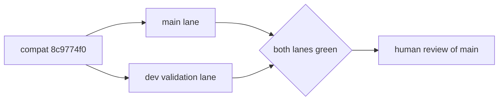

# chore: AUT-2155 bump Megatron Core nightly pins

[Upstream PR](https://github.com/NVIDIA-NeMo/Megatron-Bridge/pull/5897) · state: closed · merged: False

## Original PR description

## Background

Update Bridge against the locked nightly MCore pair. Companion validation PR: `mcore-dev` from `chore/bump-mcore-dev-260826`.

Only this PR may merge, after both lanes validate compatibility commit `8c9774f0a83bff81b8460ab6c6e64d4ce2708179`.

## What changed

- Set `.main.commit` to `35e42f006497b4b6c9c18e5f0b9a2ef03f88cebc`.
- Set `.dev.commit` to `c8cd108b10f3ad019542d612fc87dd6dc3073054`.
- Pin the MCore gitlink to the main commit.
- Carry dual-compatible Bridge fixes and the main lane lock refresh.

## Details

The dev PR is temporary validation scaffolding and must close as superseded after this PR lands.

## Tested

Exact-head admission passed, including editable source rebinding, MCore import verification, launcher syntax checks, and collection of 10,209 unit tests. Main unit and complete active H100 functional streams are submitted locally; authoritative CI and local results remain pending.

## Review and discussion

### reviews

### issue_comments

- copy-pr-bot[bot] · comment · 2026-08-30T19:54:57Z · [source](https://github.com/NVIDIA-NeMo/Megatron-Bridge/pull/5897#issuecomment-5470910389)

This pull request requires additional validation before any workflows can run on NVIDIA's runners.

Pull request vetters can view their responsibilities [here](https://docs.gha-runners.nvidia.com/cpr/vetters).

Contributors can view more details about this message [here](https://docs.gha-runners.nvidia.com/cpr/contributors).

### inline_comments

## Changed files and fixed code

- `.dev.commit` · modified · additions 1 / deletions 1
  - [head](https://github.com/svcnemo-autobot/Megatron-Bridge/blob/c82576db9e60f078605f32d362740053e25efe97/.dev.commit)
  - [base](https://github.com/NVIDIA-NeMo/Megatron-Bridge/blob/deadfb12cd28d46da9f9ad728fb3f5f7f9dcdd02/.dev.commit)
- `.github/workflows/cicd-main.yml` · modified · additions 6 / deletions 1
  - [head](https://github.com/svcnemo-autobot/Megatron-Bridge/blob/c82576db9e60f078605f32d362740053e25efe97/.github/workflows/cicd-main.yml)
  - [base](https://github.com/NVIDIA-NeMo/Megatron-Bridge/blob/deadfb12cd28d46da9f9ad728fb3f5f7f9dcdd02/.github/workflows/cicd-main.yml)
- `.main.commit` · modified · additions 1 / deletions 1
  - [head](https://github.com/svcnemo-autobot/Megatron-Bridge/blob/c82576db9e60f078605f32d362740053e25efe97/.main.commit)
  - [base](https://github.com/NVIDIA-NeMo/Megatron-Bridge/blob/deadfb12cd28d46da9f9ad728fb3f5f7f9dcdd02/.main.commit)
- `3rdparty/Megatron-LM` · modified · additions 1 / deletions 1
  - [head](https://github.com/svcnemo-autobot/Megatron-Bridge/blob/c82576db9e60f078605f32d362740053e25efe97/3rdparty/Megatron-LM)
  - [base](https://github.com/NVIDIA-NeMo/Megatron-Bridge/blob/deadfb12cd28d46da9f9ad728fb3f5f7f9dcdd02/3rdparty/Megatron-LM)
- `src/megatron/bridge/inference/vlm/qwenvl_inference_wrapper.py` · modified · additions 25 / deletions 1
  - [head](https://github.com/svcnemo-autobot/Megatron-Bridge/blob/c82576db9e60f078605f32d362740053e25efe97/src/megatron/bridge/inference/vlm/qwenvl_inference_wrapper.py)
  - [base](https://github.com/NVIDIA-NeMo/Megatron-Bridge/blob/deadfb12cd28d46da9f9ad728fb3f5f7f9dcdd02/src/megatron/bridge/inference/vlm/qwenvl_inference_wrapper.py)
- `src/megatron/bridge/models/conversion/model_bridge.py` · modified · additions 4 / deletions 2
  - [head](https://github.com/svcnemo-autobot/Megatron-Bridge/blob/c82576db9e60f078605f32d362740053e25efe97/src/megatron/bridge/models/conversion/model_bridge.py)
  - [base](https://github.com/NVIDIA-NeMo/Megatron-Bridge/blob/deadfb12cd28d46da9f9ad728fb3f5f7f9dcdd02/src/megatron/bridge/models/conversion/model_bridge.py)
- `src/megatron/bridge/models/deepseek/attention.py` · modified · additions 41 / deletions 4
  - [head](https://github.com/svcnemo-autobot/Megatron-Bridge/blob/c82576db9e60f078605f32d362740053e25efe97/src/megatron/bridge/models/deepseek/attention.py)
  - [base](https://github.com/NVIDIA-NeMo/Megatron-Bridge/blob/deadfb12cd28d46da9f9ad728fb3f5f7f9dcdd02/src/megatron/bridge/models/deepseek/attention.py)
- `src/megatron/bridge/models/transformer_config.py` · modified · additions 53 / deletions 0
  - [head](https://github.com/svcnemo-autobot/Megatron-Bridge/blob/c82576db9e60f078605f32d362740053e25efe97/src/megatron/bridge/models/transformer_config.py)
  - [base](https://github.com/NVIDIA-NeMo/Megatron-Bridge/blob/deadfb12cd28d46da9f9ad728fb3f5f7f9dcdd02/src/megatron/bridge/models/transformer_config.py)
- `src/megatron/bridge/training/gtp.py` · modified · additions 8 / deletions 2
  - [head](https://github.com/svcnemo-autobot/Megatron-Bridge/blob/c82576db9e60f078605f32d362740053e25efe97/src/megatron/bridge/training/gtp.py)
  - [base](https://github.com/NVIDIA-NeMo/Megatron-Bridge/blob/deadfb12cd28d46da9f9ad728fb3f5f7f9dcdd02/src/megatron/bridge/training/gtp.py)
- `src/megatron/bridge/training/initialize.py` · modified · additions 6 / deletions 2
  - [head](https://github.com/svcnemo-autobot/Megatron-Bridge/blob/c82576db9e60f078605f32d362740053e25efe97/src/megatron/bridge/training/initialize.py)
  - [base](https://github.com/NVIDIA-NeMo/Megatron-Bridge/blob/deadfb12cd28d46da9f9ad728fb3f5f7f9dcdd02/src/megatron/bridge/training/initialize.py)
- `tests/functional_tests/test_groups/training/test_pretrain.py` · modified · additions 12 / deletions 2
  - [head](https://github.com/svcnemo-autobot/Megatron-Bridge/blob/c82576db9e60f078605f32d362740053e25efe97/tests/functional_tests/test_groups/training/test_pretrain.py)
  - [base](https://github.com/NVIDIA-NeMo/Megatron-Bridge/blob/deadfb12cd28d46da9f9ad728fb3f5f7f9dcdd02/tests/functional_tests/test_groups/training/test_pretrain.py)
- `tests/mcore_dev.py` · added · additions 28 / deletions 0
  - [head](https://github.com/svcnemo-autobot/Megatron-Bridge/blob/c82576db9e60f078605f32d362740053e25efe97/tests/mcore_dev.py)
  - [base](https://github.com/NVIDIA-NeMo/Megatron-Bridge/blob/deadfb12cd28d46da9f9ad728fb3f5f7f9dcdd02/tests/mcore_dev.py)
- `tests/unit_tests/data/collators/test_model_collators.py` · modified · additions 28 / deletions 14
  - [head](https://github.com/svcnemo-autobot/Megatron-Bridge/blob/c82576db9e60f078605f32d362740053e25efe97/tests/unit_tests/data/collators/test_model_collators.py)
  - [base](https://github.com/NVIDIA-NeMo/Megatron-Bridge/blob/deadfb12cd28d46da9f9ad728fb3f5f7f9dcdd02/tests/unit_tests/data/collators/test_model_collators.py)
- `tests/unit_tests/inference/test_tokenizer.py` · modified · additions 17 / deletions 3
  - [head](https://github.com/svcnemo-autobot/Megatron-Bridge/blob/c82576db9e60f078605f32d362740053e25efe97/tests/unit_tests/inference/test_tokenizer.py)
  - [base](https://github.com/NVIDIA-NeMo/Megatron-Bridge/blob/deadfb12cd28d46da9f9ad728fb3f5f7f9dcdd02/tests/unit_tests/inference/test_tokenizer.py)
- `tests/unit_tests/models/deepseek/test_deepseek_attention.py` · modified · additions 12 / deletions 0
  - [head](https://github.com/svcnemo-autobot/Megatron-Bridge/blob/c82576db9e60f078605f32d362740053e25efe97/tests/unit_tests/models/deepseek/test_deepseek_attention.py)
  - [base](https://github.com/NVIDIA-NeMo/Megatron-Bridge/blob/deadfb12cd28d46da9f9ad728fb3f5f7f9dcdd02/tests/unit_tests/models/deepseek/test_deepseek_attention.py)
- `tests/unit_tests/models/hybrid/test_hybrid_provider.py` · modified · additions 2 / deletions 2
  - [head](https://github.com/svcnemo-autobot/Megatron-Bridge/blob/c82576db9e60f078605f32d362740053e25efe97/tests/unit_tests/models/hybrid/test_hybrid_provider.py)
  - [base](https://github.com/NVIDIA-NeMo/Megatron-Bridge/blob/deadfb12cd28d46da9f9ad728fb3f5f7f9dcdd02/tests/unit_tests/models/hybrid/test_hybrid_provider.py)
- `tests/unit_tests/models/nemotron_omni/test_nemotron_omni_model.py` · modified · additions 1 / deletions 2
  - [head](https://github.com/svcnemo-autobot/Megatron-Bridge/blob/c82576db9e60f078605f32d362740053e25efe97/tests/unit_tests/models/nemotron_omni/test_nemotron_omni_model.py)
  - [base](https://github.com/NVIDIA-NeMo/Megatron-Bridge/blob/deadfb12cd28d46da9f9ad728fb3f5f7f9dcdd02/tests/unit_tests/models/nemotron_omni/test_nemotron_omni_model.py)
- `tests/unit_tests/models/nemotron_vl/test_nemotron_vl_provider.py` · modified · additions 2 / deletions 3
  - [head](https://github.com/svcnemo-autobot/Megatron-Bridge/blob/c82576db9e60f078605f32d362740053e25efe97/tests/unit_tests/models/nemotron_vl/test_nemotron_vl_provider.py)
  - [base](https://github.com/NVIDIA-NeMo/Megatron-Bridge/blob/deadfb12cd28d46da9f9ad728fb3f5f7f9dcdd02/tests/unit_tests/models/nemotron_vl/test_nemotron_vl_provider.py)
- `tests/unit_tests/models/test_model_bridge.py` · modified · additions 0 / deletions 3
  - [head](https://github.com/svcnemo-autobot/Megatron-Bridge/blob/c82576db9e60f078605f32d362740053e25efe97/tests/unit_tests/models/test_model_bridge.py)
  - [base](https://github.com/NVIDIA-NeMo/Megatron-Bridge/blob/deadfb12cd28d46da9f9ad728fb3f5f7f9dcdd02/tests/unit_tests/models/test_model_bridge.py)
- `tests/unit_tests/training/megatron_mimo/test_megatron_mimo_checkpointing.py` · modified · additions 1 / deletions 0
  - [head](https://github.com/svcnemo-autobot/Megatron-Bridge/blob/c82576db9e60f078605f32d362740053e25efe97/tests/unit_tests/training/megatron_mimo/test_megatron_mimo_checkpointing.py)
  - [base](https://github.com/NVIDIA-NeMo/Megatron-Bridge/blob/deadfb12cd28d46da9f9ad728fb3f5f7f9dcdd02/tests/unit_tests/training/megatron_mimo/test_megatron_mimo_checkpointing.py)
- `tests/unit_tests/training/test_decentralized_pg.py` · modified · additions 4 / deletions 5
  - [head](https://github.com/svcnemo-autobot/Megatron-Bridge/blob/c82576db9e60f078605f32d362740053e25efe97/tests/unit_tests/training/test_decentralized_pg.py)
  - [base](https://github.com/NVIDIA-NeMo/Megatron-Bridge/blob/deadfb12cd28d46da9f9ad728fb3f5f7f9dcdd02/tests/unit_tests/training/test_decentralized_pg.py)
- `tests/unit_tests/training/test_gtp.py` · modified · additions 5 / deletions 0
  - [head](https://github.com/svcnemo-autobot/Megatron-Bridge/blob/c82576db9e60f078605f32d362740053e25efe97/tests/unit_tests/training/test_gtp.py)
  - [base](https://github.com/NVIDIA-NeMo/Megatron-Bridge/blob/deadfb12cd28d46da9f9ad728fb3f5f7f9dcdd02/tests/unit_tests/training/test_gtp.py)
- `tests/unit_tests/utils/test_common_utils.py` · modified · additions 18 / deletions 8
  - [head](https://github.com/svcnemo-autobot/Megatron-Bridge/blob/c82576db9e60f078605f32d362740053e25efe97/tests/unit_tests/utils/test_common_utils.py)
  - [base](https://github.com/NVIDIA-NeMo/Megatron-Bridge/blob/deadfb12cd28d46da9f9ad728fb3f5f7f9dcdd02/tests/unit_tests/utils/test_common_utils.py)
- `uv.lock` · modified · additions 186 / deletions 187
  - [head](https://github.com/svcnemo-autobot/Megatron-Bridge/blob/c82576db9e60f078605f32d362740053e25efe97/uv.lock)
  - [base](https://github.com/NVIDIA-NeMo/Megatron-Bridge/blob/deadfb12cd28d46da9f9ad728fb3f5f7f9dcdd02/uv.lock)

## Evidence and interpretation boundary

[Original JSON, discussions and patches](../../evidence/prs/NVIDIA-NeMo--Megatron-Bridge/5897-986839620df032abd24b98cabeee6b528e928cd73928c8b6fe90fbad3758fa02.json) · SHA-256 `986839620df032abd24b98cabeee6b528e928cd73928c8b6fe90fbad3758fa02`.

Diff complete: False. Missing/binary/truncated patches require pinned source inspection. This is a source page, not an independently verified optimization case. Open, merged and released are different states; recheck the deployed dependency.
