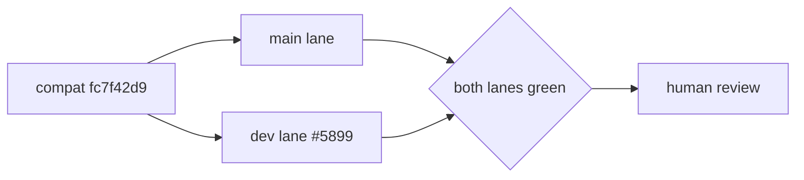

# chore: AUT-2155 bump Megatron Core nightly pins

[Upstream PR](https://github.com/NVIDIA-NeMo/Megatron-Bridge/pull/5898) · state: closed · merged: False

## Original PR description

## Background

Update Bridge against frozen MCore main `35e42f00` and dev `c8cd108b`. Companion dev validation: #5899.

Only this PR may merge, after both lanes validate compatibility commit `fc7f42d90a8bd71695cd68f41ce578c2468a4b0a`.

## What changed

- Retain both frozen pins, the main gitlink, main dependency metadata, and lockfile.
- Carry the shared dual-compatible fixes and current Bridge `main`.
- Preserve dependency and build inputs while resolving base drift.

## Details

The dev PR is validation-only and must never merge.

## Tested

The previous main head passed authoritative CI. Both current heads require CI on `fc7f42d9`. Local GPU admission is blocked by repeated pre-run pod loss.

## Review and discussion

### reviews

### issue_comments

- copy-pr-bot[bot] · comment · 2026-08-30T19:54:57Z · [source](https://github.com/NVIDIA-NeMo/Megatron-Bridge/pull/5898#issuecomment-5470910432)

This pull request requires additional validation before any workflows can run on NVIDIA's runners.

Pull request vetters can view their responsibilities [here](https://docs.gha-runners.nvidia.com/cpr/vetters).

Contributors can view more details about this message [here](https://docs.gha-runners.nvidia.com/cpr/contributors).

- svcnvidia-nemo-ci · comment · 2026-08-30T19:57:39Z · [source](https://github.com/NVIDIA-NeMo/Megatron-Bridge/pull/5898#issuecomment-5470922728)

/ok to test da4b8735e2048d7d1300a1bcd07de34708d7e37d

- svcnemo-autobot · comment · 2026-08-30T20:06:47Z · [source](https://github.com/NVIDIA-NeMo/Megatron-Bridge/pull/5898#issuecomment-5470967780)

Exact-source audit for the commit-approval finding:

- `fzyzcjy/torch_memory_saver` is public and was successfully cloned at exact commit `9bc9a442e6d108c7b7903def199896a005143aaf`.
- The complete tracked source, `setup.py`, package import/runtime code, native sources, and build scripts were inspected.
- Build/install performs local native compilation. The only subprocess in `setup.py` is fixed-argument `readelf -d <torch library>` for XPU ABI detection; no shell or network is used.
- Default import creates a lazy singleton. No HTTP/socket access, credential-file access, metadata-service access, or exfiltration path was found in `setup.py`, `torch_memory_saver/`, or `csrc/`.
- `configure_subprocess()` only scopes `LD_PRELOAD` when explicitly requested. Optional disk-backup mode writes tensor spill files only when explicitly enabled; it is not part of CI's install/import path.
- The dependency and exact SHA originate from selected MCore main commit `35e42f006497b4b6c9c18e5f0b9a2ef03f88cebc` and appeared through the required full lock refresh. Removing or replacing it would no longer represent that pinned MCore dependency closure.

No dependency input was changed because the reported issue was lack of audit access rather than a concrete defect. Please reconsider commit approval using this exact-source evidence.

- svcnvidia-nemo-ci · comment · 2026-08-30T22:16:10Z · [source](https://github.com/NVIDIA-NeMo/Megatron-Bridge/pull/5898#issuecomment-5471593033)

/ok to test daceec505e543cd3f42e2e8c156d1f6007c892d1

- svcnemo-autobot · comment · 2026-08-30T22:53:55Z · [source](https://github.com/NVIDIA-NeMo/Megatron-Bridge/pull/5898#issuecomment-5471766475)

Exact-source audit for the FlashMLA commit-approval finding:

- Typed Git cloned `deepseek-ai/FlashMLA` branch `nv_dev` at the exact locked commit `b7643bd54521f563b839b98289b5cd048c062ba2`.
- The commit is verified and changes only CUDA dispatch/instantiation code plus a Python docstring for `INDEXER_TOPK=1024` and head-128 support.
- `setup.py` performs native CUDA compilation. Its subprocesses are fixed-argument calls to `nvcc --version`, `git submodule update --init csrc/cutlass`, and `git rev-parse --short HEAD`; it contains no shell invocation.
- The sole submodule is NVIDIA CUTLASS, immutably pinned at `147f5673d0c1c3dcf66f78d677fd647e4a020219` and used as compile-time headers.
- The complete tracked `setup.py`, `flash_mla/`, and parent `csrc/` surfaces were scanned. No HTTP client, socket, curl/wget, cloud-metadata, credential-file, `os.system`, `Popen`, native `system`, or native file-open surface was found.
- Runtime import exposes the compiled CUDA operators through `flash_mla_interface.py`; no network, subprocess, credential access, or file-write behavior was found.
- Bridge’s manifest already selects `rev = "nv_dev"`; the required full lock refresh records the immutable resolution after `#` as `b7643bd...`. Changing that source or pinning around it would alter the selected MCore dependency closure without an identified source defect.

The earlier blocker was audit access, not a concrete risk. No dependency input was changed.

- svcnemo-autobot · comment · 2026-08-30T23:25:58Z · [source](https://github.com/NVIDIA-NeMo/Megatron-Bridge/pull/5898#issuecomment-5471915961)

Exact-candidate evidence for the MagiAttention finding:

- The main gitlink is frozen at `35e42f006497b4b6c9c18e5f0b9a2ef03f88cebc`.
- The exact commit’s `experimental/` tree contains only `experimental/agent_compose`; `experimental/lite/tests/setup_magi_attention_env.sh` is not present.
- The commit itself changes only `skills/update-golden-values/SKILL.md`.
- Candidate Bridge workflows, Dockerfiles, scripts, tests, and `pyproject.toml` contain no reference to `setup_magi_attention_env`, `MAGI_ATTENTION_SOURCE`, `install_flash_attn_cute`, or `experimental/lite`.
- The script exists in the separately frozen MCore dev tree, but the Bridge validation paths do not invoke it. It also fails closed unless a caller explicitly supplies `MAGI_ATTENTION_SOURCE` and `MAGI_ATTENTION_VENV`.

Therefore the unpinned external-source install path is not executable from this main candidate. No dependency or CI input was changed.

- svcnvidia-nemo-ci · comment · 2026-08-31T02:11:04Z · [source](https://github.com/NVIDIA-NeMo/Megatron-Bridge/pull/5898#issuecomment-5472840056)

/ok to test c3260ebc7fc5425a8fde0fac7f8d86a2dc2ecfbe

- svcnvidia-nemo-ci · comment · 2026-08-31T06:13:02Z · [source](https://github.com/NVIDIA-NeMo/Megatron-Bridge/pull/5898#issuecomment-5474477530)

/ok to test 986af6c6725592b43984e4380414cdedb91028a0

- svcnvidia-nemo-ci · comment · 2026-08-31T07:49:06Z · [source](https://github.com/NVIDIA-NeMo/Megatron-Bridge/pull/5898#issuecomment-5475373118)

/ok to test 6710abfdcdb3ce3c8e7170756b34fecddfbf0bcb

- svcnvidia-nemo-ci · comment · 2026-08-31T09:14:12Z · [source](https://github.com/NVIDIA-NeMo/Megatron-Bridge/pull/5898#issuecomment-5476256820)

/ok to test 8eee95e6e44da0d0ca15ab1be6078e3c38e25695

- svcnvidia-nemo-ci · comment · 2026-08-31T10:42:20Z · [source](https://github.com/NVIDIA-NeMo/Megatron-Bridge/pull/5898#issuecomment-5477187244)

/ok to test 0774bdb78d14c8a177cc9168359d3a5c6c0dbadb

- svcnvidia-nemo-ci · comment · 2026-08-31T10:58:00Z · [source](https://github.com/NVIDIA-NeMo/Megatron-Bridge/pull/5898#issuecomment-5477352364)

/ok to test 1b3ce2cd3d43e259c5f4db3383d3808321cccfb5

- svcnvidia-nemo-ci · comment · 2026-08-31T16:42:31Z · [source](https://github.com/NVIDIA-NeMo/Megatron-Bridge/pull/5898#issuecomment-5481454102)

/ok to test 41971d76e9f8b7e726540e4f2613a25bae3d9a65

- svcnvidia-nemo-ci · comment · 2026-08-31T19:06:20Z · [source](https://github.com/NVIDIA-NeMo/Megatron-Bridge/pull/5898#issuecomment-5483146871)

/ok to test c82576db9e60f078605f32d362740053e25efe97

### inline_comments

## Changed files and fixed code

- `.dev.commit` · modified · additions 1 / deletions 1
  - [head](https://github.com/svcnemo-autobot/Megatron-Bridge/blob/c82576db9e60f078605f32d362740053e25efe97/.dev.commit)
  - [base](https://github.com/NVIDIA-NeMo/Megatron-Bridge/blob/deadfb12cd28d46da9f9ad728fb3f5f7f9dcdd02/.dev.commit)
- `.github/workflows/cicd-main.yml` · modified · additions 6 / deletions 1
  - [head](https://github.com/svcnemo-autobot/Megatron-Bridge/blob/c82576db9e60f078605f32d362740053e25efe97/.github/workflows/cicd-main.yml)
  - [base](https://github.com/NVIDIA-NeMo/Megatron-Bridge/blob/deadfb12cd28d46da9f9ad728fb3f5f7f9dcdd02/.github/workflows/cicd-main.yml)
- `.main.commit` · modified · additions 1 / deletions 1
  - [head](https://github.com/svcnemo-autobot/Megatron-Bridge/blob/c82576db9e60f078605f32d362740053e25efe97/.main.commit)
  - [base](https://github.com/NVIDIA-NeMo/Megatron-Bridge/blob/deadfb12cd28d46da9f9ad728fb3f5f7f9dcdd02/.main.commit)
- `3rdparty/Megatron-LM` · modified · additions 1 / deletions 1
  - [head](https://github.com/svcnemo-autobot/Megatron-Bridge/blob/c82576db9e60f078605f32d362740053e25efe97/3rdparty/Megatron-LM)
  - [base](https://github.com/NVIDIA-NeMo/Megatron-Bridge/blob/deadfb12cd28d46da9f9ad728fb3f5f7f9dcdd02/3rdparty/Megatron-LM)
- `src/megatron/bridge/inference/vlm/qwenvl_inference_wrapper.py` · modified · additions 25 / deletions 1
  - [head](https://github.com/svcnemo-autobot/Megatron-Bridge/blob/c82576db9e60f078605f32d362740053e25efe97/src/megatron/bridge/inference/vlm/qwenvl_inference_wrapper.py)
  - [base](https://github.com/NVIDIA-NeMo/Megatron-Bridge/blob/deadfb12cd28d46da9f9ad728fb3f5f7f9dcdd02/src/megatron/bridge/inference/vlm/qwenvl_inference_wrapper.py)
- `src/megatron/bridge/models/conversion/model_bridge.py` · modified · additions 4 / deletions 2
  - [head](https://github.com/svcnemo-autobot/Megatron-Bridge/blob/c82576db9e60f078605f32d362740053e25efe97/src/megatron/bridge/models/conversion/model_bridge.py)
  - [base](https://github.com/NVIDIA-NeMo/Megatron-Bridge/blob/deadfb12cd28d46da9f9ad728fb3f5f7f9dcdd02/src/megatron/bridge/models/conversion/model_bridge.py)
- `src/megatron/bridge/models/deepseek/attention.py` · modified · additions 41 / deletions 4
  - [head](https://github.com/svcnemo-autobot/Megatron-Bridge/blob/c82576db9e60f078605f32d362740053e25efe97/src/megatron/bridge/models/deepseek/attention.py)
  - [base](https://github.com/NVIDIA-NeMo/Megatron-Bridge/blob/deadfb12cd28d46da9f9ad728fb3f5f7f9dcdd02/src/megatron/bridge/models/deepseek/attention.py)
- `src/megatron/bridge/models/transformer_config.py` · modified · additions 53 / deletions 0
  - [head](https://github.com/svcnemo-autobot/Megatron-Bridge/blob/c82576db9e60f078605f32d362740053e25efe97/src/megatron/bridge/models/transformer_config.py)
  - [base](https://github.com/NVIDIA-NeMo/Megatron-Bridge/blob/deadfb12cd28d46da9f9ad728fb3f5f7f9dcdd02/src/megatron/bridge/models/transformer_config.py)
- `src/megatron/bridge/training/gtp.py` · modified · additions 8 / deletions 2
  - [head](https://github.com/svcnemo-autobot/Megatron-Bridge/blob/c82576db9e60f078605f32d362740053e25efe97/src/megatron/bridge/training/gtp.py)
  - [base](https://github.com/NVIDIA-NeMo/Megatron-Bridge/blob/deadfb12cd28d46da9f9ad728fb3f5f7f9dcdd02/src/megatron/bridge/training/gtp.py)
- `src/megatron/bridge/training/initialize.py` · modified · additions 6 / deletions 2
  - [head](https://github.com/svcnemo-autobot/Megatron-Bridge/blob/c82576db9e60f078605f32d362740053e25efe97/src/megatron/bridge/training/initialize.py)
  - [base](https://github.com/NVIDIA-NeMo/Megatron-Bridge/blob/deadfb12cd28d46da9f9ad728fb3f5f7f9dcdd02/src/megatron/bridge/training/initialize.py)
- `tests/functional_tests/test_groups/training/test_pretrain.py` · modified · additions 12 / deletions 2
  - [head](https://github.com/svcnemo-autobot/Megatron-Bridge/blob/c82576db9e60f078605f32d362740053e25efe97/tests/functional_tests/test_groups/training/test_pretrain.py)
  - [base](https://github.com/NVIDIA-NeMo/Megatron-Bridge/blob/deadfb12cd28d46da9f9ad728fb3f5f7f9dcdd02/tests/functional_tests/test_groups/training/test_pretrain.py)
- `tests/mcore_dev.py` · added · additions 28 / deletions 0
  - [head](https://github.com/svcnemo-autobot/Megatron-Bridge/blob/c82576db9e60f078605f32d362740053e25efe97/tests/mcore_dev.py)
  - [base](https://github.com/NVIDIA-NeMo/Megatron-Bridge/blob/deadfb12cd28d46da9f9ad728fb3f5f7f9dcdd02/tests/mcore_dev.py)
- `tests/unit_tests/data/collators/test_model_collators.py` · modified · additions 28 / deletions 14
  - [head](https://github.com/svcnemo-autobot/Megatron-Bridge/blob/c82576db9e60f078605f32d362740053e25efe97/tests/unit_tests/data/collators/test_model_collators.py)
  - [base](https://github.com/NVIDIA-NeMo/Megatron-Bridge/blob/deadfb12cd28d46da9f9ad728fb3f5f7f9dcdd02/tests/unit_tests/data/collators/test_model_collators.py)
- `tests/unit_tests/inference/test_tokenizer.py` · modified · additions 17 / deletions 3
  - [head](https://github.com/svcnemo-autobot/Megatron-Bridge/blob/c82576db9e60f078605f32d362740053e25efe97/tests/unit_tests/inference/test_tokenizer.py)
  - [base](https://github.com/NVIDIA-NeMo/Megatron-Bridge/blob/deadfb12cd28d46da9f9ad728fb3f5f7f9dcdd02/tests/unit_tests/inference/test_tokenizer.py)
- `tests/unit_tests/models/deepseek/test_deepseek_attention.py` · modified · additions 12 / deletions 0
  - [head](https://github.com/svcnemo-autobot/Megatron-Bridge/blob/c82576db9e60f078605f32d362740053e25efe97/tests/unit_tests/models/deepseek/test_deepseek_attention.py)
  - [base](https://github.com/NVIDIA-NeMo/Megatron-Bridge/blob/deadfb12cd28d46da9f9ad728fb3f5f7f9dcdd02/tests/unit_tests/models/deepseek/test_deepseek_attention.py)
- `tests/unit_tests/models/hybrid/test_hybrid_provider.py` · modified · additions 2 / deletions 2
  - [head](https://github.com/svcnemo-autobot/Megatron-Bridge/blob/c82576db9e60f078605f32d362740053e25efe97/tests/unit_tests/models/hybrid/test_hybrid_provider.py)
  - [base](https://github.com/NVIDIA-NeMo/Megatron-Bridge/blob/deadfb12cd28d46da9f9ad728fb3f5f7f9dcdd02/tests/unit_tests/models/hybrid/test_hybrid_provider.py)
- `tests/unit_tests/models/nemotron_omni/test_nemotron_omni_model.py` · modified · additions 1 / deletions 2
  - [head](https://github.com/svcnemo-autobot/Megatron-Bridge/blob/c82576db9e60f078605f32d362740053e25efe97/tests/unit_tests/models/nemotron_omni/test_nemotron_omni_model.py)
  - [base](https://github.com/NVIDIA-NeMo/Megatron-Bridge/blob/deadfb12cd28d46da9f9ad728fb3f5f7f9dcdd02/tests/unit_tests/models/nemotron_omni/test_nemotron_omni_model.py)
- `tests/unit_tests/models/nemotron_vl/test_nemotron_vl_provider.py` · modified · additions 2 / deletions 3
  - [head](https://github.com/svcnemo-autobot/Megatron-Bridge/blob/c82576db9e60f078605f32d362740053e25efe97/tests/unit_tests/models/nemotron_vl/test_nemotron_vl_provider.py)
  - [base](https://github.com/NVIDIA-NeMo/Megatron-Bridge/blob/deadfb12cd28d46da9f9ad728fb3f5f7f9dcdd02/tests/unit_tests/models/nemotron_vl/test_nemotron_vl_provider.py)
- `tests/unit_tests/models/test_model_bridge.py` · modified · additions 0 / deletions 3
  - [head](https://github.com/svcnemo-autobot/Megatron-Bridge/blob/c82576db9e60f078605f32d362740053e25efe97/tests/unit_tests/models/test_model_bridge.py)
  - [base](https://github.com/NVIDIA-NeMo/Megatron-Bridge/blob/deadfb12cd28d46da9f9ad728fb3f5f7f9dcdd02/tests/unit_tests/models/test_model_bridge.py)
- `tests/unit_tests/training/megatron_mimo/test_megatron_mimo_checkpointing.py` · modified · additions 1 / deletions 0
  - [head](https://github.com/svcnemo-autobot/Megatron-Bridge/blob/c82576db9e60f078605f32d362740053e25efe97/tests/unit_tests/training/megatron_mimo/test_megatron_mimo_checkpointing.py)
  - [base](https://github.com/NVIDIA-NeMo/Megatron-Bridge/blob/deadfb12cd28d46da9f9ad728fb3f5f7f9dcdd02/tests/unit_tests/training/megatron_mimo/test_megatron_mimo_checkpointing.py)
- `tests/unit_tests/training/test_decentralized_pg.py` · modified · additions 4 / deletions 5
  - [head](https://github.com/svcnemo-autobot/Megatron-Bridge/blob/c82576db9e60f078605f32d362740053e25efe97/tests/unit_tests/training/test_decentralized_pg.py)
  - [base](https://github.com/NVIDIA-NeMo/Megatron-Bridge/blob/deadfb12cd28d46da9f9ad728fb3f5f7f9dcdd02/tests/unit_tests/training/test_decentralized_pg.py)
- `tests/unit_tests/training/test_gtp.py` · modified · additions 5 / deletions 0
  - [head](https://github.com/svcnemo-autobot/Megatron-Bridge/blob/c82576db9e60f078605f32d362740053e25efe97/tests/unit_tests/training/test_gtp.py)
  - [base](https://github.com/NVIDIA-NeMo/Megatron-Bridge/blob/deadfb12cd28d46da9f9ad728fb3f5f7f9dcdd02/tests/unit_tests/training/test_gtp.py)
- `tests/unit_tests/utils/test_common_utils.py` · modified · additions 18 / deletions 8
  - [head](https://github.com/svcnemo-autobot/Megatron-Bridge/blob/c82576db9e60f078605f32d362740053e25efe97/tests/unit_tests/utils/test_common_utils.py)
  - [base](https://github.com/NVIDIA-NeMo/Megatron-Bridge/blob/deadfb12cd28d46da9f9ad728fb3f5f7f9dcdd02/tests/unit_tests/utils/test_common_utils.py)
- `uv.lock` · modified · additions 186 / deletions 187
  - [head](https://github.com/svcnemo-autobot/Megatron-Bridge/blob/c82576db9e60f078605f32d362740053e25efe97/uv.lock)
  - [base](https://github.com/NVIDIA-NeMo/Megatron-Bridge/blob/deadfb12cd28d46da9f9ad728fb3f5f7f9dcdd02/uv.lock)

## Evidence and interpretation boundary

[Original JSON, discussions and patches](../../evidence/prs/NVIDIA-NeMo--Megatron-Bridge/5898-26a1e4f7fd71a7a9b7cfc7d1f2a9ff1542c54259f8f5a62dd93661572227dd32.json) · SHA-256 `26a1e4f7fd71a7a9b7cfc7d1f2a9ff1542c54259f8f5a62dd93661572227dd32`.

Diff complete: False. Missing/binary/truncated patches require pinned source inspection. This is a source page, not an independently verified optimization case. Open, merged and released are different states; recheck the deployed dependency.
