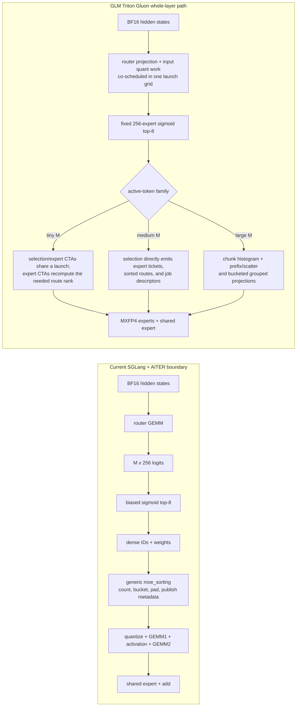

# feat(amd): add native GLM MXFP4 Triton Gluon MoE backend

[Upstream PR](https://github.com/sgl-project/sglang/pull/41639) · state: open · merged: False

## Original PR description

## Motivation

GLM-5.2/5.3 decode on MI355X spends a material part of each step in the MoE layer. The existing runner boundary receives already-materialized top-k IDs and weights, so a model-specific kernel cannot optimize across router projection, top-k, route sorting, expert scheduling, activation quantization, routed experts, and the shared expert.

This PR adds an **explicit, strict, whole-layer Triton Gluon MoE backend** for the audited GLM Quark MXFP4 contract. Its main optimization is not a standalone faster top-k operation: the selected routes directly become the expert schedule, removing the generic `topk_ids -> moe_sorting -> expert GEMM` handoff.

The backend is opt-in and fail-closed. `auto` never selects it, unsupported contracts raise before execution, and a requested Gluon path never silently falls back to AITER or another MoE runner.

## Modifications

### 1. What this adds

- `gluon` as a `MoeRunnerBackend` choice.
- A reusable whole-layer `GluonMoeBackend` interface with model-specific binding, eager weight preparation, execution, and output ABI validation.
- A GLM-5.2/5.3 implementation for serialized Quark W4A4 MXFP4 target experts and the audited BF16 NextN expert layout on gfx950.
- Shape-family kernels for decode, speculative verification, and prefill, including continuous TP4/EP1 and TP8/EP1 coverage through a 32K prefill chunk.
- TP/EP-aware shared-expert handling and reuse of SGLang's existing post-expert collective/finalization path.

Enable the target and speculative paths explicitly:

```bash
--moe-runner-backend gluon \
--speculative-moe-runner-backend gluon
```

### 2. Kernel design

The optimized layer owns this model-specific sequence:



Important details:

- **Tiny M:** the router uses split-K CDNA4 MFMA work to expose enough CTAs on MI355X. Selection is compile-time specialized for 256 experts/top-8. The up-projection launch consumes the selected route directly instead of waiting for a generic sort.
- **Medium M:** top-k appends routes directly to expert buckets and publishes the descriptors consumed by the expert projection.
- **Large M:** chunked counting, prefix/scatter, and bucketed projections cover prefill shapes. The 32K family splits large routed-partial/code buffers so every gfx950 buffer address remains below the 4-GiB window.
- **Quantization:** router projection and activation quantization are independent CTAs in the same launch grid; this removes a host launch and lets both work classes occupy the device together. They are not incorrectly described as a single CTA reading the input once.
- **Shared expert:** TP/EP1 target execution consumes SGLang's normal appended shared-expert representation (257 experts). EP and NextN keep the native shared expert and add it before SGLang's existing collective.

The isolated measurements below show that standalone top-k is approximately tied with AITER. The useful difference is the producer/consumer boundary:

```text
AITER: router -> top-k metadata -> generic MoE sort -> expert work
Gluon: router/quant -> top-k becomes the expert schedule -> expert work
```

### rocprofiler-sdk kernel decomposition

To separate GPU work from Python/dispatcher/launch overhead, the full TP8/EP1 MoE call was profiled at PR HEAD `317b7156d` with rocprofiler-sdk 1.1.0 (`--kernel-trace --marker-trace --stats`). Each AITER and Gluon arm was enclosed in its own ROCTx range and repeated 100 times on MI355X. `GPU active` below is the sum of device kernel durations per call. `GPU span` is from the first kernel start to the final kernel end under tracing; its parenthesized component is time between kernels and is profiler-sensitive. The `full MoE` column retains the low-overhead HIP-event result from the table above rather than treating traced wall time as application latency.

| M | Path | Kernels / layer | GPU active | Traced GPU span (inter-kernel gaps) | Full MoE, low-overhead |
|---:|---|---:|---:|---:|---:|
| 1 | AITER | 15 | 60.82 us | 649.17 us (587.41 us) | 574.97 us |
| 1 | Gluon | 4 | 13.47 us | 70.76 us (57.44 us) | 99.42 us |
| 16 | AITER | 14 | 95.57 us | 611.47 us (516.93 us) | 543.89 us |
| 16 | Gluon | 3 | 39.05 us | 63.12 us (24.06 us) | 94.34 us |
| 32 | AITER | 15 | 119.22 us | 657.49 us (537.73 us) | 706.99 us |
| 32 | Gluon | 5 | 64.30 us | 104.74 us (40.52 us) | 159.48 us |

The exact AITER device-time decomposition is:

| AITER stage | M=1 | M=16 | M=32 |
|---|---:|---:|---:|
| Router matmul, including BF16-to-FP32 cast where present | 2.69 us | 6.39 us | 7.78 us |
| Biased grouped top-k | 4.06 us | 4.96 us | 4.89 us |
| Generic route metadata sort/pad | 6.25 us | 9.72 us | 14.06 us |
| Routed input quantization + scatter | 2.76 us | 4.25 us | 4.68 us |
| Routed gate/up GEMM + SiLU/multiply | 18.11 us | 27.87 us | 36.77 us |
| Routed activation quantization + scatter | 2.67 us | 3.02 us | 3.81 us |
| Routed down GEMM | 3.82 us | 14.42 us | 19.68 us |
| Shared input quantization | 2.15 us | 2.88 us | 3.34 us |
| Shared gate/up GEMM, including split-K reduce | 7.90 us | 6.26 us | 7.04 us |
| Shared SiLU + multiply | 3.75 us | 8.15 us | 9.15 us |
| Shared activation quantization | 1.51 us | 1.96 us | 2.18 us |
| Shared down GEMM | 3.43 us | 3.40 us | 3.47 us |
| Routed + shared final add | 1.73 us | 2.27 us | 2.37 us |
| **Total GPU active** | **60.82 us** | **95.57 us** | **119.22 us** |

Gluon performs the same logical work with fused shape-specific stages:

| Gluon kernel/stage | M=1 | M=16 | M=32 |
|---|---:|---:|---:|
| Router GEMM + routed/shared input quantization | 2.48 us | 3.25 us | 3.60 us |
| Top-k scheduling + routed/shared gate/up GEMM | 5.18 us | - | - |
| Top-k scheduling + routed/shared gate/up + activation quantization | - | 23.91 us | - |
| Top-k to expert-job schedule | - | - | 4.61 us |
| Routed/shared gate/up GEMM + activation quantization | - | - | 33.80 us |
| Activation + quantization | 2.52 us | - | - |
| Routed/shared down GEMM + weighted reduction | 3.30 us | 11.89 us | - |
| Routed/shared down GEMM | - | - | 18.10 us |
| Weighted route reduction + shared add | - | - | 4.19 us |
| **Total GPU active** | **13.47 us** | **39.05 us** | **64.30 us** |

This changes the interpretation of the earlier isolated timings. At `M=1`, the Gluon `_router_linear` device body is **not** slower: it takes `2.48 us` while also quantizing routed and shared inputs, versus `2.69 us` for AITER's router-only GEMM. The earlier `17-18 us` versus `8-9 us` result measured the complete launch boundary, so it exposed launcher/dispatcher latency rather than slower router arithmetic. The current small-M optimization target should therefore not be the `2.48 us` router body in isolation.

### 3. SGLang integration, isolation, and support matrix

The integration sits above `MoeRunnerCore`, because that interface starts after routing has already been computed. The runtime flow is:

```text
explicit Gluon selection
  -> validate quant/model/runtime contract
  -> bind GLM backend
  -> prepare packed weights after checkpoint load and before CUDA graph capture
  -> dispatch by TP/EP, target/NextN, and active M
  -> validate rank-local output tensor ABI
  -> existing SGLang _finalize_normal_output / post_experts_all_reduce
```

Isolation from other paths:

- `auto` never selects Gluon; AITER, Triton, FlashInfer, MegaMoE, DeepEP, CPU, and other models retain their existing behavior.
- GLM modules and Gluon kernels are imported lazily only after explicit selection.
- Binding validates `model_type`, hidden/intermediate dimensions, 256 routed experts, sigmoid normalized top-8, quant ABI, gfx950, TP/EP-local shapes, shared-expert state, stream mode, A2A, EPLB, MoE DP, and routed scaling.
- Quark layout preparation is owned by the selected backend; Gluon does not construct a dummy AITER runner.
- Unsupported M/topology/model/quant combinations raise an actionable error. There is no native/AITER fallback from the Gluon backend.

Current audited matrix:

| Total TP | EP | Rank-local routed experts | Rank-local intermediate | Target/NextN M coverage |
|---:|---:|---:|---:|---:|
| 4 | 1 | 256 | 512 | 1..32768 |
| 4 | 4 | 64 | 2048 | 1..16768 |
| 8 | 1 | 256 | 256 | 1..32768 |
| 8 | 2 | 128 | 512 | 1..16768 |
| 8 | 4 | 64 | 1024 | 1..16768 |
| 8 | 8 | 32 | 2048 | 1..16768 |

Current model scope:

- GLM-5.2/5.3 `glm_moe_dsa` target with serialized Quark W4A4 MXFP4 experts.
- GLM NextN/EAGLE draft with the exact audited BF16 expert ABI.

This is intentionally not a generic Gluon MoE claim. Future fixed-topology MoEs can reuse the backend boundary, but each model still needs its own strict validator, weight-layout adapter, routing semantics, kernel family, correctness comparison, and performance evidence. The most direct next extension is another GLM-family Quark MXFP4 shape; unrelated models should not be enabled by relaxing the current checks.

## Accuracy Tests

### 4. Kernel correctness

- Low-M old/new Gluon schedule comparison at M=1..8: exact bitwise match.
- Router/top-k isolation at M=1,2,4,8,16,32,64,128:
  - identical dense logits: top-8 ID match fraction `1.0`;
  - maximum top-k weight difference `<= 5.96e-8`;
  - production split-logit selector vs. dense selector: IDs match `1.0`, weights exactly equal.
- EP2/EP4/EP8 compact kernels vs. rank-masked AITER at M=65,96,192,255:
  - all outputs finite;
  - relative L2 ranges: `0.004556-0.004568` (EP2), `0.004146-0.004172` (EP4), `0.003849-0.003886` (EP8);
  - maximum absolute error `<= 9.77e-4`.
- Large-M TP8/EP1 Gluon vs. AITER at M=128..32768: relative L2 `1.81%-2.33%`, consistent with different MXFP4 quantization/accumulation order.

### 5. End-to-end correctness

Current integration was exercised on GLM-5.2-MXFP4 with EAGLE/NextN, FP8 KV cache, DSA Triton attention, and CUDA graphs:

| Topology / arm | Result |
|---|---|
| TP4/EP4, AITER vs. Gluon | 8/8 exact response texts and 8/8 exact output-token ID sequences |
| TP4/EP1, AITER vs. Gluon default shared fusion | 8/8 exact texts and token IDs |
| TP4/EP1, AITER vs. Gluon with `--disable-shared-experts-fusion` | 8/8 exact texts and token IDs |

Logs confirm the intended shared policy on every rank (EP target/NextN native; EP1 target fused and NextN native) and contain no fallback, skipped Gluon dispatch, assertion, runtime exception, memory access fault, or GPU fault.

Strict AgentX functional canaries using the InferenceX workload configuration also completed for TP8/EP2, EP4, and EP8 with target and draft Gluon enabled: 16 backend reports per topology, zero skipped dispatches, zero request/benchmark errors, and no fallback.

### 6. GSM8K

**Score: `0.9437` (94.37%, 1,240/1,314 correct).** The full run completed without request errors in 896.44 s at 146.98 output tok/s. This is above the existing 0.92 MI35x GSM8K accuracy threshold used by SGLang's GLM MXFP4 accuracy coverage.

Configuration:

- full 1,314-question GSM8K test set, 5-shot completion prompt;
- GLM-5.2-MXFP4, TP4/EP1, target + NextN Gluon;
- EAGLE `3/4/1`, FP8 KV cache, Triton DSA, CUDA graph;
- `--chunked-prefill-size 32768`, 256 client threads, temperature 0, maximum 512 output tokens;
- strict backend: no fallback.

This run also covers the TP4/EP1 large-prefill family. An initial run exposed a real coverage boundary at `M=16802`; the implementation was extended to the full 32K chunk instead of reducing the prefill chunk or hiding the shape behind a fallback. A separate strict request with exactly 32,768 prompt tokens then completed successfully (`prompt_tokens=32768`, one generated token, 8.49 s E2E) with no runtime/GPU error or fallback.

### 7. Test inventory

Latest local validation on MI355X:

- `72 passed` across:
  - `test/registered/unit/models/test_gluon_moe_backend.py`
  - `test/registered/unit/spec/test_draft_construction_isolation.py`
  - `test/registered/unit/layers/moe/test_fused_shared_expert_scaling.py`
  - `test/registered/unit/models/test_glm_nextn_moe_ptpc.py`
- Continuous dispatch tests enumerate every integer M in each supported range and assert strict rejection immediately outside the audited ranges.
- Official Ruff error selection (`F401,F821,F823,UP037`): pass.
- Ruff format check over all 25 changed Python files: pass.
- `git diff --check`: pass.
- Full repository CI: pending; this PR is intentionally opened as Draft.

## Speed Tests and Profiling

### Microbenchmark method

- AMD Instinct MI355X, one rank of TP8/EP1 unless stated otherwise.
- AITER `acf8fdf9307431ece8ee275971c41cb3d1a7020b`.
- PyTorch `2.9.1+rocm7.2.0.git7e1940d4`, Triton `3.8.0`.
- 20 warmups, 200 timed repetitions, alternating arm order, HIP-event medians.
- The AITER baseline includes SGLang's real small-M sorting patch and native shared-expert work.
- Measurements were collected on equivalent pre-rebase kernel revisions; the rebased integration and 32K TP4 adapter were subsequently correctness-tested as described above.

#### Route preparation decomposition (microseconds)

| M | AITER router + top-k + sort | Gluon router + quant + select/schedule | Speedup |
|---:|---:|---:|---:|
| 1 | 62.16 | 32.94 | 1.89x |
| 8 | 62.86 | 31.96 | 1.97x |
| 16 | 61.48 | 31.90 | 1.93x |
| 32 | 200.78 | 47.40 | 4.24x |
| 64 | 190.74 | 52.58 | 3.63x |
| 128 | 175.76 | 47.06 | 3.73x |

At M=1..16, AITER's standalone router is about 2x faster and standalone top-k is approximately tied. The net win comes from eliminating the generic `moe_sorting`/handoff, which costs about 38-50 us by itself. At M>=32, Gluon also has the faster router schedule.

#### Complete rank-local MoE layer (microseconds)

| M | AITER | Gluon | Speedup |
|---:|---:|---:|---:|
| 1 | 574.97 | 99.42 | 5.78x |
| 8 | 578.35 | 85.32 | 6.78x |
| 16 | 543.89 | 94.34 | 5.77x |
| 32 | 706.99 | 159.48 | 4.43x |
| 64 | 670.25 | 172.78 | 3.88x |
| 128 | 674.65 | 203.26 | 3.32x |

A later M=1 fusion removed the standalone activation-quant launch and improved the Gluon arm from `100.80 us / 4 launches` to `81.94 us / 3 launches` (`-18.71%`, exact bitwise output). The shared MTP M=6 schedule improved its isolated layer from `121.44 us / 5 launches` to `85.86 us / 3 launches` (`-29.30%`).

#### Large-M complete layer

| M | Gluon | AITER | Speedup | Latency reduction |
|---:|---:|---:|---:|---:|
| 128 | 0.153 ms | 0.510 ms | 3.33x | 69.9% |
| 1024 | 0.224 ms | 0.563 ms | 2.52x | 60.3% |
| 8192 | 0.789 ms | 1.941 ms | 2.46x | 59.4% |
| 16384 | 1.370 ms | 3.600 ms | 2.63x | 61.9% |
| 32768 | 2.711 ms | 7.042 ms | 2.60x | 61.5% |

rocprof confirms that the savings are not only CPU launch timing:

| M | AITER launches / GPU-active time | Gluon launches / GPU-active time |
|---:|---:|---:|
| 1 | 15 / 60.82 us | 4 / 13.47 us (later optimized to 3 launches) |
| 16 | 14 / 95.57 us | 3 / 39.05 us |
| 32 | 15 / 119.22 us | 5 / 64.30 us |

### AgentX end-to-end performance

TP8/EP1, GLM-5.2-MXFP4, MTP `3/4/1`, strict target+draft Gluon, 32K chunk, two-node forward/reverse A/B:

Con / MTP | P90 ITV | vs 09/24 baseline | tput/chip | succ request
-- | -- | -- | -- | --
C1 3/4/1 | 316.970 | +22.98% | 2338.423 | 258
C1 5/6/1 | 295.403 | +14.62% | 2304.512 | 256
C2 3/4/1 | 243.293 | +29.63% | 2555.224 | 434
C2 5/6/1 | 175.893 | -6.28% | 2419.022 | 409


## Checklist

- [x] Format changed code with Ruff and run the repository's official Ruff error selection.
- [x] Add focused unit tests for backend selection, model/quant/topology contracts, shared experts, weight preparation, dispatch coverage, and strict rejection.
- [x] Document the design, integration boundary, supported matrix, accuracy, and performance in this PR description.
- [x] Provide kernel microbenchmarks, rocprof decomposition, end-to-end performance, and accuracy results.
- [x] Follow the SGLang code-style guidance for the changed Python files.
- [ ] Run full upstream CI and resolve reviewer feedback.
- [ ] Re-run the MTP 5/6/1 C=1 end-to-end arm before marking ready for review.


<!-- pr-states:start -->
---
### CI States

Latest PR Test (Base): <!-- slot:pr-test:start -->:x: [Run #38224037819](https://github.com/sgl-project/sglang/actions/runs/38224037819)<!-- slot:pr-test:end -->
Latest PR Test (Extra): <!-- slot:pr-test-extra:start -->:x: [Run #38224037431](https://github.com/sgl-project/sglang/actions/runs/38224037431)<!-- slot:pr-test-extra:end -->
Latest PR Test (AMD ROCm 10): <!-- slot:pr-test-amd:start -->:x: [Run #38224037886](https://github.com/sgl-project/sglang/actions/runs/38224037886)<!-- slot:pr-test-amd:end -->
<!-- pr-states:end -->

## Review and discussion

### reviews

- jiejingzhangamd · COMMENTED · 2026-09-29T23:53:43Z · [source](https://github.com/sgl-project/sglang/pull/41639#pullrequestreview-5359892682)

(No body; status only.)

- jiejingzhangamd · COMMENTED · 2026-09-29T23:58:03Z · [source](https://github.com/sgl-project/sglang/pull/41639#pullrequestreview-5359918976)

(No body; status only.)

- jiejingzhangamd · COMMENTED · 2026-09-29T23:58:18Z · [source](https://github.com/sgl-project/sglang/pull/41639#pullrequestreview-5359920361)

comments about process_weights_after_loading

### issue_comments

- jiejingzhangamd · comment · 2026-09-30T20:48:39Z · [source](https://github.com/sgl-project/sglang/pull/41639#issuecomment-5919471524)

Performance update for `2a32da4b82155373a37b98742ed637de2dd50361` (MI355X, real GLM-5.2-MXFP4 checkpoint, paired CUDA events, fused shared expert on both paths):

| topology | M | Gluon | AITER baseline | speedup |
|---|---:|---:|---:|---:|
| TP8/EP1 | 48 | 154.9 us | 291.6 us | 1.88x |
| TP8/EP1 | 4096 | 396.3 us | 677.2 us | 1.71x |
| TP8/EP1 | 32768 | 2605.8 us | 2843.0 us | 1.09x |
| TP4/EP1 | 48 | 173.6 us | 322.3 us | 1.86x |
| TP4/EP1 | 4096 | 496.1 us | 803.6 us | 1.62x |
| TP4/EP1 | 32768 | 3537.5 us | 3221.1 us | 0.91x |
| TP4/EP4 rank 0 | 48 | 179.3 us | 358.6 us | 2.00x |
| TP4/EP4 rank 0 | 4096 | 567.3 us | 729.2 us | 1.29x |
| TP4/EP4 rank 0 | 32768 | 4362.0 us | 3663.6 us | 0.84x |
| TP4/EP4 rank 3 | 4096 | 529.6 us | 686.5 us | 1.30x |
| TP4/EP4 rank 3 | 32768 | 3614.6 us | 3238.2 us | 0.90x |

The commit filters non-local EP routes before W13/W2 projection. On TP4/EP4 rank 0 this reduced M4096 from 1161.7 us to 567.3 us and M32768 from 9187.9 us to 4362.0 us. It also fixes the TP4/EP1 fused-shared adapter for M>4192. Unit tests: 68 passed.

A 300 s c=8 AgentX smoke produced P90 interactivity 122.740 tok/s/user, statistically unchanged from 123.180 before this commit and below the same-image baseline 167.895. Thus the remaining end-to-end gap is outside the isolated target MoE kernel; no fallback was introduced.


- 1am9trash · comment · 2026-10-06T01:27:26Z · [source](https://github.com/sgl-project/sglang/pull/41639#issuecomment-6007435660)

cc @EricKing626, @Jacob0226
Big improvement on GLM moe.

- kzjeef · comment · 2026-10-07T03:28:18Z · [source](https://github.com/sgl-project/sglang/pull/41639#issuecomment-6030286968)

/rerun-failed-ci


- jiejingzhangamd · comment · 2026-10-07T03:32:06Z · [source](https://github.com/sgl-project/sglang/pull/41639#issuecomment-6030325670)

/rerun-failed-ci


### inline_comments

- jiejingzhangamd · comment · 2026-09-29T23:53:43Z · [source](https://github.com/sgl-project/sglang/pull/41639#discussion_r4139488756)

File: `python/sglang/srt/layers/quantization/quark/schemes/quark_w4a4_mxfp4_moe.py` · line 910

This is intentional in the current design: runner ownership and weight-layout ownership are separate capabilities. AITER owns both, while Gluon is a whole-layer backend and therefore does not create or own the conventional `MoeRunner` (`_owns_moe_runner=False`). However, Gluon still consumes and owns the post-load Quark MXFP4 layout prepared here (`_owns_moe_weight_layout=True`). The guard therefore needs to check whether a backend can consume the resulting layout, rather than whether it owns a `MoeRunner`. This does not by itself imply a second full weight copy; for the fused EP1 path Gluon reuses the prepared Parameters.

- jiejingzhangamd · comment · 2026-09-29T23:58:03Z · [source](https://github.com/sgl-project/sglang/pull/41639#discussion_r4139512854)

File: `python/sglang/srt/layers/quantization/quark/schemes/quark_w4a4_mxfp4_moe.py` · line 910

it's not affect other backend because it only happens on post of Quark W4A4 MXFP4 MoE. 
AITER have both value TRUE, it's not affected. 
Gluon only check weight layout. 
other quantization not go through this path , so they will have no effect. 

## Changed files and fixed code

- `python/sglang/srt/arg_groups/choices.py` · modified · additions 1 / deletions 0
  - [head](https://github.com/jiejingzhangamd/sglang/blob/ceef14ee6d5f9d618161d4cb9b89b0bd2d8697ba/python/sglang/srt/arg_groups/choices.py)
  - [base](https://github.com/sgl-project/sglang/blob/62ff466ac0c2cdd5521acf7d4c673fa7630eb083/python/sglang/srt/arg_groups/choices.py)
- `python/sglang/srt/layers/moe/fused_moe_triton/layer.py` · modified · additions 12 / deletions 0
  - [head](https://github.com/jiejingzhangamd/sglang/blob/ceef14ee6d5f9d618161d4cb9b89b0bd2d8697ba/python/sglang/srt/layers/moe/fused_moe_triton/layer.py)
  - [base](https://github.com/sgl-project/sglang/blob/62ff466ac0c2cdd5521acf7d4c673fa7630eb083/python/sglang/srt/layers/moe/fused_moe_triton/layer.py)
- `python/sglang/srt/layers/moe/glm_mxfp4_gluon.py` · added · additions 372 / deletions 0
  - [head](https://github.com/jiejingzhangamd/sglang/blob/ceef14ee6d5f9d618161d4cb9b89b0bd2d8697ba/python/sglang/srt/layers/moe/glm_mxfp4_gluon.py)
  - [base](https://github.com/sgl-project/sglang/blob/62ff466ac0c2cdd5521acf7d4c673fa7630eb083/python/sglang/srt/layers/moe/glm_mxfp4_gluon.py)
- `python/sglang/srt/layers/moe/gluon_backend.py` · added · additions 110 / deletions 0
  - [head](https://github.com/jiejingzhangamd/sglang/blob/ceef14ee6d5f9d618161d4cb9b89b0bd2d8697ba/python/sglang/srt/layers/moe/gluon_backend.py)
  - [base](https://github.com/sgl-project/sglang/blob/62ff466ac0c2cdd5521acf7d4c673fa7630eb083/python/sglang/srt/layers/moe/gluon_backend.py)
- `python/sglang/srt/layers/moe/gluon_kernels/__init__.py` · added · additions 1 / deletions 0
  - [head](https://github.com/jiejingzhangamd/sglang/blob/ceef14ee6d5f9d618161d4cb9b89b0bd2d8697ba/python/sglang/srt/layers/moe/gluon_kernels/__init__.py)
  - [base](https://github.com/sgl-project/sglang/blob/62ff466ac0c2cdd5521acf7d4c673fa7630eb083/python/sglang/srt/layers/moe/gluon_kernels/__init__.py)
- `python/sglang/srt/layers/moe/gluon_kernels/glm_mxfp4/__init__.py` · added · additions 1 / deletions 0
  - [head](https://github.com/jiejingzhangamd/sglang/blob/ceef14ee6d5f9d618161d4cb9b89b0bd2d8697ba/python/sglang/srt/layers/moe/gluon_kernels/glm_mxfp4/__init__.py)
  - [base](https://github.com/sgl-project/sglang/blob/62ff466ac0c2cdd5521acf7d4c673fa7630eb083/python/sglang/srt/layers/moe/gluon_kernels/glm_mxfp4/__init__.py)
- `python/sglang/srt/layers/moe/gluon_kernels/glm_mxfp4/fused_moe_tp4_m128_4192.py` · added · additions 661 / deletions 0
  - [head](https://github.com/jiejingzhangamd/sglang/blob/ceef14ee6d5f9d618161d4cb9b89b0bd2d8697ba/python/sglang/srt/layers/moe/gluon_kernels/glm_mxfp4/fused_moe_tp4_m128_4192.py)
  - [base](https://github.com/sgl-project/sglang/blob/62ff466ac0c2cdd5521acf7d4c673fa7630eb083/python/sglang/srt/layers/moe/gluon_kernels/glm_mxfp4/fused_moe_tp4_m128_4192.py)
- `python/sglang/srt/layers/moe/gluon_kernels/glm_mxfp4/fused_moe_tp4_m16769_32768_shared.py` · added · additions 15 / deletions 0
  - [head](https://github.com/jiejingzhangamd/sglang/blob/ceef14ee6d5f9d618161d4cb9b89b0bd2d8697ba/python/sglang/srt/layers/moe/gluon_kernels/glm_mxfp4/fused_moe_tp4_m16769_32768_shared.py)
  - [base](https://github.com/sgl-project/sglang/blob/62ff466ac0c2cdd5521acf7d4c673fa7630eb083/python/sglang/srt/layers/moe/gluon_kernels/glm_mxfp4/fused_moe_tp4_m16769_32768_shared.py)
- `python/sglang/srt/layers/moe/gluon_kernels/glm_mxfp4/fused_moe_tp4_m1_16.py` · added · additions 491 / deletions 0
  - [head](https://github.com/jiejingzhangamd/sglang/blob/ceef14ee6d5f9d618161d4cb9b89b0bd2d8697ba/python/sglang/srt/layers/moe/gluon_kernels/glm_mxfp4/fused_moe_tp4_m1_16.py)
  - [base](https://github.com/sgl-project/sglang/blob/62ff466ac0c2cdd5521acf7d4c673fa7630eb083/python/sglang/srt/layers/moe/gluon_kernels/glm_mxfp4/fused_moe_tp4_m1_16.py)
- `python/sglang/srt/layers/moe/gluon_kernels/glm_mxfp4/fused_moe_tp4_m32_64.py` · added · additions 357 / deletions 0
  - [head](https://github.com/jiejingzhangamd/sglang/blob/ceef14ee6d5f9d618161d4cb9b89b0bd2d8697ba/python/sglang/srt/layers/moe/gluon_kernels/glm_mxfp4/fused_moe_tp4_m32_64.py)
  - [base](https://github.com/sgl-project/sglang/blob/62ff466ac0c2cdd5521acf7d4c673fa7630eb083/python/sglang/srt/layers/moe/gluon_kernels/glm_mxfp4/fused_moe_tp4_m32_64.py)
- `python/sglang/srt/layers/moe/gluon_kernels/glm_mxfp4/fused_moe_tp4_m4193_16768_shared.py` · added · additions 634 / deletions 0
  - [head](https://github.com/jiejingzhangamd/sglang/blob/ceef14ee6d5f9d618161d4cb9b89b0bd2d8697ba/python/sglang/srt/layers/moe/gluon_kernels/glm_mxfp4/fused_moe_tp4_m4193_16768_shared.py)
  - [base](https://github.com/sgl-project/sglang/blob/62ff466ac0c2cdd5521acf7d4c673fa7630eb083/python/sglang/srt/layers/moe/gluon_kernels/glm_mxfp4/fused_moe_tp4_m4193_16768_shared.py)
- `python/sglang/srt/layers/moe/gluon_kernels/glm_mxfp4/fused_moe_tp8_m1024_4192.py` · added · additions 435 / deletions 0
  - [head](https://github.com/jiejingzhangamd/sglang/blob/ceef14ee6d5f9d618161d4cb9b89b0bd2d8697ba/python/sglang/srt/layers/moe/gluon_kernels/glm_mxfp4/fused_moe_tp8_m1024_4192.py)
  - [base](https://github.com/sgl-project/sglang/blob/62ff466ac0c2cdd5521acf7d4c673fa7630eb083/python/sglang/srt/layers/moe/gluon_kernels/glm_mxfp4/fused_moe_tp8_m1024_4192.py)
- `python/sglang/srt/layers/moe/gluon_kernels/glm_mxfp4/fused_moe_tp8_m1024_4192_mtp.py` · added · additions 452 / deletions 0
  - [head](https://github.com/jiejingzhangamd/sglang/blob/ceef14ee6d5f9d618161d4cb9b89b0bd2d8697ba/python/sglang/srt/layers/moe/gluon_kernels/glm_mxfp4/fused_moe_tp8_m1024_4192_mtp.py)
  - [base](https://github.com/sgl-project/sglang/blob/62ff466ac0c2cdd5521acf7d4c673fa7630eb083/python/sglang/srt/layers/moe/gluon_kernels/glm_mxfp4/fused_moe_tp8_m1024_4192_mtp.py)
- `python/sglang/srt/layers/moe/gluon_kernels/glm_mxfp4/fused_moe_tp8_m1_16.py` · added · additions 873 / deletions 0
  - [head](https://github.com/jiejingzhangamd/sglang/blob/ceef14ee6d5f9d618161d4cb9b89b0bd2d8697ba/python/sglang/srt/layers/moe/gluon_kernels/glm_mxfp4/fused_moe_tp8_m1_16.py)
  - [base](https://github.com/sgl-project/sglang/blob/62ff466ac0c2cdd5521acf7d4c673fa7630eb083/python/sglang/srt/layers/moe/gluon_kernels/glm_mxfp4/fused_moe_tp8_m1_16.py)
- `python/sglang/srt/layers/moe/gluon_kernels/glm_mxfp4/fused_moe_tp8_m1_16_mtp.py` · added · additions 425 / deletions 0
  - [head](https://github.com/jiejingzhangamd/sglang/blob/ceef14ee6d5f9d618161d4cb9b89b0bd2d8697ba/python/sglang/srt/layers/moe/gluon_kernels/glm_mxfp4/fused_moe_tp8_m1_16_mtp.py)
  - [base](https://github.com/sgl-project/sglang/blob/62ff466ac0c2cdd5521acf7d4c673fa7630eb083/python/sglang/srt/layers/moe/gluon_kernels/glm_mxfp4/fused_moe_tp8_m1_16_mtp.py)
- `python/sglang/srt/layers/moe/gluon_kernels/glm_mxfp4/fused_moe_tp8_m256.py` · added · additions 403 / deletions 0
  - [head](https://github.com/jiejingzhangamd/sglang/blob/ceef14ee6d5f9d618161d4cb9b89b0bd2d8697ba/python/sglang/srt/layers/moe/gluon_kernels/glm_mxfp4/fused_moe_tp8_m256.py)
  - [base](https://github.com/sgl-project/sglang/blob/62ff466ac0c2cdd5521acf7d4c673fa7630eb083/python/sglang/srt/layers/moe/gluon_kernels/glm_mxfp4/fused_moe_tp8_m256.py)
- `python/sglang/srt/layers/moe/gluon_kernels/glm_mxfp4/fused_moe_tp8_m32_128.py` · added · additions 365 / deletions 0
  - [head](https://github.com/jiejingzhangamd/sglang/blob/ceef14ee6d5f9d618161d4cb9b89b0bd2d8697ba/python/sglang/srt/layers/moe/gluon_kernels/glm_mxfp4/fused_moe_tp8_m32_128.py)
  - [base](https://github.com/sgl-project/sglang/blob/62ff466ac0c2cdd5521acf7d4c673fa7630eb083/python/sglang/srt/layers/moe/gluon_kernels/glm_mxfp4/fused_moe_tp8_m32_128.py)
- `python/sglang/srt/layers/moe/gluon_kernels/glm_mxfp4/fused_moe_tp8_m32_256_mtp.py` · added · additions 338 / deletions 0
  - [head](https://github.com/jiejingzhangamd/sglang/blob/ceef14ee6d5f9d618161d4cb9b89b0bd2d8697ba/python/sglang/srt/layers/moe/gluon_kernels/glm_mxfp4/fused_moe_tp8_m32_256_mtp.py)
  - [base](https://github.com/sgl-project/sglang/blob/62ff466ac0c2cdd5521acf7d4c673fa7630eb083/python/sglang/srt/layers/moe/gluon_kernels/glm_mxfp4/fused_moe_tp8_m32_256_mtp.py)
- `python/sglang/srt/layers/moe/gluon_kernels/glm_mxfp4/fused_moe_tp8_m4193_16768.py` · added · additions 610 / deletions 0
  - [head](https://github.com/jiejingzhangamd/sglang/blob/ceef14ee6d5f9d618161d4cb9b89b0bd2d8697ba/python/sglang/srt/layers/moe/gluon_kernels/glm_mxfp4/fused_moe_tp8_m4193_16768.py)
  - [base](https://github.com/sgl-project/sglang/blob/62ff466ac0c2cdd5521acf7d4c673fa7630eb083/python/sglang/srt/layers/moe/gluon_kernels/glm_mxfp4/fused_moe_tp8_m4193_16768.py)
- `python/sglang/srt/layers/moe/utils.py` · modified · additions 4 / deletions 0
  - [head](https://github.com/jiejingzhangamd/sglang/blob/ceef14ee6d5f9d618161d4cb9b89b0bd2d8697ba/python/sglang/srt/layers/moe/utils.py)
  - [base](https://github.com/sgl-project/sglang/blob/62ff466ac0c2cdd5521acf7d4c673fa7630eb083/python/sglang/srt/layers/moe/utils.py)
- `python/sglang/srt/layers/quantization/quark/schemes/quark_w4a4_mxfp4_moe.py` · modified · additions 16 / deletions 3
  - [head](https://github.com/jiejingzhangamd/sglang/blob/ceef14ee6d5f9d618161d4cb9b89b0bd2d8697ba/python/sglang/srt/layers/quantization/quark/schemes/quark_w4a4_mxfp4_moe.py)
  - [base](https://github.com/sgl-project/sglang/blob/62ff466ac0c2cdd5521acf7d4c673fa7630eb083/python/sglang/srt/layers/quantization/quark/schemes/quark_w4a4_mxfp4_moe.py)
- `python/sglang/srt/layers/quantization/unquant.py` · modified · additions 3 / deletions 0
  - [head](https://github.com/jiejingzhangamd/sglang/blob/ceef14ee6d5f9d618161d4cb9b89b0bd2d8697ba/python/sglang/srt/layers/quantization/unquant.py)
  - [base](https://github.com/sgl-project/sglang/blob/62ff466ac0c2cdd5521acf7d4c673fa7630eb083/python/sglang/srt/layers/quantization/unquant.py)
- `python/sglang/srt/models/deepseek_v2.py` · modified · additions 65 / deletions 7
  - [head](https://github.com/jiejingzhangamd/sglang/blob/ceef14ee6d5f9d618161d4cb9b89b0bd2d8697ba/python/sglang/srt/models/deepseek_v2.py)
  - [base](https://github.com/sgl-project/sglang/blob/62ff466ac0c2cdd5521acf7d4c673fa7630eb083/python/sglang/srt/models/deepseek_v2.py)
- `python/sglang/srt/models/glm4_moe.py` · modified · additions 18 / deletions 0
  - [head](https://github.com/jiejingzhangamd/sglang/blob/ceef14ee6d5f9d618161d4cb9b89b0bd2d8697ba/python/sglang/srt/models/glm4_moe.py)
  - [base](https://github.com/sgl-project/sglang/blob/62ff466ac0c2cdd5521acf7d4c673fa7630eb083/python/sglang/srt/models/glm4_moe.py)
- `test/registered/unit/models/test_gluon_moe_backend.py` · added · additions 520 / deletions 0
  - [head](https://github.com/jiejingzhangamd/sglang/blob/ceef14ee6d5f9d618161d4cb9b89b0bd2d8697ba/test/registered/unit/models/test_gluon_moe_backend.py)
  - [base](https://github.com/sgl-project/sglang/blob/62ff466ac0c2cdd5521acf7d4c673fa7630eb083/test/registered/unit/models/test_gluon_moe_backend.py)

## Evidence and interpretation boundary

[Original JSON, discussions and patches](../../evidence/prs/sgl-project--sglang/41639-80ec1e554a3fc54a51ecb1fd20012e040bad49d3c3573b406f6ba392bcefbca1.json) · SHA-256 `80ec1e554a3fc54a51ecb1fd20012e040bad49d3c3573b406f6ba392bcefbca1`.

Diff complete: True. Missing/binary/truncated patches require pinned source inspection. This is a source page, not an independently verified optimization case. Open, merged and released are different states; recheck the deployed dependency.
