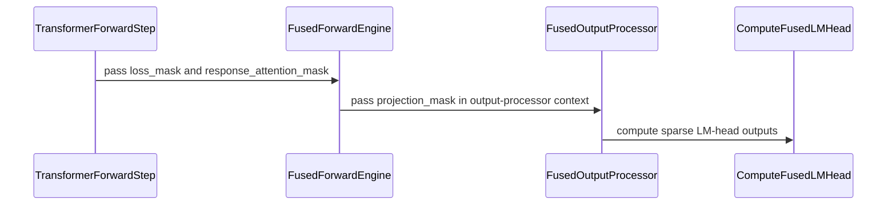

# [megatron] feat: project LM head only for response tokens

[Upstream PR](https://github.com/verl-project/verl/pull/7686) · state: open · merged: False

## Original PR description

### What does this PR do?

Add an opt-in `response_only_lm_head` setting to the Megatron engine. It selects loss-bearing predictor rows before vocabulary projection or fused linear log-probability/entropy computation, then restores scalar outputs to the existing token layout. Unselected positions are zero-filled and excluded by the existing loss mask. The option defaults to `false`.

#### Why this is needed

Prompt tokens, tool outputs and padding may not contribute to the policy loss but still incur vocabulary-projection work. Selecting only active rows reduces this work and, on the unfused path, vocabulary-sized intermediates. Whole-step memory savings depend on where the peak occurs.

Fusion and row selection are complementary: fusion avoids materializing full logits, while response-only reduces the number of rows supplied to either head. Both switches can be enabled independently. Fusion does not make memory independent of sequence length: the existing Triton head still keeps row-dependent reduction statistics and backward workspaces. Selecting active rows can reduce these as well as head computation.

#### Related work

This PR implements Megatron TP/SP/CP/PP integration for unfused projection and the existing Triton fused head, including its native output-processor hook and compatibility adapter. It complements the FSDP/FSDP2 row-selection work in [#7370](https://github.com/verl-project/verl/pull/7370) and the Blackwell-specific fused-head integration in [#5130](https://github.com/verl-project/verl/pull/5130).

[#7826](https://github.com/verl-project/verl/pull/7826) restores the output-processor hook in the MTP patch and makes the existing fused head reachable from BSHD forward. Its description of this PR as unfused-only is outdated: response-only selection already applies to both heads and skips masked prompt and tool-output positions as well as padding. The benefit depends on the active-row fraction. Dense logits per rank also depend on TP/CP partitioning, so adding DP ranks alone and increasing TP/CP are different memory-scaling cases.

[#7945](https://github.com/verl-project/verl/pull/7945) adds a Liger TP fused backend. Its current fused adapters process all supplied rows; the claimed preservation of response-only selection does not implement this PR's loss-mask selection. Row selection is conceptually complementary to that backend, but integration must respect gradient ownership: the existing Triton head needs TP input-gradient reduction, whereas Liger already performs it. Combining the implementations without adapting SP backward could reduce gradients twice.

Both PRs are open as of October 12, 2026 and are not included in this rebase. Neither combined path is claimed as validated. The A100 results below evaluate the existing Triton head, not Liger; isolated head speedups reported in #7945 should also be distinguished from its small or inconclusive training-throughput differences.

### Design and correctness

- **Causal alignment:** construct the full loss mask and apply the same next-token shift, padding and CP layout as labels. A selected target at position `t` selects `hidden[t - 1]`; internal masked spans are preserved.
- **TP/SP:** select rows after the required SP gather. On the unfused path, disable the output layer's duplicate gather and input-gradient reduction for that invocation. The explicit gather owns backward reduce-scatter. The fused non-SP path explicitly reduces vocabulary-local hidden gradients across TP.
- **Empty CP ranks:** project one dummy row and retain a zero-gradient path through the head so distributed backward remains connected.
- **Output compatibility:** select aligned labels and temperatures, then restore log probabilities, entropy and, on the unfused path, sum-of-squared-probability outputs to the original token layout. Downstream loss processing is unchanged.

### Compatibility and limitations

- THD on both paths; BSHD on the unfused path. TP, SP, static/dynamic CP and PP integration are supported, but the experiments below cover only the stated configuration.
- Existing fused-head requirements remain: remove-padding, uniform temperature, a compatible CUDA/Triton stack, and no sum-pi-squared output. This change does not add an NPU fused backend; selection on the supported unfused path does not depend on a CUDA fused-head implementation.
- MTP training and top-k distillation are not supported.
- Unfused SP with `defer_embedding_wgrad_compute=true` is rejected: the deferred drain would gather already selected activations a second time.
- Benefits diminish as the active-row fraction approaches 100%; selection/restoration adds some overhead.

#### Generic Triton single-token fix

The change also replaces seven `num_tokens.to(tl.float32)` expressions with `tl.full((), num_tokens, tl.float32)`. On the affected Triton stack, a single-token call can specialize `num_tokens` to an integer without `.to()`. This is a pre-existing fused-kernel compilation issue, reproduced independently of response-only selection; the empty-CP dummy row exposes it. The fix preserves the intended arithmetic and is independent of the gradient-validation limitations below.

### Test

#### A100 controlled A/B

Setup: eight A100 GPUs, Qwen3-8B BF16, THD/remove-padding, TP=2, PP=2, CP=2, SP enabled, rollout TP=4. Each step contains four prompts with four responses each.

For each RULER NIAH workload, one cache-generation run is followed by four runs covering fused and response-only on/off. Each run completes 12 steps; measured arms replay the same 16 trajectories per step. No traceback, OOM or unhandled error was logged. Rewards are nonconstant, advantages have both signs, and gradients are nonzero.

The 8K→8K workload has mean prompt lengths of 7633–7781 tokens and 8192-token responses; 16K→4K has mean prompt lengths of 15683.75–16122.5 and 4096-token responses. Responses are forced to the length limit with `ignore_eos=true`. These are fixed-length pressure tests, not learning-quality evaluations.

Results below use **steps 3–12**, excluding the first two training steps. Step time includes cached-rollout training, not actual generation. SD is the sample standard deviation across ten steps in one run, not a confidence interval. These September 11–12 measurements predate the October 12 rebase onto upstream main `2035f58d`, including its newer Megatron/VLM integration and dependency stack. They are historical results; performance and distributed correctness must be revalidated on the rebased code.

#### Memory and training-stage timing


The figure shows means across steps 3–12; time error bars are sample SD. In the 16K→4K workload, response-only lowers cached-step time by **7.94% unfused / 15.96% fused** and actor-update time by **7.07% / 15.01%**. For 8K→8K, the corresponding reductions are **1.25% / 5.72%** and **1.55% / 7.21%**. The small 8K→8K unfused difference is within the observed step-to-step variation.

Unfused response-only lowers the reported memory metric by **5.13 GiB / 15.43%** for 16K→4K and **3.52 GiB / 11.20%** for 8K→8K. Fusion alone reaches a lower memory metric than unfused response-only in these runs; adding response-only to fusion changes it by zero and approximately 0.09 GiB, respectively.

Memory bars are means of `actor/perf/max_memory_allocated_gb`. Instrumentation resets the CUDA peak counters also read by this metric, so these are **not independently measured whole-step or all-GPU maximum peaks**. All measured arms use synchronized instrumentation, and cached-step timing excludes actual rollout generation.

The existing Triton fused head increases actor-update time by approximately 20–22% relative to unfused in this configuration. Its tiled reductions and backward recomputation trade storage for computation, but these runs do not isolate the bottleneck or establish that fused implementations are generally slower. Response-only reduces the number of rows processed within either backend. No Liger performance or NPU measurement is inferred from these results.

#### Correctness evidence and limitations

Within each backend, logged entropy, policy loss and total loss match between baseline and response-only over steps 3–12. Gradient norms do not match exactly. Maximum per-step relative differences, using the first arm as denominator, are:

| Comparison | 8K→8K | 16K→4K |
| --- | ---: | ---: |
| Unfused baseline vs unfused response-only | 0.112% | 4.861% |
| Fused baseline vs fused response-only | 0.126% | 2.011% |
| Unfused baseline vs fused baseline | 0.537% | 6.779% |
| Unfused response-only vs fused response-only | 0.599% | 5.645% |

Differences also exist without response-only, but this does not establish that its differences are harmless. Cache generation and replay show a larger unexplained discrepancy in one 16K→4K step (gradient norm 0.692205 vs 0.233730). Fixed-input/weight/order baseline repeats and gradient-tensor comparisons remain necessary. The runs demonstrate nonzero-gradient distributed liveness, including empty CP ranks, not strict backward numerical equivalence.

#### Functional tests

```bash
python -m pytest -q tests/models/mcore/test_response_only_lm_head_on_cpu.py
```

The module uses 15 parameterized cases to cover nested/padded causal alignment, CP zigzag boundaries, sparse/dense values and gradients, label/temperature alignment, empty masks, and SP gather/state restoration on normal and exceptional exits. It also checks the deferred-weight-gradient guard. Fused cases use differentiable Torch math rather than the real CUDA kernel.

On the rebased revision, Ruff checks, formatting, Python syntax and test-layout validation passed locally. Pytest collection on the Windows host stopped at the missing `megatron` dependency; no functional-test pass count is claimed. Run the command above in the supported Linux PyTorch/Megatron environment, then repeat distributed forward/backward validation on the target stack.

A separate four-GPU TP=2/CP=2 regression is available on the validation branch (`lm_head_test`, not included in this functional PR):

```bash
CUDA_DEVICE_MAX_CONNECTIONS=1 torchrun --standalone --nproc_per_node=4 \
  -m pytest -q tests/special_distributed/test_response_only_lm_head.py
```

It compares real fused outputs and gradients against a full-vocabulary Torch reference, including SP on/off and an empty CP rank. The validation branch and archived patch pair still target the earlier baseline; update their functional code to the rebased revision before using them to validate this rebase. A passing result on the target stack is still required; this isolated test does not exercise full-model PP.

### API and usage

```yaml
actor_rollout_ref:
  actor:
    megatron:
      response_only_lm_head: true
  ref:
    megatron:
      response_only_lm_head: true
```

Actor and reference settings are independent. To combine with the fused head, also set `actor_rollout_ref.model.use_fused_kernels=true`.

### Checklist Before Submitting

- [x] Add opt-in configuration and focused functional tests.
- [x] Complete both 12-step A100 workloads with fused and response-only on/off.
- [x] Rebase the functional branch onto upstream main `2035f58d` and pass local static checks.
- [ ] Repeat functional, distributed and performance validation on the rebased Linux stack.
- [ ] Run `pre-commit run --all-files --show-diff-on-failure --color=always` and request CI.

Codex assisted with this PR.

<!-- This is an auto-generated comment: release notes by coderabbit.ai -->

## Summary by CodeRabbit

* **New Features**
  * Added an optional setting to project language-model outputs only for response positions selected by the loss mask. It is disabled by default and can be enabled in Megatron engine configurations.
  * Log-probability and entropy outputs retain their usual sequence layout, including for padded inputs and sequence-parallel execution.
  * The option is not supported with top-k distillation or MTP training.

<!-- end of auto-generated comment: release notes by coderabbit.ai -->

## Review and discussion

### reviews

- tardis-key · COMMENTED · 2026-09-14T07:30:45Z · [source](https://github.com/verl-project/verl/pull/7686#pullrequestreview-5195010514)

(No body; status only.)

- qiangyupei · COMMENTED · 2026-09-14T13:45:17Z · [source](https://github.com/verl-project/verl/pull/7686#pullrequestreview-5198437954)

(No body; status only.)

### issue_comments

- CLAassistant · comment · 2026-09-02T10:59:55Z · [source](https://github.com/verl-project/verl/pull/7686#issuecomment-5508495232)

[](https://cla-assistant.io/verl-project/verl?pullRequest=7686) <br/>Thank you for your submission! We really appreciate it. Like many open source projects, we ask that you sign our [Contributor License Agreement](https://cla-assistant.io/verl-project/verl?pullRequest=7686) before we can accept your contribution.<br/><sub>You have signed the CLA already but the status is still pending? Let us [recheck](https://cla-assistant.io/check/verl-project/verl?pullRequest=7686) it.</sub>

- coderabbitai · comment · 2026-10-12T07:04:39Z · [source](https://github.com/verl-project/verl/pull/7686#issuecomment-6119420511)

<!-- This is an auto-generated comment: summarize by coderabbit.ai -->
<!-- review_stack_entry_start -->

<a href="https://app.coderabbit.ai/change-stack/verl-project/verl/pull/7686?scope=ghh_OusAJGA4HG8ljoOV0wJvVx8NmnZIjc2DdjmxOu0xZWA&amp;cs_source=review_comment"><picture><source media="(prefers-color-scheme: dark)" srcset="https://storage.googleapis.com/coderabbit_public_assets/review-stack-in-coderabbit-ui-dark.svg?v=3"><source media="(prefers-color-scheme: light)" srcset="https://storage.googleapis.com/coderabbit_public_assets/review-stack-in-coderabbit-ui.svg?v=3"></picture></a>

<!-- review_stack_entry_end -->
<!-- recent_review_start -->

No actionable comments were generated in the recent review. 🎉

<details>
<summary><strong>ℹ️ Recent review info</strong></summary>
<dl>
<dd>
<dl>
<dd>

<details>
<summary><strong>⚙️ Run configuration</strong></summary>
<dl>
<dd>
<dl>
<dd>

- **Configuration used**: defaults
- **Review profile**: CHILL
- **Plan**: Advanced
- **Run ID**: `e42e8197-3d27-4ca5-99d0-31ae409becaa`

<hr>

</dd>
</dl>

<hr>

</dd>
</dl>
</details>

<details>
<summary><strong>📥 Commits</strong></summary>
<dl>
<dd>
<dl>
<dd>

Reviewing files that changed from the base of the PR and between 2035f58dcb06d8cad4caee107b30f4045d724367 and 03e1b2951ea7f5aaa49ac4fb8b2c8aa85a4c5eb7.

<hr>

</dd>
</dl>

<hr>

</dd>
</dl>
</details>

<details>
<summary><strong>📒 Files selected for processing (9)</strong></summary>
<dl>
<dd>
<dl>
<dd>

* `tests/models/mcore/test_response_only_lm_head_on_cpu.py`
* `verl/models/mcore/model_forward.py`
* `verl/models/mcore/model_forward_fused.py`
* `verl/models/mcore/response_only_lm_head.py`
* `verl/trainer/config/_generated_ppo_megatron_trainer.yaml`
* `verl/trainer/config/engine/megatron.yaml`
* `verl/utils/kernel/kernels.py`
* `verl/workers/config/engine.py`
* `verl/workers/engine/megatron/transformer_impl.py`

<hr>

</dd>
</dl>

<hr>

</dd>
</dl>
</details>

**Included review availability:** This review used your included allowance. Your plan provides up to 10 included reviews per hour; 8 remain after this review.

<hr>

</dd>
</dl>

<hr>

</dd>
</dl>
</details>

---


<!-- recent_review_end -->
<!-- walkthrough_start -->

<details>
<summary><strong>📝 Walkthrough</strong></summary>
<dl>
<dd>

<details>
<summary><strong>📝 Walkthrough</strong></summary>
<dl>
<dd>

## Walkthrough

The Megatron engine now supports optional response-only LM-head projection in fused and non-fused paths. It selects rows using a loss-derived projection mask and restores processed outputs to their original layout. The change also updates float32 denominators in Triton entropy mean reductions.

### Changes

**Response-only LM-head projection**

|Layer / File(s)|Summary|
|:---|:---|
|**Configure and construct projection masks** <br> `verl/workers/config/engine.py`, `verl/trainer/config/engine/megatron.yaml`, `verl/trainer/config/_generated_ppo_megatron_trainer.yaml`, `verl/models/mcore/model_forward.py`, `verl/workers/engine/megatron/transformer_impl.py`, `tests/models/mcore/test_response_only_lm_head_on_cpu.py`|The engine configuration adds `response_only_lm_head`, defaulting to false. The `thd` and `bshd` forward paths build projection masks from loss-mask inputs and pass them to model execution and logits processing. Tests cover next-token mask alignment across padded and nested inputs and context-parallel partitions.|
|**Select and restore response rows** <br> `verl/models/mcore/response_only_lm_head.py`, `verl/workers/engine/megatron/transformer_impl.py`, `tests/models/mcore/test_response_only_lm_head_on_cpu.py`|New helpers select hidden states, labels, and temperatures at mask positions, then restore outputs to the dense layout. The output-layer context handles sequence-parallel settings and rejects deferred embedding weight gradients. The non-fused logits processor applies sparse selection and rejects top-k distillation and MTP training. Tests compare values and gradients with dense projection, including empty masks.|
|**Integrate response-only projection in the fused path** <br> `verl/models/mcore/model_forward_fused.py`, `verl/workers/engine/megatron/transformer_impl.py`, `tests/models/mcore/test_response_only_lm_head_on_cpu.py`|The fused path builds and passes a projection mask, then uses a shared helper for sparse LM-head computation in native and legacy output-processor paths. The helper gathers hidden states for sequence parallelism or copies them into the tensor-parallel region when applicable. Tests cover both sequence-parallel modes, empty masks, values, gradients, and unselected outputs.|

**Triton entropy mean denominators**

|Layer / File(s)|Summary|
|:---|:---|
|**Use float32 scalar denominators** <br> `verl/utils/kernel/kernels.py`|Seven forward and backward mean-reduction paths use a float32 scalar created with `tl.full` as the denominator.|

<!-- change_assessment_start -->
**Priority:** ➖ Normal


**Estimated code review effort:** 3 (Moderate) | ~25 minutes

<!-- change_assessment_commit:"03e1b2951ea7f5aaa49ac4fb8b2c8aa85a4c5eb7" -->
**Change:** Feature
<!-- change_assessment_end -->

### Sequence Diagram(s)



<hr>

</dd>
</dl>
</details>

<hr>

</dd>
</dl>
</details>

<!-- walkthrough_end -->
<!-- final_review_risk_start -->
**Merge Risk:** **⚪ Minimal** · up to `03e1b`
<!-- final_review_risk_coverage:{"sourceCommitId":"03e1b2951ea7f5aaa49ac4fb8b2c8aa85a4c5eb7","coveredCommitId":"03e1b2951ea7f5aaa49ac4fb8b2c8aa85a4c5eb7","kind":"reviewed"} -->

No identified issue blocks merging. Response-only projection remains opt-in, and the inspected mask and gradient paths preserve their intended behavior.
<!-- final_review_risk_end -->
<!-- architecture_review_start -->
<details>
<summary><strong>Security Architecture Review</strong></summary>
<dl>
<dd>
<dl>
<dd>

**Security architecture risk:** **🔵 Low** · up to `03e1b`

The optimization preserves output layouts and includes safeguards for unsupported combinations and empty selections. No introduced security vulnerability was established. Concurrent-use and distributed recovery behavior remain incompletely verified.

**Retained concerns**
No architecture-level concerns identified.

<dl>
<dd>

<details>
<summary><strong>Security review details</strong></summary>
<dl>
<dd>

**Security Blast Radius**
- _inferred_ — The directly evidenced impact is training-output and gradient computation across participating worker ranks and model chunks. The supplied deployment context does not establish the maximum tenant, service, or environment exposure.

**Trust Boundaries and Controls**
- _inferred_ — Inspected worker entrypoints continue to pass training tensors into the existing engine scheduler. The new setting changes processing within that path; no new attacker-facing endpoint or authority transition was established. This does not resolve security properties of uninspected batch producers or deployments.

</dd>
</dl>
</details>

</dd>
</dl>

</dd>
</dl>

<hr>

</dd>
</dl>
</details>
<!-- architecture_review_end -->
<!-- pre_merge_checks_walkthrough_start -->

<details>
<summary><strong>Pre-merge checks | <sup><picture></picture></sup> 4 | <sup><picture></picture></sup> 1</strong></summary>
<dl>
<dd>

### ❌ Failed checks (1 warning)

|     Check name     |                                              Status                                              | Explanation                                                                                                                                                                                               | Resolution                                                                         |
| :---------------- | :----------------------------------------------------------------------------------------------: | :-------------------------------------------------------------------------------------------------------------------------------------------------------------------------------------------------------- | :--------------------------------------------------------------------------------- |
| Docstring Coverage |  | Docstring coverage is 41.18% which is insufficient. The required threshold is 80.00%. Docstring coverage is scoped to functions touched by this diff. Analyzed 34 functions across 7 files. (2 skipped: … | Write docstrings for the functions missing them to satisfy the coverage threshold. |

<details>
<summary><strong>✅ Passed checks (4 passed)</strong></summary>
<dl>
<dd>

|         Check name         |                                             Status                                             | Explanation                                                                                                          |
| :------------------------ | :--------------------------------------------------------------------------------------------: | :------------------------------------------------------------------------------------------------------------------- |
|     Linked Issues check    |  | Check skipped because no linked issues were found for this pull request.                                             |
| Out of Scope Changes check |  | Check skipped because no linked issues were found for this pull request.                                             |
|      Description Check     |  | Check skipped - CodeRabbit’s high-level summary is enabled.                                                          |
|         Title check        |  | The title clearly and concisely describes the main change: projecting the Megatron LM head only for response tokens. |

<hr>

</dd>
</dl>
</details>

<details>
<summary><strong>Full details: Docstring Coverage</strong></summary>
<dl>
<dd>

**Explanation**

Docstring coverage is 41.18% which is insufficient. The required threshold is 80.00%. Docstring coverage is scoped to functions touched by this diff. Analyzed 34 functions across 7 files. (2 skipped: 2 unsupported.)

</dd>
</dl>
</details>

<hr>

</dd>
</dl>
</details>

<!-- pre_merge_checks_walkthrough_end -->

- [ ] <!-- {"checkboxId":"585bb3f6-faf5-4dbf-96d2-74e382adf19a"} --> Fix all pre-merge checks with AI
<!-- finishing_touch_checkbox_start -->

<details>
<summary><strong>✨ Finishing Touches</strong></summary>
<dl>
<dd>
<dl>
<dd>

<details open>
<summary><strong>🧪 Generate unit tests (beta)</strong></summary>
<dl>
<dd>
<dl>
<dd>

- [ ] <!-- {"checkboxId": "f47ac10b-58cc-4372-a567-0e02b2c3d479", "radioGroupId": "utg-output-choice-group-unknown_comment_id"} --> Create a new PR

</dd>
</dl>

<hr>

</dd>
</dl>
</details>

<hr>

</dd>
</dl>

<hr>

</dd>
</dl>
</details>

<!-- finishing_touch_checkbox_end -->

<!-- autopilot:start -->
- [ ] <!-- {"checkboxId":"2708ad07-9f24-4260-9c11-7dc76a49f2e3"} --> <strong title="Keep fixing CodeRabbit findings and required CI, and resolving merge conflicts">Autofix</strong> · Keep fixing CodeRabbit findings and required CI, and resolving merge conflicts
<!-- autopilot:end -->
<!-- tips_start -->

---


<sub>Comment `@coderabbitai help` to get the list of available commands.</sub>

<!-- tips_end -->

### inline_comments

- tardis-key · comment · 2026-09-14T07:30:45Z · [source](https://github.com/verl-project/verl/pull/7686#discussion_r4003024024)

File: `tests/models/mcore/test_response_only_lm_head_on_cpu.py` · line None

.to(bool) ?

- qiangyupei · comment · 2026-09-14T13:45:17Z · [source](https://github.com/verl-project/verl/pull/7686#discussion_r4005810841)

File: `tests/models/mcore/test_response_only_lm_head_on_cpu.py` · line None

Thanks for your comment. I'll add .to(torch.bool) to match the production path before comparing against the boolean expected mask.

## Changed files and fixed code

- `tests/models/mcore/test_response_only_lm_head_on_cpu.py` · added · additions 208 / deletions 0
  - [head](https://github.com/qiangyupei/verl-090/blob/03e1b2951ea7f5aaa49ac4fb8b2c8aa85a4c5eb7/tests/models/mcore/test_response_only_lm_head_on_cpu.py)
  - [base](https://github.com/verl-project/verl/blob/2035f58dcb06d8cad4caee107b30f4045d724367/tests/models/mcore/test_response_only_lm_head_on_cpu.py)
- `verl/models/mcore/model_forward.py` · modified · additions 62 / deletions 16
  - [head](https://github.com/qiangyupei/verl-090/blob/03e1b2951ea7f5aaa49ac4fb8b2c8aa85a4c5eb7/verl/models/mcore/model_forward.py)
  - [base](https://github.com/verl-project/verl/blob/2035f58dcb06d8cad4caee107b30f4045d724367/verl/models/mcore/model_forward.py)
- `verl/models/mcore/model_forward_fused.py` · modified · additions 62 / deletions 19
  - [head](https://github.com/qiangyupei/verl-090/blob/03e1b2951ea7f5aaa49ac4fb8b2c8aa85a4c5eb7/verl/models/mcore/model_forward_fused.py)
  - [base](https://github.com/verl-project/verl/blob/2035f58dcb06d8cad4caee107b30f4045d724367/verl/models/mcore/model_forward_fused.py)
- `verl/models/mcore/response_only_lm_head.py` · added · additions 157 / deletions 0
  - [head](https://github.com/qiangyupei/verl-090/blob/03e1b2951ea7f5aaa49ac4fb8b2c8aa85a4c5eb7/verl/models/mcore/response_only_lm_head.py)
  - [base](https://github.com/verl-project/verl/blob/2035f58dcb06d8cad4caee107b30f4045d724367/verl/models/mcore/response_only_lm_head.py)
- `verl/trainer/config/_generated_ppo_megatron_trainer.yaml` · modified · additions 3 / deletions 0
  - [head](https://github.com/qiangyupei/verl-090/blob/03e1b2951ea7f5aaa49ac4fb8b2c8aa85a4c5eb7/verl/trainer/config/_generated_ppo_megatron_trainer.yaml)
  - [base](https://github.com/verl-project/verl/blob/2035f58dcb06d8cad4caee107b30f4045d724367/verl/trainer/config/_generated_ppo_megatron_trainer.yaml)
- `verl/trainer/config/engine/megatron.yaml` · modified · additions 4 / deletions 0
  - [head](https://github.com/qiangyupei/verl-090/blob/03e1b2951ea7f5aaa49ac4fb8b2c8aa85a4c5eb7/verl/trainer/config/engine/megatron.yaml)
  - [base](https://github.com/verl-project/verl/blob/2035f58dcb06d8cad4caee107b30f4045d724367/verl/trainer/config/engine/megatron.yaml)
- `verl/utils/kernel/kernels.py` · modified · additions 7 / deletions 7
  - [head](https://github.com/qiangyupei/verl-090/blob/03e1b2951ea7f5aaa49ac4fb8b2c8aa85a4c5eb7/verl/utils/kernel/kernels.py)
  - [base](https://github.com/verl-project/verl/blob/2035f58dcb06d8cad4caee107b30f4045d724367/verl/utils/kernel/kernels.py)
- `verl/workers/config/engine.py` · modified · additions 3 / deletions 0
  - [head](https://github.com/qiangyupei/verl-090/blob/03e1b2951ea7f5aaa49ac4fb8b2c8aa85a4c5eb7/verl/workers/config/engine.py)
  - [base](https://github.com/verl-project/verl/blob/2035f58dcb06d8cad4caee107b30f4045d724367/verl/workers/config/engine.py)
- `verl/workers/engine/megatron/transformer_impl.py` · modified · additions 27 / deletions 1
  - [head](https://github.com/qiangyupei/verl-090/blob/03e1b2951ea7f5aaa49ac4fb8b2c8aa85a4c5eb7/verl/workers/engine/megatron/transformer_impl.py)
  - [base](https://github.com/verl-project/verl/blob/2035f58dcb06d8cad4caee107b30f4045d724367/verl/workers/engine/megatron/transformer_impl.py)

## Evidence and interpretation boundary

[Original JSON, discussions and patches](../../evidence/prs/verl-project--verl/7686-f7ef418076cf16c5a877b6abdf0c064add59a926ccc1d618d20ec801cae5caf4.json) · SHA-256 `f7ef418076cf16c5a877b6abdf0c064add59a926ccc1d618d20ec801cae5caf4`.

Diff complete: True. Missing/binary/truncated patches require pinned source inspection. This is a source page, not an independently verified optimization case. Open, merged and released are different states; recheck the deployed dependency.
