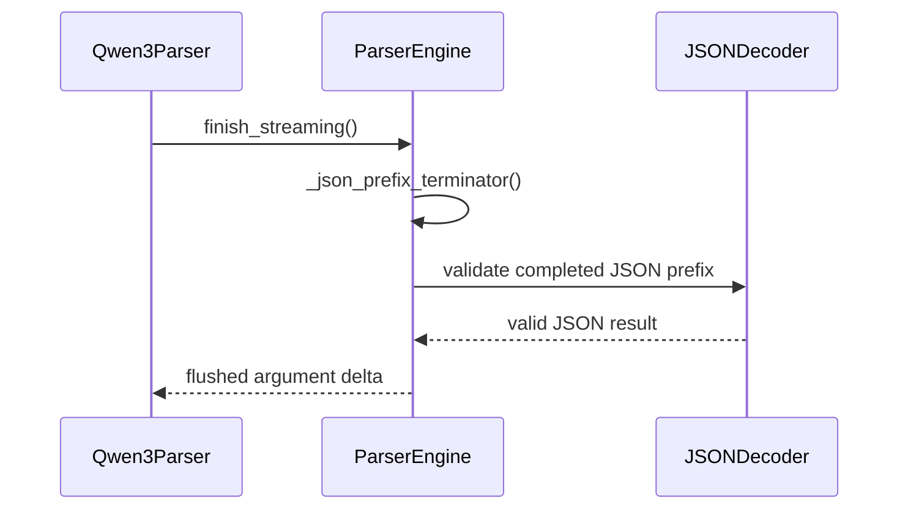

# [Bugfix][Parser] Terminate streamed tool arguments the flush cannot extend

[Upstream PR](https://github.com/vllm-project/vllm/pull/53739) · state: open · merged: False

## Original PR description

## Purpose

A streaming tool call can end with `finish_reason` set while `arguments` is cut off mid-string. Any client that calls `json.loads` on the accumulated arguments fails on it. Reproduced live on Qwen3.8-27B in 7 of 25 requests sent straight at the worker, no proxy in the path.

`_safe_arg_prefix` (`parser_engine.py:299` on main at `8a2364605c0b`) deliberately streams unterminated string values for prefix-stable keys. Its own docstring (`:306-308`) carries the contract: "String values for keys in `string_keys` are prefix-stable, so stream their unterminated content instead of buffering long arguments until the closing tag arrives." Something has to close them, and that something is the flush.

`_flush_arg_converter` (`parser_engine.py:1052` on main) re-derives the arguments with `partial=False`. Four of the seven in-tree converters build their result from completed parameters and fold the still-open one in only under `if partial:`. So when generation ends while a parameter is open, the non-partial re-derivation **drops that parameter**, and the result is neither longer than nor a prefix of what was already streamed. Both guards (`:1068-1070`) fail, the function returns `None`, and nothing ever terminates the prefix the client is holding.

This is not conditional on the model misbehaving. Anything that ends generation with a parameter open reaches it: a `max_tokens` stop, a stop string, or a malformed continuation.

### Blast radius, measured

On main at `8a2364605c0b`, 13 engine parsers set an `arg_converter`, through 7 converters. Each converter called directly with one complete and one open string parameter:

| converter | parsers | `partial=True` -> `partial=False` |
|---|---|---|
| `_qwen3_arg_converter` | qwen3, seed_oss, nemotron_v3, granite_thinking_parser | drops the open parameter, 75 chars -> 21 |
| `_minimax_m2_arg_converter` | minimax_m2 | drops the open parameter, 75 -> 21 |
| `_glm47_arg_converter` | glm47_moe, ling3 | drops the open parameter, 75 -> 21 |
| `_dsml_arg_converter` | deepseek_v4, deepseek_v32, deepseek_v41 | drops the open parameter, 75 -> 21 |
| `_inkling_arg_converter` | inkling | returns the same unterminated span, 73 -> 73, so the flush has nothing to append |
| `_granite_arg_converter` | granite (#49648) | same as inkling, 73 -> 73 |
| `_gemma4_arg_converter` | gemma4 | not affected, keeps the open parameter, 75 -> 75 and parses |

12 of the 13 parsers use a converter that reaches the defect. gemma4 does not, which is why the fix sits at the engine's guard rather than in any one converter. kimi_k2 and mistral set no `arg_converter`, return early and are unaffected.

End to end through one parser per converter, EOS at every token of a call whose last string parameter is open, one token per delta: 62 of 98 cuts end with unparsable `arguments` for qwen3, 59 of 109 for minimax_m2, 59 of 130 for glm47_moe, 65 of 155 for deepseek_v4, and 73 of 73 for both inkling and granite. With this PR merged into main, none of the six ends on partial JSON; inkling and granite end with no arguments at all on 6 cuts each (known limit below).

The two shapes need two branches, and both are in this change: the four dropping converters fail the `startswith` guard, and inkling and granite fail the length guard by returning exactly what was already sent.

### The fix

Close what was already streamed instead of emitting nothing. `_json_prefix_terminator` scans the prefix for an open escape, an open string and unbalanced brackets, appends the shortest suffix that makes it parse, and verifies with `json.loads` before returning it. If it cannot make the prefix parse it returns `""` and the old `None` behavior stands, so this can only turn an unparsable message into a parseable one.

The client gets the truncated value rather than an unparsable message. Truncation is already the semantics here, since the model never produced the rest.

Known limits. EOS inside the first key of an inkling or granite args object (`{"pa`) streams no arguments at all, 6 of the 73 cuts above; on main those 6 stream the partial key and do not parse either. And this PR changes only the stream: a truncated inkling or granite call still returns the unterminated span as its non-streaming `arguments` (`{"path": "README.md", "content": "# Title...`), on main, on main with the four converter PRs below, and with this PR.

### Coercion must not rewrite the streamed prefix

`_fix_arg_types` (`parser_engine.py:381` on main) re-serialized the whole object with `json.dumps` (`:405`) whenever it coerced any value. inkling and granite pass the model's JSON through verbatim, so a streamed prefix with compact separators, a `\u00e9` escape or newline indentation stopped being a prefix of the flush result, and the flush closed what was streamed instead. At `9b25b6123c` that lost data with no error. It now re-serializes only the coerced top-level values, in place, and keeps every other character.

Through `InklingParser`, one token per delta, schema `s: string, n: integer, t: string`:

| args | main `8a2364605c0b` | `9b25b6123c` | `9c69f476174d` |
|---|---|---|---|
| `{"s":"a","n":"42","t":"b"}` | `{"s":"a","n":"42","t":"b` (unparsable) | `{"s":"a","n":null}` | `{"s":"a","n":42,"t":"b"}` |
| `{"s":"a","t":"b","n":"42"}` | `{"s":"a","t":"b","n":` (unparsable) | `{"s":"a","t":"b"}` | `{"s":"a","t":"b","n":42}` |
| `{"s": "\u00e9", "n": "42", "t": "b"}` | unparsable | `{"s": "\u00e9", "n": null}` | `{"s": "\u00e9", "n": 42, "t": "b"}` |
| `{"s": "a", "n": "42", "t": "b"}` | unparsable | `{"s": "a", "n": 42, "t": "b"}` | `{"s": "a", "n": 42, "t": "b"}` |

Over 11 such inputs, 5 ended wrong at `9b25b6123c` and 0 at `9c69f476174d`, where the streamed arguments also match the non-streaming result byte for byte in all 11. Granite, merged with main, gives the same 5 and 0. The `null` arrived with the #48706 port in `4aacd85b9a`: at `b3fbaf77d4` the compact middle case ended `{"s":"a","n":"42","t":"b"}`, parseable, with `n` still a string. The dropped last field dates to `67f2f7c13f`.

For converters that already build their output with `json.dumps(..., ensure_ascii=False)` (qwen3, minimax_m2, glm47, dsml, gemma4) the new output is byte-identical to the old one: 60,000 randomized inputs over 3 seeds, 0 differences. For inkling and granite, non-streaming `arguments` now keep the model's own formatting when a value is coerced, as they already did when nothing was coerced.

### Relationship to other work

- **#57707** (issue #57699) **and #58349, #58418, #58437** (issue #57827) fix the truncation one converter at a time: each makes the `partial=False` pass keep the open trailing parameter, for qwen3, minimax_m2, glm47 and dsml (deepseek_v4, v32, v41). That is a converter-level fix; this PR is engine-level. For those four converters the two overlap, and the converter fixes keep more: a truncated `"count": 12` survives as `12`, where this PR alone withholds it, and deepseek_v4's open string survives in full, where this PR alone closes it as `""`. They also fix the non-streaming result, which this PR does not touch: with this PR alone, non-streaming `arguments` for those four still drop the open parameter (`{"path": "README.md"}`) while the stream carries its truncated content. I applied all four to main `8a2364605c0b` without this PR's source: EOS at every token ends parseable for qwen3, minimax_m2, glm47_moe and deepseek_v4 (0 unparsable in 98, 109, 130 and 155 cuts), and this PR's four Qwen3 tests pass. What they cannot reach is a converter that returns the model's JSON verbatim. On that tree inkling and granite stay at 73 of 73 unparsable, and 32 of this PR's tests fail: all 29 cases in `TestTruncatedArgsFlush` (24 truncation, 5 coercion) and the three #48706 middle-field tests. The dangling `"key": ` and the partial `\u` escape are withheld in `_safe_arg_prefix`, and in these runs only inkling and granite need that: for qwen3, minimax_m2 and glm47 the converter PRs alone also fix a truncated integer and a truncated `"ok": tr`, and `json.dumps` output never ends inside an escape. With this PR and all four merged into main, `pytest tests/parser` gives 5211 passed, and the 12 qwen3, minimax_m2, glm47_moe and deepseek_v4 outputs are byte-identical to the four PRs alone.
- **#46303** merged on 2026-09-23 as `b33c8a657d48`. On main, `serving.py:765-770` reports `tool_calls` only when the engine's own finish reason is `stop`, so a `max_tokens` cutoff now keeps `length`. A stop string still reports `tool_calls`. It changes only `chat_completion/serving.py` and its test, so the payload is still unparsable on main without this PR, as the sweep above shows. All 7 of my field captures predate it and report `finish_reason: tool_calls`.
- **#48706** fixes the coercion-instability class in `_safe_arg_prefix`: a non-string middle field is coerced at flush time and breaks the `startswith` invariant. This PR now carries that fix. Both PRs change `_safe_arg_prefix`, and #48706's unconditional clip, applied here, fails 5 of this PR's tests (the `literal` and `sign` cases of `TestTruncatedArgsFlush`, at EOS and at `<|end_message|>`, plus `test_schema_typed_trailing_string_is_withheld_with_its_key`). ZhengDeL ported it onto this branch in amittell/vllm#2, adding a `last_comma` condition that keeps a trailing field withheld along with its key. That port is `4aacd85b9a`, with his authorship and mahadrehmann and muhammadfawaz1 as co-authors. On top of it, `90105e1762` stops an interrupted call from closing a finished field as `null`, `9b25b6123c` withholds middle values only when the tick's JSON does not parse, so Qwen3 and the other `json.dumps` converters keep streaming after a non-string field, and `9c69f476174d` stops the flush's coercion from rewriting what inkling and granite already streamed. With this PR merged, #48706's fix is in, along with three of its four tests. The fourth, the Qwen3 close-tag test, is replaced as described under Test Plan.
- **#47137** (closed) documented the same trigger class from the other side, content/markup divergence when generation terminates via `max_tokens` or a stop string before the tool call is promoted. Different code path, same class of cutoff.
- **#47761** (closed) reported the same error string from `qwen3_coder` on the ParserEngine path. I am not claiming it: the reporter saw it on v0.23.0 as well as v0.24.0, and `vllm/parser/engine/parser_engine.py` does not exist at v0.23.0, so at least part of their report has a different cause.

Not a duplicate. Searched open PRs on 2026-09-25 for `_flush_arg_converter`, `streamed_json`, `_safe_arg_prefix`, `_fix_arg_types`, "unterminated tool call arguments", "tool arguments unterminated", "parser engine flush arguments" and "streamed tool arguments". Besides the PRs above, #55497 adds a warning log in the same `_flush_arg_converter` branch and leaves the prefix unterminated, and #51141 makes `_safe_arg_prefix` incremental for performance. Both conflict textually with this PR (`git merge-tree` against `9c69f476174d`: #55497 in `parser_engine.py`, #51141 in `parser_engine.py` and both test files); neither closes the prefix or touches the coercion re-serialization.

## Test Plan

Two regressions in `tests/parser/engine/test_qwen3.py`, one per trigger:

- `test_unclosed_parameter_still_streams_valid_json` - the model reopens `<tool_call>` without closing the current parameter.
- `test_truncated_parameter_still_streams_valid_json` - generation simply stops mid-value, no stray markup at all.

Both feed one character at a time, which is the worst case for the prefix invariant and the only way to hit the boundary reliably. An earlier version of the first test used natural chunk boundaries and passed with the fix reverted, because `<tool_call>` arrived as a complete literal and the incremental lexer transitioned cleanly.

Sweeping every single split point of both inputs makes the boundary explicit:

| input | length | split points | unparsable, unpatched | unparsable, patched |
|---|---|---|---|---|
| reopened `<tool_call>` | 174 | 173 | 12 | 0 |
| plain truncation | 131 | 130 | 12 | 0 |

In both cases the 12 reproducing boundaries are exactly positions 1 to 12, inside the opening `<tool_call>\n` literal, which is what forces the lexer to hold the prefix across the chunk edge. Char-by-char feeding reproduces on both and is what the committed tests use.

```bash
python -m pytest -q tests/parser/engine/test_qwen3.py
python -m pytest -q tests/parser/
```

### Coercion-safe prefixes

- `TestCoercionInstabilityRegression` (`tests/parser/engine/test_parser_engine.py`): integer, boolean and null middle fields must end coerced and untruncated. All 3 fail at `b3fbaf77d4`.
- `TestTruncatedArgsFlush` (`tests/parser/engine/test_inkling.py`) gains three shapes with a non-string field first: `comma_after_number`, `literal_after_number` and `literal_after_string_after_number`, each at EOS and at `<|end_message|>`. All 6 fail at `4aacd85b9a` and pass at `90105e1762`.
- `test_streaming_string_after_int_param_streams_before_close` (`tests/parser/engine/test_qwen3.py`) goes through the Qwen3 grammar. It fails at `90105e1762` and passes at `9b25b6123c`.
- `TestTruncatedArgsFlush::test_coercion_keeps_the_streamed_prefix` (5 shapes: compact first, middle and last field, a `\u00e9` escape, newline-indented JSON) and `TestFixArgTypes::test_only_coerced_values_are_rewritten`: 5 of the 6 fail at `9b25b6123c` and all pass at `9c69f476174d`. `compact_first` passes at `9b25b6123c` too, because the streamed prefix stops at `{"n":` and `json.dumps` writes `{"n": 42`, so it guards that shape rather than reproducing the bug.

```
pytest tests/parser, 9c69f476174d                              4778 passed (9b25b6123c: 4772)
pytest tests/parser, merged with main 8a2364605c0b               5194 passed (9b25b6123c merged: 5188)
pytest tests/parser, merged with main + #57707/#58349/#58418/#58437   5211 passed
engine consumers outside tests/parser (tool_parsers, tool_use, reasoning)
                                                               202 passed, 5 skipped, same at 9b25b6123c
                              Linux x86_64, CPU torch, VLLM_TARGET_DEVICE=cpu, 0 errors
pre-commit on the changed files, including mypy 3.10 and 3.12: all passed
```

## Test Result

As measured when this PR was opened, with the two Qwen3 tests; current suite numbers are under Test Plan.

```
unpatched engine, both tests kept:  2 failed, 51 deselected
                                    json.decoder.JSONDecodeError:
                                    Unterminated string starting at: line 1 column 34 (char 33)
                                    args = '{"path": "README.md", "content": "# Title\n\nbody text that stops mid-sen'
patched:                            53 passed
whole parser suite, patched:        4054 passed, 24 errors in 146.39s
```

The 24 errors were all `tests/parser/test_harmony.py::TestAdjustRequest` and were a missing dependency in that test image, not this change. Control on the same tree with the engine reverted: `40 passed, 24 errors`, the same 24.

The red arm reproduces the exact error string seen in production, including the column.

### Field evidence

Qwen3.8-27B-NVFP4, temperature 1.0, top_p 0.95, `max_tokens` 3000, one `write_file` tool with `path` and `content` string properties, prompt asking for a 40-line markdown document. Requests sent directly to the vLLM worker, so no router, gateway or proxy is in the path. 7 of 25 requests produced unparsable `arguments`:

| run | finish_reason | arguments len | frames | stray markup in arguments |
|---|---|---|---|---|
| 01 | tool_calls | 1930 | 156 | no |
| 02 | tool_calls | 948 | 88 | yes |
| 05 | tool_calls | 4409 | 349 | no |
| 07 | tool_calls | 2688 | 218 | no |
| 16 | tool_calls | 640 | 54 | yes |
| 20 | tool_calls | 2127 | 187 | no |
| 24 | tool_calls | 4263 | 343 | no |

All 7 fail with `Unterminated string`. 5 of the 7 carry no stray markup at all: the document just stops, which is what a `max_tokens` cutoff looks like from the client side. Run 05 ends `... confirm the handler module is importable from the worker environment.` with no closing quote and no closing brace.

Two caveats on that rate, because it is not a field rate. `max_tokens: 3000` against a prompt asking for 40+ lines manufactures length stops, so 7 of 25 overstates what a caller with a large budget would see. And the harness only persisted failures, so the 7 files are the failures out of runs indexed 0 to 24, not a sample of all outcomes.

### Live end-to-end validation (matched patched vs unpatched arms)

Unit tests establish the mechanism; this establishes that the fix removes the defect from a real server.

Host kebab-spark-3, NVIDIA GB10 (sm_121), aarch64. vLLM `0.26.1rc1.dev1164+g794b7b354`, editable install of this branch. Model `unsloth/Qwen3.8-27B-NVFP4`, snapshot `a767244d27bd`, on local NVMe. Identical server flags in all four runs:

```
vllm serve <model> --served-model-name qwen38 --port 8300 \
  --gpu-memory-utilization 0.6 --max-model-len 8192 \
  --enable-auto-tool-choice --tool-call-parser qwen3_xml --trust-remote-code
```

The parser actually selected was read from the live interpreter rather than the log: `qwen3_xml -> Qwen3EngineToolParser`, `_parser_engine_cls = vllm.parser.qwen3.Qwen3Parser`, `issubclass(Qwen3Parser, ParserEngine) = True`, `_flush_arg_converter` present. So the changed code is on the path.

Arms were switched by applying and reverting the isolated `parser_engine.py` diff on ONE install (pure Python, no rebuild), restarting the server between arms, and asserting the patch state from the running venv each time via `hasattr(Qwen3Parser, "_close_streamed_json")`.

**Run A, the sampling parameters from the field capture** (temperature 1.0, top_p 0.95, `max_tokens` 3000):

| arm | malformed `arguments` | N |
|---|---|---|
| unpatched | 4 | 40 |
| patched | 0 | 40 |

All 4 unpatched failures carry the identical signature `Unterminated string starting at: line 1 column 34 (char 33)`, char 33 being the opening quote of the `content` value. The final SSE frame of each is an ordinary mid-word content delta carrying `finish_reason`, with no closing flush delta at all:

```
{"choices":[{"delta":{"tool_calls":[{"index":0,"function":{"arguments":" to"}}]},
  "finish_reason":"tool_calls","stop_reason":null}]}
```

**Run A's patched arm is reported for completeness and is not sufficient on its own.** None of its 40 requests reached the token cap (max 1251 argument deltas, every content value ended cleanly), so that arm never exercised the trigger. In the unpatched arm 8 of 40 did reach the cap: 4 during reasoning before any tool call (empty `arguments`), and 4 inside an open `<parameter=>`, all 4 of which were malformed. Conditional on the trigger, that is 4 of 4.

**Run B, trigger forced on every request.** Identical to Run A except `max_tokens` 400 and `chat_template_kwargs: {"enable_thinking": false}`, applied to BOTH arms. Removing the variable-length reasoning block makes the cap land inside the tool call rather than inside reasoning:

| arm | malformed `arguments` | N |
|---|---|---|
| unpatched | **40** | 40 |
| patched | **0** | 40 |

All 80 requests truncated at the cap (SSE frame counts 341 to 364 against `max_tokens` 400), so the triggering condition held on every one. All 40 unpatched failures were again exactly `Unterminated string starting at: line 1 column 34 (char 33)`. All 40 patched responses parse, with shape `{"path": "README.md", "content": ...}`, content truncated mid-token (1340 / 1495 / 1759 chars for min / median / max) and a final delta of exactly `"}`.

Separately, the 4 malformed `arguments` strings captured in unpatched Run A were fed to `_json_prefix_terminator` directly: each yields terminator `"}` and then parses, preserving `path` and the truncated `content` (1247 to 3708 chars).

0 malformed in 80 patched requests, against 4 of 40 at the natural rate and 40 of 40 with the trigger forced.

### The finish_reason made this harder to notice

On every failure in both runs, `finish_reason` was `"tool_calls"` and `stop_reason` was `null` - never `"length"`. On that build (`g794b7b354`), `serving.py:761-762` set `finish_reason` to `tool_calls` whenever a tool call was streamed, whatever the engine's real stop reason. #46303 (`b33c8a657d48`, 2026-09-23) narrowed that to `output.finish_reason == "stop"` (`serving.py:765-770` on main), so a `max_tokens` cutoff now reports `length`. A stop-string cutoff still reports `tool_calls`, and on main without this PR its `arguments` can still end mid-value with nothing in the response saying so.

## Model evaluation

None applies, and the reason is worth stating rather than leaving as a silent omission. This change runs after generation, in the parser's end-of-stream flush and in schema coercion of the parsed arguments. It cannot affect sampling, logits or model output, and accuracy benchmarks do not exercise tool-call streaming at all.

The question that does matter is whether it alters output on well-formed tool calls. Measured when this PR was opened: six well-formed Qwen3 tool calls (single parameter, two parameters, embedded quotes and newlines and backslashes, JSON braces inside the value, an empty value, multibyte content), each fed as a whole string, character by character, and at every single split point - 794 stream variants in total - through both the patched and the unpatched engine. The streamed `arguments` are byte-identical between the two arms in all 794 variants.

Two honest notes on that number. 84 of the 794 variants produce non-empty arguments, and all 84 are valid JSON; the whole-string and character-by-character feeds produce the complete correct JSON for all six inputs. The remaining variants emit nothing, in both arms alike - a pre-existing interaction between a two-chunk split landing mid-literal and the incremental lexer, which this PR does not touch and does not change.

For the coercion change in `9c69f476174d`: `json.dumps`-built converter output is byte-identical to before (60,000 randomized inputs, above). Well-formed Inkling calls change only where a value is coerced, and there the streamed arguments now equal the non-streaming result.

## Notes

AI assistance (Claude Code) was used for the code reading, the converter measurements, the tests and this description. The submitter reviewed every changed line and ran the tests above.


## Review and discussion

### reviews

- claude · COMMENTED · 2026-08-25T14:21:03Z · [source](https://github.com/vllm-project/vllm/pull/53739#pullrequestreview-5020055425)

## Claude Code Review

This pull request is from a fork — automated review is disabled. A repository maintainer can comment `@claude review` to run a one-time review.

- chatgpt-codex-connector · COMMENTED · 2026-08-25T14:28:30Z · [source](https://github.com/vllm-project/vllm/pull/53739#pullrequestreview-5020141145)


### 💡 Codex Review

Here are some automated review suggestions for this pull request.

**Reviewed commit:** `eb7cdb959c`
    

<details> <summary>ℹ️ About Codex in GitHub</summary>
<br/>

[Your team has set up Codex to review pull requests in this repo](https://chatgpt.com/codex/cloud/settings/general). Reviews are triggered when you
- Open a pull request for review
- Mark a draft as ready
- Comment "@codex review".

If Codex has suggestions, it will comment; otherwise it will react with 👍.


Codex can also answer questions or update the PR. Try commenting "@codex address that feedback".
            
</details>

- copilot-pull-request-reviewer · COMMENTED · 2026-09-04T06:43:42Z · [source](https://github.com/vllm-project/vllm/pull/53739#pullrequestreview-5110005228)

### 🟢 Approval recommended

The fix is well-scoped, includes deterministic regression coverage, and the remaining feedback is limited to a documentation clarification.

<details>
<summary>Pull request overview</summary>

Fixes a ParserEngine streaming edge case where tool-call `arguments` can be left as an unterminated JSON prefix when generation ends mid-parameter, by terminating the already-streamed prefix during the end-of-stream flush so clients can successfully `json.loads` the accumulated arguments.

**Changes:**
- Update `_safe_arg_prefix` to avoid streaming a trailing non-streamable key’s dangling separator (so the flush can safely drop an unfinished parameter).
- Extend `_flush_arg_converter` with `_close_streamed_json` + `_json_prefix_terminator` to append the shortest suffix that makes the streamed prefix parseable.
- Add targeted regression tests for Qwen3 streaming truncation/unclosed-parameter cases and unit tests for the new prefix-termination logic.
</details>

<details>
<summary>File summaries</summary>

| File | Description |
| ---- | ----------- |
| `vllm/parser/engine/parser_engine.py` | Ensures streamed tool-call argument prefixes are terminated into parseable JSON when the flush cannot extend them. |
| `tests/parser/engine/test_qwen3.py` | Adds streaming regression tests for truncated/unclosed Qwen3 tool parameters (including typed-schema behavior). |
| `tests/parser/engine/test_parser_engine.py` | Updates `_safe_arg_prefix` expectations and adds unit tests for `_json_prefix_terminator`. |
</details>

<details>
<summary>Review details</summary>

- **Files reviewed:** 3/3 changed files
- **Comments generated:** 1
- **Review effort level:** Lite
</details>

---

💡 <a href="/vllm-project/vllm/new/main?filename=.github/skills/code-review/SKILL.md" class="Link--inTextBlock" target="_blank" rel="noopener noreferrer">Add a `code-review` agent skill</a> or configure MCP servers for context-aware, tailored reviews. <a href="https://docs.github.com/copilot/how-tos/use-copilot-agents/request-a-code-review/use-code-review?tool=webui#mcp-servers-and-agent-skills" class="Link--inTextBlock" target="_blank" rel="noopener noreferrer">Learn more in the docs.</a>

- amittell · COMMENTED · 2026-09-04T09:23:22Z · [source](https://github.com/vllm-project/vllm/pull/53739#pullrequestreview-5111250014)

(No body; status only.)

- amittell · COMMENTED · 2026-09-04T09:23:24Z · [source](https://github.com/vllm-project/vllm/pull/53739#pullrequestreview-5111250312)

(No body; status only.)

- amittell · COMMENTED · 2026-09-04T09:23:27Z · [source](https://github.com/vllm-project/vllm/pull/53739#pullrequestreview-5111250626)

(No body; status only.)

- amittell · COMMENTED · 2026-09-04T09:23:29Z · [source](https://github.com/vllm-project/vllm/pull/53739#pullrequestreview-5111250934)

(No body; status only.)

### issue_comments

- coderabbitai · comment · 2026-09-04T06:34:27Z · [source](https://github.com/vllm-project/vllm/pull/53739#issuecomment-5536681375)

<!-- This is an auto-generated comment: summarize by coderabbit.ai -->
<!-- review_stack_entry_start -->

[](https://app.coderabbit.ai/change-stack/vllm-project/vllm/pull/53739)

<!-- review_stack_entry_end -->
<!-- recent_review_start -->

No actionable comments were generated in the recent review. 🎉

<details>
<summary>ℹ️ Recent review info</summary>

<details>
<summary>⚙️ Run configuration</summary>

**Configuration used**: Repository UI

**Review profile**: CHILL

**Plan**: Team

**Run ID**: `61b77342-4d7b-4f45-b708-768d8755917c`

</details>

<details>
<summary>📥 Commits</summary>

Reviewing files that changed from the base of the PR and between 6b2324d7b7d087711486692181b8730cb24522e8 and a1fe257474af168fdfa9d9e132e89ac2ab22f2c0.

</details>

<details>
<summary>📒 Files selected for processing (1)</summary>

* `vllm/parser/engine/parser_engine.py`

</details>

<details>
<summary>🚧 Files skipped from review as they are similar to previous changes (1)</summary>

* vllm/parser/engine/parser_engine.py

</details>

**Included review availability:** Your plan provides up to 10 included reviews per hour; 8 remain after this review.

</details>

---


<!-- recent_review_end -->
<!-- walkthrough_start -->

## Walkthrough

ParserEngine now withholds incomplete trailing JSON values, avoids partial escapes, and completes safe prefixes during flushes. Parser tests cover prefix handling and terminators. Qwen3 tests cover unclosed and truncated string and typed parameters.

### Changes

**Streaming JSON argument handling**

|Layer / File(s)|Summary|
|---|---|
|**Safe argument prefix selection** <br> `vllm/parser/engine/parser_engine.py`, `tests/parser/engine/test_parser_engine.py`|ParserEngine retains complete top-level values, withholds incomplete non-string values, and avoids partial escape sequences. Tests cover separators, containers, arrays, escapes, and schema-typed strings.|
|**JSON prefix flush completion** <br> `vllm/parser/engine/parser_engine.py`, `tests/parser/engine/test_parser_engine.py`|Flush handling generates validated suffixes for unterminated strings, containers, and supported dangling values.|
|**Qwen3 truncated parameter validation** <br> `tests/parser/engine/test_qwen3.py`|Qwen3 tests verify valid JSON after unclosed, truncated, and schema-typed parameter streams.|

**Estimated code review effort:** 4 (Complex) | ~45 minutes


### Sequence Diagram(s)



<!-- walkthrough_end -->
<!-- final_review_risk_start -->
**Merge Risk:** _⚪ Minimal_ · up to `a1fe2`
<!-- final_review_risk_coverage:{"sourceCommitId":"a1fe257474af168fdfa9d9e132e89ac2ab22f2c0","coveredCommitId":"a1fe257474af168fdfa9d9e132e89ac2ab22f2c0","kind":"reviewed"} -->

The change completes truncated streamed tool-call JSON arguments and includes reported parser and Qwen3 regression coverage. No concrete merge-blocking risk remains.
<!-- final_review_risk_end -->
<!-- pre_merge_checks_walkthrough_start -->

<details>
<summary>🚥 Pre-merge checks | ✅ 4 | ❌ 1</summary>

### ❌ Failed checks (1 warning)

|     Check name     | Status     | Explanation                                                                                                                                                                                 | Resolution                                                                         |
| :----------------: | :--------- | :------------------------------------------------------------------------------------------------------------------------------------------------------------------------------------------ | :--------------------------------------------------------------------------------- |
| Docstring Coverage | ⚠️ Warning | Docstring coverage is 40.00% which is insufficient. The required threshold is 80.00%. Docstring coverage is scoped to functions touched by this diff. Analyzed 15 functions across 3 files. | Write docstrings for the functions missing them to satisfy the coverage threshold. |

<details>
<summary>✅ Passed checks (4 passed)</summary>

|         Check name         | Status   | Explanation                                                                                                                                      |
| :------------------------: | :------- | :----------------------------------------------------------------------------------------------------------------------------------------------- |
|     Linked Issues check    | ✅ Passed | Check skipped because no linked issues were found for this pull request.                                                                         |
| Out of Scope Changes check | ✅ Passed | Check skipped because no linked issues were found for this pull request.                                                                         |
|         Title check        | ✅ Passed | The title clearly identifies the parser bugfix: terminating streamed tool arguments when the flush cannot extend them.                           |
|      Description check     | ✅ Passed | The description directly explains the unterminated streamed JSON bug, the engine-level fix, regression coverage, test results, and known limits. |

</details>

</details>

<!-- pre_merge_checks_walkthrough_end -->
<!-- finishing_touch_checkbox_start -->

<details>
<summary>✨ Finishing Touches 💡 1</summary>

<!-- finishing_touch_suggestion:fix_ci -->
<details open>
<summary>🛠️ Fix failing CI checks 💡</summary>

- [ ] <!-- {"checkboxId": "6d21cfe8-ec3f-40e2-9222-b8318b64d3b0", "radioGroupId": "fix-ci-output-choice-group-unknown_comment_id"} -->   Create stacked PR
- [ ] <!-- {"checkboxId": "9f0d24fb-b419-4f01-baf0-8b26b6424f34", "radioGroupId": "fix-ci-output-choice-group-unknown_comment_id"} -->   Commit on current branch

</details>

</details>

<!-- finishing_touch_checkbox_end -->
<!-- tips_start -->

---

Thanks for using [CodeRabbit](https://coderabbit.ai?utm_source=oss&utm_medium=github&utm_campaign=vllm-project/vllm&utm_content=53739)! It's free for OSS, and your support helps us grow. If you like it, consider giving us a shout-out.

<details>
<summary>❤️ Share</summary>

- [X](https://twitter.com/intent/tweet?text=I%20just%20used%20%40coderabbitai%20for%20my%20code%20review%2C%20and%20it%27s%20fantastic%21%20It%27s%20free%20for%20OSS%20and%20offers%20a%20free%20trial%20for%20the%20proprietary%20code.%20Check%20it%20out%3A&url=https%3A//coderabbit.ai)
- [Mastodon](https://mastodon.social/share?text=I%20just%20used%20%40coderabbitai%20for%20my%20code%20review%2C%20and%20it%27s%20fantastic%21%20It%27s%20free%20for%20OSS%20and%20offers%20a%20free%20trial%20for%20the%20proprietary%20code.%20Check%20it%20out%3A%20https%3A%2F%2Fcoderabbit.ai)
- [Reddit](https://www.reddit.com/submit?title=Great%20tool%20for%20code%20review%20-%20CodeRabbit&text=I%20just%20used%20CodeRabbit%20for%20my%20code%20review%2C%20and%20it%27s%20fantastic%21%20It%27s%20free%20for%20OSS%20and%20offers%20a%20free%20trial%20for%20proprietary%20code.%20Check%20it%20out%3A%20https%3A//coderabbit.ai)
- [LinkedIn](https://www.linkedin.com/sharing/share-offsite/?url=https%3A%2F%2Fcoderabbit.ai&mini=true&title=Great%20tool%20for%20code%20review%20-%20CodeRabbit&summary=I%20just%20used%20CodeRabbit%20for%20my%20code%20review%2C%20and%20it%27s%20fantastic%21%20It%27s%20free%20for%20OSS%20and%20offers%20a%20free%20trial%20for%20proprietary%20code)

</details>


<sub>Comment `@coderabbitai help` to get the list of available commands.</sub>

<!-- tips_end -->

- amittell · comment · 2026-09-04T09:26:08Z · [source](https://github.com/vllm-project/vllm/pull/53739#issuecomment-5538429507)

Follow-up at 5448bf23a, 6b2324d7b and a1fe2574 for the four review findings.

The two substantive ones were real and are fixed at the source. `_safe_arg_prefix` was streaming a non-streamable trailing value as its separator alone, so a truncation inside a schema-typed number, bool, object or array left the client holding `{"path": "README.md", "count": ` with no valid completion; it now stops after the last complete top-level value. It could also end a streamed string inside a `\uXXXX` escape, which no suffix can complete; it now tracks escapes and never ends inside one. `_json_prefix_terminator` completes a dangling `:` or an array `,` with `null` as defense in depth.

Red/green on kebab-spark-3 (GB10, vllm 0.26.1rc1.dev1193+gc2294420c): with the source change reverted, 17 of the 37 cases in `TestSafeArgPrefix` and `TestJsonPrefixTerminator` fail; with it, `tests/parser/engine` is 3,814 passed and `tests/parser` excluding `test_harmony.py` is 4,035 passed. That one file needs a vocab download the test host cannot reach and fails identically on the base commit.

Test docstrings shortened as asked, and the `null` comment corrected: it no longer claims schema validity, only that the prefix parses.


- amittell · comment · 2026-09-22T19:26:13Z · [source](https://github.com/vllm-project/vllm/pull/53739#issuecomment-5782620350)

Rebased onto current main (`f944491db9`, 2026-09-22) and re-verified. `git range-diff` reports all five commits unchanged, so the diff under review is the same one.

The defect is still on main. `_flush_arg_converter` still returns `None` when the re-derived arguments are no longer a prefix of what was streamed (`parser_engine.py:1069-1070`), and `_safe_arg_prefix` still ends a non-streamable trailing value on its `"key": ` separator (`parser_engine.py:346` and `:348`).

Re-run at `af6a082bdf` on x86_64, CPU only (Python 3.12.14, torch 2.13.0+cpu, `VLLM_TARGET_DEVICE=cpu`):

```
pytest tests/parser/    this PR  4744 passed
                        main     4721 passed
```

Compared per test id: the 30 ids that only exist in this PR's run are its new cases, and all pass. 0 shared ids change outcome. 7 ids exist only on main, and they are the existing `TestSafeArgPrefix` cases whose expected value this PR changes on purpose, e.g. `{"a": 1}` now yields `""` instead of `{"a": `. That is the withheld separator from 5448bf23a.

Negative controls on `test_qwen3.py` + `test_parser_engine.py` (198 tests), a fresh copy of the tree per arm, with the named function swapped for main's version:

| `parser_engine.py` | failed |
|---|---|
| this PR | 0 |
| whole file from main | 28 |
| `_flush_arg_converter` from main only | 3, the three streaming regressions |
| `_safe_arg_prefix` from main only | 13 |

Each of the two changes fails its own tests when reverted alone.

ruff 0.14.0 check and format, typos 1.43.5, and the mypy 1.20.2 hook at `--python-version 3.10` are clean on the three changed files.


- amittell · comment · 2026-09-24T14:59:03Z · [source](https://github.com/vllm-project/vllm/pull/53739#issuecomment-5816598204)

Pushed `f589694c80` and `b3fbaf77d4`, both caught in review: the flush's extend branch, which this PR never touched, can also leave `arguments` unparsable.

**Case.** Inkling, tool schema `{s: string, n: integer}`, generation stops after `"s": "hello", "n": 4` (EOS, or `<|end_message|>` arriving while the args object is still open). Through the real `InklingParser`, one token per delta, at 462f6636ff:

```
streamed before the end: {"s": "hello"
flush appends:           , "n": 4
client holds:            {"s": "hello", "n": 4
json.loads:              Expecting ',' delimiter: line 1 column 22 (char 21)
```

**Cause.** `_inkling_arg_converter` returns the args span verbatim, even with `partial=False`, so when EOS cuts the object off, the non-partial result is itself unterminated. It is longer than what was streamed and starts with it, so `_flush_arg_converter` takes the extend branch, which sends `final_json[len(prev):]` without checking that `final_json` parses. The other converters (qwen3 and seed_oss, minimax_m2, glm47, dsml, gemma4) build their result with `json.dumps`. Called with `partial=False` at every EOS cut point of a well-formed call, none of them returned unparsable JSON; inkling did at 47 of 69.

**Fix.**

- `f589694c80`: in the extend branch, when `final_json` does not parse, append `_json_prefix_terminator(final_json)` to the diff. The reported case now ends `{"s": "hello", "n": 4}`.
- `b3fbaf77d4`: some spans have no completion: EOS inside or just after a key, right after a comma, inside a literal such as `tr` or a bare `-`, or inside a `\u` escape. For those the terminator returns `""`. Instead of sending the span, drop it and close the prefix already streamed with `_close_streamed_json`, the same as the branch above it does. `{"s": "hello", ` becomes `{"s": "hello"}`.

A `final_json` that parses is sent exactly as before.

**EOS at every character** inside six well-formed Inkling args objects, 209 cut points, streamed one token per delta:

| | unparsable `arguments` |
|---|---|
| 462f6636ff | 159 |
| f589694c80 | 74 |
| b3fbaf77d4 | 0 |

At b3fbaf77d4, 191 are valid JSON. The other 18 stop inside the first key (`{"`, `{"s`, `{"s"`), before any argument text was streamed. The call now carries its name with empty `arguments` rather than a fragment such as `{"s`. A strict `json.loads("")` still fails there, so for a call that never streamed an argument this trades a fragment for an empty string rather than making it parse.

**Tests.** `TestTruncatedArgsFlush` in `tests/parser/engine/test_inkling.py` covers nine truncation shapes, each ending at EOS and at `<|end_message|>`. All are fed through `InklingParser` one token per delta.

```
462f6636ff:  first 6 cases fail (Expecting ',' delimiter / Expecting value)
f589694c80:  those 6 pass; the 12 cases added in b3fbaf77d4 fail
b3fbaf77d4:  18 passed
pytest tests/parser/: 4744 / 4750 / 4762 passed, no errors (macOS arm64, CPU only)
```

**Well-formed output is unchanged.** I ran 2,730 feed variants: whole, one token or character per delta, and one split at every boundary. That is 826 Qwen3 variants across six shapes, and 1,904 Inkling variants in token and text-only mode, with and without a schema. The streamed `arguments` are byte-identical between 462f6636ff and b3fbaf77d4 in all 2,730, and all 1,904 Inkling variants go through the changed branch. As in the description's run, only 84 of the Qwen3 variants produce non-empty arguments, in both arms alike.


- amittell · comment · 2026-09-24T18:30:31Z · [source](https://github.com/vllm-project/vllm/pull/53739#issuecomment-5819872638)

Pushed `4aacd85b9a`, `90105e1762` and `9b25b6123c` on top of `b3fbaf77d4`. Together they bring #48706's coercion fix into this PR through ZhengDeL's port in amittell/vllm#2, and fix two things the port broke on this branch.

- `4aacd85b9a` is ZhengDeL's commit, cherry-picked with his authorship and the co-author credit for mahadrehmann and muhammadfawaz1 from #48706. It withholds a non-string middle value until the flush, so `_fix_arg_types` cannot rewrite bytes the client already holds. Through `InklingParser`, a complete call with a quoted integer (`"n": "42", "s": "hi"`) ended `{"n": "42", "s": "hi"}` at `b3fbaf77d4` and now ends `{"n": 42, "s": "hi"}`. Its `last_comma` condition is what lets it sit beside this PR: without it, 5 tests fail here (the `literal` and `sign` cases of `TestTruncatedArgsFlush`, at EOS and at `<|end_message|>`, plus `test_schema_typed_trailing_string_is_withheld_with_its_key`).
- `90105e1762`: withholding the middle value let the streamed prefix end on `"n": `, and when EOS left no completion, the `b3fbaf77d4` fallback closed that prefix with `null`. So `{"n": 42, ` ended `{"n": null}`. When it extends what was streamed, the span is now closed after its last complete value instead. EOS at every character of two Inkling args objects, 90 cut points: 27 replaced a finished value with `null` after the cherry-pick, 0 now, and 0 at `b3fbaf77d4`.
- `9b25b6123c`: the withholding only matters when the tick's JSON does not parse. Qwen3 and the other converters that build with `json.dumps` already coerce middle values while streaming, but under the clip they stopped streaming at the first non-string field. For an integer, then a 27-chunk string, that was 1 delta before `</parameter>` instead of 28, and it is 28 again. This commit also replaces `test_qwen3_partial_xml_close_tag_not_included_in_value`, which fed a partial close tag straight into an `ARG_VALUE_CHUNK`. The Qwen3 scanner does not emit one: `test_streaming_long_string_arg_before_parameter_end` splits the tag the same way and streams no tag text. The replacement goes through the Qwen3 grammar.

Well-formed calls through the Qwen3 and Inkling parsers, 549 feed variants: arguments are identical to `b3fbaf77d4` in 539. The other 10 are the quoted-integer input, now `{"n": 42, "content": "x"}`. `pytest tests/parser/engine`: 4371 passed. `pytest tests/parser`: 4748 passed, with the same 401 GPU-fixture setup errors as `b3fbaf77d4` (CPU-only Linux). `pre-commit run --files` on the four changed files passes, and so does the manual-stage `mypy-3.12` hook.

The #48706 section of the description is updated to match.


- amittell · comment · 2026-09-26T02:13:25Z · [source](https://github.com/vllm-project/vllm/pull/53739#issuecomment-5842279260)

Pushed `9c69f476174d`. It fixes a silent data loss this branch had on compact JSON, and the description is updated to match.

`_fix_arg_types` re-serialized the whole args object with `json.dumps` whenever it coerced a value. Inkling (and Granite on main) pass the model's JSON through verbatim, so with compact separators the streamed prefix stopped being a prefix of the flush result, and the flush closed what it had instead. Through `InklingParser`, one token per delta, with `n: integer`, at `9b25b6123c`:

- `{"s":"a","n":"42","t":"b"}` ended `{"s":"a","n":null}`: `t` dropped, `n` nulled, no error
- `{"s":"a","t":"b","n":"42"}` ended `{"s":"a","t":"b"}`
- spaced JSON did the same when an earlier string carried a `\u00e9` escape, or with newline indentation

The coercion now rewrites only the coerced top-level values, in place. 11 inputs: 5 ended wrong at `9b25b6123c`, 0 now, and the streamed arguments match the non-streaming result byte for byte. For the `json.dumps` converters (qwen3, minimax_m2, glm47, dsml, gemma4) the output is byte-identical to before, 60,000 randomized inputs and 0 differences. The new tests fail 5 of 6 on `9b25b6123c`; the sixth, `compact_first`, passes there because the prefix stops at `{"n":`.

Description changes:

- #46303 merged as `b33c8a657d48`, so a `max_tokens` cutoff now reports `length` on main. The finish_reason section says that, and that a stop string still reports `tool_calls`.
- #57707 (#57699) and #58349, #58418, #58437 (#57827) are in the relationship section. With all four on main and none of this PR, qwen3, minimax_m2, glm47_moe and deepseek_v4 end parseable at every EOS cut, and for a truncated integer or deepseek_v4's open string they keep more than this PR does. They also fix the non-streaming result, which this PR does not touch. Inkling and Granite stay at 73 of 73 cuts unparsable, and 32 of this PR's tests still fail there. One gap none of these close: a truncated Inkling or Granite call still returns the unterminated span as its non-streaming `arguments`. I left that out of this PR; the description lists it under known limits. All five together: `pytest tests/parser` 5211 passed.
- Blast radius recounted at `8a2364605c0b`: 13 engine parsers set an `arg_converter` through 7 converters, and 12 of them use an affected one. ling3 and nemotron_v3 use the glm47 and qwen3 converters, both on main and at this branch's base, so the old "no arg_converter" line was wrong.

`pytest tests/parser`: 4778 passed on the branch, 5194 merged with main `8a2364605c0b` (Linux x86_64, CPU only). Granite is only on main, so its regression test is not on this branch; merged with main, a 6-case Granite test passes, and fails 2 of 6 without this commit. Happy to add it if a maintainer wants main merged in.


- amittell · comment · 2026-10-05T20:08:53Z · [source](https://github.com/vllm-project/vllm/pull/53739#issuecomment-6002083340)

Scope, now that the per-parser PRs are up: #57707, #59882 and #58349/#58418/#58437 fix the qwen3, minimax_m2, glm47 and deepseek_v4 parsers one at a time. This PR covers what they don't: converters that pass the model's JSON through verbatim (Inkling, Granite), and keeping the streamed argument prefix consistent with the final arguments. It merges cleanly after #57707 or #59882.

@chaunceyjiang @sfeng33 could one of you take a look?


### inline_comments

- chatgpt-codex-connector · comment · 2026-08-25T14:28:30Z · [source](https://github.com/vllm-project/vllm/pull/53739#discussion_r3854012318)

File: `tests/parser/engine/test_qwen3.py` · line None

**<sub><sub></sub></sub>  Shorten the regression-test explanations**

Reduce these docstrings to a brief statement of the behavior under test. This block restates the parser implementation, production evidence, and chunk-boundary mechanics across fourteen lines, and the second test repeats another extended explanation; most of this is already evident from the test names, setup, and assertions, making the tests unnecessarily difficult to scan. The repository explicitly requires comments and docstrings to remain brief and direct.

AGENTS.md reference: [AGENTS.md:L125-L129](https://github.com/vllm-project/vllm/blob/eb7cdb959ca3533708ceb8b0051786aca685af44/AGENTS.md#L125-L129)

Useful? React with 👍 / 👎.

- chatgpt-codex-connector · comment · 2026-08-25T14:28:30Z · [source](https://github.com/vllm-project/vllm/pull/53739#discussion_r3854012334)

File: `vllm/parser/engine/parser_engine.py` · line 1276

**<sub><sub></sub></sub>  Complete dangling values before closing containers**

When the truncated parameter is schema-typed as a number, boolean, object, or array, `_safe_arg_prefix` can already have streamed a prefix such as `{"count": ` while the final converter drops that open parameter. This terminator only appends the closing `}`, producing `{"count": }`; `json.loads` rejects it and the method returns an empty suffix, so clients still receive unparseable arguments under the same truncation scenario this change is intended to fix. Handle a dangling key/value separator, for example by withholding it earlier or completing the missing value with a valid placeholder.

Useful? React with 👍 / 👎.

- chatgpt-codex-connector · comment · 2026-08-25T14:28:30Z · [source](https://github.com/vllm-project/vllm/pull/53739#discussion_r3854012342)

File: `vllm/parser/engine/parser_engine.py` · line 1242

**<sub><sub></sub></sub>  Finish partial Unicode escapes before quoting the string**

For converters that expose the model's JSON verbatim, notably Inkling, truncation can occur inside a Unicode escape such as `{"text":"\u12`. The scanner clears `escape` immediately after consuming `u` and does not track the required four hexadecimal digits, so it appends only the closing quote and brace; validation then fails and returns no suffix, leaving the streamed arguments malformed. Track incomplete `\uXXXX` escapes and complete or otherwise safely terminate them before closing the string.

Useful? React with 👍 / 👎.

- copilot-pull-request-reviewer · comment · 2026-09-04T06:43:41Z · [source](https://github.com/vllm-project/vllm/pull/53739#discussion_r3931565493)

File: `vllm/parser/engine/parser_engine.py` · line None

The comment claims `null` is "the one placeholder every schema type accepts", but JSON Schema commonly disallows `null` unless it's explicitly included (e.g., `type: integer`). Since this helper is focused on producing parseable JSON, it would be clearer to avoid implying schema validity and note that validation may still fail.

- amittell · comment · 2026-09-04T09:23:22Z · [source](https://github.com/vllm-project/vllm/pull/53739#discussion_r3932626562)

File: `vllm/parser/engine/parser_engine.py` · line 1276

Fixed in 5448bf23a, at both layers.

`_safe_arg_prefix` now stops after the last complete top-level value when the trailing value cannot stream, so `{"path": "README.md", "count": ` is never sent: the client gets `{"path": "README.md"` and the flush appends the rest. `_json_prefix_terminator` completes a dangling `:` or an array `,` with `null` as defense in depth, and still returns no suffix for an object after a comma, where any completion would invent a key.

Regression: `test_truncated_typed_parameter_still_streams_valid_json`, a schema-typed integer parameter truncated mid-value and fed one character at a time. With the source change reverted, 17 of the 37 cases in `TestSafeArgPrefix` and `TestJsonPrefixTerminator` fail; with it, `tests/parser/engine` is 3,814 passed on a GB10 (vllm 0.26.1rc1.dev1193+gc2294420c).

- amittell · comment · 2026-09-04T09:23:24Z · [source](https://github.com/vllm-project/vllm/pull/53739#discussion_r3932626815)

File: `vllm/parser/engine/parser_engine.py` · line 1242

Fixed in 5448bf23a, at the source rather than in the terminator.

`_safe_arg_prefix` now tracks `\uXXXX` while it streams a string and never ends the prefix inside an escape, so `{"text":"\u12` is cut back to `{"text":"` before anything is sent, and a complete escape streams as before. Every converter reaches the client through `_safe_arg_prefix` (`_compute_arg_delta`, parser_engine.py:946), Inkling included, so this covers the verbatim-JSON converters and not just the tag-shaped ones.

The terminator still yields no suffix for a partial escape, since any completion would invent characters, and that case is pinned in `TestJsonPrefixTerminator`.

- amittell · comment · 2026-09-04T09:23:27Z · [source](https://github.com/vllm-project/vllm/pull/53739#discussion_r3932627034)

File: `tests/parser/engine/test_qwen3.py` · line None

Done in 6b2324d7b. The two docstrings are one and four lines now; the mechanism stays documented on `_close_streamed_json`, which is where a reader hits it.

- amittell · comment · 2026-09-04T09:23:29Z · [source](https://github.com/vllm-project/vllm/pull/53739#discussion_r3932627291)

File: `vllm/parser/engine/parser_engine.py` · line None

Fair, and corrected in a1fe2574. JSON Schema rejects `null` unless the type admits it, so "the one placeholder every schema type accepts" was wrong.

The comment now says what the placeholder is actually for: making the prefix parse. The client is being handed a truncated call either way, and a `null` that fails the tool's schema is strictly better than arguments no JSON parser accepts, which is the failure this PR exists to remove.

## Changed files and fixed code

- `tests/parser/engine/test_inkling.py` · modified · additions 93 / deletions 2
  - [head](https://github.com/amittell/vllm/blob/c30a211476e936e0da9347a0aff4b9dda6ae0211/tests/parser/engine/test_inkling.py)
  - [base](https://github.com/vllm-project/vllm/blob/2bea22002d66a6c89d208fa682b40a89538f023c/tests/parser/engine/test_inkling.py)
- `tests/parser/engine/test_parser_engine.py` · modified · additions 126 / deletions 8
  - [head](https://github.com/amittell/vllm/blob/c30a211476e936e0da9347a0aff4b9dda6ae0211/tests/parser/engine/test_parser_engine.py)
  - [base](https://github.com/vllm-project/vllm/blob/2bea22002d66a6c89d208fa682b40a89538f023c/tests/parser/engine/test_parser_engine.py)
- `tests/parser/engine/test_qwen3.py` · modified · additions 120 / deletions 0
  - [head](https://github.com/amittell/vllm/blob/c30a211476e936e0da9347a0aff4b9dda6ae0211/tests/parser/engine/test_qwen3.py)
  - [base](https://github.com/vllm-project/vllm/blob/2bea22002d66a6c89d208fa682b40a89538f023c/tests/parser/engine/test_qwen3.py)
- `vllm/parser/engine/parser_engine.py` · modified · additions 220 / deletions 19
  - [head](https://github.com/amittell/vllm/blob/c30a211476e936e0da9347a0aff4b9dda6ae0211/vllm/parser/engine/parser_engine.py)
  - [base](https://github.com/vllm-project/vllm/blob/2bea22002d66a6c89d208fa682b40a89538f023c/vllm/parser/engine/parser_engine.py)

## Evidence and interpretation boundary

[Original JSON, discussions and patches](../../evidence/prs/vllm-project--vllm/53739-d750ec0c67748181076318b9b4dcc94ca472daa02b1bcaa7ddfbd27f3040036a.json) · SHA-256 `d750ec0c67748181076318b9b4dcc94ca472daa02b1bcaa7ddfbd27f3040036a`.

Diff complete: True. Missing/binary/truncated patches require pinned source inspection. This is a source page, not an independently verified optimization case. Open, merged and released are different states; recheck the deployed dependency.
