# [ROCm][Kimi-K3] Mono MoE as a vLLM kernel (vllm/models/kimi_k3/amd/mono)

[Upstream PR](https://github.com/vllm-project/vllm/pull/60793) · state: open · merged: False

## Original PR description

**Draft.** Moves the one-launch Kimi-K3 MoE decode kernel into vLLM under `vllm/models/kimi_k3/amd/mono/`. Kimi-K3 in vLLM is the only user of this kernel. The layout follows #60397, which does the same for DeepSeek-V4.1.

Based on `main` (a98247ab4d, rebased 2026-10-10; #60397's `VLLM_ROCM_MONO_DECODE` flag is now on `main` and this PR reuses it). Measured and tested with the vLLM nightly `vllm/vllm-openai-rocm:nightly-rocm100-81198e97ba7eee2a22540caaa756b7fdddcb4d93` (AITER v0.1.24.post1, FlyDSL 0.3.4.1) plus this package. No AITER change is needed.

## The result

At decode batch sizes of up to 16 tokens, one Kimi-K3 MoE layer runs as **one kernel launch instead of seven kernels on two streams**: routing, the routed experts and the shared expert together. The layer gets **15–24% shorter on MI355X** (47.5 → 36.9 µs at 1 token, 87.8 → 68.8 µs at 8). In serving that is up to **+14.8% output tok/s** (8k / 1k at concurrency 4), with accuracy unchanged. The same launch, extended to more tokens on a side branch, stays ahead up to 32 tokens (−3% to −7% at 20–32); the build measured on MI355X falls behind from 40, which later changes address (see [Work in progress](#work-in-progress)).

## What it does
- **The kernel:** one persistent launch for a whole MoE layer at M ≤ 16 tokens on gfx950. It runs top-k, the expert sort, a4w4 gemm1 and gemm2, and the bf16 shared expert. `vllm/models/kimi_k3/amd/mono/README.md` describes the stages, tickets, hand-offs and numerics.
- **vLLM side:** `vllm/models/kimi_k3/amd/mono_decode.py` (`MonoLatentMoE`) decides which layers and steps take the launch and makes the call, as #60397 does for DeepSeek-V4.1; `ROCmLatentMoERunner` only dispatches to it.
- **One path:** the launch always carries the shared expert. A layer takes it when it is opted in, on gfx950, at M ≤ 16, with AITER's a4w4 SiTUv2 MoE (`VLLM_ROCM_USE_AITER_MOE_SITUV2` = `auto`/`1`, the default), and its shared expert is vLLM's bf16 KimiMLP. Anything else runs the stock multi-kernel path unchanged, including the `0` (a16w4) and `a8w4` modes.
- **Opt-in:** `VLLM_ROCM_MONO_DECODE=1` (default off). This is the same switch name #60397 introduces, so one switch covers every model's mono decode kernels. Without FlyDSL the stock path runs.
- **AITER use:** nothing is vendored. gemm1 is AITER's a4w4 stage-1 body (`mxfp4_gemm1._gemm1_body`), imported. `stages/gemm1.py` (85 lines) changes only how it stores its outputs: while the body is traced, its global output views and stores (`_global_scalar_tiles`, `_scalar_store`) are swapped for device-scope stores, so the intermediate and its scales write through the XCD's L2 (worth about 1.9 µs); the swap is undone after the trace, and the compile fails if AITER's body stops writing its outputs that way. The compiled ISA is identical to a build with the body copied and edited. gemm2 comes from AITER's stock `compile_gemm2_a4w4_port(_composition=...)` hook.
- **JIT cache:** a sha256 digest of the package sources and of the AITER kernel sources it traces (`mxfp4_gemm1.py`, `mxfp4_gemm_common.py`) is part of the key.
- **Tests:**
  - `tests/models/kimi_k3/test_amd_mono_gate.py` (CPU) checks which calls take the launch.
  - `tests/models/kimi_k3/test_amd_mono_moe.py` (gfx950) compares against `biased_grouped_topk` + `fused_moe` + KimiMLP math at Kimi-K3's TP8 shapes (latent hidden 3584 for the routed experts, full hidden 7168 for the shared expert), eager and under graph replay, for M 1–16.
  - Both sit under `tests/models/kimi_k3/`, where the existing MI355 Kimi-K3 step runs them; no new CI step. They pass on MI355X at the PR head (19 passed).

## Uplift: multi-kernel → mono-kernel

How long one MoE layer takes from launch to finish. Measured on Kimi-K3 decode inputs recorded from a TP8 serving run (8k input, concurrency 20–64, so every M from 1 to 64 occurs; 1–14 recorded inputs per M) and real weights: one CUDA graph per schedule, median of 60 replays timed with CUDA events around the graph launch, so gaps between kernels and stream fork/join are included. A 1 GiB buffer is read before every replay, so the weights come from HBM as in serving, where 68 other layers run between two calls of a layer. Mean of layers 1/15/30/45/60.

- **A, vLLM today:** `biased_grouped_topk` + `fused_moe` (sort, quant, gemm1, gemm2) for the routed experts, with the shared expert (KimiMLP: gate_up GEMM, `situ_and_mul`, down GEMM) on vLLM's aux stream.
- **B, control:** the same kernels on one stream, shared expert first.
- **C, this PR:** one launch.

The three at M = 8 on MI355X. Bar lengths are to scale (1 character = 2 µs). f/j = stream fork/join, sort+q = sort and quant, gu = shared gate_up, down = shared down, g2 = gemm2. Where the kernels split inside each bar is schematic.

```text
                          0        20        40        60        80        100 µs
                          |---------|---------|---------|---------|---------|
A. vLLM today: shared expert on the aux stream (overlapped)    87.8 µs
   main stream            [f][topk][sort+q][gemm1......][gemm2....][j]
   aux stream                [gate_up..][situ][down]
B. shared expert, then routed, one stream (serialized)         87.7 µs
   one stream             [gate_up][situ][down][topk][sort][gemm1][g2]
C. this PR: one launch                                         68.8 µs
   one launch             [topk+gu.][sort][gemm1+down][gemm2]
```



```mermaid
xychart-beta
    title "One Kimi-K3 MoE layer, MI355X (µs, lower is better)"
    x-axis "tokens per step (M)" [1, 2, 4, 8, 12, 16, 20, 24, 28, 32, 40, 48, 56, 64]
    y-axis "µs" 0 --> 230
    bar [47.5, 52.0, 64.0, 87.8, 102.1, 120.0, 127.4, 143.2, 150.0, 157.3, 160.6, 189.4, 200.8, 212.2]
    bar [36.9, 39.4, 50.9, 68.8, 85.9, 102.2, 118.6, 132.5, 141.9, 152.3, 174.7, 194.5, 206.0, 220.1]
```

The first bar in each pair is vLLM today (A), the second is the mono launch (C).

| M (tokens) | A | B | **C** | C vs A |
|---:|---:|---:|---:|---:|
| 1 | 47.5 | 47.1 | **36.9** | −22% |
| 2 | 52.0 | 51.9 | **39.4** | −24% |
| 4 | 64.0 | 63.7 | **50.9** | −20% |
| 8 | 87.8 | 87.7 | **68.8** | −22% |
| 12 | 102.1 | 102.2 | **85.9** | −16% |
| 16 | 120.0 | 119.4 | **102.2** | −15% |
| *this PR enables the launch up to here; the rows below are measured but not enabled* | | | | |
| 20 | 127.4 | 127.3 | **118.6** | −7% |
| 24 | 143.2 | 142.9 | **132.5** | −7% |
| 28 | 150.0 | 149.4 | **141.9** | −5% |
| 32 | 157.3 | 157.2 | **152.3** | −3% |
| 40 | 160.6 | 175.4 | **174.7** | +9% |
| 48 | 189.4 | 190.5 | **194.5** | +3% |
| 56 | 200.8 | 200.5 | **206.0** | +3% |
| 64 | 212.2 | 211.0 | **220.1** | +4% |

This PR takes M ≤ 16. The rows above 16 come from the same launch with the shared expert looping over two to four 16-row blocks, one compile per 16-token bucket ([amd-mghanimi/vllm `kimik3/mono-moe-m64`](https://github.com/amd-mghanimi/vllm/tree/kimik3/mono-moe-m64) at 47048610e8); at M ≤ 16 that version compiles to the same kernel. Routed and shared outputs match the recorded stock outputs at every M from 1 to 64 (49 values of M, 5 layers; worst routed cosine 0.999973, the stock path against its own recording 0.999975; shared ≥ 0.99992).

**Above 16 tokens.** Enabling the launch up to 32 tokens gave no measurable serving gain, but a single run cannot resolve the gain to expect there: at c16 a −15% layer gives −2.6% TPOT (table below), so −7% at 20–24 tokens should give about −1%. Serving A/B of the per-bucket version with `M_MAX = 32` against this PR's cap of 16 (same MI355X node, 8k / 1k):

| Concurrency | TPOT ms, cap 16 | TPOT ms, cap 32 | Δ |
|---:|---:|---:|---:|
| 16 | 26.57 | 25.79 | −2.9% |
| 20 | 28.86 | 29.95 | +3.8% |
| 24 | 31.04 | 31.39 | +1.1% |
| 32 | 35.57 | 36.24 | +1.9% |

At c16 both builds run the same kernel, so ±3% is the noise of a single run, and c20–c32 are within it. The cap stays at 16 until repeated runs or a serving trace of the MoE layer show the gain. Accuracy is unchanged (GPQA greedy 0.823 / 0.823; NIAH at c32: 4k 1.000 / 0.995, 128k 0.96 / 0.92 of 50) and neither server logged a fault.

On MI350X (earlier recordings, M ≤ 16) C vs A is −16% to −25%. MI355X is faster than MI350X, so compare each GPU's C with its own A, not across GPUs.

Where the time goes:
- **A ≈ B up to M = 32 (within 0.6 µs).** Overlapping on the aux stream saves nothing there: what the shared expert overlaps is paid back in the fork and join edges, and its kernels wait for the routed path's CUs.
- **C removes six launches and both stream edges.** The shared expert's gate/up tiles run while routing waits on its counters, using CUs and HBM bandwidth that routing leaves idle; its down tiles fill the gap between gemm1 and gemm2.
- **The gain shrinks as M grows.** What C removes is a fixed cost, while the GEMM work grows with M. Above 32 the build in the table loses: at M = 40 the stock path's overlap starts to pay (A is 15 µs faster than B), and from 48 on C is 2–4% behind both A and B. A per-ticket trace (MI350X) put the loss in the shared expert, not the routed tiles: each of its tiles walked the two to four row blocks one memory round trip at a time, so it no longer hid behind routing and the gemm1 → gemm2 gap. The routed tiles hold one to three tokens each and run at the stock kernels' throughput.
- **The shared expert has to be inside.** A launch that replaced only the routed kernels, with the shared expert still separate, saved 0–5 µs in the same runs, so this PR keeps only the fused launch.

**What this setup leaves out:** the layer runs alone on one GPU, without attention, the TP all-reduce or neighbouring layers competing for the GPU. The serving section below covers that.

## Serving: end-to-end A/B on MI355X

TP8, real Kimi-K3 weights, one MI355X node. Arm A is the stock nightly above; arm B is the same image plus this package, with `VLLM_ROCM_MONO_DECODE=1`. One run per arm per cell, no failed requests. Mean TPOT in ms.

<details><summary>Server and benchmark commands</summary>

Server (both arms; arm B adds `VLLM_ROCM_MONO_DECODE=1`):

```bash
VLLM_ROCM_USE_AITER=1 VLLM_ROCM_USE_AITER_MOE=1 VLLM_ROCM_USE_AITER_MLA=1 \
VLLM_ROCM_USE_AITER_MOE_SITUV2=1 VLLM_ROCM_USE_AITER_CUSTOM_AR=1 \
VLLM_ROCM_QUICK_REDUCE_QUANTIZATION=INT4 VLLM_USE_BREAKABLE_CUDAGRAPH=1 SAFETENSORS_FAST_GPU=1 \
vllm serve moonshotai/Kimi-K3 --served_model_name moonshotai/Kimi-K3 \
  --tensor_parallel_size 8 --trust_remote_code --mm_encoder_tp_mode data \
  --host 0.0.0.0 --port 8000 --max_model_len 131072 --kv_cache_dtype fp8 \
  --max_num_batched_tokens 16384 --max_num_seqs 256 --max_cudagraph_capture_size 512 \
  --no_enable_prefix_caching --no-enable_log_requests --async_scheduling \
  --compilation_config '{"cudagraph_mode":"FULL_AND_PIECEWISE","custom_ops":["+fused_rms_norm_gated"]}' \
  --mm_encoder_attn_backend ROCM_AITER_FA --tool_call_parser kimi_k3 --enable_auto_tool_choice
```

Each cell, for input/output (I, O), concurrency C, N prompts (16 at c1 and c2, 24 at c3, 32 at c4, 64 at c8, 96 at c16, 128 at c32, 256 at c64, 384 at c128, 768 at c256) and a per-cell seed:

```bash
python3 -m sglang.bench_serving --backend vllm --model moonshotai/Kimi-K3 --port 8000 \
  --dataset-name random --random-input-len I --random-output-len O --random-range-ratio 0.8 \
  --max-concurrency C --num-prompts N --warmup-requests C --request-rate inf --seed S
```

</details>

| Input / output | Concurrency | A (stock) | B (mono) | TPOT | Output tok/s A → B |
|---|---:|---:|---:|---:|---:|
| 8k / 1k | 1 | 14.58 | 13.66 | −6.3% | 66.8 → 71.1 (+6.4%) |
| 8k / 1k | 2 | 14.76 | 14.33 | −2.9% | 129 → 133 (+3.0%) |
| 8k / 1k | 3 | 18.49 | 16.09 | **−13.0%** | 157 → 180 (**+14.4%**) |
| 8k / 1k | 4 | 19.04 | 16.50 | **−13.3%** | 201 → 231 (**+14.8%**) |
| 8k / 1k | 8 | 20.70 | 20.05 | −3.1% | 365 → 377 (+3.3%) |
| 8k / 1k | 16 | 27.93 | 27.21 | −2.6% | 539 → 552 (+2.5%) |
| 8k / 1k | 32 | 35.36 | 35.32 | −0.1% | 818 → 820 (+0.3%) |
| 8k / 1k | 64 | 53.65 | 52.48 | −2.2% | 1091 → 1114 (+2.1%) |
| 8k / 1k | 128 | 80.82 | 80.83 | 0% | 1393 → 1393 (0%) |
| 8k / 1k | 256 | 134.85 | 134.68 | −0.1% | 1653 → 1655 (+0.2%) |
| 60k / 600 | 4 | 31.66 | 29.21 | −7.7% | 104 → 112 (+8.3%) |
| 60k / 600 | 16 | 84.26 | 83.67 | −0.7% | 162 → 163 (+0.6%) |
| 60k / 600 | 64 | 286.42 | 286.04 | −0.1% | 189 → 189 (0%) |
| 128k / 1k | 4 | 36.32 | 34.01 | −6.4% | 89 → 93 (+5.0%) |
| 128k / 1k | 16 | 110.70 | 110.20 | −0.5% | 124 → 125 (+0.6%) |

- The gain is where the kernel runs: a decode step of at most 16 tokens. At c4 it is 6–13% at every input length. Above c16 a step has more than 16 tokens, both arms run the stock path, and the cells agree within noise (c32, c128, c256).
- Long inputs dilute the gain at c8–c16: attention and communication dominate the step.
- The 8k c1–c3 rows are a later run of the same two images, both arms on one node, with a c4 repeat that matched (19.18 → 16.64 ms, +14.6% tok/s). No memory access fault in either arm.
- Later single runs on the same node: an image built from this branch's package (identical `mono/`, pre-rebase commit 83ea91b51) gave 13.52 / 14.36 / 16.54 / 20.10 / 26.17 ms at c1 / c2 / c4 / c8 / c16; the stock path (same image, switch off) gave 18.87 ms at c4 and 26.34 at c16. So c4 holds at −12% to −13% across three pairs, while c16 has ranged from −0.6% to −2.6%, which is within run-to-run noise.
- **Final run with this PR's head** (3fcde6e7b6; arm B is the vLLM nightly 81198e97 with this branch's diff applied, arm A the same nightly unpatched; both arms on one MI355X node, one after the other, the full table above). Median TPOT, A → B, 8k / 1k: c1 14.18 → 13.51 ms (−4.7%), c2 −3.0%, c3 −13.6%, c4 19.05 → 16.58 ms (−13.0%), c8 −3.3%, c16 −2.5%, c32 to c256 within ±0.1%. 60k / 600 c4 −8.1%, 128k / 1k c4 −6.4%, the c16 and c64 long-input cells −0.5% to −1.2%. Every request succeeded and neither server logged a memory access fault.

## Accuracy: stock vs mono on MI355X

Same two images and server command as above, TP8, real weights; the two arms ran on two MI355X nodes in parallel. No memory access fault in any server or client log of either arm.

**NIAH** (RULER `niah_single_2`, lm_eval 0.4.13, greedy, 200 samples at 4k and 50 at 128k). Arm A ran twice; its two runs show the run-to-run noise.

<details><summary>lm_eval command</summary>

One run per (length L, concurrency C), L in {4096, 131072}, C in {1, 4, 8, 16, 32}, limit 200 at 4k and 50 at 128k:

```bash
lm_eval --model local-chat-completions --tasks niah_single_2 \
  --model_args '{"model":"moonshotai/Kimi-K3","tokenizer":"moonshotai/Kimi-K3","base_url":"http://localhost:8000/v1/chat/completions","num_concurrent":C,"tokenized_requests":false,"timeout":3600}' \
  --metadata '{"max_seq_lengths":[L]}' --limit LIMIT \
  --batch_size auto --apply_chat_template --seed 1234 --log_samples --output_path OUT
```

The task's own generation settings apply: `temperature 0`, `max_gen_toks 128`.

</details>


| Length | Concurrency | A (stock), run 1 / run 2 | B (mono) | Samples that differ: A1 vs A2 / A vs B |
|---|---:|---:|---:|---:|
| 4k | 1 | 0.985 / 0.990 | 1.000 | 5 / 2 |
| 4k | 4 | 1.000 / 0.990 | 1.000 | 2 / 2 |
| 4k | 8 | 0.995 / 0.990 | 1.000 | 3 / 2 |
| 4k | 16 | 0.985 / 0.990 | 1.000 | 5 / 2 |
| 4k | 32 | 0.990 / 1.000 | 0.990 | 2 / 2 |
| 128k | 1 | 0.94 / 0.96 | 0.98 | 1 / 1 |
| 128k | 4 | 0.90 / 0.94 | 0.94 | 6 / 4 |
| 128k | 8 | 0.98 / 0.94 | 0.84 | 4 / 9 |
| 128k | 16 | 0.86 / 0.92 | 0.96 | 7 / 6 |
| 128k | 32 | 0.92 / 0.96 | 0.90 | 4 / 5 |
| **mean** | | 4k 0.991 / 0.992, 128k 0.920 / 0.944 | 4k 0.998, 128k 0.924 | |

- A third stock run at c4 (the same greedy session as GPQA) gave 4k 0.995 and 128k 0.88, inside A's spread.
- Every failed sample in both arms is the same kind: the answer is cut off before the number ("The special magic number for …"). None is a wrong number or garbled text, and the same documents fail in both arms (13, 17, 26, 30, 44).
- The low 128k c8 cell on B (0.84) is eight such cut-off answers. A's runs disagree with each other by up to 7 of 50 samples at 128k, and B's neighbouring cells c4 and c16 (also in the mono range) score 0.94 and 0.96.

**GPQA Diamond** (`sglang.test.run_eval`, 16 threads so most decode steps stay within the kernel's 16 tokens): A 0.758, B 0.758 (150/198 each; 143 both right, 41 both wrong, 7 on one arm only). This run sampled at temperature 1.0, where some answers repeat a token until `max_tokens` and never print `Answer:` (A 32, B 31 such loops); the mono kernel does not change this. Greedy (no temperature or top-p, 32 threads, otherwise the same command): mono 0.823 (also 0.823 with the cap raised to 32, above), stock path 0.813 (same image with the switch off, a later session). That is 2 of 198 questions apart, the size of run-to-run differences.

**Final run with this PR's head** (same two images as the final serving run, one MI355X node, NIAH and GPQA as above): NIAH mean over c1 / 4 / 8 / 16 / 32, A → B: 4k 0.992 → 0.996, 128k 0.928 → 0.952. GPQA at temperature 1.0 (16 threads): A 0.778, B 0.747, 6 of 198 questions apart; one standard error of that difference is 0.043, and the earlier pair at the same settings tied at 0.758. No memory access fault in any server or client log.

<details><summary>run_eval command</summary>

```bash
python3 -m sglang.test.run_eval --eval-name gpqa --model moonshotai/Kimi-K3 \
  --host localhost --port 8000 --num-threads 16 --max-tokens 32768 \
  --chat-template-kwargs '{"enable_thinking": true, "think_end_token": "</think>"}' \
  --temperature 1.0 --top-p 0.95
```

</details>

**Correctness (M ≤ 16):** on the recorded serving calls, the routed output's worst cosine against the stock outputs is 0.999974; the stock path against itself gives 0.999975. The shared output is ≥ 0.99995. Local tests on MI350X: 19 passed (gate and numerics). Re-measured on MI350X after making the fused launch the only path: same times within 0.5 µs.

**Debug tooling** lives on a separate branch ([amd-mghanimi/vllm#13](https://github.com/amd-mghanimi/vllm/pull/13)), stacked on this one: layer recording (`VLLM_ROCM_K3_RECORD`), the AITER call spy, the fault probe and `benchmarks/kernels/benchmark_kimi_k3_moe_replay.py`, which replays A, B and C as above. This PR carries no debug code.

## Work in progress

Not needed for this PR's M ≤ 16 scope, listed so the numbers above are read with their status.

- **Serving repeats.** The serving and accuracy tables ran images built from an earlier revision of this package that still had an optional routed-only mode; the fused launch they ran is the same code. Repeated with this PR's head (4ece2feb2, before the rebase onto a98247ab4d, which changed no kernel code) on one MI355X node, three rounds in alternating order, each round serving stock, stock with `VLLM_DISABLE_SHARED_EXPERTS_STREAM=1`, and this PR (8k / 1k, median TPOT in ms, spread across rounds ≤ 0.05 ms, all requests successful):

  | concurrency | stock | stock, shared-experts stream off | this PR | PR vs stock | PR vs stream off |
  |---|---|---|---|---|---|
  | 4 | 18.86 | 17.68 | 16.42 | −12.9% | −7.1% |
  | 8 | 20.72 | 21.34 | 20.09 | −3.1% | −5.9% |
  | 16 | 26.98 | 27.56 | 26.28 | −2.6% | −4.6% |

  Turning the stream off helps stock only at c4 and costs 2–3% at c8/c16, so stock as shipped is the baseline at c8 and above; at c4 this PR is still 7.1% ahead of the better stock setting.
- **Where the c4 gain comes from.** Torch-profiler traces of both arms (MI355X, 8k / 1k, decode-only steps of one request) give a decode step 11% / 14% / 17% shorter at c1 / c2 / c4. At c1 and c2 the saving is the shared expert folded into the launch, the routed path, and a shorter all-reduce after the MoE layer (the ranks stay in step without the second stream). At c4 most of the extra comes from the stock path: the a4w4 gemm1 that AITER's tuned table selects at 4 tokens runs 42.9 µs per call in serving, against 15.0 µs for the 2-token variant, while offline it scales about 1.6x from 2 to 4 tokens. Serving the stock path with the 2-token kernels at 4 tokens (only that row of AITER's tuned table changed, through `AITER_CONFIG_FMOE`) brings gemm1 to 27.4 µs and the stock decode step down 6.9% (19.17 → 17.86 ms). Against that stock, mono's c4 step is 10.9% shorter (15.91 ms), against 17.0% for stock as shipped. The slow call comes from vLLM's shared-experts stream: with `VLLM_DISABLE_SHARED_EXPERTS_STREAM=1` (stock, same window), the same gemm1 takes 18.4 µs, as it does offline, and the stock step drops 9.5% (19.17 → 17.36 ms). In serving, every gemm1 on the aux stream starts while the shared expert's last GEMM is still running on the main stream; they overlap for only 3.4 µs, but gemm1 then runs at less than half speed for the rest of the call. Against stock with the stream off, mono's c4 step is 8.3% shorter. Next: the same comparison at c8 and c16, in the serving repeats below (which add a stock arm with the stream off).
- **Memory access fault.** An intermittent fault was seen with an earlier version of the kernel, in a launch that fused the shared expert, under 32-thread GPQA with graphs. It has not recurred in any run above, but a run without a fault does not prove it is gone. The investigation stays open until the cause is found.
- **Above 16 tokens** (side branch `kimik3/mono-moe-m64`; the cap change is not in this PR). Two changes since the MI355X table, measured on MI350X layer replay (not comparable with the MI355X numbers):
  - Shared expert loads kept in flight across row blocks (5d4575ba13): −9 µs at M = 64; mono now beats A at every M ≤ 64 on MI350X layer 30 (−8 to −22 µs).
  - The expert sort's scattered rows use plain stores, with a release on the routed flag instead of device-scope stores (4abd40260c): a further −2.8 / −4.1 / −4.0 µs at M 32 / 48 / 64, identical outputs. This one is now in this PR (4ece2feb2d before the rebase, 8e6754a0fd after): at M ≤ 16 it is neutral on MI355X layer replay (layers 1 / 30 / 60, M 1–16, two alternating repeats on one GPU: median −0.2 µs warm and −0.5 µs cold, against a 0.6 µs median repeat-to-repeat spread), with identical outputs, and the tests pass on MI355X (19 passed).

  Left above 32 tokens is the shared expert's own work plus about 4 µs of routing; the routed GEMMs are at stock parity. Rebuilt with both changes and a cap of 32 (2 row blocks), MI355X layer replay at M 17–32 gives mono 5.6–12.2% below the stock routed path with the shared expert on its own stream (cold mean, identical outputs). Serving trace at c32 (8k / 1k, same MI355X node, 881 decode-only steps of one request, every step 25–32 tokens): the decode step is 1.2% shorter than stock (26.93 → 26.61 ms median GPU span); this PR's head (cap 16) matches stock there (−0.0%). At 25–32 tokens the fused launch costs 0.8 ms per step more than stock's routed kernels, and folding the shared expert saves 1.7 ms. A 1.2% step gain is below what one serving run resolves, and the gain is the shared-expert fold minus the 0.8 ms the launch loses to stock's routed kernels, so the cap stays at 16 in this PR. Raising it waits until the launch matches stock's routed kernels above 16 tokens.
- **Other SiTUv2 modes** (`0` = a16w4, `a8w4`). They run the stock path today. Their stock MoE costs 6–13 µs more per layer than a4w4 at M 1–32 (MI350X, mean of three layers). Op-level, a16w4 is the more accurate mode (per-layer cosine against fp32 0.99998, vs 0.98 for a4w4). End-to-end accuracy on the stock path (MI355X, TP8, one run each), a4w4 / a16w4 / a8w4: greedy GPQA 0.813 / 0.813 / 0.833, NIAH 4k 0.995 / 1.000 / 0.995, NIAH 128k 0.88 / 0.92 / 0.96, no memory access fault in any mode. A GPQA repeat gave a4w4 0.828 and a8w4 0.823 (two-run means 0.821 and 0.828; the same config varies by 1.5 points between runs). Neither a16w4 nor a8w4 shows an accuracy gap over a4w4, so no mono kernel is planned for either mode.
- **Fused latent all-reduce + RMSNorm** (#57920) on top of this PR: no TPOT change at c1–c16 in one A/B. Whether the fused kernel actually fired is not yet verified (kernel trace pending).


## Review and discussion

### reviews

### issue_comments

- mergify · comment · 2026-10-10T02:43:48Z · [source](https://github.com/vllm-project/vllm/pull/60793#issuecomment-6092926364)

This pull request has merge conflicts that must be resolved before it can be
merged. Please rebase the PR, @amd-mghanimi.

https://docs.github.com/en/pull-requests/collaborating-with-pull-requests/working-with-forks/syncing-a-fork


### inline_comments

## Changed files and fixed code

- `tests/models/kimi_k3/test_amd_mono_gate.py` · added · additions 92 / deletions 0
  - [head](https://github.com/amd-mghanimi/vllm/blob/3fcde6e7b6e0a0bb29912cb8301f4665a2771858/tests/models/kimi_k3/test_amd_mono_gate.py)
  - [base](https://github.com/vllm-project/vllm/blob/a98247ab4db686ee03c66d5feb3c761e52a2f8ab/tests/models/kimi_k3/test_amd_mono_gate.py)
- `tests/models/kimi_k3/test_amd_mono_moe.py` · added · additions 178 / deletions 0
  - [head](https://github.com/amd-mghanimi/vllm/blob/3fcde6e7b6e0a0bb29912cb8301f4665a2771858/tests/models/kimi_k3/test_amd_mono_moe.py)
  - [base](https://github.com/vllm-project/vllm/blob/a98247ab4db686ee03c66d5feb3c761e52a2f8ab/tests/models/kimi_k3/test_amd_mono_moe.py)
- `vllm/envs.py` · modified · additions 3 / deletions 2
  - [head](https://github.com/amd-mghanimi/vllm/blob/3fcde6e7b6e0a0bb29912cb8301f4665a2771858/vllm/envs.py)
  - [base](https://github.com/vllm-project/vllm/blob/a98247ab4db686ee03c66d5feb3c761e52a2f8ab/vllm/envs.py)
- `vllm/models/kimi_k3/amd/latent_moe_runner.py` · modified · additions 31 / deletions 0
  - [head](https://github.com/amd-mghanimi/vllm/blob/3fcde6e7b6e0a0bb29912cb8301f4665a2771858/vllm/models/kimi_k3/amd/latent_moe_runner.py)
  - [base](https://github.com/vllm-project/vllm/blob/a98247ab4db686ee03c66d5feb3c761e52a2f8ab/vllm/models/kimi_k3/amd/latent_moe_runner.py)
- `vllm/models/kimi_k3/amd/mono/README.md` · added · additions 107 / deletions 0
  - [head](https://github.com/amd-mghanimi/vllm/blob/3fcde6e7b6e0a0bb29912cb8301f4665a2771858/vllm/models/kimi_k3/amd/mono/README.md)
  - [base](https://github.com/vllm-project/vllm/blob/a98247ab4db686ee03c66d5feb3c761e52a2f8ab/vllm/models/kimi_k3/amd/mono/README.md)
- `vllm/models/kimi_k3/amd/mono/__init__.py` · added · additions 6 / deletions 0
  - [head](https://github.com/amd-mghanimi/vllm/blob/3fcde6e7b6e0a0bb29912cb8301f4665a2771858/vllm/models/kimi_k3/amd/mono/__init__.py)
  - [base](https://github.com/vllm-project/vllm/blob/a98247ab4db686ee03c66d5feb3c761e52a2f8ab/vllm/models/kimi_k3/amd/mono/__init__.py)
- `vllm/models/kimi_k3/amd/mono/common/__init__.py` · added · additions 5 / deletions 0
  - [head](https://github.com/amd-mghanimi/vllm/blob/3fcde6e7b6e0a0bb29912cb8301f4665a2771858/vllm/models/kimi_k3/amd/mono/common/__init__.py)
  - [base](https://github.com/vllm-project/vllm/blob/a98247ab4db686ee03c66d5feb3c761e52a2f8ab/vllm/models/kimi_k3/amd/mono/common/__init__.py)
- `vllm/models/kimi_k3/amd/mono/common/ops.py` · added · additions 120 / deletions 0
  - [head](https://github.com/amd-mghanimi/vllm/blob/3fcde6e7b6e0a0bb29912cb8301f4665a2771858/vllm/models/kimi_k3/amd/mono/common/ops.py)
  - [base](https://github.com/vllm-project/vllm/blob/a98247ab4db686ee03c66d5feb3c761e52a2f8ab/vllm/models/kimi_k3/amd/mono/common/ops.py)
- `vllm/models/kimi_k3/amd/mono/common/plan.py` · added · additions 82 / deletions 0
  - [head](https://github.com/amd-mghanimi/vllm/blob/3fcde6e7b6e0a0bb29912cb8301f4665a2771858/vllm/models/kimi_k3/amd/mono/common/plan.py)
  - [base](https://github.com/vllm-project/vllm/blob/a98247ab4db686ee03c66d5feb3c761e52a2f8ab/vllm/models/kimi_k3/amd/mono/common/plan.py)
- `vllm/models/kimi_k3/amd/mono/common/sync.py` · added · additions 114 / deletions 0
  - [head](https://github.com/amd-mghanimi/vllm/blob/3fcde6e7b6e0a0bb29912cb8301f4665a2771858/vllm/models/kimi_k3/amd/mono/common/sync.py)
  - [base](https://github.com/vllm-project/vllm/blob/a98247ab4db686ee03c66d5feb3c761e52a2f8ab/vllm/models/kimi_k3/amd/mono/common/sync.py)
- `vllm/models/kimi_k3/amd/mono/layer.py` · added · additions 460 / deletions 0
  - [head](https://github.com/amd-mghanimi/vllm/blob/3fcde6e7b6e0a0bb29912cb8301f4665a2771858/vllm/models/kimi_k3/amd/mono/layer.py)
  - [base](https://github.com/vllm-project/vllm/blob/a98247ab4db686ee03c66d5feb3c761e52a2f8ab/vllm/models/kimi_k3/amd/mono/layer.py)
- `vllm/models/kimi_k3/amd/mono/runner.py` · added · additions 200 / deletions 0
  - [head](https://github.com/amd-mghanimi/vllm/blob/3fcde6e7b6e0a0bb29912cb8301f4665a2771858/vllm/models/kimi_k3/amd/mono/runner.py)
  - [base](https://github.com/vllm-project/vllm/blob/a98247ab4db686ee03c66d5feb3c761e52a2f8ab/vllm/models/kimi_k3/amd/mono/runner.py)
- `vllm/models/kimi_k3/amd/mono/stages/__init__.py` · added · additions 5 / deletions 0
  - [head](https://github.com/amd-mghanimi/vllm/blob/3fcde6e7b6e0a0bb29912cb8301f4665a2771858/vllm/models/kimi_k3/amd/mono/stages/__init__.py)
  - [base](https://github.com/vllm-project/vllm/blob/a98247ab4db686ee03c66d5feb3c761e52a2f8ab/vllm/models/kimi_k3/amd/mono/stages/__init__.py)
- `vllm/models/kimi_k3/amd/mono/stages/gemm1.py` · added · additions 84 / deletions 0
  - [head](https://github.com/amd-mghanimi/vllm/blob/3fcde6e7b6e0a0bb29912cb8301f4665a2771858/vllm/models/kimi_k3/amd/mono/stages/gemm1.py)
  - [base](https://github.com/vllm-project/vllm/blob/a98247ab4db686ee03c66d5feb3c761e52a2f8ab/vllm/models/kimi_k3/amd/mono/stages/gemm1.py)
- `vllm/models/kimi_k3/amd/mono/stages/route.py` · added · additions 370 / deletions 0
  - [head](https://github.com/amd-mghanimi/vllm/blob/3fcde6e7b6e0a0bb29912cb8301f4665a2771858/vllm/models/kimi_k3/amd/mono/stages/route.py)
  - [base](https://github.com/vllm-project/vllm/blob/a98247ab4db686ee03c66d5feb3c761e52a2f8ab/vllm/models/kimi_k3/amd/mono/stages/route.py)
- `vllm/models/kimi_k3/amd/mono/stages/shared.py` · added · additions 203 / deletions 0
  - [head](https://github.com/amd-mghanimi/vllm/blob/3fcde6e7b6e0a0bb29912cb8301f4665a2771858/vllm/models/kimi_k3/amd/mono/stages/shared.py)
  - [base](https://github.com/vllm-project/vllm/blob/a98247ab4db686ee03c66d5feb3c761e52a2f8ab/vllm/models/kimi_k3/amd/mono/stages/shared.py)
- `vllm/models/kimi_k3/amd/mono_decode.py` · added · additions 202 / deletions 0
  - [head](https://github.com/amd-mghanimi/vllm/blob/3fcde6e7b6e0a0bb29912cb8301f4665a2771858/vllm/models/kimi_k3/amd/mono_decode.py)
  - [base](https://github.com/vllm-project/vllm/blob/a98247ab4db686ee03c66d5feb3c761e52a2f8ab/vllm/models/kimi_k3/amd/mono_decode.py)

## Evidence and interpretation boundary

[Original JSON, discussions and patches](../../evidence/prs/vllm-project--vllm/60793-e399ca090dbe6734ae9a506e046174643c36ce794f4fa4fbfb99f929db745e45.json) · SHA-256 `e399ca090dbe6734ae9a506e046174643c36ce794f4fa4fbfb99f929db745e45`.

Diff complete: True. Missing/binary/truncated patches require pinned source inspection. This is a source page, not an independently verified optimization case. Open, merged and released are different states; recheck the deployed dependency.
