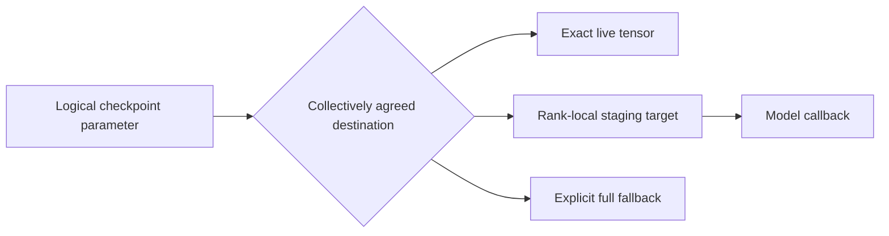
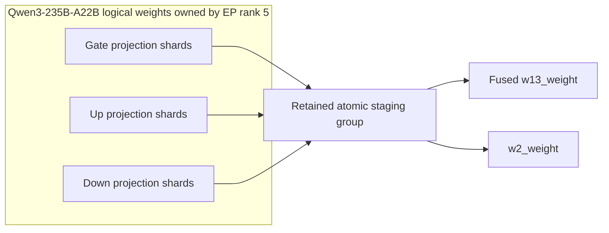

# [RL] Support model-native rank-local destinations for NCCL M2N

[Upstream PR](https://github.com/vllm-project/vllm/pull/60949) · state: open · merged: False

## Original PR description

## Summary

This is the second PR in the stack and is based on vllm-project/vllm#60934. It
lets a model module expose a validated rank-local shard target for a logical
checkpoint parameter. NCCL M2N can then reshard directly into the data owned by
each inference worker instead of reconstructing a complete logical tensor on
every worker.

Fixes #59835.

Before this PR, each parameter was either written into an exact live tensor or
received in full and passed through `load_weights`:

```text
logical parameter -> exact live tensor OR full tensor on every worker
```

After this PR, the destination planner selects and collectively agrees one of
three modes:

```text
logical parameter -> exact live tensor
                  OR rank-local staging target + model callback
                  OR explicitly permitted full tensor on every worker
```

The destination contract is generic. Model integrations define how a logical
checkpoint parameter maps to local storage and how the local shard is consumed.
Unquantized `RoutedExperts` is the first production integration; fused MoE
`w13`/`w2` tensors provide the concrete example below.



### Relationship to #60934 and PR boundary

#60934 adds per-parameter trainer-side source layouts while preserving the
existing receiver behavior. This PR builds on that source contract and changes
destination selection and loading.

| Behavior | #60934 | This PR |
|---|---|---|
| Source mesh | Each parameter declares its source mesh and placements | Unchanged |
| Destination mesh | One mesh shared by every parameter | Unchanged |
| Destination selection | Exact-name in-place target or full-tensor fallback | Adds validated rank-local staging targets |
| Receiver loading | Exact live tensor or complete logical tensor through `load_weights` | Exact live tensor, rank-local model callback, or explicitly permitted full fallback |

This PR does not introduce per-parameter destination meshes. It adds
per-parameter destination targets over the existing session-wide destination
mesh.

## Problem

#59835 describes the missing model-native loading path for sharded NCCL M2N
destinations. When a logical checkpoint tensor does not exactly match a live
vLLM parameter, the existing fallback reconstructs the complete tensor on every
generator worker, even when that worker consumes only one rank-local shard.

## Implementation

This PR expands the NCCL M2N control plane so every participant agrees on the
complete destination plan before entering the ordered data-plane collectives.

### Model-native sharded targets

`ShardedWeightRequest`, `ShardedWeightSpec`, and `ShardedWeightTarget` define a
model-loader contract independent of NCCL M2N implementation types. A target
declares its local shape, shard dimension/index/count, consumer callback,
atomic group, and retention requirements.

The API is model-independent and has a synthetic non-MoE consumer test. It does
not classify parameters by name inside the transport engine.

### Whole-plan destination agreement

The planner resolves every logical parameter before PyNccl initialization:

1. prefer a validated semantic rank-local target;
2. otherwise use a validated exact-name in-place target; or
3. use full fallback only when the producer explicitly permits it.

All worker plans are gathered and validated for parameter order, destination
mode, shard ownership, geometry, atomic staging groups, and fallback policy. A
deterministic destination digest and commit token prove agreement before data
transfer begins.

`plan_summary()` reports source and destination digests, mode counts, logical
global bytes, and planned aggregate receiver bytes. Receiver bytes describe the
destination volume implied by the plan, not measured fabric traffic.

### Module-scoped in-place demotion

A later layerwise fallback load can overwrite direct writes in the same module.
The planner therefore demotes only affected in-place siblings in that module.
Unrelated modules remain in-place, and a semantic sharded target remains
sharded.

### Bounded staging and update lifecycle

Rank-local shards use reusable bounded staging buffers. Complete atomic groups
stay live until their model callback finishes. Bindings are recreated for every
update so stale model pointers do not survive repeated updates.

A receive or consumer failure poisons the session. A generator that may contain
a partial update cannot silently re-enter another collective sequence.

### Fused routed experts

`RoutedExperts` maps unquantized, uniformly and contiguously EP-sharded logical
weights to the experts owned by the local worker:

- gate/up shards use the existing loading path into `w13_weight`;
- down shards use the existing loading path into `w2_weight`; and
- paired shards remain retained until native layer loading finalizes.

### Qwen3-235B-A22B example

Qwen3-235B-A22B provides a concrete example of the generic contract. The model
has 128 routed experts, while the measured generator uses EP16. Generator EP
rank 5 therefore owns experts 40 through 47.

For those experts, checkpoint gate and up projections must be loaded into the
runtime's fused `w13_weight`, while the down projection must be loaded into
`w2_weight`:

| Logical checkpoint weight | Rank-local data received by EP rank 5 | Runtime target |
|---|---|---|
| Gate projection | Experts 40–47 | `w13_weight` |
| Up projection | Experts 40–47 | `w13_weight` |
| Down projection | Experts 40–47 | `w2_weight` |

The destination is derived from `RoutedExperts` ownership and loading metadata,
not from model-name checks in the transport layer. The gate, up, and down
shards remain staged as an atomic group until the existing model loading path
has fused and committed them.



Qwen is the first production integration and the end-to-end validation example;
it is not a constraint on the transport contract.

## Supported scope

The generic source and destination contracts are independent of model type,
world size, and the measured 16-to-16 topology. The first `RoutedExperts`
consumer currently supports:

- unquantized FP16 or BF16 weights;
- generator TP1 and PP1 with expert parallelism enabled;
- uniform contiguous linear expert ownership; and
- recognized logical gate/up and down projections.

Recognized but malformed or unsupported semantic targets fail closed. Other
parameters may use exact in-place or explicitly permitted full fallback.

All parameters still share one configured destination mesh. Per-parameter
destination meshes are future work and are not implemented here.

## Validation

Coverage includes:

- destination disagreement before PyNccl construction;
- worker-specific shard-index validation;
- direct, staged, and full-fallback entries in one plan;
- module-scoped demotion;
- complete staging-group retention and bounded reuse;
- update-scoped callback rebinding;
- callback failure and session poisoning;
- explicit owner-local receiver-byte accounting;
- a non-Qwen semantic consumer; and
- routed-expert ownership and `w13`/`w2` fusion.

Focused validation ran on an AArch64 compute node with four NVIDIA GB200 GPUs:

| Component | Version or setting |
|---|---|
| Python | 3.12.13 |
| PyTorch | 2.13.0+cu130 |
| CUDA | 13.0 |
| NCCL | 2.30.7 |
| NCCL extensions | 0.1.0 |
| FlashInfer | 0.6.17 |
| `NCCL_CUMEM_ENABLE` | `1` |

```bash
python -P -m pytest -vv -ra \
  tests/distributed/test_weight_transfer_m2n.py \
  tests/model_executor/model_loader/test_sharded_weight.py
pre-commit run --all-files
```

The focused suite completed with `191 passed, 14 warnings` and no skipped
tests. All pre-commit checks passed, as did a strict MkDocs build using the
ReadTheDocs dependency set. The suite includes real TCP and pre-shared UID
transfers, TP2 destination resharding, mixed source meshes, and a generic
owner-local semantic consumer in addition to the routed-expert integration.

## End-to-end performance

We compared the existing SkyRL NCCL broadcast backend with NCCL M2N using the
same eight-node allocation, immutable software environment, model, training
workload, and generator configuration. The only experimental variable was
`weight_sync_backend`.

This experiment used no LoRA and performed full-parameter BF16 fine-tuning.

| Configuration | Value |
|---|---|
| Model | Qwen3-235B-A22B |
| Hardware | 8 nodes, 4 GB200 GPUs per node |
| Trainer | 4 nodes / 16 GPUs |
| Generator | 4 nodes / 16 GPUs |
| Trainer parallelism | TP4 / PP1 / CP1 / EP16 / ETP1 / EDP1 |
| Generator parallelism | TP1 / PP1 / DP16 / EP16 / EDP1 |
| Training | Full-parameter BF16; no LoRA |
| Workload | GSM8K GRPO |
| Batch | 16 prompts; 4 generations per prompt |
| Sequence limits | 512 prompt tokens; 1,024 generated tokens |
| Generator attention | FlashInfer |
| Generator MoE | FlashInfer TRTLLM unquantized monolithic MoE |
| CUDA graphs | Enabled |
| NCCL | `NCCL_CUMEM_ENABLE=1`; unchanged debug settings |
| Topology | NVLink/MNNVL within each 16-GPU role; InfiniBand/GDRDMA between roles |
| Sampling | 1 cold synchronization excluded; 10 warm synchronizations retained |
| Synchronization point | Each retained synchronization followed a completed optimizer step |

Both methods ran back-to-back on the same nodes. The trainer and generator
software environments, model state, optimizer configuration, MoE backend,
attention backend, CUDA-graph policy, and NCCL settings were identical.

### Results

| Timing boundary | NCCL broadcast | NCCL M2N | Improvement |
|---|---:|---:|---:|
| Weight-sync E2E mean | 13.869 s | 3.044 s | 4.557×; 78.05% lower |
| Total unavailable mean | 13.924 s | 3.099 s | 4.494×; 77.75% lower |
| Pause/resume and outer wrapper mean | 0.0547 s | 0.0549 s | Unchanged |

The mean is the primary result and retains every warm sample. The E2E medians
were 13.741 seconds for NCCL broadcast and 2.850 seconds for NCCL M2N.

### Timing boundaries

The weight-sync E2E timer starts before Megatron weight extraction and
conversion. It includes required trainer collectives, trainer-to-generator
transfer, and vLLM receive/load processing, and ends after the generator update
finishes.

`update_weights` is a concurrent wall-clock interval. Megatron extraction,
required collectives, NCCL M2N reshard operations, and receiver loading can
overlap inside it. Its components therefore cannot be interpreted as
independent or additive network-transfer measurements.

| NCCL M2N interval | Warm mean | Included work |
|---|---:|---|
| Start-session fanout | 0.068 s | Starts and validates the update across receivers |
| `update_weights` | 2.926 s | Extraction, collectives, M2N transfer, and receiver loading |
| Finish/commit fanout | 0.030 s | Finalizes staged consumers and commits the update |
| Inner dispatch residual | 0.020 s | Remaining synchronization and dispatch overhead |
| Weight-sync E2E | 3.044 s | Complete inner synchronization boundary |
| Pause/resume and outer wrapper | 0.055 s | Generator availability control outside the inner boundary |
| Total unavailable | 3.099 s | Complete interval during which generation is unavailable |

### Agreed destination plan

The destination plan selected the transfer mode independently for each logical
parameter while preserving one collective order across all participating
ranks.

| Destination mode | Parameters | Logical global size | Planned aggregate receiver size |
|---|---:|---:|---:|
| Exact in-place | 94 | 0.099 GB | 1.577 GB |
| Rank-local staged | 188 | 454.193 GB | 454.193 GB |
| Explicit full fallback | 755 | 15.896 GB | 254.335 GB |
| **Total** | **1,037** | **470.187 GB** | **710.104 GB** |

Reconstructing the complete 470.187-GB checkpoint on all 16 generator workers
would produce 7.523 TB of aggregate receiver payload. The agreed M2N plan
reduces that planned volume to 0.710 TB: a 10.59× reduction, or 90.56% less
receiver payload.

These values describe destination-buffer volume derived from the agreed plan.
They are not physical InfiniBand byte counters and should not be compared
directly with the 4.557× end-to-end latency improvement.

Qwen3-235B-A22B is the measured example. The source-layout, destination-target,
and collective-agreement contracts are not specific to this model, world size,
or parallelism configuration.

The stack was subsequently rebased onto #60934. Range-diff validation confirmed
that the restack changed commit history without changing the measured PR2 patch
content.

## Stack

This is the second PR in a two-PR stack:

1. vllm-project/vllm#60934 adds the general per-parameter source-layout
   contract and collective-safe NCCL M2N source plan.
2. This PR adds collectively agreed rank-local destination targets, bounded
   staging and consumer callbacks, with unquantized `RoutedExperts` as the first
   production integration.

This PR is intended to be reviewed and merged after #60934.

## AI assistance

OpenAI Codex assisted with implementation, tests, validation automation,
benchmark analysis, figures, and drafting. The human submitter reviewed every
changed line before submission.

---

<details>
<summary> Pull Request Checklist </summary>

- [x] I used vLLM's `/pr-checklist` skill. (Mandatory for agents, optional for humans).
- [x] AI assistance was used during the creation of this PR.

- [x] **Design Fit:** Minimizes impact on core components, reuses existing functionality, and justifies added complexity.
- [x] **Testing and Validation:** Validates the change and ensures any added tests are meaningful and reliable, with CI coverage or documented CI resource constraints and validation performed outside CI.
- [x] **Code Quality and Style:** Keeps code and comments clear and concise, and updates relevant documentation and examples.
- [x] **Pull Request Contents:** Includes a brief summary and relevant links, supports claims with evidence, explains root causes and implementation trade-offs, and follows the contributing guide.
</details>


## Review and discussion

### reviews

- claude · COMMENTED · 2026-10-10T03:19:30Z · [source](https://github.com/vllm-project/vllm/pull/60949#pullrequestreview-5477331451)

## Claude Code Review

This pull request is from a fork — automated review is disabled. A repository maintainer can comment `@claude review` to run a one-time review.

### issue_comments

- mergify · comment · 2026-10-10T03:20:02Z · [source](https://github.com/vllm-project/vllm/pull/60949#issuecomment-6093240155)

Documentation preview: https://vllm--60949.org.readthedocs.build/en/60949/

- github-actions · comment · 2026-10-10T06:53:50Z · [source](https://github.com/vllm-project/vllm/pull/60949#issuecomment-6094851575)

✅ @pkousha, CI is now available for this PR.

- `/ci run` starts upstream CI; `/amd-ci run` starts AMD CI only.
- Your branch must contain every commit currently on its upstream target branch. Merge or rebase onto the latest target branch, then rerun the command. Append `--allow-stale` to a run command to test an outdated branch at your own risk.
- `/ci retry` retries failed jobs in the CI build for the current PR head. If the current head has no CI build, it starts a new CI build for the current head containing only jobs that failed in the latest earlier CI build for this PR.
- `/amd-ci retry` retries failed jobs in AMD CI for the current PR head. Use `/amd-ci run` when the current head has no AMD CI build.
- `/ci cancel` cancels scheduled or running CI builds for this PR branch; `/amd-ci cancel` does the same for AMD CI only.

<!-- vllm-ci-authorized -->

- mergify · comment · 2026-10-11T13:54:11Z · [source](https://github.com/vllm-project/vllm/pull/60949#issuecomment-6109750864)

This pull request has merge conflicts that must be resolved before it can be
merged. Please rebase the PR, @pkousha.

https://docs.github.com/en/pull-requests/collaborating-with-pull-requests/working-with-forks/syncing-a-fork


- hao-aaron · comment · 2026-10-12T01:21:33Z · [source](https://github.com/vllm-project/vllm/pull/60949#issuecomment-6116072594)

Thanks for this. The expert-resharding results are impressive, and getting rid of full-tensor replication for routed experts is the right goal.

I'd like to hold off on merging this one for now, though. It builds on the current layerwise reload behavior, which modulewise reload (#59502) is about to change quite a bit. A few things I expect to shift:

- **Where M2N writes.** With modulewise, each module exposes checkpoint-format load targets (`ensure_materialized`). These are hosted in the live storage when the bytes fit, and scratch otherwise. M2N could reshard straight into those, so the separate in-place path and the module demotion rule wouldn't be needed. It would also cover quantized models, since PWAL handles the conversion afterwards.
- **Staging and retention.** The retention groups and bounded staging pool exist because today's wrapped loaders hold on to their input views until the module completes. Modulewise runs loaders immediately, so much of that lifetime management should go away.
- **How destinations are discovered.** Instead of per-layer `resolve_sharded_weight_target` providers, I think we can derive the plan by tracing the existing loaders on meta, like sharded RDT's bake does. Each tensor then becomes one of: direct into a target view, rank-local slice into staging, or full fallback. That avoids adding model-specific transfer code to `RoutedExperts` and friends.
- **Failure handling.** Same as on #60934: I'd like update failures to go through the reload-side dirty flag rather than a transport-specific terminal state.

Per-parameter destination meshes would probably also be needed for broader coverage (GQA replication, EP ≠ TP, DP replicas of experts), which fits naturally with the per-parameter source work in #60934.

I'll try to get modulewise reload ready to use as soon as possible, and will update here once it's in so we can revisit this.

_This review/comment was written by an AI agent (Claude Code) on my behalf._


### inline_comments

## Changed files and fixed code

- `examples/rl/rlhf_m2n.py` · modified · additions 21 / deletions 2
  - [head](https://github.com/pkousha/vllm/blob/934866dd3b106dfcaa0602d1338b75e9c7e33de9/examples/rl/rlhf_m2n.py)
  - [base](https://github.com/vllm-project/vllm/blob/2d69083c4a09dfeb17d761ae96d2e571a628309c/examples/rl/rlhf_m2n.py)
- `tests/distributed/test_weight_transfer_m2n.py` · modified · additions 2672 / deletions 341
  - [head](https://github.com/pkousha/vllm/blob/934866dd3b106dfcaa0602d1338b75e9c7e33de9/tests/distributed/test_weight_transfer_m2n.py)
  - [base](https://github.com/vllm-project/vllm/blob/2d69083c4a09dfeb17d761ae96d2e571a628309c/tests/distributed/test_weight_transfer_m2n.py)
- `tests/model_executor/model_loader/test_sharded_weight.py` · added · additions 492 / deletions 0
  - [head](https://github.com/pkousha/vllm/blob/934866dd3b106dfcaa0602d1338b75e9c7e33de9/tests/model_executor/model_loader/test_sharded_weight.py)
  - [base](https://github.com/vllm-project/vllm/blob/2d69083c4a09dfeb17d761ae96d2e571a628309c/tests/model_executor/model_loader/test_sharded_weight.py)
- `vllm/distributed/weight_transfer/m2n_common.py` · modified · additions 626 / deletions 60
  - [head](https://github.com/pkousha/vllm/blob/934866dd3b106dfcaa0602d1338b75e9c7e33de9/vllm/distributed/weight_transfer/m2n_common.py)
  - [base](https://github.com/vllm-project/vllm/blob/2d69083c4a09dfeb17d761ae96d2e571a628309c/vllm/distributed/weight_transfer/m2n_common.py)
- `vllm/distributed/weight_transfer/m2n_engine.py` · modified · additions 594 / deletions 194
  - [head](https://github.com/pkousha/vllm/blob/934866dd3b106dfcaa0602d1338b75e9c7e33de9/vllm/distributed/weight_transfer/m2n_engine.py)
  - [base](https://github.com/vllm-project/vllm/blob/2d69083c4a09dfeb17d761ae96d2e571a628309c/vllm/distributed/weight_transfer/m2n_engine.py)
- `vllm/distributed/weight_transfer/m2n_layout.py` · modified · additions 196 / deletions 51
  - [head](https://github.com/pkousha/vllm/blob/934866dd3b106dfcaa0602d1338b75e9c7e33de9/vllm/distributed/weight_transfer/m2n_layout.py)
  - [base](https://github.com/vllm-project/vllm/blob/2d69083c4a09dfeb17d761ae96d2e571a628309c/vllm/distributed/weight_transfer/m2n_layout.py)
- `vllm/distributed/weight_transfer/m2n_plan.py` · added · additions 540 / deletions 0
  - [head](https://github.com/pkousha/vllm/blob/934866dd3b106dfcaa0602d1338b75e9c7e33de9/vllm/distributed/weight_transfer/m2n_plan.py)
  - [base](https://github.com/vllm-project/vllm/blob/2d69083c4a09dfeb17d761ae96d2e571a628309c/vllm/distributed/weight_transfer/m2n_plan.py)
- `vllm/distributed/weight_transfer/m2n_source.py` · modified · additions 101 / deletions 37
  - [head](https://github.com/pkousha/vllm/blob/934866dd3b106dfcaa0602d1338b75e9c7e33de9/vllm/distributed/weight_transfer/m2n_source.py)
  - [base](https://github.com/vllm-project/vllm/blob/2d69083c4a09dfeb17d761ae96d2e571a628309c/vllm/distributed/weight_transfer/m2n_source.py)
- `vllm/distributed/weight_transfer/m2n_staging.py` · added · additions 144 / deletions 0
  - [head](https://github.com/pkousha/vllm/blob/934866dd3b106dfcaa0602d1338b75e9c7e33de9/vllm/distributed/weight_transfer/m2n_staging.py)
  - [base](https://github.com/vllm-project/vllm/blob/2d69083c4a09dfeb17d761ae96d2e571a628309c/vllm/distributed/weight_transfer/m2n_staging.py)
- `vllm/distributed/weight_transfer/m2n_trainer.py` · modified · additions 518 / deletions 200
  - [head](https://github.com/pkousha/vllm/blob/934866dd3b106dfcaa0602d1338b75e9c7e33de9/vllm/distributed/weight_transfer/m2n_trainer.py)
  - [base](https://github.com/vllm-project/vllm/blob/2d69083c4a09dfeb17d761ae96d2e571a628309c/vllm/distributed/weight_transfer/m2n_trainer.py)
- `vllm/distributed/weight_transfer/nccl_common.py` · modified · additions 62 / deletions 9
  - [head](https://github.com/pkousha/vllm/blob/934866dd3b106dfcaa0602d1338b75e9c7e33de9/vllm/distributed/weight_transfer/nccl_common.py)
  - [base](https://github.com/vllm-project/vllm/blob/2d69083c4a09dfeb17d761ae96d2e571a628309c/vllm/distributed/weight_transfer/nccl_common.py)
- `vllm/model_executor/layers/fused_moe/routed_experts.py` · modified · additions 250 / deletions 9
  - [head](https://github.com/pkousha/vllm/blob/934866dd3b106dfcaa0602d1338b75e9c7e33de9/vllm/model_executor/layers/fused_moe/routed_experts.py)
  - [base](https://github.com/vllm-project/vllm/blob/2d69083c4a09dfeb17d761ae96d2e571a628309c/vllm/model_executor/layers/fused_moe/routed_experts.py)
- `vllm/model_executor/layers/fused_moe/runner/moe_runner.py` · modified · additions 15 / deletions 0
  - [head](https://github.com/pkousha/vllm/blob/934866dd3b106dfcaa0602d1338b75e9c7e33de9/vllm/model_executor/layers/fused_moe/runner/moe_runner.py)
  - [base](https://github.com/vllm-project/vllm/blob/2d69083c4a09dfeb17d761ae96d2e571a628309c/vllm/model_executor/layers/fused_moe/runner/moe_runner.py)
- `vllm/model_executor/model_loader/sharded_weight.py` · added · additions 197 / deletions 0
  - [head](https://github.com/pkousha/vllm/blob/934866dd3b106dfcaa0602d1338b75e9c7e33de9/vllm/model_executor/model_loader/sharded_weight.py)
  - [base](https://github.com/vllm-project/vllm/blob/2d69083c4a09dfeb17d761ae96d2e571a628309c/vllm/model_executor/model_loader/sharded_weight.py)

## Evidence and interpretation boundary

[Original JSON, discussions and patches](../../evidence/prs/vllm-project--vllm/60949-00ee799506d676b43872bd4d5066b3727a8a072a63a3a8b71a8941aef2529acc.json) · SHA-256 `00ee799506d676b43872bd4d5066b3727a8a072a63a3a8b71a8941aef2529acc`.

Diff complete: False. Missing/binary/truncated patches require pinned source inspection. This is a source page, not an independently verified optimization case. Open, merged and released are different states; recheck the deployed dependency.
